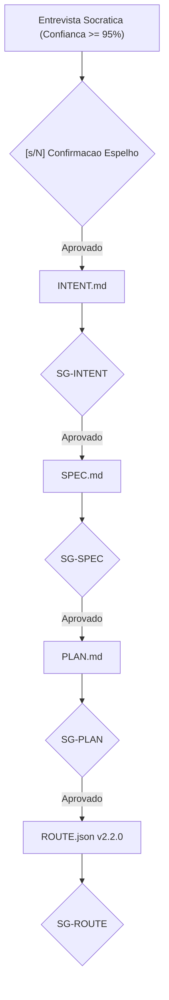
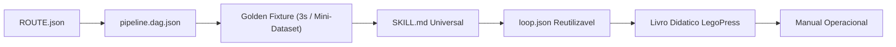

# 🏗️ Pipeline Canônico para Geração de Novos Pipelines no LegoLoop

> **Data:** 2026-11-09  
> **Status:** Rascunho para Revisão do Operador  
> **Escopo:** Mapeamento ponta a ponta da esteira de fabricação, governança, materialização e canonização de novos pipelines  
> **Fontes de Verdade:** `internal/fabricar/` · `internal/fechar/` · `skills/legoloop-fabricar/` · `docs/templates/`

---

## 1. Visão Geral e Taxonomia

No LegoLoop, a criação de um pipeline não é a geração isolada de um script, mas a **Fábrica de um Processo Canônico Completo**. Um processo acabado entrega compulsoriamente a Tríade de Execução (**Skill + Loop + DAG**) amparada pela Tríade de Governança (**INTENT + SPEC + PLAN + ROUTE**), pela Camada Didática (**Manual + Livro LegoPress**) e chancelada pela **Canonização em 9 Etapas**.

| Termo | O que é no LegoLoop | Onde vive | Papel na Esteira |
| :--- | :--- | :--- | :--- |
| **Peça** | Unidade modular encaixável no Canvas (8 naturezas: Trigger, Controle, Skill, MCP, Loop, Script, Hook, Gate) | `SKILL.md`, scripts, MCPs, hooks, gates | Consome peças existentes do cofre e gera uma peça Skill nova |
| **Loop** | Esteira/sub-grafo reutilizável no acervo | `~/.aidd/canonical/loops/<nome>.loop.json` e `loops/<slug>/` | Criação de peça de composição hierárquica |
| **Pipeline (DAG)** | O grafo acíclico executável com nós, comandos, saídas e gates | `<nome>.dag.json` | O motor executável via `legoloop run` |
| **Função** | Capacidade nativa do binário em Go | `legoloop fabricar`, `legoloop fechar` | O executor da esteira de criação e canonização |
| **Processo** | O produto final completo | `legoloop-<slug>` | 1 Skill + 1 Loop + 1 Pipeline DAG + 5 Docs Governança + Livro + Manual |

---

## 2. As 3 Portas de Disparo (Gatilho Inicial)

A criação é comandada pela função **`legoloop fabricar`**:
1. **Pelo Chat do Agente:** Invocação da skill `legoloop-fabricar` via comando `/legoloop-fabricar "<ideia>"`.
2. **Pela CLI do Terminal:** `legoloop fabricar "<ideia>" [--yes] [--goal "<meta>"] [--dry-run]`.
3. **Pelo Studio Web/Canvas:** Botão **+ Novo Processo** na barra superior, acionando o motor em Go.

---

## 3. Fase de Afunilamento Cognitivo (Entrevista Socrática)

* **Motor:** Subcomando `legoloop fabricar entrevista` conduzido pelo Brain LLM configurado.
* **Regra Negativa de Ouro:** Não utiliza STE-PT durante a entrevista; o diálogo humano-agente é fluido, conversacional e apresenta estritamente **uma única pergunta por turno**.
* **Critérios de Parada Matemática:**
  1. **Confiança $\ge 95\%$:** Medida pelo motor semântico com base no preenchimento de restrições técnicas e operacionais.
  2. **Premonição das 3 Próximas Respostas:** O cérebro atinge o limiar em que já infere e antecipa os 3 passos subsequentes do usuário sem ambiguidades.
* **Espelho da Intenção (*Intent Mirroring*):** Apresenta o resumo executivo das decisões e exige o Stop-Gate humano (`[s/N]`). Antes dessa confirmação, absolutamente nada é gravado em disco.

---

## 4. Esteira de Governança ISO em Cascata (Prefixo `YYYY-MM-DD_*`)

Cada documento é derivado estritamente do anterior e bloqueado por um Stop-Gate humano (`SG-*`):

1. **`INTENT.md`:** Declara o objetivo inegociável, custo-alvo e limites de contorno. $\rightarrow$ 🛑 **`SG-INTENT`**
2. **`SPEC.md`:** Especificação técnica formal com contratos BDD, critérios de aceitação e costuras de teste (Test Seams). $\rightarrow$ 🛑 **`SG-SPEC`**
3. **`PLAN.md`:** Decomposição vertical em tickets de implementação com TDD estrito. $\rightarrow$ 🛑 **`SG-PLAN`**
4. **`ROUTE.json`:** O mapa de rota executável (v2.2.0) com hashes SHA-256 dos documentos upstream, modelos cognitivos roteados por complexidade, limites de contexto e tickets nascendo em `PENDING`. $\rightarrow$ 🛑 **`SG-ROUTE`**

---

## 5. Materialização do Pipeline e Ativos Técnicos

Após a aprovação da ROUTE, a fábrica materializa os componentes executáveis e didáticos:

1. **Grafo Executável (`pipeline.dag.json`):**  
   Espelho fiel da ROUTE para tempo de execução (`legoloop run`). Contém nós, comandos CLI, dependências (`depends_on`), roteamento de modelo e gates mecânicos de arquivos.
2. **Golden Fixture Determinística:**  
   Ativo sintético mínimo de teste (ex.: `fixture_3s.mp4` para vídeo, ou dataset mínimo estruturado) gerado em `loop/` para validar a execução ponta a ponta sem falhas de integração. $\rightarrow$ 🛑 **`SG-DAG-FIXTURE`**
3. **Skill Canônica Universal (`skills/<slug>/SKILL.md`):**  
   A peça de invocação do agente. Define quando usar e quando NÃO usar, contratos de entrada e saída (`consumes` / `produces`), invariantes negativas e modelos recomendados.
4. **Loop Reutilizável (`loops/<slug>/<slug>.loop.json`):**  
   Registra a esteira no acervo (`~/.aidd/canonical/loops/`), permitindo que este pipeline seja consumido como sub-loop em outros pipelines via `/legoloop-compor`.
5. **Livro Didático LegoPress (`docs/books/<slug>/`):**  
   Compilado pelo motor editorial: `livro.json`, capítulos em `partes/`, `slug.md` e `slug.pdf` gerado via Typst/Pandoc com auditoria geométrica contra páginas órfãs.
6. **Manual Operacional (`docs/manuals/YYYY-MM-DD_MANUAL_FUNCAO_<SLUG>_LEGOLOOP.md`):**  
   Documentação de referência técnica para humanos e agentes, detalhando comandos, flags e topologia.

---

## 6. Fase de Fechamento & Canonização (`legoloop fechar`)

Executada após a conclusão dos testes em TDD verde para blindar o ecossistema através da **Cadeia Canônica de 9 Etapas**:

1. **Auditoria do Manual:** Valida presença e completude do documento em `docs/manuals/`.
2. **Auditoria do Livro LegoPress:** Executa `legoloop legopress auditar`, verificando integridade do PDF ($\ge 50$ KB) e capítulos ($\ge 200$ bytes).
3. **Distribuição Universal da Skill:** Executa `legoloop instalar-skills`, injetando a skill em todos os harnesses detectados no sistema (Claude, Cursor, Windsurf, Antigravity/Gemini).
4. **Validação do Grafo DAG:** Executa `legoloop validate` sobre o `pipeline.dag.json`.
5. **Recompilação Fresca do Binário:** Roda `go build -o bin/legoloop.exe ./cmd/legoloop` e `go install ./cmd/legoloop` para atualizar o binário no PATH global.
6. **Atualização da Governança Viva:** Atualiza as tabelas de processos em `AGENTS.md`, `MEMORY.md` e `README.md`.
7. **Reindexação do Grafo Semântico:** Atualiza o grafo vetorial de código via `codebase-memory-mcp cli index_repository`.
8. **Portões Mecânicos de Qualidade & Commit:** Executa `go test -count=1 ./...`, `go vet`, `funclen <= 35 linhas` e realiza o commit atômico rastreável.
9. **Relatório de Conclusão & Telemetria Estrita:** Gera `docs/reports/YYYY-MM-DD_REPORT_<SLUG>.md` com a contabilidade auditável de tempo gasto, consumo de tokens e custo financeiro (USD e BRL) orçado versus realizado.
