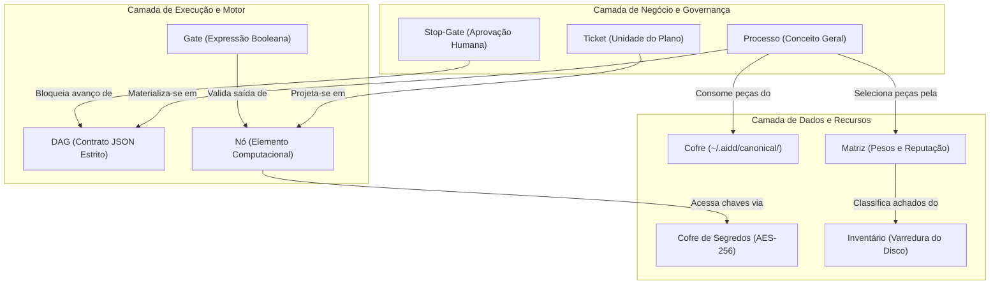

# 📐 Relatório de Auditoria Taxonômica ASD-STE100: Padronização Semântica e Eliminação da Esquizofrenia Terminológica no LegoLoop

> **Status:** Concluído  
> **Data:** 2026-11-10  
> **Norma de Referência:** ASD-STE100 (Simplified Technical English) — Regra 1: *"One word, one meaning. One meaning, one word."*  
> **Escopo Auditado:** 9.028 arquivos (`internal/`, `cmd/`, `loops/`, `skills/`, `schemas/`, `docs/`)  
> **Objetivo:** Erradicar a ambiguidade terminológica, ruído vetorial e alucinações de inferência para agentes de IA e desenvolvedores humanos.

---

## 1. Diagnóstico Forense: A "Esquizofrenia Taxonômica" no LegoLoop

A varredura mecânica do repositório identificou **6 grandes zonas de colisão semântica** onde termos sinônimos competem pelo mesmo conceito e termos polissêmicos acumulam múltiplos significados antagônicos.

### Métrica de Dispersão Terminológica (Ocorrências Reais no Repositório)

```
[Zona 1: Orquestração]    loop (5.862) | pipeline (5.035) | dag (4.697) | processo (4.309) | esteira (1.549) | grafo (1.519) | fluxo (1.136)
[Zona 2: Blocos]          skill (10.747) | peça (3.195) | bloco (1.242) | componente (147) | asset (51)
[Zona 3: Repositórios]    matriz (3.221) | cofre (1.710) | vault (1.662) | inventário (844) | catálogo (622) | registry (163)
[Zona 4: Unidades Nó]     ticket (3.336) | etapa (2.736) | nó (2.307) | task (1.283) | fase (1.105) | passo (1.065)
[Zona 5: Verificação]     gate (6.438) | stop-gate (1.810) | verificação (1.281) | portão (159) | barreira (144)
[Zona 6: Geração]         fabricar (4.299) | criar (1.165) | gerar (681) | scaffold (167) | canonizar (143)
```

---

## 2. As 6 Zonas de Fricção Cognitiva e seus Efeitos em LLMs e Humanos

### Zona 1: Orquestração e Execução Sequencial
* **Termos em Conflito:** `processo`, `loop`, `pipeline`, `esteira`, `grafo`, `dag`, `fluxo`.
* **Impacto Cognitivo:** 
  * O LLM não sabe se `legoloop run` consome um "loop", um "pipeline" ou um "dag".
  * Estrutura física: a pasta chama-se `loops/`, o arquivo interno chama-se `pipeline.dag.json`, o parser Go chama-se `dag.DAG`, o comando do CLI chama-se `fabricar <nome>` (para criar um processo) e a API do Studio expõe simultaneamente `/api/loops` e `/api/processos`.
  * **Efeito em IA:** O modelo gera rotas chamando ora `pipeline_id`, ora `loop_id`, ora `processo_id`, quebrando schemas estritos JSON com `DisallowUnknownFields`.

### Zona 2: Unidade Básica Reutilizável de Trabalho
* **Termos em Conflito:** `peça`, `skill`, `bloco`, `componente`, `asset`.
* **Impacto Cognitivo:**
  * Toda skill é uma peça, mas nem toda peça é uma skill (existem peças do tipo `gate`, `hook`, `script`, `mcp`, `loop`). Porém, a documentação e prompts frequentemente usam "skill" quando se referem genericamente a "peça", e "bloco" quando se referem aos nós de composição no Studio.
  * O pacote `internal/assets` inventaria peças, mas chama tudo internamente de `Asset`; o pacote `internal/matriz` chama de `Peca`; o Studio chama de `Piece` e as rotas de governança chamam de `Skill`.

### Zona 3: Armazenamento e Repositórios
* **Termos em Conflito:** `cofre`, `vault`, `matriz`, `inventário`, `catálogo`, `registry`.
* **Impacto Cognitivo:**
  * O termo **"cofre"** sofre de polissemia grave:
    1. Significa o cofre de segurança criptográfica AES-256 de chaves de API (`internal/vault`);
    2. Significa o diretório local `~/.aidd/canonical/` onde moram as peças e loops canônicos do ecossistema.
  * O termo **"matriz"** (`internal/matriz`) refere-se ao ranking ponderado de reputação e vocabulário, mas nos prompts é confundido com o "catálogo de peças" do Studio.

### Zona 4: Unidade Atômica de Execução dentro do Grafo
* **Termos em Conflito:** `nó`, `etapa`, `passo`, `fase`, `ticket`, `task`.
* **Impacto Cognitivo:**
  * Na CLI, o comando é `legoloop refinar "<nome>" --etapa ID`.
  * No DAG JSON, a lista é `"nodes": [{ "id": ... }]`.
  * No PLAN Markdown, a unidade é chamada de `Ticket TICK-NN.N`.
  * Na INTENT, a unidade é chamada de `Fase` ou `Bloco de Entrega`.
  * Quando o LLM tenta referenciar o alvo no CLI `--etapa`, ele passa o ID do ticket (ex.: `TICK-01.1`) em vez do ID do nó no DAG (ex.: `n01_crawler`), causando erro de argumento inválido.

### Zona 5: Portões de Validação e Homologação
* **Termos em Conflito:** `gate`, `stop-gate`, `portão`, `barreira`, `verificação`.
* **Impacto Cognitivo:**
  * "Gate" mecânico (`exit_code == 0 && file_exists(...)`) e "Stop-Gate" humano (pausa interativa com aprovação do operador) são tratados indistintamente em várias partes da literatura como "portões" ou "gates", levando agentes autônomos a tentar "auto-aprovar" stop-gates humanos sem pedir permissão explícita.

### Zona 6: Verbos de Ciclo de Vida e Criação
* **Termos em Conflito:** `fabricar`, `criar`, `gerar`, `canonizar`, `scaffold`.
* **Impacto Cognitivo:**
  * Historicamente, o comando para criar um processo começou como `legoloop canonize <nome>`. Depois, `canonize` foi reservado para a desduplicação por SHA-256 e o novo comando passou a ser `legoloop fabricar <nome>`.
  * Prompts de agentes continuam usando "canonize esse processo" querendo dizer "fabrique um novo processo", acionando o algoritmo errado de hashing do disco.

---

## 3. Dicionário Canônico ASD-STE100 do LegoLoop

A tabela abaixo institui o **Padrão Terminológico Inviolável (SSOT)**. Apenas os termos da coluna **Termo Aprovado (STE-PT)** são permitidos. Os termos da coluna **Sinônimos Proibidos** ficam estritamente banidos do vocabulário técnico de agentes, código e documentação.

| Domínio Semântico | Termo Aprovado (STE-PT) | Definição Estrita (Significado Único) | Sinônimos Proibidos (Banidos) | Aplicação Formal |
| :--- | :--- | :--- | :--- | :--- |
| **Entidade Macro** | **Processo** | O artefato de negócio abstrato de ponta a ponta (composto por Intent, Spec, Plan, Route e DAG). | *fluxo, esteira, pipeline, workflow* | CLI (`/processos`), UI, Documentação (`SPEC`). |
| **Grafo Executável** | **DAG** | O grafo acíclico direcionado executável no formato JSON consumido pelo motor Go (`pipeline.dag.json`). | *loop, pipeline.json, árvore, grafo* | Código (`internal/dag`), Schemas, Arquivos (`pipeline.dag.json`). |
| **Unidade Reutilizável** | **Peça** | Qualquer elemento individual modular do catálogo de ferramentas do ecossistema. | *asset, bloco, componente, gadget* | Go (`Peca`, `Piece`), CLI (`matriz`), UI (`Paleta de Peças`). |
| **Subtipo de Peça** | **Skill** | Peça executável que instrui ou orquestra um agente através de um arquivo `SKILL.md`. | *prompt, agente, instrução, persona* | Subpasta `skills/`, frontmatter `name: legoloop-*`. |
| **Elemento do Grafo** | **Nó** | O elemento atômico estrutural de computação dentro do DAG (`id: "n01_..."`). | *etapa, passo, fase, task* | JSON do DAG (`nodes: []`), Go (`Node`), Canvas. |
| **Unidade de Plano** | **Ticket** | O pacote de trabalho atômico decomposto no PLAN e mapeado 1:1 na ROUTE (`TICK-NN.N`). | *fase, tarefa, issue, story* | Arquivos `PLAN.md`, `ROUTE.json`. |
| **Passo Interativo** | **Etapa** | Subdivisão sequencial de execução lógica do processo exposta ao operador na CLI. | *nó, passo, milestone* | Argumento CLI (`legoloop refinar --etapa ID`). |
| **Armazém Canônico** | **Cofre** | O diretório central imutável no sistema operacional (`~/.aidd/canonical/`) para distribuição de peças e loops. | *vault, gaveta, almoxarifado, registry* | CLI (`--vault`), Sistema de Arquivos (`~/.aidd`). |
| **Armazém de Chaves** | **Cofre de Segredos** | O subsistema criptográfico AES-256-GCM para chaves de API e tokens de provedores. | *cofre (isolado), vault, keychain, keystore* | Pacote Go (`internal/vault`), CLI (`legoloop creds`). |
| **Índice de Aptidão** | **Matriz** | A estrutura de dados e pesos de vocabulário que calcula a reputação e adequação das peças (`registry_matrix.json`). | *catálogo, ranking, inventário* | Pacote Go (`internal/matriz`), CLI (`legoloop matriz`). |
| **Catálogo Físico** | **Inventário** | A listagem de arquivos e peças físicas detectadas na varredura do disco local. | *scanner, matriz, catálogo* | Pacote Go (`internal/assets`), API `/api/inventory`. |
| **Gate Mecânico** | **Gate** | Validação booleana automatizada executada pelo motor Go (`exit_code == 0 && file_exists(...)`). | *portão, barreira, checagem* | Chave JSON `"gate": "..."`, Go (`internal/gate`). |
| **Parada Humana** | **Stop-Gate** | Ponto de interrupção deliberado e obrigatório que exige confirmação explícita do operador humano. | *human-in-the-loop, portão manual, trava* | Tipo de nó `"type": "stop_gate"`, ID `"SG-NN"`. |
| **Ação de Criação** | **Fabricar** | O comando determinístico que orquestra a criação completa de um processo novo (`legoloop fabricar`). | *criar, gerar, canonizar, scaffold* | CLI (`legoloop fabricar`), Studio (`+ Novo Processo`). |
| **Ação de Desduplicação** | **Canonizar** | O cálculo de hash SHA-256 e unificação de cópias idênticas no cofre (`legoloop canonize`). | *fabricar, consolidar, fundir* | CLI (`legoloop canonize --root`). |
| **Ação de Conclusão** | **Fechar** | A cadeia determinística de 9 etapas de canonização, compilação e emissão de manual (`legoloop fechar`). | *finalizar, concluir, homologar, entregar* | CLI (`legoloop fechar`). |

---

## 4. Matriz Racional de Separação (Polissemia Resolvida)



---

## 5. Plano de Remediação Mecânica e Higienização Taxonômica

Para eliminar o ruído nos agentes e nos arquivos de governança, propõe-se os seguintes 4 micro-tickets cirúrgicos:

1. **`TICK-TAX-01` — Normalização de Schemas e APIs REST (`Studio` e `DAG`):**
   * Renomear rotas ambíguas no Studio: unificar endpoints para `/api/processos` (gerenciamento) e `/api/dag` (execução do grafo), eliminando o termo misto `/api/loops`.
2. **`TICK-TAX-02` — Diferenciação Explícita de Cofres (`Vault` vs `Cofre`):**
   * Renomear nos logs e CLI o pacote `internal/vault` para `Cofre de Segredos` (segredos criptográficos), mantendo `Cofre` exclusivamente para a pasta canônica de peças `~/.aidd/canonical/`.
3. **`TICK-TAX-03` — Higienização dos Prompts dos Harnesses no `AGENTS.md`:**
   * Inserir a Tabela Canônica ASD-STE100 no `AGENTS.md` como Lei #15, proibindo expressamente agentes de utilizarem os sinônimos banidos em raciocínios e comandos de terminal.
4. **`TICK-TAX-04` — Normalização dos Nós nos Templates (`TEMPLATE_DAG.json` e `TEMPLATE_ROUTE.json`):**
   * Garantir que nenhum template utilize "etapa" ou "task" no corpo do JSON, padronizando estritamente em `"nodes": [{ "id": "n01_...", ... }]`.
