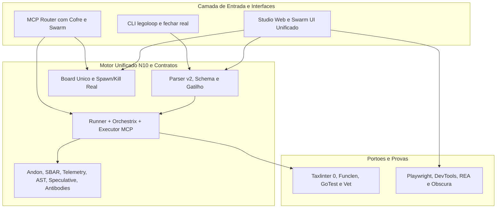

# 📋 SPEC: Correção Integral e Homologação do Ecossistema LegoLoop

> **Status:** Proposta para Revisão (Stop-Gate Único Humano)  
> **Data:** 2026-11-14  
> **Versão:** 1.0.0  
> **Autor:** Antigravity Coordinator (Fusão Addy Osmani + Matt Pocock + AIDD-Spec)  
> **Iniciativa:** I-A / I-B / I-C — Homologação Integral do Ecossistema LegoLoop  
> **Referência da Intenção:** [docs/intents/2026-11-14_INTENT_HOMOLOGACAO_ECOSISTEMA.md](../intents/2026-11-14_INTENT_HOMOLOGACAO_ECOSISTEMA.md)  
> **Alvo Primário:** `cmd/legoloop`, `internal/`, `tools/`, `schemas/`, diretório de Processos, `skills/`, `docs/`  
> **Consome:** INTENT aprovada · **Produz:** PLAN, ROUTE e DAG  
> **Template:** TEMPLATE_SPEC.md v2.0.0

---

## 1. Premissas Técnicas Assumidas (Addy Osmani)

> [!IMPORTANT]
> Todas as premissas técnicas abaixo governam as 3 frentes de correção. Alerte no Stop-Gate único caso alguma premissa divirja da arquitetura desejada:
1. **Runtime e Dependências:** Go 1.27 conforme `go.mod`, 100% biblioteca padrão (`stdlib`), zero dependências externas adicionadas ao `go.mod`/`go.sum`, e frontend HTML/CSS/JS embutido via `embed` sem bundler Node em produção.
2. **Persistência e Isolamento:** Arquivos locais em JSON/Markdown com gravação atômica (`temp` único por PID/timestamp + `os.Rename`), travas cross-processo em arquivo quando compartilhado, e testes herméticos em `t.TempDir()` sem tocar `~/.aidd` real.
3. **Segurança HTTP e Path Jail:** Servidores locais restritos a loopback (`127.0.0.1`), validação de `Host` allowlist e `Origin`/`Sec-Fetch-Site` em todos os métodos mutantes (`POST`, `PUT`, `PATCH`, `DELETE`), zero `innerHTML` não sanitizado, mascaramento estrito de caminhos absolutos (`~`, `<projeto>`) e segredos em respostas JSON/SSE/logs.
4. **Reaproveitamento e Integração:** Os 9 motores N10 já testados em `internal/runner`, `internal/brain`, `internal/combo`, `internal/board`, `internal/dag` e `internal/gate` serão conectados diretamente aos circuitos de execução reais em vez de reescritos ou removidos.

---

## 2. Fronteiras de Ação & Regras de Governança (Boundaries — Addy Osmani)

Todos os workers do Swarm devem obedecer estritamente ao sistema de fronteiras em 3 níveis:
* **Sempre Fazer:**
  * Desenvolver via TDD estrito (teste unitário falhando antes do código de produção, confirmado com mutação quando aplicável).
  * Manter funções pequenas e de responsabilidade única (`<= 35` linhas no `tools/funclen`).
  * Validar caminhos via `os.Root` / `filepath.IsLocal` / Path Jail estrito (sem `..`, sem symlinks externos, sem cópia de `.env*` ou `credential_*.json`).
  * Tratar erros explicitamente sem descartes silenciosos (`_ =`) em operações de disco, rede ou subprocesso.
  * Recompilar `bin/legoloop.exe` após alterações Go antes da verificação cega.
* **Perguntar Antes:**
  * Adicionar qualquer pacote externo ao `go.mod`.
  * Alterar permanentemente configurações de usuário fora do repositório sem uso do comando dedicado (`instalar-skills`, `sync-harnesses`).
  * Executar comandos destrutivos globais de processo no SO.
* **Nunca Fazer:**
  * Inserir stubs (`TODO`, `pass`, placeholders como `"mp4-placeholder"`, PNG 1x1 sintético ou tokens fictícios `80000`/`65000`) em código de produção (Lei #1).
  * Interpolar dados externos em `innerHTML` no frontend ou abrir endpoints mutantes sem verificação de `Origin`.
  * Relaxar portões de teste (`limiteTaxonomia > 0`, burlas por concatenação de string como `".lo"+"op.json"` ou `t.Skip` injustificado).
  * Usar `alert()`, `confirm()` ou `taskkill /IM legoloop.exe`.

---

## 3. Visão Geral, Arquitetura & Costuras de Teste (Test Seams — Pocock)

A arquitetura alvo conecta o ciclo completo dos 3 canais de entrada (CLI, Agentes/MCP Router e Studio Web/Swarm UI) ao núcleo de execução (`runner` + `orchestrix` + `board`), protegido por Path Jail, validação de schema v2 única e motores N10 ativos.

### Diagrama de Fronteiras (Mermaid)



### Costuras de Teste (Test Seams — Pocock)
* **Costura Primária (Highest Seam):** `runner.Run(ctx, d, opts)` com dependências injetáveis (`orchestrix.Executor`, `mcp.Client`, `board.Store`, `fechar.Deps`) e servidor `studio.NewServer(deps)` testável via `httptest` e navegador headless real.
* **Justificativa:** Permite validar TDD Red-Green determinístico nas bordas (subprocessos helper, `httptest`, diretórios temporários) e prova real fim a fim com o binário compilado sem poluir `~/.aidd`.
* **Costuras Secundárias:** `dag.Parse(raw)`, `mcp.NewRouter(store, skills).Serve(r, w)`, `board.OpenSwarmBoard(dir)`, `cli.Run(args, io)` e funções puras de UI em Node (`app.js`, `inspector.js`, `palette.js`, `swarm.js`).
* **Dublês Permitidos (somente nas bordas):** Processos helper Go para simular harnesses CLI, FFmpeg/Chromium ausentes ou servidores MCP STDIO em testes unitários, além de `httptest.Server` para backends 9Router/Ollama.

---

## 4. Contratos de Dados & Schemas Formais

```go
// Contrato formal consolidado para alinhamento Schema v2 <-> Go, Path Jail e Swarm Unificado.
package homologacao

import "errors"

var (
	ErrDependenciaAusente = errors.New("dependencia externa ausente no PATH")
	ErrCaminhoForaDaRaiz  = errors.New("caminho fora da raiz permitida")
	ErrMatrizAusente      = errors.New("matriz de pecas nao encontrada no cofre")
)

// SwarmPathPolicy define o contrato único de diretório para Swarm Board e descoberta.
// Escrita canônica: <projeto>/.legoloop-swarm/swarm.json (lock por arquivo + atomic rename).
// Leitura retrocompatível: .legoloop-swarm/swarm.json, .swarm/swarm.json e swarm_board.json.
type SwarmPathPolicy struct {
	CanonicalRelPath string `json:"canonical_rel_path"`
}

// NodeV2Parity garante alinhamento 1:1 entre schemas/dag.v2.json e internal/dag.Node:
// Campos suportados: Role, Papel, Via, Combo, TokenBudget, TestSeam, StopGate, Type("mcp").
type NodeV2Parity struct {
	Role  string `json:"role,omitempty"`
	Papel string `json:"papel,omitempty"`
}
```

---

## 5. Critérios Binários de Aceite por Ticket (BDD / EARS)

> [!NOTE]
> Cada critério `AC-*` fecha um Nano-ticket/Micro-ticket com verificação mecânica binária (`exit code == 0`, resposta HTTP exata ou asserção DOM/Node).

### Épico 01 — Saneamento de Suíte, Schemas e Segredos (Iniciativa I-A)

* [ ] `AC-E01.1`: **Suíte e DAGs 100% válidos sem rastros de segredos no git**
  * **Dado que:** `docs/dags/2026-11-14_DAG_AUDITORIA_E2E_SWARM.json` falha em `route2dag_test.go:119` e há rastros com tokens/e-mails em `RELATORIO_AUDITORIA_GEMINI4.md`, `AUDITORIA_FONTE.txt` e binário `legoloop.exe` na raiz.
  * **Quando:** o DAG quebrado for corrigido para o contrato v2, os rastros/binário obsoleto forem removidos e `isolated.go` filtrar `.env*`, `credential_*.json`, erros de `copyPath` e symlinks.
  * **Então:** `go test -count=1 ./tools/route2dag/...` e `bin/legoloop.exe validate` sobre todos os DAGs retornam `exit code 0`, e `CreateIsolatedWorkspace` jamais copia `.env*` ou `credential_*.json` para `%TEMP%`.
* [ ] `AC-E01.2`: **Paridade 1:1 Schema v2, Parser Go, Gatilho e `ROUTE` ↔ `DAG`**
  * **Dado que:** `schemas/dag.v2.json` diverge de `internal/dag/Node`, `ontology.go`/`compose.go`/`style.css` divergem sobre o tipo do Gatilho e 4 pares `ROUTE`/`DAG` divergem em nós.
  * **Quando:** todos os campos v2 (`Role`, `Papel`, `Via`, `Combo`, `TokenBudget`, `TestSeam`, nó `mcp`, `sensitiveDirs` com `.env*`) forem alinhados, a regra de Gatilho unificada e os 4 pares `ROUTE`/`DAG` sincronizados.
  * **Então:** testes unitários de paridade Schema ↔ Go e Gatilho passam com `exit code 0` e `CheckParity`/comparação estrutural entre os pares `ROUTE` e `DAG` resulta em `0` divergências.
* [ ] `AC-E01.3`: **Taxonomia `taxlinter` zerada e combos legados migrados**
  * **Dado que:** `go run ./tools/taxlinter` reporta `58` violações, `templates_test.go:28` oculta com `limiteTaxonomia = 38`, `studiodoc/store.go:42` concatena a extensão JSON do Studio e existem `171` referências a combos legados.
  * **Quando:** todas as violações em `cmd/legoloop/` e `docs/templates/` forem sanadas, `limiteTaxonomia` for fixado em `0` e combos no acervo de Processos, `skills/` e `internal/router/` migrarem para os 6 combos certificados (`t-*-128k`/`t-micro-8k`) mantendo alias em `combo/legado.go`.
  * **Então:** `go run ./tools/taxlinter` nos alvos oficiais sai com `exit code 0` e `0` violações, e testes de `combo` e `templates` passam com `exit code 0`.

### Épico 02 — Segurança Path Jail, Concorrência e Remoção de Stubs de Mídia (Iniciativa I-A)

* [ ] `AC-E02.1`: **Path Jail blindado, Zero Data Race no SSE e `runner` isolado antes do gate**
  * **Dado que:** `reveal.go`, `piece_actions.go` e `security.go` aceitam caminhos absolutos/`DELETE` sem `Origin`, `run_api.go` tem data race em SSE com `WriteTimeout: 90s`, `handleDAGStatus` retorna mock `"idle"`, e `runner.go` promove artefato antes do `evalGate`.
  * **Quando:** Path Jail estrito, trava de `Origin` em `POST/PUT/PATCH/DELETE`, mutex + `ResponseController` no SSE, estado real em `handleDAGStatus` e `evalGate` antes de `promoteArtifact` (com `os.Root`/`IsLocal` e remoção do stub `unsupported`) forem implementados.
  * **Então:** testes de segurança Path Jail/CSRF/CORS (inclusive tentativas de traversal e `DELETE` cruzado), race/concorrência no SSE e rollback de artefato reprovado no gate passam com `exit code 0`.
* [ ] `AC-E02.2`: **Eliminação total de placeholders em `internal/motion` e `internal/videorea`**
  * **Dado que:** `motion/encode.go:28` grava `"mp4-placeholder"`, `motion/render.go:41` grava PNG branco 1x1 e `videorea/cartoon_render.go` ignora `script.Scenes` com fallback MP4 falso de 32 bytes.
  * **Quando:** os encoders/renderers forem reescritos para invocar FFmpeg e Chromium/Playwright reais processando `script.Scenes`, retornando erro explícito tipado (`ErrDependenciaAusente`) quando ausentes no PATH.
  * **Então:** nenhum arquivo produzido em caso de erro contém bytes placeholder falsos e testes unitários/borda comprovam tanto a geração real quanto o erro explícito sem stub.

### Épico 03 — CLI, Harnesses, Skills, MCP Router e `fechar` Real (Iniciativa I-B)

* [ ] `AC-E03.1`: **MCP Router operacional e executor real do nó `mcp`**
  * **Dado que:** `cli/mcp_router.go:14` passa `nil, nil`, oculta `swarm_*` no `tools/list`, ignora JSON inválido sem `-32700`, corta linhas > 64KiB, cria `.legoloop-swarm/` em `swarm_status`, e `dag.Parse` rejeita nó `mcp`.
  * **Quando:** o roteador carregar o inventário real de skills/peças (`SetSkills`), expor ferramentas `swarm_*`, devolver erro JSON-RPC `-32700`, suportar payloads grandes, tornar `swarm_status` 100% leitura e conectar `internal/orchestrix/mcp_client.go` ao `runner` para nós `mcp`.
  * **Então:** testes STDIO reais (`initialize`, `tools/list`, `mcp_search`, `call_mcp_tool`, JSON inválido) e execução de nó `mcp` contra subprocesso helper MCP passam com `exit code 0`.
* [ ] `AC-E03.2`: **Paridade CLI, Harnesses/Skills e `fechar` 100% real**
  * **Dado que:** há divergências em `cli` (`usage`, flags, exit codes, `--json` sujo no `canonize`, `stept status` escrevendo, `cli_test.go:383` timeout), `skills/embed.go` exclui `ai-motion-graphics`, `vinculo.go` omite Antigravity `~/.gemini/config/skills`, `sync_harnesses.go` quebra `.jsonc` e desabilita `mcp.rea`, `scanner.go` indexa `.trash`, e `fechar` usa stubs e tokens falsos (`80000`/`65000`).
  * **Quando:** todos os subcomandos/flags da CLI forem alinhados, `embed.go`/`vinculo.go`/`sync_harnesses.go`/`scanner.go` corrigidos, `cli_test.go:383` estabilizado e `fechar` receber injeção real de rebuild, governança, reindex e portões sem valores inventados.
  * **Então:** `legoloop fechar <slug> --dry-run --json` reporta medições reais (duração em ms real, zero tokens fictícios `80000`/`65000`), `canonize --dry-run --json` emite JSON puro, `stept status` não altera disco e testes de `cli`, `skills`, `assets` e `fechar` passam sem timeout.

### Épico 04 — Integração dos 9 Motores N10 e Unificação Swarm Board/Runtime (Iniciativa I-B)

* [ ] `AC-E04.1`: **Todos os 9 motores N10 conectados aos circuitos reais de produção**
  * **Dado que:** `ExecuteWithAndon`, `FormatSBAR`, `FlightRecord`, `ValidateRedBlueBoundary`, `MergeAST`, `AntibodiesDB`, `ExecuteSpeculative`, `ValidarRequisicao`, `ValidateProvenance` e `ValidateSTE100` têm 0 chamadores em produção, além de falhas em `internal/orchestrix` (subprocesso e `unit_harness.go`) e HTTP retry/413/429.
  * **Quando:** cada motor for integrado ao respectivo ponto no `runner`, `orchestrix` e `dag`, com propagação de flags/Path Jail no executor de subprocesso, `envGateway` em `unit_harness.go`, timeout HTTP adequado e tratamento de 413/429/stderr.
  * **Então:** busca estática confirma chamadores ativos em produção para todos os 9 motores e testes integrados comprovam failover, telemetria, Andon Cord, SBAR, Antibodies e bloqueio Red/Blue.
* [ ] `AC-E04.2`: **Swarm Board único com file-lock, `@mention` exato e spawn/kill real**
  * **Dado que:** `swarm.go`, `swarm_discovery.go`, `swarm_api.go` e `cli/swarm_ui.go` usam caminhos conflitantes, não têm lock cross-processo, usam `strings.Contains` em `@mention`, não encerram PID no `KillWorker` e vazam subprocesso em `swarm_runtime_test.go:38`.
  * **Quando:** o caminho único `.legoloop-swarm/swarm.json` (com leitura retrocompatível), file-lock, escrita atômica única, `@mention` por regex de fronteira, distinção real `share` vs `branch`, e `SpawnWorker`/`SetWorkerModel`/`KillWorker` (encerrando PID do SO) forem conectados.
  * **Então:** `go test -count=1 ./internal/board/...` passa sem vazamento de `TempDir` no Windows e prova real cria, comunica, troca modelo e encerra worker sem processos órfãos.

### Épico 05 — Segurança, Unificação e Jornadas E2E do Studio & Swarm UI (Iniciativa I-C)

* [ ] `AC-E05.1`: **Swarm UI unificado, zero XSS, estado preservado e gestão de workers na UI**
  * **Dado que:** `cli/swarm_ui.go` duplica HTML sem middleware `secure()`, `swarm.js` executa XSS via `innerHTML`, destrói `#cmd-in` no SSE, vaza `selectedAgent` entre abas, bloqueia reabertura de abas e não possui UI para spawn/troca de modelo.
  * **Quando:** `cli/swarm_ui.go` passar a reutilizar o frontend e middleware seguro de `internal/studio`, todo `innerHTML` for substituído por manipulação DOM segura (`textContent`), estado de input e seleção for preservado por aba e controles de `+ Worker` e troca de modelo forem adicionados.
  * **Então:** teste Playwright com payload `` garante `__xssProbe === undefined`, SSE preserva digitação e spawn/post/kill funcionam pela interface HTTP sem erro de console.
* [ ] `AC-E05.2`: **Jornada E2E completa do Studio (`#btn-run`, `+ Novo Processo`, Gatilho, SVG e Combos)**
  * **Dado que:** `#btn-run` falha com `compileDAG is not defined`, `+ Novo Processo` sem matriz retorna HTTP 500 enganoso, Gatilho diverge em portas/ID, arestas SVG desalinham e `COMBO_HONESTO_SPECS` / `<lego-item-modal>` têm dados obsoletos.
  * **Quando:** `#btn-run` compilar/abrir `#modal-run` funcional via SSE, `ErrSemMatriz` mapear para HTTP 422 com orientação clara, identificador e portas do Gatilho unificarem, `portPoint` alinhar com zoom/pan, `COMBO_HONESTO_SPECS` refletir os 6 combos certificados e `<lego-item-modal>` + `templates.json` forem corrigidos.
  * **Então:** criação de Processo do zero pela UI (Gatilho → Peças → Validar → Materializar → Executar) e inspeção de combos/itens completam no navegador sem erros JS nem HTTP 500.

### Épico 06 — Design System, Responsividade, Contraste WCAG AA e A11y (Iniciativa I-C)

* [ ] `AC-E06.1`: **Layout sem clipping (1440/1024/390px), Inspetor recuperável, Modais e Tema**
  * **Dado que:** `.workspace`/`.sidebar` assumem topbar de `56px` cortando controles em `1440x900`, `1024px` e `390px`, Inspetor recolhido não reabre por obstrução de `#canvas-telemetry-bar`, `.modal-item-header` quebra `×`, `inventario.html` omite link `Swarm` e não há seletor de tema.
  * **Quando:** o layout passar a grid/flex dinâmico sem altura hardcoded de topbar, botão/rail de reabertura do Inspetor ficar sempre clicável, modais usarem classe consistente, navegação unificar links e seletor Claro/Escuro persistido for adicionado.
  * **Então:** auditoria Playwright em `1440x900`, `1024x768` e `390x844` mostra `0` overflow horizontal/clipping de controles, todos os modais centralizados com `×` alinhado e troca de tema Claro/Escuro funcional.
* [ ] `AC-E06.2`: **Contraste WCAG AA (`>= 4.5:1`), Guildas legíveis e Semântica ARIA**
  * **Dado que:** há múltiplas falhas WCAG AA em Light e Dark (`/`, `/inventario`, `/swarm`), `.guilda-badge` tem `8px`, `entryFromBlock` omite guilda, há tokens CSS indefinidos e elementos interativos sem semântica ARIA/teclado.
  * **Quando:** tokens de contraste Light/Dark forem recalibrados (`>= 4.5:1` texto normal / `>= 3:1` grande/controles), `.guilda-badge` receber `>= 11px` e contraste garantido, `entryFromBlock` receber guildas e marcação HTML/ARIA for corrigida.
  * **Então:** varredura automatizada de contraste e acessibilidade em Playwright retorna `0` violações WCAG AA de contraste e `0` controles interativos inacessíveis por teclado nas rotas `/`, `/inventario` e `/swarm`.

### Épico 07 — Verificação Cega Independente & Fechamento Canônico Universal (Iniciativa I-C)

* [ ] `AC-E07.1`: **Verificação Cega Independente (Red-Team Gate >= 9.5/10 em todas as frentes)**
  * **Dado que:** toda a implementação da Etapa 4 foi integrada na branch principal e compilada em `bin/legoloop.exe`.
  * **Quando:** auditores cegos independentes executarem todos os portões Go (`test`, `vet`, `gofmt`, `funclen`, `taxlinter`, `go.mod`), testes de CLI/MCP/Harnesses e inspeção real do Studio e Swarm UI via Playwright, Chrome DevTools, REA e Obscura.
  * **Então:** todas as frentes atingem nota comprovada `>= 9.5/10` (média global `>= 9.5/10`) com `0` falhas de teste, `0` erros de console/HTTP e `0` violações de linter.
* [ ] `AC-E07.2`: **Fechamento Canônico Universal (Lei #11) e Telemetria Factual**
  * **Dado que:** a Etapa 5 homologou todas as frentes com nota `>= 9.5/10`.
  * **Quando:** forem gerados e auditados o Manual Operacional, Livro LegoPress, Skill canônica `legoloop-homologacao`, sincronização via `instalar-skills`, `go install ./cmd/legoloop`, atualização de `AGENTS.md`/`MEMORY.md`/`README.md`, reindexação `codebase-memory-mcp` e Relatório Final.
  * **Então:** `legoloop legopress auditar` passa, `legoloop validate` aprova o novo DAG, `bin/legoloop.exe` e o PATH ficam sincronizados e `docs/reports/2026-11-14_REPORT_HOMOLOGACAO_ECOSISTEMA.md` registra notas Antes vs Depois com provas reais.

### Critério Não Funcional Global

* [ ] `AC-NF.1`: **Inviolabilidade de Desempenho, Hermeticidade e Segurança**
  * **Dado que:** comandos CLI e endpoints HTTP do Studio operam sob carga local e entradas hostis (traversal, payloads XSS, JSON malformado, requisições sem `Origin`).
  * **Quando:** forem executados testes de carga/latência, regressão e segurança em todas as rotas e CLI.
  * **Então:** tempo de carregamento inicial do Studio permanece `< 500ms` (FCP), nenhum arquivo real de `~/.aidd` ou `.env*` é tocado ou exposto, e requisições hostis recebem `400`/`403`/`422` sem crash nem vazamento de caminho absoluto.

### Rastreabilidade Requisito para Critério

| R | Requisito | AC |
| :--- | :--- | :--- |
| `R1` | Suíte Go, DAGs válidos e remoção de segredos trackeados | `AC-E01.1` |
| `R2` | Paridade Schema v2 ↔ Parser Go, Gatilho e `ROUTE` ↔ `DAG` | `AC-E01.2` |
| `R3` | Taxonomia `taxlinter` zerada e migração de combos legados | `AC-E01.3` |
| `R4` | Path Jail, CSRF/CORS, data race SSE e ordem `evalGate`/`promoteArtifact` | `AC-E02.1` |
| `R5` | Substituição de stubs em `motion` e `videorea` | `AC-E02.2` |
| `R6` | `mcp-router` real e executor de nó `mcp` STDIO | `AC-E03.1` |
| `R7` | Paridade CLI, skills/harnesses e `fechar` sem stubs/fakes | `AC-E03.2` |
| `R8` | Integração dos 9 motores N10 e resiliência `orchestrix` | `AC-E04.1` |
| `R9` | Unificação Swarm Board, file-lock e spawn/kill real | `AC-E04.2` |
| `R10` | Swarm UI unificado, zero XSS e gestão de workers na UI | `AC-E05.1` |
| `R11` | Jornada E2E do Studio, `#btn-run`, `ErrSemMatriz` e combos/modais | `AC-E05.2` |
| `R12` | Layout responsivo, inspetor recuperável, modais e seletor de tema | `AC-E06.1` |
| `R13` | Contraste WCAG AA, guildas legíveis e acessibilidade ARIA | `AC-E06.2` |
| `R14` | Verificação cega `>= 9.5/10`, segurança NF e Fechamento Lei #11 | `AC-E07.1`, `AC-E07.2`, `AC-NF.1` |

---

## 6. Comandos Operacionais & Critério de Conclusão Global (Addy Osmani)

### Comandos de Verificação Mecânica
* **Build:** `go build -o bin/legoloop.exe ./cmd/legoloop`
* **Test:** `go test -count=1 ./...` e `go test -count=1 -tags e2e ./internal/e2e/...`
* **Estática, Formatação e Taxonomia:** `go vet ./...`, `gofmt -l .`, `go run ./tools/funclen internal cmd tools` e `go run ./tools/taxlinter` nos alvos oficiais
* **Dependências intactas:** `git diff --exit-code go.mod go.sum`

### Critério de Done Global
A especificação técnica é considerada **100% CONCLUÍDA** quando:
- [ ] 100% dos critérios binários `AC-E01.*` a `AC-E07.*` e `AC-NF.1` estiverem marcados como atendidos (`[x]`).
- [ ] Todos os comandos de verificação mecânica passarem com exit code `0` e saída de `gofmt -l .` vazia.
- [ ] Notas comprovadas por verificação cega na Etapa 5 atingirem `>= 9.5/10` em cada frente e na média global.
- [ ] Fechamento Canônico Universal (Lei #11) concluído sem arquivos órfãos ou processos pendentes.

---

🛑 **STOP-GATE ÚNICO DE AUDITORIA HUMANA:**  
*As premissas assumidas, fronteiras, contratos e critérios binários acima atendem à sua expectativa?*  
*A aprovação deste documento ocorre em conjunto com INTENT, PLAN, ROUTE e DAG no Stop-Gate único humano.*
