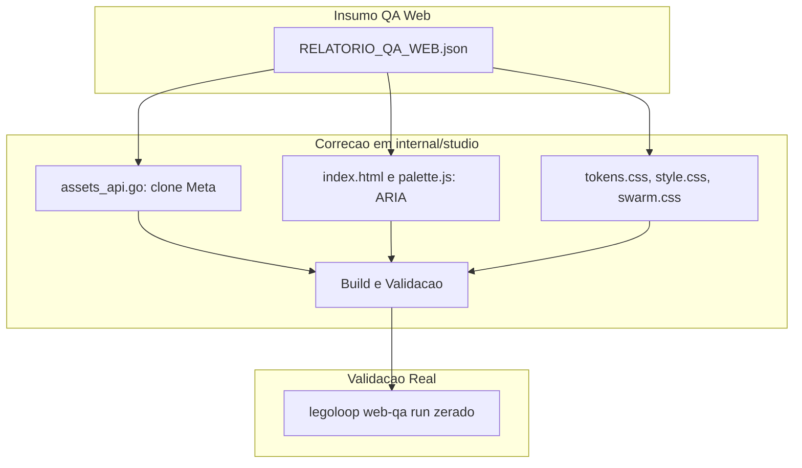

# 📋 SPEC: Correção dos Achados QA Web do LegoLoop Studio v2

> **Status:** Proposta para Execução em Swarm/Build  
> **Data:** 2026-11-15  
> **Versão:** 1.0.0  
> **Autor:** Antigravity (LegoLoop Governança)  
> **Iniciativa:** CORRECAO_STUDIO_QA_WEB  
> **Referência da Intenção:** [2026-11-15_INTENT_CORRIGIR_OS_ACHADOS_DO_QA_WEB_.md](../intents/2026-11-15_INTENT_CORRIGIR_OS_ACHADOS_DO_QA_WEB_.md)  
> **Referência da Entrevista:** [2026-11-15_INTERVIEW_CORRECAO_STUDIO_QA_WEB.md](../interviews/2026-11-15_INTERVIEW_CORRECAO_STUDIO_QA_WEB.md)  
> **Alvo Primário:** `internal/studio/assets_api.go`, `internal/studio/static/`  
> **Consome:** INTENT + INTERVIEW · **Produz:** PLAN, ROUTE, DAG e SWARM  
> **Template:** TEMPLATE_SPEC.md v2.0.0

---

## 1. Premissas Técnicas Assumidas (Addy Osmani)

1. Go conforme `go.mod` com zero dependências externas novas (`maps` da stdlib).
2. Arquivos estáticos HTML/CSS/JS servidos via `embed.FS` em `internal/studio/` permanecem embutidos no binário final.
3. Segurança loopback preservada sem alteração de contratos JSON/REST públicos nem rotas novas fora de `/`, `/inventario` e `/swarm`.
4. Paleta light/dark visual preservada fielmente movendo as definições `:root` e `[data-theme="dark"]` para `internal/studio/static/tokens.css`.

---

## 2. Fronteiras de Ação & Regras de Governança (Boundaries — Addy Osmani)

* **Sempre Fazer:**
  * Desenvolver via TDD estrito (teste falhando antes da implementação).
  * Manter funções Go com no máximo 35 linhas (`funclen`).
  * Recompilar `bin/legoloop.exe` após edição Go (`AGENTS.md`, regra 5).
* **Perguntar Antes:**
  * Alterar rotas HTTP ou payload JSON de `/api/*`.
  * Modificar código fora de `internal/studio/`.
* **Nunca Fazer:**
  * Inserir stubs, mocks em produção ou ignorar testes quebrados.
  * Alterar a paleta visual ou remover suporte light/dark do Studio.

---

## 3. Visão Geral, Arquitetura & Costuras de Teste (Test Seams — Pocock)

As correções atuam em quatro frentes independentes dentro de `internal/studio/`:
1. **Concorrência (`assets_api.go`):** clonar `it.Meta` antes de gravar `score`, `tier`, `badge_color` e `favorite` em `(*Server).present` (`internal/studio/assets_api.go:232-255`), eliminando corrida sobre mapas compartilhados no snapshot.
2. **Acessibilidade (`index.html`, `palette.js`):** garantir `aria-required-children` válido em `#palette-cats` (`role="tab"`) e `#palette-list` (`role="option"` ou container semântico apropriado).
3. **Layout (`renderlint`):** corrigir controles e cortes de viewport em `375px`, `768px` e `1280px` nas rotas `/`, `/inventario` e `/swarm`.
4. **Design Tokens (`tokens.css`, `style.css`, `swarm.css`, HTMLs):** extrair tokens `:root` e dark para `tokens.css`, importar nas páginas HTML e substituir todas as cores literais de `style.css` e `swarm.css` por `var(--...)`.

### Diagrama de Fronteiras (Mermaid)



### Costuras de Teste (Test Seams — Pocock)
* **Costura Primária (Highest Seam):** `(*Server).ServeHTTP` via `httptest.NewServer` + `./bin/legoloop.exe web-qa run --project . --alvo legoloop-studio-v3`.
* **Justificativa:** Valida concorrência HTTP real no backend Go e renderização real no navegador pelas oito ferramentas.
* **Costuras Secundárias:** Teste unitário paralelo de `itemsOf`/`present` em `internal/studio/assets_api_test.go` e `lintDesignTokens` em `tools/webqa/webqa.mjs`.
* **Dublês Permitidos:** Nenhum no runtime; apenas `sync.WaitGroup` concorrente nos testes Go.

---

## 4. Contratos de Dados & Schemas Formais

```go
// Contrato de imutabilidade do item apresentado em internal/studio/assets_api.go.
package studio

import "maps"

// cloneMetaPreservandoContrato garante mapa independente por resposta HTTP.
func cloneMeta(src map[string]string) map[string]string {
	if src == nil {
		return make(map[string]string)
	}
	return maps.Clone(src)
}
```

---

## 5. Critérios Binários de Aceite por Nó / Ticket (BDD)

### Épico 01 — Estabilidade Concorrente do Servidor Studio

* [ ] `AC-E01.1`: **Ausência de `concurrent map writes` em requisições paralelas a `/api/assets/*`**
  * **Dado que:** Um snapshot em cache possui itens com `Meta` populado (`skill`, `hook`, `gate`, `script`).
  * **Quando:** Cinquenta goroutines disparam `GET /api/assets/skill` simultaneamente contra `(*Server)`.
  * **Então:** Zero panics ocorrem, todas as respostas retornam HTTP `200`, e o mapa original do snapshot não sofre mutação compartilhada.
* [ ] `AC-E01.2`: **Item sem `Meta` pré-alocado não gera panic nem `nil map`**
  * **Dado que:** Um `assets.Item` possui `Meta == nil`.
  * **Quando:** `(*Server).present` processa o item concorrentemente.
  * **Então:** `Meta` recebe mapa novo com `score`, `tier` e `badge_color` válidos.

### Épico 02 — Acessibilidade (`axe-core`) e Layout (`renderlint`)

* [ ] `AC-E02.1`: **Zero violações críticas/sérias no `axe-core` em desktop e mobile**
  * **Dado que:** O Studio serve `/`, `/inventario` e `/swarm`.
  * **Quando:** `axe-core` audita todas as rotas em `1440x900` e `390x844`.
  * **Então:** `metrics.axe.critical == 0` e `metrics.axe.serious == 0`.
* [ ] `AC-E02.2`: **Zero achados no `renderlint` após estabilização do servidor**
  * **Dado que:** O Studio está estável sem `ERR_CONNECTION_REFUSED`.
  * **Quando:** `renderlint` audita `/`, `/inventario` e `/swarm` em `375px`, `768px` e `1280px` (light/dark).
  * **Então:** `metrics.renderlint.violations == 0` e nenhuma rota falha com erro de conexão.

### Épico 03 — SSOT de Design Tokens (`aidd-linter-design`)

* [ ] `AC-E03.1`: **Zero cores literais hardcoded fora de `tokens.css`**
  * **Dado que:** Os tokens light/dark foram extraídos para `internal/studio/static/tokens.css` e linkados nos HTMLs.
  * **Quando:** `runDesignLinterAudit` varre `internal/studio/static/` e styles inline do runtime.
  * **Então:** `metrics.designLinter.violations == 0` mantendo cores visuais equivalentes em light e dark.
* [ ] `AC-E03.2`: **Folha `tokens.css` carrega com HTTP 200 sem quebrar testes estáticos do Studio**
  * **Dado que:** `internal/studio/static_test.go` e `tokens.css` estão no `embed.FS`.
  * **Quando:** `go test -count=1 ./internal/studio/...` executa.
  * **Então:** Todos os testes Go e JS do Studio passam (`exit code == 0`).

### Rastreabilidade Requisito para Critério

| R | Requisito | AC |
| :--- | :--- | :--- |
| `R1` | Eliminar panic `concurrent map writes` em `internal/studio/assets_api.go` | `AC-E01.1`, `AC-E01.2` |
| `R2` | Corrigir acessibilidade ARIA (`axe-core`) nas rotas do Studio | `AC-E02.1` |
| `R3` | Corrigir layout/controles (`renderlint`) em desktop e mobile | `AC-E02.2` |
| `R4` | Migrar 328 violações CSS para `tokens.css` (`aidd-linter-design`) | `AC-E03.1`, `AC-E03.2` |

---

## 6. Comandos Operacionais & Critério de Conclusão Global (Addy Osmani)

* **Build:** `go build -o bin/legoloop.exe ./cmd/legoloop`
* **Test:** `go test -count=1 ./internal/studio/... ./internal/cli/...`
* **Estática e formatação:** `go vet ./...`, `gofmt -l internal/studio`, `go run ./tools/funclen internal`
* **Dependências intactas:** `git diff --exit-code go.mod go.sum`
* **Validação Real:** `./bin/legoloop.exe web-qa run --project . --port 7893 --alvo legoloop-studio-v3` (zero achados críticos/sérios).

### Critério de Done Global
- [ ] `AC-E01.1`..`AC-E03.2` todos `[x]`.
- [ ] `go test -count=1 ./...`, `go vet ./...`, `gofmt -l internal/studio`, `funclen` verdes.
- [ ] Novo relatório em `docs/qa-web/` com `status: PASSED` (0 críticos, 0 sérios).
