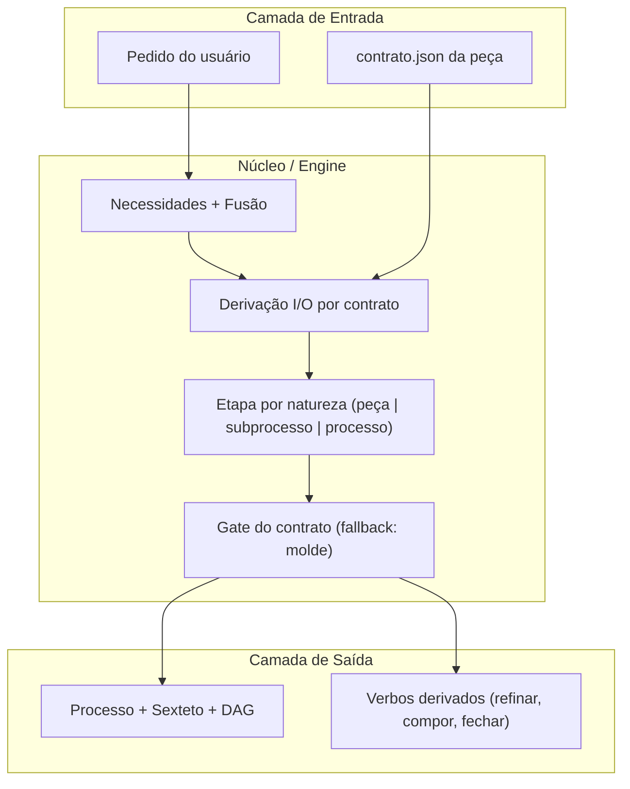

# 📋 SPEC: Fabricar Agnóstico — Contrato de I/O, Molde por Natureza e Verbos Derivados

> **Status:** Proposta para Revisão
> **Data:** 2026-11-16
> **Versão:** 1.0.0
> **Autor:** audit-verbos (Fusão Addy Osmani + Matt Pocock + AIDD-Spec)
> **Iniciativa:** I01 — Agnosticidade Universal dos Verbos de Processo
> **Referência da Intenção:** [docs/intents/2026-11-16_INTENT_FABRICAR_AGNOSTICO.md](../intents/2026-11-16_INTENT_FABRICAR_AGNOSTICO.md)
> **Alvo Primário:** internal/fabricar, internal/processo, internal/matriz, internal/refinar, internal/compor, internal/fechar, internal/listar
> **Consome:** INTENT aprovada · **Produz:** PLAN e ROUTE
> **Template:** TEMPLATE_SPEC.md v2.0.0

---

## 1. Premissas Técnicas Assumidas (Addy Osmani)

> [!IMPORTANT]
> A IA lista abaixo todas as premissas técnicas adotadas para evitar decisões silenciosas. Alerte no Stop-Gate 02 caso alguma premissa esteja incorreta:
1. Go conforme o `go.mod`, stdlib apenas; zero dependências externas novas (`git diff --exit-code go.mod go.sum`).
2. Armazenamento em arquivos locais do SO (cofre `~/.aidd/canonical` e `docs/` do projeto); sem banco externo. O manifesto `contrato.json` vive ao lado da peça no cofre.
3. Sem rede nova: a cadeia de lacunas (fonte externa) permanece como sugestão em warnings; nenhuma chamada HTTP nova.
4. Reuso obrigatório: `internal/processo` (Etapa, Artefato, Store, GateParaArtefato como fallback), `internal/gate` (DSL), `internal/matriz` (Vocab, Needs), `internal/ste` (mensagens). Não serão tocados: `internal/studio`, `internal/legopress`, `internal/videorea`.

---

## 2. Fronteiras de Ação & Regras de Governança (Boundaries — Addy Osmani)

O Processo e os agentes devem respeitar estritamente o sistema de fronteiras em 3 níveis:
* **Sempre Fazer:**
  * Desenvolver via TDD estrito (teste unitário falhando antes do código de produção).
  * Manter funções pequenas, enxutas e de responsabilidade única (< 35 linhas).
  * Validar rigorosamente todos os inputs e decodificações de JSON, incluindo caminhos (sem `..`, sem caminho absoluto fora da raiz).
  * Tratar caminhos de forma compatível com Windows e POSIX (`filepath.Join` / `filepath.ToSlash`).
  * Recompilar o binário ao final de qualquer ticket que altere Go (AGENTS.md, regra 5).
* **Perguntar Antes:**
  * Adicionar qualquer nova dependência externa no `go.mod`.
  * Alterar schemas persistidos no disco que possam quebrar retrocompatibilidade (`contrato.json` é aditivo; `.processo.json` não muda de formato).
  * Alterar contratos públicos de CLI, de API do Studio, do DAG do Processo ou de `ROUTE.json`.
  * Modificar regras globais no `AGENTS.md`.
* **Nunca Fazer:**
  * Criar funções vazias com `TODO`, `pass`, `// implementar depois` ou mocks simulados em código de produção (Lei #1: Zero Stubs). Dublês de teste ficam em `_test.go`, apenas nas bordas (E/S, LLM, relógio).
  * Commitar arquivos temporários, segredos ou variáveis de ambiente no git.
  * Ignorar testes falhando ou quebrar a suíte global de testes.
  * Reimplementar lógica de peça curada existente (`aidd-spec`, `aidd-tickets`): o gate anti-reimplementação reprová-la-ia.
  * Alterar o vocabulário embutido `vocab.default.json` de forma retroativa; ele vira semente, e o crescimento é por acréscimo via cofre.

---

## 3. Visão Geral, Arquitetura & Costuras de Teste (Test Seams — Pocock)

A peça ganha um manifesto `contrato.json` com `entra`, `sai`, `efeitos` e `gate_sugerido`. O motor `fabricar` passa a derivar etapa, artefato e gate do contrato da peça escolhida; sem contrato, cai no molde atual (retrocompatível). O nó do processo aceita 3 naturezas: **peça** (executável), **subprocesso** (peça que embrulha processo) e **processo** (composição). A aptidão na matriz vira compatibilidade de I/O; o vocabulário vira meta-dado de busca. Os verbos refinar/compor/fechar/listar/remover/matriz passam a consumir o contrato.

### Diagrama de Fronteiras (Mermaid)



### Costuras de Teste (Test Seams — Pocock)
* **Costura Primária (Highest Seam):** `fabricar.Fabricar(ctx, req, deps)` com `Deps.Matriz` injetada (matriz em memória com peça com contrato e peça sem contrato) e LLM dublê de borda.
* **Justificativa:** a costura cobre derivação de I/O, gate e retrocompatibilidade fim a fim sem acoplar a implementação interna das camadas.
* **Costuras Secundárias:** `processo.ContratoDe(peca)` (carrega e valida o manifesto), `fabricar.ArtefatoDe` (hoje mora em `natureza.go`), `matriz.AptidaoPorIO`, `gateanti.Reprova(cofre, contrato)`.
* **Dublês Permitidos (somente nas bordas):** LLM, relógio, sistema de arquivos, cofre em memória. Nunca dublê de Peça interna.

---

## 4. Contratos de Dados & Schemas Formais

```go
// Contrato formal: manifesto de I/O da peça. Pacote: internal/processo.
package processo

import (
	"errors"
	"strings"
)

// ErrContratoInvalido sinaliza manifesto que não satisfaz o contrato.
var ErrContratoInvalido = errors.New("processo: contrato inválido")

// Entrada declara o que a peça consome.
type Entrada struct {
	Tipo     string `json:"tipo"`     // marcador | texto | dados | codigo | json | url | estado
	Opcional bool   `json:"opcional"`
}

// Saida declara o que a peça produz.
type Saida struct {
	Tipo           string `json:"tipo"`                       // idem Entrada.Tipo
	CaminhoPadrao  string `json:"caminho_padrao,omitempty"`   // relativo; default vem do molde
	Promete        bool   `json:"promete"`
	GateSugerido   string `json:"gate_sugerido,omitempty"`    // DSL de internal/gate; fallback GateParaArtefato
}

// Contrato é o manifesto contrato.json da peça.
type Contrato struct {
	Nome     string   `json:"nome"`
	Tipo     string   `json:"tipo"`     // skill | script | hook | gate | mcp | processo
	Naturezas []string `json:"naturezas"`
	Entra    []Entrada `json:"entra"`
	Sai      []Saida   `json:"sai"`
	Efeitos  []string  `json:"efeitos"` // arquivo | rede | terminal | estado
}

// Validate checa o contrato antes de qualquer E/S.
func (c Contrato) Validate() error {
	if strings.TrimSpace(c.Nome) == "" || len(c.Sai) == 0 {
		return ErrContratoInvalido
	}
	return nil
}
```

```json
{
  "schema": "contrato.v1",
  "nome": "coletor-csv",
  "tipo": "script",
  "naturezas": ["dados"],
  "entra": [{ "tipo": "url", "opcional": false }],
  "sai": [{ "tipo": "dados", "caminho_padrao": "out/coleta.csv", "promete": true, "gate_sugerido": "line_count('out/coleta.csv') >= 2" }],
  "efeitos": ["arquivo", "rede"]
}
```

---

## 5. Critérios Binários de Aceite por Nó / Ticket (BDD)

> [!NOTE]
> Cada critério `AC-XX` deve ser mecanicamente verificável via teste unitário, asserção ou comando de terminal (`exit code == 0`). Use valores concretos (tabela de casos) em vez de adjetivos. Cada épico deve ter ao menos um critério de caminho de falha (entrada inválida, erro de E/S, estado já existente).

### Épico 01 — Contrato de I/O da Peça

* [ ] `AC-E01.1`: **Contrato válido gera etapa com I/O do manifesto** (caminho feliz)
  * **Dado que:** a matriz em memória tem a peça `coletor-csv` com `contrato.json` válido (`sai[0].caminho_padrao="out/coleta.csv"`, `gate_sugerido="line_count('out/coleta.csv') >= 2"`) e o pedido tem natureza `dados` com etapa `coletar`.
  * **Quando:** `fabricar.Fabricar` roda com `DryRun=true`.
  * **Então:** a etapa `coletar` tem `Produz.Caminho == "out/coleta.csv"`, `Produz.Tipo == "dados"` e `Gate == "line_count('out/coleta.csv') >= 2"`; zero LACUNA para `coletar`; exit code 0.
* [ ] `AC-E01.2`: **Contrato inválido é recusado sem efeito colateral** (caminho de falha)
  * **Dado que:** um `contrato.json` com `sai` vazio ou `caminho_padrao` com `..`/caminho absoluto.
  * **Quando:** `processo.ContratoDe` carrega o manifesto.
  * **Então:** erro `ErrContratoInvalido` retornado; nenhum arquivo criado; `Fabricar` aborta com exit code 1 e mensagem STE-PT.

### Épico 02 — Molde Agnóstico por Natureza

* [ ] `AC-E02.1`: **Nó aceita as 3 naturezas e deriva artefato por natureza do contrato**
  * **Dado que:** contratos com `naturezas` `dados` (sai `dados`), `midia` (sai `marcador`) e um processo composto sem contrato.
  * **Quando:** o motor monta as etapas (`peca`, `subprocesso`, `processo`).
  * **Então:** cada etapa tem `Tipo` de artefato vindo do contrato (`dados`, `marcador`) ou do molde atual quando ausente; nenhuma etapa rejeita natureza por não constar do vocabulário embutido.
* [ ] `AC-E02.2`: **Vocabulário cresce por acréscimo sem recompilar** (caminho de falha do molde fixo)
  * **Dado que:** o cofre define etapa `renderizar` ausente de `vocab.default.json`.
  * **Quando:** o pedido pede a etapa `renderizar`.
  * **Então:** a etapa é aceita sem aviso de "termo descartado"; `matriz.Needs.Etapas` contém `renderizar`; exit code 0.

### Épico 03 — Cadeia Sexteto e Verbos Derivados

* [ ] `AC-E03.1`: **Sexteto completo gerado para qualquer natureza**
  * **Dado que:** pedido de natureza `midia` com peça contratada.
  * **Quando:** `fabricar` roda (dry-run).
  * **Então:** o plano lista os 6 artefatos do Sexteto (INTERVIEW, INTENT, SPEC, PLAN, ROUTE/DAG, TEMPLATE/REPORT) com caminhos ISO `YYYY-MM-DD_*`; exit code 0.
* [ ] `AC-E03.2`: **refinar e compor aceitam I/O e natureza de nó** (caminho de falha)
  * **Dado que:** processo com etapa de peça contratada e processo composto.
  * **Quando:** `refinar --sai` altera a saída da etapa e `compor` liga um subprocesso.
  * **Então:** o `.processo.json` persiste o novo `Sai` e a etapa composta tem `Compoe` preenchido; `refinar` sem `--peca/--caso/--titulo/--sai/--entra` devolve `ErrMudanca`; exit code definido.
* [ ] `AC-E03.3`: **fechar parametriza a cadeia por natureza**
  * **Dado que:** processo de natureza `midia` (sem binário Go).
  * **Quando:** `fechar` executa com `--dry-run`.
  * **Então:** a etapa "Recompilação do Binário" é omitida ou marcada como não aplicável; a cadeia restante executa; exit code 0.

### Épico 04 — Gate Anti-Reimplementação

* [ ] `AC-E04.1`: **Peça nova com I/O igual a peça existente é reprovada** (caminho de falha)
  * **Dado que:** o cofre tem `coletor-csv` (contrato com `sai[0].tipo="dados"`) e uma peça nova declara `sai` estruturalmente igual.
  * **Quando:** o gate anti-reimplementação avalia a peça nova.
  * **Então:** erro sentinela `ErrReimplementacao` citando a peça existente; nenhuma gravação; exit code 1.
* [ ] `AC-E04.2`: **Peça nova com I/O distinto passa** (caminho feliz)
  * **Dado que:** peça nova com `sai[0].tipo="json"` e `entra` distintos.
  * **Quando:** o gate avalia.
  * **Então:** aprovação; a peça entra no cofre; exit code 0.

### Épico 05 — Varredura dos Outros Verbos

* [ ] `AC-E05.1`: **matriz calcula aptidão por compatibilidade de I/O**
  * **Dado que:** peça A com `sai[0].tipo="dados"` e pedido com etapa que consome `dados`.
  * **Quando:** `MergeByFit` roda.
  * **Então:** A tem `Aptidao == 1` para a etapa mesmo sem caso de uso do vocabulário; peça sem perfil e sem contrato mantém o comportamento atual (fora, com motivo).
* [ ] `AC-E05.2`: **listar e remover operam peças com contrato** (caminho de falha)
  * **Dado que:** cofre com peça solta com contrato e processo `legoloop-*`.
  * **Quando:** `listar --json` e `remover` da peça.
  * **Então:** `listar` inclui a peça com `contrato` resumido; `remover` recusa nome sem `legoloop-` (exit 2) e remove a peça com rollback `.legoloop-bak` quando aplicável.
* [ ] `AC-NF.1`: **Path jail do contrato** (não funcional)
  * **Dado que:** manifesto hostil com `caminho_padrao="../../../etc/passwd"` ou absoluto.
  * **Quando:** `ContratoDe` valida.
  * **Então:** `ErrContratoInvalido` em < 100ms; nenhum acesso ao disco fora da raiz; `filepath.IsLocal` sempre verdadeiro nos caminhos aceitos.

### Rastreabilidade Requisito para Critério

| R | Requisito | AC |
| :--- | :--- | :--- |
| `R1` | Contrato de I/O declarado por peça, com validação formal | `AC-E01.1`, `AC-E01.2`, `AC-NF.1` |
| `R2` | Molde agnóstico por natureza de nó | `AC-E02.1`, `AC-E02.2` |
| `R3` | Cadeia Sexteto completa e verbos derivados consumindo o contrato | `AC-E03.1`, `AC-E03.2`, `AC-E03.3` |
| `R4` | Gate anti-reimplementação | `AC-E04.1`, `AC-E04.2` |
| `R5` | Varredura dos outros 6 verbos | `AC-E05.1`, `AC-E05.2` |

> Cada `R` tem ao menos um `AC`. O `covers` do front matter lista todos os `R`.

---

## 6. Comandos Operacionais & Critério de Conclusão Global (Addy Osmani)

### Comandos de Verificação Mecânica
* **Build:** `go build -o bin/legoloop.exe ./cmd/legoloop`
* **Test:** `go test -v ./...`
* **Estática e formatação:** `go vet ./...` e `gofmt -l .` (saída vazia). `golangci-lint run ./...` é opcional e só vale se estiver instalado e configurado no repositório.
* **Dependências intactas:** `git diff --exit-code go.mod go.sum`
* **Taxonomia:** `go run ./tools/taxlinter internal cmd loops skills docs/templates` (Lei #15)

### Critério de Done Global
A especificação técnica é considerada **100% CONCLUÍDA** quando:
- [ ] 100% dos critérios binários `AC-E{N}.{M}` e `AC-NF.{K}` estiverem marcados como atendidos (`[x]`).
- [ ] O comando de **Test** passar com exit code 0.
- [ ] `go vet ./...` e `gofmt -l .` não reportarem nada.
- [ ] O comando de **Build** recompilar com sucesso o binário `bin/legoloop.exe`.
- [ ] Zero arquivos temporários ou órfãos residuais.

---

🛑 **STOP-GATE 02 DE AUDITORIA HUMANA:**
*As premissas assumidas, as fronteiras (boundaries), os contratos e os critérios binários acima atendem à sua expectativa?*
*Somente após a aprovação explícita do usuário, deve-se gerar o PLAN (`TEMPLATE_PLAN.md`) e a ROUTE (`TEMPLATE_ROUTE.json`).*