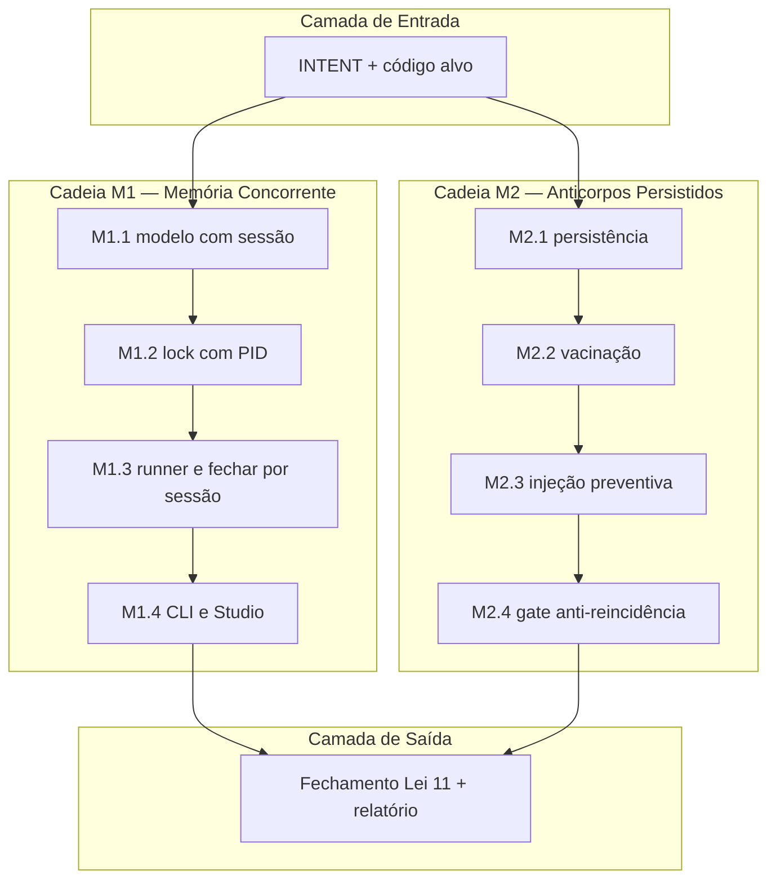

# 📋 SPEC: Memória de Execução Concorrente + Anticorpos Persistidos

> **Status:** Proposta para Revisão  
> **Data:** 2026-11-16  
> **Versão:** 1.0.0  
> **Autor:** planejador (enxame SWARM — demanda MEMÓRIA-CONCORRENTE+ANTICORPOS)  
> **Iniciativa:** MEMORIA_CONCORRENTE_ANTICORPOS  
> **Referência da Intenção:** [docs/intents/2026-11-16_INTENT_MEMORIA_EXECUCAO_ANTICORPOS.md](../intents/2026-11-16_INTENT_MEMORIA_EXECUCAO_ANTICORPOS.md)  
> **Alvo Primário:** internal/triagem, internal/brain, internal/fechar, internal/board (padrão de lock, só leitura), cmd/legoloop  
> **Consome:** INTENT registrada · **Produz:** PLAN, ROUTE e DAG  
> **Template:** TEMPLATE_SPEC.md v2.0.0  

---

## 1. Premissas Técnicas Assumidas (Addy Osmani)

> [!IMPORTANT]
> A IA lista abaixo todas as premissas técnicas adotadas para evitar decisões silenciosas. Alertar no SG-M01 caso alguma premissa esteja incorreta:
1. Runtime Go conforme o `go.mod`; somente stdlib; zero dependências externas novas (`git diff --exit-code -- go.mod go.sum`).
2. Armazenamento em arquivos locais do Processo (`loops/<slug>/memoria_execucao.json` e `loops/<slug>/anticorpos.json`); sem banco externo.
3. Lock de arquivo com PID, copiando o padrão de `internal/board` (`swarm_lock.go` + sufixos por SO); compatível com Windows e POSIX.
4. Reuso: tipos `MemoriaExecucao` (`internal/triagem/memoria.go`) e `AntibodiesDB` (`internal/brain/antibodies.go`) evoluem no lugar; `internal/fechar/quarteto.go` ajusta só o zeramento; nenhum outro verbo é alterado além do necessário.
5. Compatibilidade: `memoria_execucao.json` legado (sem sessão) é lido como sessão `legado` e migrado sem perda; `anticorpos.json` nasce vazio em Processo sem histórico.

---

## 2. Fronteiras de Ação & Regras de Governança (Boundaries — Addy Osmani)

O Processo e os agentes devem respeitar estritamente o sistema de fronteiras em 3 níveis:
* **Sempre Fazer:**
  * Desenvolver via TDD estrito (teste unitário falhando antes do código de produção; mutação prova o teste).
  * Manter funções pequenas, enxutas e de responsabilidade única (≤ 35 linhas).
  * Validar rigorosamente todos os inputs e decodificações de JSON, incluindo caminhos (sem `..`, sem caminho absoluto fora da raiz).
  * Tratar caminhos de forma compatível com Windows e POSIX (`filepath.Join` / `filepath.ToSlash`).
  * Recompilar o binário ao final de qualquer ticket que altere Go (AGENTS.md, regra 5).
* **Perguntar Antes:**
  * Adicionar qualquer nova dependência externa no `go.mod`.
  * Alterar schemas persistidos no disco (`memoria_execucao.json`, `anticorpos.json`) que possam quebrar retrocompatibilidade.
  * Alterar contratos públicos de CLI, de API do Studio, do DAG do Processo ou de `ROUTE.json`.
  * Modificar regras globais no `AGENTS.md`.
* **Nunca Fazer:**
  * Criar funções vazias com `TODO`, `pass`, `// implementar depois` ou mocks simulados em código de produção (Lei #1: Zero Stubs). Dublês de teste ficam em `_test.go`, apenas nas bordas (E/S, relógio).
  * Commitar arquivos temporários, segredos ou variáveis de ambiente no git.
  * Ignorar testes falhando ou quebrar a suíte global de testes.
  * Tocar no Cofre (`~/.aidd`) fora de verbos oficiais; nunca `taskkill /IM legoloop.exe`.
  * Nunca editar `loops/<slug>/*.json` à mão — só verbos oficiais.

---

## 3. Visão Geral, Arquitetura & Costuras de Teste (Test Seams — Pocock)

Duas lacunas fecham em paralelo. A Lacuna 1 transforma `memoria_execucao.json` em estado por sessão (ID de sessão + PID) protegido por lock de arquivo; o `fechar` zera só a sessão dona e limpa arquivos órfãos. A Lacuna 2 persiste `AntibodiesDB` em `loops/<slug>/anticorpos.json`, deduplica por `errSig`, vacina reincidência com antídoto automático, injeta contexto preventivo antes do Nó 1 e bloqueia erro conhecido em runtime. As cadeias M1 e M2 são independentes e rodam em paralelo; M3 (fechamento canônico Lei 11) só começa após SG-M02 e SG-M03.

### Diagrama de Fronteiras (Mermaid)



### Costuras de Teste (Test Seams — Pocock)
* **Costura Primária (Highest Seam):** `triagem.SalvarMemoria(dir string, m MemoriaExecucao) error` e `triagem.LerMemoria(dir string) (MemoriaExecucao, error)` — borda única de E/S da memória; a suíte bate aqui para provar lock, sessão e ciclo completo.
* **Justificativa:** toda corrupção de corrida se manifesta na borda de leitura e gravação; testar aqui evita acoplar o teste aos detalhes internos do lock.
* **Costuras Secundárias:** `brain.AntibodiesDB.Record/Find/InjectPreventiveContext` com persistência; `fechar` (zeramento por sessão); contrato de CLI de sessões ativas.
* **Dublês Permitidos (somente nas bordas):** sistema de arquivos em `t.TempDir()` e relógio injetável para timestamps. Nunca dublê de Peça interna. Proibido tocar `~/.aidd` nos testes.

---

## 4. Contratos de Dados & Schemas Formais

```go
// Contrato formal: memória de execução por sessão.
package triagem

import "errors"

// ErrSessaoInvalida sinaliza sessão sem ID ou sem PID válido.
var ErrSessaoInvalida = errors.New("triagem: sessão inválida")

// ErrLockOcupado sinaliza lock retido por outra sessão além do tempo limite.
var ErrLockOcupado = errors.New("triagem: lock ocupado")

// MemoriaExecucao registra o estado de execução de uma sessão de um processo.
type MemoriaExecucao struct {
	Processo     string                `json:"processo"`
	SessaoID     string                `json:"sessao_id"` // UUID da sessão
	PID          int                   `json:"pid"`       // PID do detentor do lock
	EtapaAtual   string                `json:"etapa_atual"`
	ProximoPasso string                `json:"proximo_passo"`
	AtualizadoEm time.Time             `json:"atualizado_em"`
	TokenBudget  *TokenBudgetTelemetry `json:"token_budget,omitempty"`
}
```

```go
// Contrato formal: anticorpos persistidos por processo.
package brain

// AntibodiesDBFile é o nome do arquivo persistido por processo.
const AntibodiesDBFile = "anticorpos.json"

// Antibody mantém a tripla erro→causa→diff e ganha contagem de reincidência.
type Antibody struct {
	Package        string `json:"package"`
	ErrorSignature string `json:"error_signature"`
	RootCause      string `json:"root_cause"`
	DiffSolution   string `json:"diff_solution"`
	Timestamp      string `json:"timestamp"`
	Recorrencias   int    `json:"recorrencias"` // 1 no registro; +1 a cada reincidência
}
```

* Erros sentinela: `ErrSessaoInvalida`, `ErrLockOcupado`, `ErrAnticorpoInvalido` (errSig ou pacote vazio), `ErrAnticorposCorrompidos` (JSON inválido em `anticorpos.json`).
* Regras de validação: `SessaoID` não vazio; `PID > 0`; `errSig` não vazio e normalizado (`strings.TrimSpace` + `EqualFold` na comparação); caminhos sempre via `filepath.Join` dentro da raiz do Processo.

---

## 5. Critérios Binários de Aceite por Nó / Ticket (BDD)

> [!NOTE]
> Cada critério `AC-XX` é mecanicamente verificável via teste unitário, asserção ou comando de terminal (`exit code == 0`). Cada épico tem ao menos um critério de caminho de falha. Formato EARS: orientado a evento ou a estado, frase binária.

### Épico 01 — Memória de Execução Concorrente

* [ ] `AC-E01.1`: **Modelo de sessão serializa e valida (M1.1 — caminho feliz)**
  * **Dado que:** um `MemoriaExecucao` com `SessaoID` "abc" e `PID` 100
  * **Quando:** o valor for serializado em JSON e validado
  * **Então:** o JSON contém `sessao_id` e `pid` e `Validate()` retorna `nil`.
* [ ] `AC-E01.2`: **Sessão sem identidade é rejeitada (M1.1 — caminho de falha)**
  * **Dado que:** um `MemoriaExecucao` com `SessaoID` vazio ou `PID` ≤ 0
  * **Quando:** `Validate()` for invocado
  * **Então:** retorna `ErrSessaoInvalida` e nada é gravado em disco.
* [ ] `AC-E01.3`: **Duas sessões simultâneas gravam sem corrupção (M1.2 — caminho feliz)**
  * **Dado que:** duas sessões com IDs distintas gravam no mesmo diretório de Processo
  * **Quando:** `SalvarMemoria` rodar em paralelo (2 goroutines, `go test -race` quando CGO disponível)
  * **Então:** as duas leituras posteriores de `LerMemoria` devolvem cada sessão íntegra e o JSON do arquivo é válido.
* [ ] `AC-E01.4`: **Lock retido não corrompe estado (M1.2 — caminho de falha)**
  * **Dado que:** a sessão A retém o lock além do tempo limite
  * **Quando:** a sessão B invocar `SalvarMemoria`
  * **Então:** retorna `ErrLockOcupado` (ou espera dentro do timeout e grava íntegro); nunca grava JSON parcial.
* [ ] `AC-E01.5`: **Fechar zera só a sessão dona e limpa órfãos (M1.3 — caminho feliz)**
  * **Dado que:** o Processo tem 2 sessões ativas e 1 sessão órfã (PID morto)
  * **Quando:** o verbo `fechar` rodar para a sessão dona
  * **Então:** a sessão dona é zerada e removida, a ativa permanece e a órfã é limpa; disco sem `memoria_execucao_*.json` órfão.
* [ ] `AC-E01.6`: **Fechar com sessão inexistente falha claro (M1.3 — caminho de falha)**
  * **Dado que:** o ID de sessão informado não existe no Processo
  * **Quando:** o verbo `fechar` rodar
  * **Então:** retorna erro com mensagem citando o ID inexistente e nenhum arquivo é alterado.
* [ ] `AC-E01.7`: **CLI expõe sessões ativas (M1.4 — caminho feliz)**
  * **Dado que:** o Processo tem 2 sessões ativas
  * **Quando:** o comando de listagem de sessões rodar com `--json`
  * **Então:** a saída JSON lista 2 objetos com `sessao_id`, `pid`, `etapa_atual` e `exit code == 0`.
* [ ] `AC-E01.8`: **Processo sem sessões devolve lista vazia (M1.4 — caminho de falha)**
  * **Dado que:** o Processo não tem nenhuma sessão registrada
  * **Quando:** o comando de listagem de sessões rodar
  * **Então:** devolve lista vazia (JSON `[]`) e `exit code == 0`, sem erro.

### Épico 02 — Anticorpos Persistidos

* [ ] `AC-E02.1`: **Anticorpos persistem entre execuções (M2.1 — caminho feliz)**
  * **Dado que:** um `AntibodiesDB` persistido em `loops/<slug>/anticorpos.json` registra 1 anticorpo
  * **Quando:** uma nova instância for carregada do mesmo diretório
  * **Então:** `Find` localiza o anticorpo registrado e o arquivo JSON é válido.
* [ ] `AC-E02.2`: **Arquivo corrompido falha com erro sentinela (M2.1 — caminho de falha)**
  * **Dado que:** `anticorpos.json` contém JSON inválido
  * **Quando:** o carregamento for invocado
  * **Então:** retorna `ErrAnticorposCorrompidos`, sem panic e sem sobrescrever o arquivo.
* [ ] `AC-E02.3`: **Reincidência vacina com antídoto (M2.2 — caminho feliz)**
  * **Dado que:** existe anticorpo para `errSig` "E1" e o erro "E1" ocorre de novo
  * **Quando:** `Record` for invocado para "E1" pela 2ª vez
  * **Então:** `Recorrencias` do anticorpo vira 2, o antídoto (`DiffSolution`) é aplicado automaticamente e o mesmo erro não se repete na execução de teste.
* [ ] `AC-E02.4`: **Registro sem assinatura é rejeitado (M2.2 — caminho de falha)**
  * **Dado que:** `Record` recebe `errSig` vazio ou pacote vazio
  * **Quando:** a validação rodar
  * **Então:** retorna `ErrAnticorpoInvalido` e o banco persistido permanece inalterado.
* [ ] `AC-E02.5`: **Contexto preventivo injeta antes do Nó 1 (M2.3 — caminho feliz)**
  * **Dado que:** o Processo tem ≥1 anticorpo no pacote do nó inicial
  * **Quando:** a execução do Processo iniciar
  * **Então:** `InjectPreventiveContext` entra no contexto antes da execução do Nó 1, comprovado por teste que observa o contexto do primeiro Nó.
* [ ] `AC-E02.6`: **Sem anticorpos a execução segue normal (M2.3 — caminho de falha)**
  * **Dado que:** o Processo não tem anticorpos registrados
  * **Quando:** a injeção preventiva rodar
  * **Então:** o contexto injetado é vazio e a execução do Nó 1 procede sem alteração.
* [ ] `AC-E02.7`: **Gate bloqueia erro conhecido em runtime (M2.4 — caminho feliz)**
  * **Dado que:** existe anticorpo para `errSig` "E2" com antídoto registrado
  * **Quando:** o erro "E2" ocorrer em runtime
  * **Então:** o antídoto é aplicado; sem antídoto aplicável a execução bloqueia com saída clara citando o `errSig`.
* [ ] `AC-E02.8`: **Erro desconhecido não é bloqueado (M2.4 — caminho de falha)**
  * **Dado que:** o erro ocorrido não tem anticorpo registrado
  * **Quando:** o gate anti-reincidência rodar
  * **Então:** o fluxo segue normal, sem bloqueio e sem antídoto aplicado.

### Épico 03 — Fechamento Canônico

* [ ] `AC-E03.1`: **Manual operacional emitido (M3.1)**
  * **Dado que:** os Épicos 01 e 02 foram homologados nos Stop-Gates
  * **Quando:** o ticket M3.1 concluir
  * **Então:** existe `docs/manuals/2026-11-16_MANUAL_FUNCAO_<NOME>_LEGOLOOP.md` sem placeholders `{{` e com checklist Lei 11.
* [ ] `AC-E03.2`: **Livro, Skill e DAG validados (M3.2)**
  * **Dado que:** o manual existe
  * **Quando:** o ticket M3.2 concluir
  * **Então:** existem `docs/books/<slug>/livro.json` + `.pdf` auditado, `skills/<nome>/SKILL.md` e `legoloop validate` devolve `exit code == 0`.
* [ ] `AC-E03.3`: **Build, governança viva e relatório (M3.3)**
  * **Dado que:** M3.2 concluiu
  * **Quando:** o ticket M3.3 concluir
  * **Então:** `go install ./cmd/legoloop` devolve `exit code == 0`, `AGENTS.md`/`MEMORY.md`/`README.md` atualizados, grafo reindexado e `docs/reports/2026-11-16_REPORT_MEMORIA_CONCORRENTE_ANTICORPOS.md` existe com telemetria tempo/tokens/custo orçado vs realizado.

### Rastreabilidade Requisito para Critério

| R | Requisito | AC |
| :--- | :--- | :--- |
| `R1` | Gestão concorrente da memória de execução com lock e estado por sessão | `AC-E01.1` … `AC-E01.8` |
| `R2` | Anticorpos persistidos por processo com vacinação de reincidência | `AC-E02.1` … `AC-E02.8` |
| `R3` | Fechamento canônico Lei 11 da demanda | `AC-E03.1`, `AC-E03.2`, `AC-E03.3` |

> Cada `R` tem ao menos um `AC`. O `covers` do front matter lista todos os `R`.

---

## 6. Comandos Operacionais & Critério de Conclusão Global (Addy Osmani)

### Comandos de Verificação Mecânica
* **Build:** `go build -o bin/legoloop.exe ./cmd/legoloop`
* **Test:** `go test -count=1 ./...`
* **Estática e formatação:** `go vet ./...`, `gofmt -l .` (saída vazia), `go run ./tools/funclen internal` (funções ≤ 35 linhas), `go run ./tools/taxlinter internal cmd loops skills docs/templates` (sem violação nova).
* **Dependências intactas:** `git diff --exit-code -- go.mod go.sum`

### Critério de Done Global
A especificação técnica é considerada **100% CONCLUÍDA** quando:
- [ ] 100% dos critérios binários `AC-E{N}.{M}` estiverem marcados como atendidos (`[x]`).
- [ ] O comando de **Test** passar com exit code 0.
- [ ] `go vet ./...` e `gofmt -l .` não reportarem nada.
- [ ] O comando de **Build** recompilar com sucesso o binário `bin/legoloop.exe`.
- [ ] Zero arquivos temporários ou órfãos residuais.

---

🛑 **STOP-GATE SG-M01 DE AUDITORIA HUMANA:**  
*As premissas assumidas, as fronteiras (boundaries), os contratos e os critérios binários acima atendem à sua expectativa?*  
*Somente após a aprovação explícita do usuário, executar os Tickets M1.1→M3.3 conforme o PLAN (`TEMPLATE_PLAN.md`) e a ROUTE (`TEMPLATE_ROUTE.json`).*
