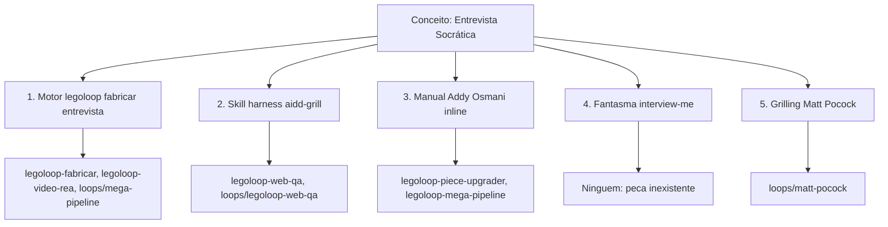

# Relatório de Auditoria de Dissonância entre Peças — LegoLoop

**Data:** 2026-11-16 · **Escopo:** `skills/*/SKILL.md` e `loops/*/pipeline.dag.json` (complementado por `loops/*/*.loop.json` e motor Go quando o conceito tem implementação em código) · **Restrição:** nenhuma alteração de código, commit ou push foi feita.

---

## 1. Resumo Executivo

Foram mapeadas **7 conceitos com reimplementações dispersas** em `skills/` e `loops/`. O conceito mais dissonante é a **Entrevista Socrática**, com **5 implementações distintas** (4 confirmadas na missão + 1 extra encontrada). O segundo é a **Especificação**, com 5 implementações. Também foi confirmado um problema **transversal**: todos os DAGs referenciam `skills/aidd-*`, paths que não existem no repositório (as peças vivem no vault do harness `~/.gemini/config/skills/`).

---

## 2. Matriz de Dissonância

| Conceito | Nº impls | Quem usa | Mais atualizada | Canônica sugerida |
| :--- | :---: | :--- | :--- | :--- |
| Entrevista Socrática | **5** | `legoloop-fabricar`, `legoloop-video-rea` (motor); `legoloop-web-qa` (`aidd-grill`); `legoloop-piece-upgrader` (manual); `legoloop-mega-pipeline` (inline + fantasma); `loops/matt-pocock` (grilling) | `legoloop-video-rea` e `legoloop-web-qa` (2026-11-15) | Motor `legoloop fabricar entrevista` (única mecanizada) |
| Especificação (SPEC) | **5** | motor `internal/specgen`; `aidd-spec` (harness); `legoloop-piece-upgrader` Passo 3 (inline); `loops/addy-osmani` e `loops/matt-pocock` (nós próprios); fantasmas `spec-driven-development`/`to-spec` | `legoloop-mega-pipeline` (2026-11-14) | Motor `internal/specgen` + `aidd-spec` como fachada |
| Fechamento/Canonização | **5** | motor `legoloop fechar` + `legoloop-fechar` + `loops/fechar`; `legoloop-mega-pipeline` Subproc 5; `legoloop-piece-upgrader` Passo 6; `legoloop-homologacao` Etapa 6; AGENTS.md Lei 11 | `legoloop-homologacao` (2026-11-14 22:41) | Motor `legoloop fechar` (único executável) |
| Homologação | **4** | `legoloop-homologacao` (+`loops/legoloop-homologacao`); `aidd-homologue` (harness, via mega-pipeline); `legoloop-piece-upgrader` Passo 6; nós "Homologação Final" em `loops/ai-motion-graphics` etc. | `legoloop-homologacao` (2026-11-14) | `aidd-homologue` p/ E2E de app; `legoloop-homologacao` p/ ecossistema |
| Triagem/Roteamento | **3** | motor `legoloop triagem`; `skills/legoloop-triagem`; `loops/*/triagem.json` (catálogo por processo) | `legoloop-triagem` (2026-11-14) | Motor `legoloop triagem`; `triagem.json` é dado, não peça |
| TDD | **5** narrações | `aidd-tdd`+`implementacao` (mega-pipeline Subproc 4); `legoloop-loop-map` Etapa 4; `loops/addy-osmani` e `loops/matt-pocock` ("Construção TDD Cirúrgica"); flag `tdd_enforced` nos loops | todas convergem (2026-11-14) | `aidd-tdd` (protocolo único; dissonância baixa) |
| Design Pass / UI | **4** | `loops/impeccable-design`; `loops/legoloop-design-ui`; `legoloop-mega-pipeline` Subproc 2; harness `impeccable`/`aidd-uiux`/`aidd-linter-design` | `legoloop-mega-pipeline` (2026-11-14) | `loops/impeccable-design` + harness `impeccable` |

---

## 3. Detalhamento dos Top-5 Conceitos

### 3.1 Entrevista Socrática — 5 implementações

1. **Motor `legoloop fabricar entrevista`** (Go, `internal/interview` via `internal/fabricar` — prova: `internal/fabricar/doc.go:10`). Usado por `skills/legoloop-fabricar/SKILL.md:43-46` e `skills/legoloop-video-rea/SKILL.md:61-62`. Único com mecanização, sessão JSON e gate de confiança ≥ 95%.
2. **Skill harness `aidd-grill`** (existe apenas no vault `~/.gemini/config/skills/`). Usada por `skills/legoloop-web-qa/SKILL.md:35` e nó `n11_entrevista_correcao` (`loops/legoloop-web-qa/pipeline.dag.json:572-576`, `ref: skills/aidd-grill`).
3. **Manual Addy Osmani inline** em `skills/legoloop-piece-upgrader/SKILL.md:55-64` (marcadores `HIPÓTESE:/CONFIANÇA:/PERGUNTA:/PALPITE:`, corte ≥ 95%).
4. **Protocolo inline duplicado** em `skills/legoloop-mega-pipeline/SKILL.md:103-118` — mesmo texto/marcadores do item 3 — que ainda cita as peças fantasma `interview-me` e `master-assembler` (`SKILL.md:104`).
5. **Grilling Matt Pocock** (achado extra): nó "Grilling & Alinhamento de Domínio" em `loops/matt-pocock/pipeline.dag.json:43` (`ref: skills/aidd-pocock`).

**Dissonâncias concretas:**
- `interview-me` **não existe** em `skills/`, `loops/`, `componentes/` nem no vault do harness — referência fantasma (`legoloop-mega-pipeline/SKILL.md:104`).
- `master-assembler` não existe no repositório; existe no vault do harness, mas é peça de montagem, não de entrevista — referência errada no mesmo trecho.
- Regra STE-PT conflita entre implementações: `legoloop-video-rea/SKILL.md:39` proíbe STE-PT na entrevista; `legoloop-web-qa` não tem essa ressalva; AGENTS.md Lei 10 impõe STE-PT sempre (aplicação ambígua na entrevista).

### 3.2 Especificação — 5 implementações

1. **Motor `internal/specgen`** (`internal/specgen/specgen.go:1`, com testes em `specgen_test.go`) — usado por `legoloop fabricar`.
2. **`aidd-spec`** (harness) — referenciada por `loops/mega-pipeline/pipeline.dag.json:164` (`ref: skills/aidd-spec`).
3. **Manual inline** — `skills/legoloop-piece-upgrader/SKILL.md:68-75` (Passo 3: "fusão Addy Osmani + Matt Pocock").
4. **Nós próprios dos loops de método** — `loops/addy-osmani` nó "Especificação & Restrições" e `loops/matt-pocock` nó "Especificação & Restrições Invariantes", cada um com gates distintos.
5. **Fantasmas** — `spec-driven-development` (Osmani) e `to-spec` (Pocock) em `skills/legoloop-mega-pipeline/SKILL.md:126`: **inexistentes** no repositório e no vault.

O `legoloop-mega-pipeline/SKILL.md:126-137` funde os 3 métodos num quinto formato (Premissas + Boundaries + Test Seams + BDD + Comandos), sobreposto ao `internal/specgen` e ao Passo 3 do `piece-upgrader`.

### 3.3 Fechamento/Canonização — 5 implementações + divergência numérica

1. **Motor `legoloop fechar`** + `skills/legoloop-fechar/SKILL.md:21,41` — **9 etapas** mecânicas.
2. **`loops/fechar/fechar.loop.json:5`** — "Sub-processo canônico em **8 etapas**" (falta a etapa do Relatório de Conclusão). **Divergência 8 × 9 confirmada.**
3. **`skills/legoloop-mega-pipeline/SKILL.md:147-153`** — Subprocesso 5 com narrativa própria (testes verdes + `go build` + limpeza).
4. **`skills/legoloop-piece-upgrader/SKILL.md:102`** — Passo 6 "Gate Mecânico de Fechamento & Homologação".
5. **`skills/legoloop-homologacao/SKILL.md:32`** — Etapa 6 "Fechamento Canônico Universal (TICK-07.2)".
   (AGENTS.md Lei 11 é a sexta narração, em prosa, com 9 itens.)

### 3.4 Homologação — 4 implementações

1. **`skills/legoloop-homologacao`** (+ `loops/legoloop-homologacao`) — auditoria integral do ecossistema em 6 etapas com verificação cega (`SKILL.md:24-32`).
2. **`aidd-homologue`** (harness) — usado por `loops/mega-pipeline/pipeline.dag.json:341` e citado em `legoloop-mega-pipeline/SKILL.md:148` junto de `quality-gatekeeper` e `playwright`.
3. **`skills/legoloop-piece-upgrader/SKILL.md:102`** — homologação embutida no Passo 6.
4. **Nós de loop** — "Homologação Final (Regressão Global e Recompilação Fresca)" em `loops/ai-motion-graphics/pipeline.dag.json:1070` e equivalentes nos demais loops de vídeo.

Fronteiras não declaradas entre "homologação de ecossistema" (item 1) e "homologação E2E de app" (item 2): mesmo nome, escopos diferentes.

### 3.5 Triagem/Roteamento — 3 implementações

1. **Motor `legoloop triagem`** (Go).
2. **`skills/legoloop-triagem`** — fachada de 0,9 KB com **`description` em inglês** (`SKILL.md:3`), violando AGENTS.md Lei 7 (PT-BR obrigatório).
3. **`loops/*/triagem.json`** — catálogo duplicado por processo (schema `triagem.v1`, presente em 10+ loops).

---

## 4. Referências Fantasma e Paths Quebrados (transversal)

| Referência | Onde | Status real |
| :--- | :--- | :--- |
| `interview-me` | `legoloop-mega-pipeline/SKILL.md:104` | **Fantasma total** (nem no harness) |
| `master-assembler` | `legoloop-mega-pipeline/SKILL.md:104` | Só no harness; peça errada para entrevista |
| `spec-driven-development` | `legoloop-mega-pipeline/SKILL.md:126` | **Fantasma total** |
| `to-spec` | `legoloop-mega-pipeline/SKILL.md:126` | **Fantasma total** |
| `ref: skills/aidd-*` | todos os DAGs (`addy-osmani`, `lauren-tan`, `matt-pocock`, `mega-pipeline`, `web-qa`, `video-edition`) | Path inexistente no repo; peça vive em `~/.gemini/config/skills/` |

---

## 5. Achados Menores

- **8 × 9 etapas** no fechamento (`loops/fechar/fechar.loop.json:5` vs `skills/legoloop-fechar/SKILL.md:21`).
- **Inglês em skill PT-BR:** `skills/legoloop-triagem/SKILL.md:3`.
- **STE-PT na entrevista:** conflito `legoloop-video-rea/SKILL.md:39` vs AGENTS.md Lei 10.
- **Cadeia INTERVIEW→INTENT→SPEC→PLAN→ROUTE→DAG** narrada 3×: `legoloop-mega-pipeline/SKILL.md:162-175`, `loops/legoloop-web-qa/pipeline.dag.json:624` e AGENTS.md Lei 6.

## 6. Recomendações (não executadas nesta auditoria)

1. Canonizar a Entrevista Socrática no motor `legoloop fabricar entrevista`; reduzir `aidd-grill` a perfil de harness e apagar os manuais inline duplicados.
2. Corrigir `legoloop-mega-pipeline/SKILL.md:104,126`: remover fantasmas `interview-me`, `spec-driven-development`, `to-spec`; corrigir `master-assembler`.
3. Unificar contagem do fechar: alinhar `loops/fechar/fechar.loop.json` a 9 etapas (inclui Relatório).
4. Traduzir o `description` de `legoloop-triagem` para PT-BR.
5. Decidir política dos `ref: skills/aidd-*`: apontar para o vault do harness ou espelhar as peças no repositório.

---

> Auditoria somente leitura. Nenhum arquivo de código foi alterado. Nenhum commit ou push foi realizado.
