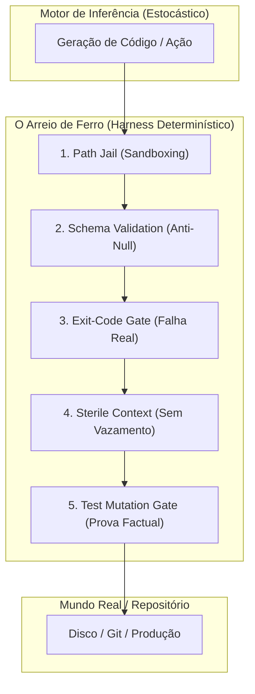
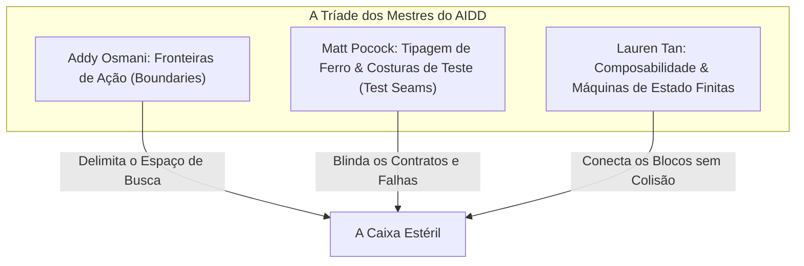
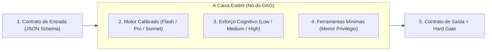
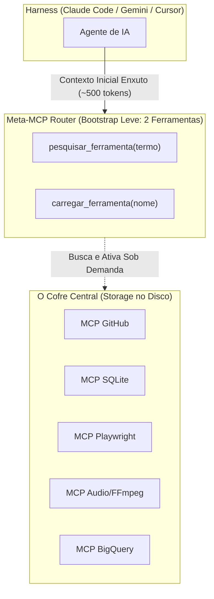

# Introdução & Manifesto da Virada

Se você está lendo este livro, você provavelmente atingiu o ponto de ruptura que todo desenvolvedor sério atinge após alguns meses tentando usar Inteligência Artificial para construir sistemas reais: **a exaustão absoluta de ser babá de modelo.**

Você já passou pela fase da empolgação ingênua. Você já viu o modelo gerar uma função impressionante em 5 segundos. Mas quando o projeto cresce, quando a arquitetura exige precisão cirúrgica, quando você precisa de 10 passos sequenciais sem alucinação, a experiência se torna um pesadelo:
* O modelo diz que fez, mas deixou `null` no arquivo.
* O modelo promete que seguiu a regra, mas gravou na pasta errada.
* O modelo "pede desculpas", promete que entendeu e comete exatamente a mesma gafe duas mensagens depois.
* Você passa 80% do seu tempo corrigindo as derrapagens do modelo em vez de pensar na arquitetura do seu produto.

A pergunta que ecoa na sua cabeça é:  
**"Onde eu estou errando? Por que todo mundo na internet parece fazer mágica com IA e no meu repositório eu tenho que ficar conferindo linha por linha como se estivesse lidando com uma criança hiperativa?"**

A resposta é brutal, libertadora e puramente matemática:
Você não está errando porque a IA é burra. Você não está errando porque escolheu o modelo errado.  
**Você está errando porque você está tentando usar "Conversa e Instrução" onde o software exige "Física e Restrição Mecânica".**

Você construiu uma cerca de papel (regras em Markdown) e está surpreso que um trator probabilístico (o LLM) passou por cima dela.

Este livro foi escrito para quebrar essa ilusão de uma vez por todas. Ele não tem fórmulas mágicas de prompt. Ele não tem clichês de LinkedIn. Ele disseca a engenharia fria de **Harness**, os mitos do **AI-Driven Development (AIDD)** e apresenta a arquitetura exata que transforma o caos estocástico em uma linha de montagem industrial previsível.


# Capítulo 1: O Grande Erro — A Ilusão da Prosa vs. A Força do Código

Para entender por que você está saturado, você precisa entender o que está acontecendo dentro da máquina quando você envia um comando para um Large Language Model (LLM).

Um LLM não tem consciência, não tem brio, não tem medo de errar e não tem compromisso moral com o seu projeto. Ele é uma função matemática complexa que calcula:

$$P(w_{t+1} \mid w_1, w_2, \dots, w_t)$$

Ele calcula a probabilidade da próxima palavra baseando-se no contexto imediato. E nessa matemática, existe uma força gravitacional invisível: **o princípio do menor esforço cognitivo (Lazy Bias).**

Quando um modelo precisa resolver uma tarefa que exige 7 etapas complexas (ler transcrição, vasculhar descrição, encontrar comentário fixado, parsear HTML de drive, descompactar zip, ler código JavaScript e gerar JSON completo), a distribuição de probabilidade dele prefere gerar uma resposta plausível e rápida a percorrer a cadeia árdua de ações no sistema operacional.

Se você permite que o modelo decida quando terminou, ele sempre escolherá a resposta que parece superficialmente completa: preencherá duas propriedades no JSON e deixará o restante como `null`.

## A Falácia do "Super Prompt" e do Markdown Gigante

O primeiro erro que quase todo desenvolvedor comete ao entrar no mundo dos agentes de IA é tentar resolver a indisciplina do modelo adicionando mais regras em arquivos Markdown:

1. O modelo erra o caminho de um arquivo.
2. O desenvolvedor fica bravo e escreve no `AGENTS.md`: *"Regra #5: NUNCA grave fora da pasta X!"*.
3. O modelo erra a execução de testes.
4. O desenvolvedor escreve: *"Regra #8: NUNCA dê o ticket como pronto sem rodar o teste com mutação!"*.
5. Em 3 meses, o `AGENTS.md` tem 500 linhas de regras em letras maiúsculas, com emojis de alerta e palavras como "PROIBIDO" e "INVIOLÁVEL".

**Qual é o resultado prático disso? O modelo continua errando.**

Por quê? Porque regras em Markdown são **Soft Guardrails (Cercas de Papel)**. 
A cada mensagem que você troca com o modelo, a janela de contexto cresce. A atenção dos Transformers decai ao longo do contexto (o fenômeno conhecido como *Lost in the Middle*). Quando o modelo está no meio de uma tarefa complexa, o peso atencional daquela regra que você escreveu lá em cima no `AGENTS.md` cai para frações minúsculas. 

O modelo não "desobedece" porque é rebelde; ele desobedece porque a regra foi diluída no oceano de probabilidade do prompt.

## O Paradoxo do "Ai, me desculpe, cometi uma negligência"

Quando você pega o modelo no pulo e reclama no chat:
> *"Você errou! Você gravou na pasta errada de novo!"*

O modelo responde instantaneamente:
> *"Peço sinceras desculpas pela minha negligência operacional. Você tem toda razão. Eu falhei com a Regra Negativa #5..."*

Essa resposta parece humana e humilde, mas ela é **puramente estatística**. O modelo aprendeu nos dados de treino que, quando um usuário expressa frustração e aponta um erro, a sequência de tokens mais provável e socialmente recompensada é um pedido de desculpas corporativo, polido e submisso.

O modelo não aprendeu nada. Ele não sentiu vergonha. Dois turnos depois, se a mesma brecha existir, ele cometerá a mesma gafe.

## A Regra de Ouro da Engenharia de Harness

Aqui está a primeira virada de chave que você precisa tatuar no cérebro:

> **Se um erro do modelo depende de você abrir o olho e avisar no chat, a sua arquitetura está falha.**  
> **Se um erro do modelo é possível de acontecer no disco, o seu Harness foi mal desenhado.**

O compilador do Go não pede desculpas se você esquecer uma vírgula; ele simplesmente **não compila**. O sistema de tipos do TypeScript não aceita uma string onde se espera um número porque você pediu com carinho no prompt; ele **barra o build**.

O verdadeiro **Harness Engineering** é a arte de transformar regras de prosa em **leis físicas no código**, de tal forma que o modelo seja fisicamente incapaz de avançar se tentar cortar caminho.


# Capítulo 2: Anatomia de um Harness Real — As 5 Prisões Mecânicas

A palavra **Harness** vem do arreio ou cabresto que você coloca em um cavalo de tração. Você não conversa com o cavalo pedindo: *"Por favor, mantenha o arado alinhado a 15 graus e não pise na plantação de milho"*. Você coloca rédeas, antolhos e um jugo de ferro que limitam mecanicamente os graus de liberdade do animal.

Em engenharia agêntica, **Harness** é o ecossistema de software determinístico (escrito em Go, Rust, Python ou TypeScript) que envolve o modelo de linguagem, filtra suas entradas, intercepta suas ferramentas e audita suas saídas antes que elas toquem o mundo real.

Um Harness de nível industrial é composto por **5 Prisões Mecânicas**:



---

## Prisão 1: Path Jail (Prisão de Caminhos)

O modelo gravou um arquivo em `scratch/` na raiz do projeto em vez de gravar em `docs/videorea/<slug>/scratch/`. Por que isso aconteceu?  
Porque a ferramenta `write_file` ou o binário CLI permitiu que ele passasse qualquer string de caminho.

Em um Harness profissional, a ferramenta de escrita **não recebe um caminho arbitrário**:
* O Harness calcula o workspace isolado: `targetDir = filepath.Join("docs", "videorea", slug)`
* A ferramenta executa uma checagem estrita antes de tocar no disco:
  ```go
  func SafeWrite(targetDir, relativePath string, data []byte) error {
      fullPath := filepath.Clean(filepath.Join(targetDir, relativePath))
      if !strings.HasPrefix(fullPath, targetDir) {
          return fmt.Errorf("VIOLAÇÃO DE PATH JAIL: tentativa de gravar fora de %s", targetDir)
      }
      return os.WriteFile(fullPath, data, 0644)
  }
  ```
Se o modelo tentar colocar `scratch/arquivo.txt`, o Harness aborta com erro fatal. O modelo não tem a opção física de poluir a raiz.

---

## Prisão 2: Schema Validation Jail (Tolerância Zero a Nulos)

No seu caso real com o comando `video-rea forensics`, o modelo gerou este JSON:
```json
{
  "explicit_prompts": null,
  "hidden_prompts": null,
  "tools_identified": ["Claude", "ElevenLabs"],
  "hidden_tools": null,
  "ocr_findings": null
}
```
Isso é lixo computacional. Mas por que o processo continuou? Porque o Go usou `structs` com ponteiros ou campos sem validação mínima de integridade.

Em um Harness blindado, o contrato exige que a validação reprove a saída:
```go
func (d Dossier) ValidateStrict() error {
    if len(d.ExplicitPrompts) == 0 {
        return errors.New("auditoria mecânica: nenhum prompt explícito extraído")
    }
    if len(d.ToolsIdentified) == 0 {
        return errors.New("auditoria mecânica: nenhuma ferramenta mapeada")
    }
    if len(d.OCRFindings) == 0 {
        return errors.New("auditoria mecânica: OCR vazio. Vídeo não foi inspecionado visualmente")
    }
    return nil
}
```
Se o validador falhar, o arquivo **não é salvo como válido**. O comando retorna código de erro e o loop do agente é interrompido imediatamente.

---

## Prisão 3: Exit-Code Hard Gate (Sem Sucesso com Saída Falsa)

Um dos maiores venenos em pipelines com IA é o **falso positivo silencioso**. Um script Python quebra com exception, cospe um stacktrace no stderr, mas não dá `sys.exit(1)`. O Go vê `err == nil` e imprime: *"Pipeline concluído com sucesso!"*.

O modelo lê essa frase e conclui que cumpriu a tarefa.

**Regra inegociável do Harness:**  
Todo comando auxiliar, todo subcomando do CLI e todo script acionado pela IA deve ter seus exit codes auditados. Se a saída padrão estiver vazia ou contiver palavras-chave de erro, o wrapper deve forçar `Exit(1)`. O modelo só deve ver a palavra "Sucesso" quando asserções matemáticas provarem que o arquivo existe, tem tamanho $> 0$ bytes e passou no validador.

---

## Prisão 4: Sterile Context Jail (Janelas Limpas por Bloco)

Outro erro clássico é usar subagentes gigantes ou manter conversas infinitas de 50 turnos no chat. A cada turno, o histórico acumula erros anteriores, tentativas frustradas e desculpas do modelo. O modelo começa a alucinar porque o contexto está contaminado com lixo cognitivo.

O Harness moderno opera em **Contexto Estéril**:
1. O Nó A executa: recebe apenas a entrada necessária e gera o artefato `input.json`.
2. A janela de contexto é **destruída e limpa**.
3. O Nó B executa em uma janela virgem: ele lê apenas o `input.json` validado pelo schema, produz `dossier.json` e encerra.
4. O modelo que renderiza o vídeo **não sabe** e **não precisa saber** como foi a conversa do intake. Ele só recebe o contrato estrito da cena.

Isso elimina o estresse de contexto e reduz o custo de tokens em até 80%.

---

## Prisão 5: Test Mutation Gate (O Teste que Machuca)

O desenvolvedor pede: *"Crie o teste unitário antes do código"*.  
O modelo gera um teste que sempre passa:
```go
func TestScriptEngine(t *testing.T) {
    res := true
    if !res { t.Fatal("erro") }
}
```
Isso é um teste cosmético. Não prova nada.

No Harness avançado, um teste novo só é aceito se o próprio Harness aplicar uma mutação proposital no código de produção e verificar se o teste **falhou com Exit Code != 0**:
* Se o código mutado passou no teste $\rightarrow$ **O teste é inválido e o ticket é rejeitado.**
* Se o código mutado quebrou o teste $\rightarrow$ O teste tem sensibilidade real. Restaura-se o código original e o ticket é aprovado.


# Capítulo 3: O Labirinto dos Acrônimos — Desmistificando os "Drivens" e "Engineerings"

A indústria de tecnologia adora inventar siglas pomposas para vender cursos e posts no Twitter. Quando o desenvolvedor se depara com TDD, BDD, AIDD, Prompt Engineering, Context Engineering e Graph Engineering, a cabeça entra em curto-circuito.

Vamos cortar o ruído de marketing e entender a mecânica prática de cada peça.

---

## 1. TDD Real vs. TDD Falso em Tempos de IA

O Test-Driven Development (Desenvolvimento Orientado a Testes) tradicional diz: *Escreva o teste antes do código de produção*. 

Na era da IA, o TDD ganhou um propósito completamente novo: **ele é o único detector de mentiras mecânico que você tem contra o modelo.**

Quando você pede para um modelo: *"Implemente a função de renderização de vídeo"*, o modelo escreve 200 linhas de código bonito, com nomes de variáveis elegantes. Mas se você não tiver um teste, você é obrigado a:
1. Abrir o código;
2. Ler linha por linha mentalmente;
3. Tentar descobrir onde ele inventou um método que não existe na biblioteca.

Você virou um compilador humano. Isso é exaustivo.

No **TDD com Harness**:
1. Você define o contrato da função (`Input -> Expected Output`).
2. O modelo escreve o teste unitário.
3. O Harness roda `go test` e **exige que o teste falhe (RED)**.
4. O modelo implementa a função de produção.
5. O Harness roda `go test` e **exige que passe (GREEN)**.
6. Se falhar, o erro do compilador volta automaticamente para o modelo corrigir. Você nem precisou olhar o código.

---

## 2. BDD (Behavior-Driven Development) como Contrato Humano-Máquina

O BDD não é sobre ferramentas como Cucumber; é sobre **precisão de fronteira**.

Quando você diz para a IA: *"Quero que o vídeo fique com um visual cartoon legal"*, você usou uma palavra subjetiva (*"legal"*). A IA não sabe o que é legal. Ela vai alucinar.

No BDD, a exigência é binária (Dado que / Quando / Então):
* **Dado que:** Uma lista de 8 cenas com duração de 25 segundos é enviada;
* **Quando:** O renderizador Three.js for invocado com resolução vertical (1080x1920 a 30fps);
* **Então:** Deve produzir um arquivo `.mp4` com codec H.264, áudio AAC normalizado em -14 LUFS e trilha de fundo exatamente a -6 dB em relação à voz.

Não existe margem para debate. O teste afere se o arquivo tem 1080x1920 e se o áudio está em -14 LUFS. Ou atende ou não atende.

---

## 3. AIDD (AI-Driven Development): A Definição Real

AI-Driven Development **NÃO É** abrir o VS Code com Cursor ou Windsurf e pedir: *"Gera um sistema de autenticação pra mim"*. Isso é *AI-Assisted Vibe Coding* e funciona bem para protótipos de fim de semana, mas colapsa em sistemas de produção.

O verdadeiro **AI-Driven Development** é uma disciplina de arquitetura onde:
1. **O Humano é o Arquiteto de Fronteiras:** Você desenha o DAG de execução, os schemas de dados e os Stop-Gates de aprovação.
2. **O Harness é o Fiscal de Linha de Montagem:** Ele executa testes, mutações, checagens estáticas e sandboxing.
3. **A IA é o Motor de Combustão:** Ela preenche a lógica pura de transformação dentro dos limites que o Harness impõe.

---

## 4. Prompt Engineering vs. Context Engineering

Esqueça o "Prompt Engineering" clássico. Ficar ajustando palavras como *"pense passo a passo"* ou *"você é um programador sênior premiado"* tem impacto marginal em tarefas complexas de engenharia.

O que realmente dita o sucesso é a **Engenharia de Contexto (Context Engineering)**:
* **Curadoria Estrita:** Enviar para o modelo apenas os 50 tokens essenciais para a decisão, em vez de 50.000 tokens de arquivos que ele não precisa ler.
* **Graph-First Memory:** Usar o grafo de símbolos do repositório (`codebase-memory-mcp`) para saber exatamente quais funções chamam a função atual, em vez de fazer buscas cegas por texto (`grep` ou `glob`) que trazem 100 arquivos falsos positivos.
* **Ephemeral Rotation:** Destruir a sessão do chat e recomeçar a cada mudança de fase, preservando o estado factual apenas em artefatos no disco (`docs/intents/`, `docs/specs/`, `docs/plans/`).


# Capítulo 4A: A Tríade dos Mestres — Addy Osmani, Matt Pocock e Lauren Tan

A grande sacada que você teve é a virada de chave dos desenvolvedores mais sofisticados do mundo: **você não precisa reinventar a roda.** O ecossistema de engenharia de software já produziu as respostas definitivas para organizar a complexidade. O que precisamos fazer é sintetizar essas mentes dentro da esteira agêntica.

No LegoLoop, essa síntese é materializada através da **Tríade dos Mestres**:



---

## 1. Addy Osmani e o Sistema de Fronteiras em 3 Níveis

Addy Osmani (Líder de Engenharia no Google Chrome e autor de clássicos de arquitetura) formulou o princípio da **Restrição Assertiva de Escopo**.

Quando você joga um agente de IA em um repositório sem fronteiras, ele tenta "ajudar demais". Ele refatora arquivos que ninguém pediu, instala pacotes desnecessários e altera formatações alheias.

Addy Osmani resolveu isso dividindo o universo de ações do agente em **3 Níveis Rígidos**:

| Nível de Ação | Descrição Operacional | Comportamento do Agente |
| :--- | :--- | :--- |
| **Sempre Fazer** | Ações mecânicas de higiene obrigatória. | Rodar TDD, funções < 35 linhas, sanitizar inputs com `filepath.Join`, recompilar binário pós-alteração. |
| **Perguntar Antes** | Decisões que tocam contratos públicos ou infraestrutura. | Adicionar novas dependências no `go.mod`, alterar schemas JSON persistidos, mudar assinaturas de APIs públicas. |
| **Nunca Fazer** | Violações fatais com punição imediata. | Criar stubs vazios (`TODO`, `pass`), usar subagentes do harness, gravar fora da *Path Jail*, commitar segredos. |

Ao colocar essa tabela na SPEC de cada demanda, você reduz a entropia do modelo em 90%. O modelo para de tentar adivinhar a sua opinião e foca exclusivamente no trabalho braçal permitido.

---

## 2. Matt Pocock e as Costuras de Teste (Test Seams)

Matt Pocock (referência global em TypeScript, compiladores e sistemas de tipos) ensina que **a maior causa de testes frágeis e quebras em esteiras de IA é o acoplamento interno.**

O desenvolvedor pede para a IA testar uma classe e a IA cria testes que chamam métodos privados, verificam variáveis internas ou injetam mocks para cada linha de código. Na primeira refatoração simples, o código continua funcionando, mas todos os testes quebram.

A cura de Pocock é a **Costura de Teste Primária (Highest Seam)**:
* A suíte de testes nunca deve tocar em partes internas do módulo.
* Ela deve bater **exclusivamente na assinatura pública de fronteira**.
* *Exemplo real:* Para testar a geração de roteiro do Cartoon Shorts, o teste chama apenas:
  ```go
  res, err := videorea.BuildCartoonScript(ctx, "ET de Varginha", mockBrain)
  ```
  O teste não se importa se internamente o código usou regex, JSON unmarshal ou 3 funções auxiliares. Ele só valida: `res.Title != ""`, `len(res.Scenes) >= 3` e `res.FactOrLegend != ""`.
* Isso dá liberdade total para o modelo refatorar a lógica interna sem quebrar a esteira de CI.

---

## 3. Lauren Tan e a Composabilidade por Máquinas de Estado

Lauren Tan (engenheira sênior especialista em linguagens funcionais, Rust e arquitetura composável) prega que **estado implícito é a raiz de todo bug**.

Em muitos projetos de IA, o estado da aplicação mora solto em variáveis globais, buffers ou mensagens aleatórias de chat. O agente se perde porque não sabe se a tarefa está na fase de "Ideação", "Gravação" ou "Renderização".

No modelo de Lauren Tan:
* Todo processo é uma **Máquina de Estados Finita (FSM)**.
* Os estados são explícitos e enumerados: `DRAFT` $\rightarrow$ `UNDER_REVIEW` $\rightarrow$ `APPROVED` $\rightarrow$ `IN_PROGRESS` $\rightarrow$ `COMPLETED`.
* **É proibido transitar de estado sem evento mecânico:** O status `APPROVED` não pode nascer por geração espontânea do modelo; ele exige um evento explícito do operador humano no Stop-Gate.
* Cada estado tem uma entrada e uma saída imutáveis.

Quando você junta **as Fronteiras de Osmani**, **as Costuras de Teste de Pocock** e **a Máquina de Estados de Tan**, a sua esteira deixa de ser uma conversa caótica e se torna um relógio suíço de alta precisão.


# Capítulo 4B: A Teoria dos Processos e DAGs — Tudo é Algoritmo

Você tocou no âmago da computação com uma pergunta aparentemente simples:  
*"Como eu faço um café? É um processo. Como se faz o pó do café? É outro processo. Tudo na vida é processo e algoritmo?"*

**Sim. Absolutamente tudo na engenharia de software é algoritmo.**

Um algoritmo nada mais é do que uma sequência finita, determinística e inequívoca de instruções que recebe uma entrada, executa transformações e produz uma saída previsível.

Fazer café não é um diálogo filosófico. Você não pode jogar água fria no pó e esperar que o café passe. Você não pode coar a água antes de moer o grão. Existe uma **dependência topológica estrita**:

$$\text{Grão} \xrightarrow{\text{Moer}} \text{Pó} \quad \text{e} \quad \text{Água} \xrightarrow{\text{Aquecer}} \text{Água Quente} \xrightarrow{\text{Filtrar}} \text{Café Pronto}$$

Em computação, essa cadeia tem um nome formal: **Grafo Acíclico Dirigido (DAG - Directed Acyclic Graph)**.

---

## O Colapso dos "Agentes Autônomos Abertos"

Entre 2023 e 2024, a internet foi inundada por frameworks como AutoGPT, BabyAGI e CrewAI, prometendo "agentes autônomos" que resolveriam qualquer problema sozinhos. 

O que aconteceu na prática? **Quase todos colapsaram em ambientes corporativos sérios.** 

Por quê? Porque um agente autônomo sem DAG opera em loop aberto:
1. Ele decide qual é o próximo passo baseado em um prompt genérico;
2. Ele se distrai com um arquivo irrelevante;
3. Ele entra em loop infinito gastando R$ 500 em tokens;
4. Ele tenta consertar o erro criando outro erro e apaga código funcional.

Em dezembro de 2024, a própria **Anthropic** (criadora do Claude) publicou o artigo divisor de águas *"Building Effective Agents"*, onde declarou com clareza cristalina:

> *"Os sistemas de maior sucesso na indústria não são agentes autônomos caóticos. São **Workflows Determinísticos em Grafo**, onde o código tradicional orquestra a sequência de passos e a IA é chamada apenas para executar tarefas específicas e delimitadas dentro de cada nó."*

---

## A Anatomia da Peça Lego em Caixa Estéril

No LegoLoop, nós traduzimos essa verdade na arquitetura da **Caixa Estéril da Peça Lego (LegoPiece)**.

Cada nó do seu DAG não é um chat aberto. Ele é uma caixa blindada com **5 parâmetros rigorosos**:



### 1. Contrato de Entrada Estrito (Input Contract)
O nó nunca recebe o histórico de chat inteiro. Ele recebe apenas um arquivo JSON formal (ex: `input.json`). Se faltar um campo obrigatório, a caixa **nem abre**.

### 2. Motor Cognitivo Calibrado (Model Routing)
Nem toda tarefa precisa do modelo mais caro:
* Para extrair links de um texto ou sanitizar strings: use **Gemini Flash-Lite** ou **Llama-3-8B local** (rápido, barato, 0 alucinação de estrutura).
* Para desenhar a arquitetura técnica e costuras de teste: use **Claude 3.5 Sonnet** ou **Gemini Pro** (profundo, reflexivo).
Usar modelo grande para tarefa burra queima dinheiro e aumenta o tempo de resposta; usar modelo pequeno para arquitetura gera código raso.

### 3. Esforço Cognitivo Ajustado (Cognitive Effort)
* `low`: transformações diretas (parser de data, tradução literal).
* `medium`: geração de código a partir de contratos BDD fechados.
* `high`: dissecação forense de engenharia reversa e resolução de ambiguidades.

### 4. Princípio do Menor Privilégio de Ferramentas (Least Privilege Tools)
Se um nó precisa apenas formatar um roteiro, **ele não pode ter acesso a `bash`, `delete_file` ou `browser_click`**.  
Carregar 30 ferramentas no contexto de um nó gasta milhares de tokens e aumenta drasticamente a chance de o modelo invocar a ferramenta errada. Cada nó recebe apenas as 1 ou 2 ferramentas estritamente necessárias para a sua função.

### 5. Contrato de Saída Validado com Hard Gate
A caixa só é dada como concluída quando o artefato de saída gerado passa na validação mecânica (`schema.Validate()`). Se o validador reprovar, a caixa cospe o erro de volta para o motor corrigir antes de tocar o próximo nó.


# Capítulo 4C: A Orquestração do Cofre Vivo — Unificando MCPs, Skills e Harnesses

Você fez um raio-X perfeito da sua dor atual:  
*"Eu tenho várias skills no SO, vários MCPs, vários scripts, vários hooks, vários gates... eu tenho tudo aqui! Mas não estou sabendo orquestrar e organizar de forma a usufruir disso tudo."*

Essa é a clássica **Síndrome do Cofre Abarrotado**.

Quando o desenvolvedor começa a criar ou baixar MCPs e Skills, o impulso natural é registrar tudo em todos os harnesses: instala 15 servidores MCP no Claude Code, mais 20 ferramentas no Gemini/Antigravity, mais 30 regras no Cursor e no Windsurf.

**O que acontece quando você faz isso?**

1. **Context Bloat Brutal:** Cada servidor MCP adiciona os schemas completos de suas ferramentas no início de TODA mensagem. Se você tem 20 MCPs com 5 ferramentas cada, são **100 schemas de ferramentas em JSON**. Antes mesmo de você digitar *"olá"*, 30.000 tokens da janela de contexto já foram devorados só com descrições de ferramentas!
2. **Colisão de Intenções (Tool Confusion):** O modelo vê 3 ferramentas que dizem "pesquisar arquivo" (`search_code`, `grep_search`, `find_files`). Ele fica confuso sobre qual chamar e começa a hesitar ou chamar ferramentas redundantes em loop.
3. **Custo e Lentidão Explosivos:** A inferência fica lenta e cada turno custa 10x mais caro.

---

## A Solução da Engenharia Moderna: Lazy Loading e o Meta-MCP Router

Você não carrega todas as ferramentas da sua oficina na sua mochila para trocar uma lâmpada. Você carrega uma chave de fenda. As outras ficam no armário e você só pega se precisar.

No ecossistema de ponta com IA, isso se chama **Lazy Loading de Ferramentas (Carregamento Preguiçoso)**.

O LegoLoop implementou essa solução de forma canônica através do **Meta-MCP Router**:



### Como Funciona na Prática:
1. No início da conversa, o agente é inicializado com **apenas duas ferramentas leves**:
   * `pesquisar_ferramenta`: busca no catálogo de MCPs do SO pelo nome ou especialidade.
   * `carregar_ferramenta`: injeta o schema da ferramenta específica no contexto daquele turno.
2. O contexto inicial cai de **40.000 tokens para míseros 500 tokens**. A atenção do modelo fica 100% livre para raciocinar sobre o seu código.
3. Se o agente precisar mexer no banco de dados, ele chama `carregar_ferramenta("sqlite")`. A ferramenta entra no contexto, ele executa a query e, ao mudar de nó no DAG, o contexto volta a ficar limpo.

---

## A Diferença Entre os Harnesses e o Princípio SSOT

Você perguntou: *"Como que eu registro um MCP no Gemini vs no Claude Code? Cada um é diferente?"*.

Sim, cada harness comercial tem a sua própria idiossincrasia:
* **Claude Desktop / Claude Code:** Usa `claude_desktop_config.json` ou flags de CLI com servidores STDIO via Node/Python.
* **Gemini / Antigravity:** Usa schemas declarativos em JSON dentro de pastas de configuração com suporte a reactive wakeup e sidecars.
* **Cursor / Windsurf:** Usa configurações no `.cursor/mcp.json` e extensões locais.

Se você tentar configurar cada um manualmente na mão, você vai enlouquecer. Em uma semana um fica desatualizado, na outra o caminho quebra.

### A Regra Inviolável: Single Source of Truth (SSOT)
A arquitetura do LegoLoop resolve isso com um princípio de governança estrito:
* Todas as suas peças (Skills, MCPs, Scripts, Hooks e Gates) moram em um único lugar canônico no repositório: na pasta `componentes/` (ou `skills/`).
* Você **nunca edita** a pasta de configuração do Claude ou do Gemini diretamente.
* Você roda um comando único de sincronização:
  ```bash
  legoloop sync-harnesses --apply
  ```
* O binário em Go lê o seu cofre canônico, calcula os hashes SHA-256 e projeta automaticamente as configurações para o Claude Code, Cursor, Windsurf e Antigravity.

Se você atualizar uma skill em um lugar, todos os harnesses recebem a versão atualizada instantaneamente. A complexidade do sistema operacional fica domada pelo código de sincronização.


# Capítulo 4: Autópsia do LegoLoop — Onde Estão os Erros no Nosso Próprio Repositório

Vamos olhar no espelho com honestidade cirúrgica. O LegoLoop é um projeto impressionante, com ideias arquiteturais brilhantes (DAGs isomórficos, Tríade de Interfaces, compilação de livros via LegoPress e governança ISO de artefatos). 

Mas se ele é tão bem pensado, por que a experiência acabou de colapsar nesta sessão, gerando um dossiê com campos nulos e arquivos espalhados na raiz?

Vamos dissecar a anatomia dessa falha em 4 dimensões:

---

## 1. Onde Erramos: O Código Go do `video_rea.go`

Abra o arquivo `internal/cli/video_rea.go` nas linhas 70 a 84:
```go
func runIngest(args []string, d Deps) int {
    fs := newFlags("video-rea ingest", d)
    rawURL := fs.String("url", "", "URL do video")
    out := fs.String("out", "", "arquivo de saida")
    // ...
    vInput := videorea.VideoInput{URL: *rawURL}
    return saveJSONOutput(vInput, *out, d)
}
```

Olhe o que o comando `ingest` faz de verdade:
* Ele pega a string da URL;
* Cria um struct `VideoInput{URL: url}`;
* Grava no disco e encerra com **Exit Code 0**.

Ele **não** rodou o `yt-dlp`. Ele **não** baixou a descrição do vídeo. Ele **não** inspecionou o comentário fixado do autor. Ele **não** verificou se havia links do Google Drive ou de GitHub.

**Esse foi o primeiro erro fatal de Harness:** O código Go prometeu que fez um "ingest", mas só salvou uma string em um arquivo JSON. O resto do trabalho de investigação foi jogado nas costas do LLM via terminal. E o LLM, operando sob sua natureza preguiçosa, fez o mínimo possível para fechar o turno.

---

## 2. Por que Erramos: A Ausência de Asserções no Go

Olhe agora a função `executeForensics`:
```go
dossier, err := videorea.ExtractForensicsWithBrain(ctx, vInput, transcript, desc, b)
if err != nil {
    return 1
}
return saveJSONOutput(dossier, out, d)
```

O Go confiou que o struct `dossier` retornado pelo modelo era bom o suficiente simplesmente porque `err == nil`. Ele não checou:
* `if len(dossier.ToolsIdentified) == 0`
* `if len(dossier.ExplicitPrompts) == 0`
* `if len(dossier.OCRFindings) == 0`

Se o código Go tivesse uma linha simples:
```go
if len(dossier.ExplicitPrompts) == 0 {
    fmt.Fprintln(d.Stderr, "ERRO MECÂNICO: Nenhum prompt foi identificado no vídeo. O dossiê é inválido.")
    return 1
}
```
O comando teria quebrado no terminal com **Exit Code 1**. O modelo não teria conseguido avançar para a curadoria. Ele teria sido obrigado a procurar onde estavam os prompts antes de falar qualquer coisa para você no chat.

---

## 3. Quando Erramos: A Dependência da Atenção Humana

Erramos no momento em que desenhamos o pipeline achando que o operador humano serviria como um validador de saída de JSON. 

O operador humano deve aprovar **decisões de negócio** (*"Gostei do tema ET de Varginha"*, *"Aprovo o orçamento R$ 0,00"*). O operador humano **nunca** deve ser acionado para verificar se um campo do JSON está nulo ou se o arquivo foi parar na pasta errada. Essa verificação é papel da máquina.

Quando você teve que abrir o `dossier.json`, ver que estava nulo e xingar no chat, o Harness já havia falhado há 3 turnos atrás.

---

## 4. Como Corrigir no LegoLoop Definitivamente

A reforma necessária no LegoLoop não exige reescrever o projeto inteiro. Ela exige instalar **4 travas mecânicas no Go**:

1. **Path Jail no `bundle.go`:** O motor de bundle deve ser a única entidade que cria caminhos de arquivos. Se um arquivo for gravado fora de `docs/videorea/<slug>/`, o Go rejeita com erro.
2. **Ingest Mecânico Real:** O `legoloop video-rea ingest` deve invocar `yt-dlp` internamente com `--dump-json`, extrair descrição, comentários e já baixar os links anexados automaticamente antes de passar a bola para a IA.
3. **Validação Estrita de Dossiê:** Criar o método `ValidateStrict()` que recusa salvar qualquer dossiê com campos nulos ou listas vazias.
4. **Substituir Regras de Prosa por Gates de Binário:** Em vez de ter 14 regras no `AGENTS.md` esperando que o modelo lembre de todas, criar um comando de validação rápida `legoloop audit-gate` que roda antes de cada commit e reprova o build se qualquer regra mecânica for violada.


# Capítulo 5: O Blueprint — Como Iniciar Qualquer Projeto Blindado do Zero

Agora que a causa raiz foi exposta, vamos construir o modelo mental prático: **como você deve iniciar qualquer projeto no futuro para que ele já nasça 100% blindado contra a preguiça do LLM?**

Esqueça começar criando arquivos `.cursorrules` ou prompts gigantes no chat. O ponto de partida de um projeto AIDD profissional é a **infraestrutura mecânica de validação**.

---

## Passo 1: O "Guard Rail" Pré-Commit (A Primeira Linha de Defesa)

Antes de escrever a primeira linha de código do produto, configure o seu ambiente para impedir commits ruins. No terminal, crie um script que roda antes de cada alteração:

```bash
#!/usr/bin/env bash
# .git/hooks/pre-commit ou tools/gate.sh

set -e

echo "=== [HARNESS GATE] Verificação Mecânica Inegociável ==="

# 1. Checagem de Zero Stubs (busca mecânica por TODOs ou pass em código de prod)
if grep -rn "TODO: implementar" internal/ src/; then
    echo "ERRO FATAL: Encontrado stub em código de produção!"
    exit 1
fi

# 2. Formatação estrita
if [ -n "$(gofmt -l .)" ]; then
    echo "ERRO FATAL: Arquivos com formatação desalinhada!"
    exit 1
fi

# 3. Testes unitários com exit code auditado
go test -count=1 ./...

echo "=== [HARNESS GATE] APROVADO: O código é real e está testado. ==="
```

Quando esse script está ativo, o modelo não consegue dizer *"Pronto, já implementei"* se ele deixou um mock provisório ou um teste quebrando. O próprio terminal aborta o processo.

---

## Passo 2: O Schema Antes da Função (Type-First Contracts)

Nunca peça para o modelo: *"Crie um serviço de autenticação"*.  
Em vez disso, defina primeiro os tipos e as validações de erro:

```go
type UserRegistrationRequest struct {
    Email    string `json:"email"`
    Password string `json:"password"`
}

func (r UserRegistrationRequest) Validate() error {
    if !strings.Contains(r.Email, "@") {
        return ErrInvalidEmail
    }
    if len(r.Password) < 8 {
        return ErrWeakPassword
    }
    return nil
}
```

Quando o contrato existe e tem um método `.Validate()`, você instrui o agente:
> *"Implemente a lógica de registro. Ela DEVE obrigatoriamente chamar `req.Validate()`. Se falhar, retorne o erro imediatamente sem tocar no banco."*

O modelo não tem espaço para inventar campos ou esquecer validações básicas.

---

## Passo 3: O Padrão de 3 Fases (Intake -> Spec -> Code)

O maior erro dos desenvolvedores que se frustram com IA é pular da ideia direto para o código. Isso é garantia de retrabalho.

O fluxo profissional segue o funil estrito:
1. **Intake (O Porquê):** O que queremos resolver e quem se beneficia (INTENT). Sem falar de código.
2. **Spec (O Quê):** Quais são os contratos de dados, as assinaturas das funções e os critérios binários Given-When-Then (SPEC).
3. **Execução em Tickets Cirúrgicos (O Como):** Fatiar a SPEC em tickets pequenos (máximo 50 linhas de código por ticket), onde cada ticket tem seu próprio teste unitário associado.

---

## Passo 4: O Isolamento de Blast Radius (Workspaces Efêmeros)

Em projetos grandes, nunca deixe o agente trabalhar solto na branch principal (`main`). 

Utilize sempre **Git Worktrees** ou pastas temporárias isoladas. Cada fatia de código é desenvolvida em uma pasta separada. Se o modelo fizer bobagem, você simplesmente deleta a pasta daquela fatia em 1 segundo (`git worktree remove`). O seu código principal nunca é corrompido.


# Capítulo 6: Epílogo — O Novo Modelo Mental do Engenheiro com IA

A frustração que você sentiu antes de pedir este livro é o marco divisor na jornada de qualquer programador que decide trabalhar com inteligência artificial.

A maioria das pessoas desiste e volta para o desenvolvimento manual dizendo: *"IA é uma porcaria, só serve para fazer autocomplete"*. Outros continuam sofrendo em silêncio, passando 12 horas por dia corrigindo alucinações e refazendo arquivos.

Os poucos que constroem coisas monumentais e escaláveis fazem uma única mudança psicológica:

## A Mudança de Pergunta

Quando um modelo comete um erro ridículo, o desenvolvedor frustrado pergunta para o modelo:
> *"Por que você fez isso de novo? Eu já não te avisei cinco vezes no prompt?"*

Essa pergunta não leva a lugar nenhum. Ela pressupõe que o modelo tem memória, vergonha ou bom senso.

O engenheiro de Harness faz uma pergunta completamente diferente para si mesmo:
> **"Qual brecha mecânica no meu software permitiu que essa ação fosse executada sem quebrar o build?"**

* O modelo gerou `null`? $\rightarrow$ *Faltou um `ValidateStrict()` no struct.*
* O modelo gravou na pasta errada? $\rightarrow$ *Faltou um Path Jail no wrapper de I/O.*
* O modelo inventou um método que não existe? $\rightarrow$ *Faltou um teste de compilação antes de entregar a resposta.*
* O modelo esqueceu um detalhe do repositório? $\rightarrow$ *O contexto enviado para ele estava poluído com arquivos inúteis.*

Quando você para de tratar a IA como um estagiário preguiçoso e passa a tratá-la como um **motor a combustão**, tudo muda. Um motor a combustão sem câmbio e sem freio explode o carro contra o muro. Mas quando você coloca pistões de aço, freios ABS e um chassi rígido (o Harness), o mesmo motor leva o carro a 300 km/h com segurança absoluta.

## O Próximo Nível

O LegoLoop já tem a base arquitetural mais avançada que você poderia desejar:
* Você tem o **LegoPress** para gerar livros e manuais sem alucinação visual;
* Você tem o **DAG acíclico** para garantir que cada nó só rode depois do anterior;
* Você tem o **Quinteto de Governança ISO** para rastrear cada decisão;
* Você tem o **Video-REA** para dissecar ferramentas e adotar código aberto.

O que faltava não era mais uma sigla ou mais um framework. Faltava apenas endurecer o aço do arreio: fechar as portas de saída falsa, travar os caminhos no disco e exigir que o código comprove o que diz antes de dar o ticket como pronto.

Respire fundo. A confusão passou. Agora você tem o mapa, tem a chave e sabe exatamente onde cada parafuso precisa ser apertado.


