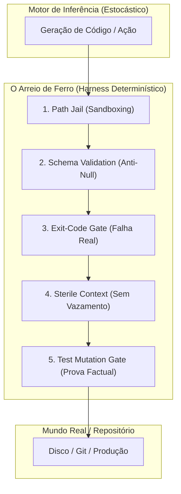

# Capítulo 2: Anatomia de um Harness Real — As 5 Prisões Mecânicas

A palavra **Harness** vem do arreio ou cabresto que você coloca em um cavalo de tração. Você não conversa com o cavalo pedindo: *"Por favor, mantenha o arado alinhado a 15 graus e não pise na plantação de milho"*. Você coloca rédeas, antolhos e um jugo de ferro que limitam mecanicamente os graus de liberdade do animal.

Em engenharia agêntica, **Harness** é o ecossistema de software determinístico (escrito em Go, Rust, Python ou TypeScript) que envolve o modelo de linguagem, filtra suas entradas, intercepta suas ferramentas e audita suas saídas antes que elas toquem o mundo real.

Um Harness de nível industrial é composto por **5 Prisões Mecânicas**:



---

## Prisão 1: Path Jail (Prisão de Caminhos)

O modelo gravou um arquivo em `scratch/` na raiz do projeto em vez de gravar em `docs/videorea/<slug>/scratch/`. Por que isso aconteceu?  
Porque a ferramenta `write_file` ou o binário CLI permitiu que ele passasse qualquer string de caminho.

Em um Harness profissional, a ferramenta de escrita **não recebe um caminho arbitrário**:
* O Harness calcula o workspace isolado: `targetDir = filepath.Join("docs", "videorea", slug)`
* A ferramenta executa uma checagem estrita antes de tocar no disco:
  ```go
  func SafeWrite(targetDir, relativePath string, data []byte) error {
      fullPath := filepath.Clean(filepath.Join(targetDir, relativePath))
      if !strings.HasPrefix(fullPath, targetDir) {
          return fmt.Errorf("VIOLAÇÃO DE PATH JAIL: tentativa de gravar fora de %s", targetDir)
      }
      return os.WriteFile(fullPath, data, 0644)
  }
  ```
Se o modelo tentar colocar `scratch/arquivo.txt`, o Harness aborta com erro fatal. O modelo não tem a opção física de poluir a raiz.

---

## Prisão 2: Schema Validation Jail (Tolerância Zero a Nulos)

No seu caso real com o comando `video-rea forensics`, o modelo gerou este JSON:
```json
{
  "explicit_prompts": null,
  "hidden_prompts": null,
  "tools_identified": ["Claude", "ElevenLabs"],
  "hidden_tools": null,
  "ocr_findings": null
}
```
Isso é lixo computacional. Mas por que o processo continuou? Porque o Go usou `structs` com ponteiros ou campos sem validação mínima de integridade.

Em um Harness blindado, o contrato exige que a validação reprove a saída:
```go
func (d Dossier) ValidateStrict() error {
    if len(d.ExplicitPrompts) == 0 {
        return errors.New("auditoria mecânica: nenhum prompt explícito extraído")
    }
    if len(d.ToolsIdentified) == 0 {
        return errors.New("auditoria mecânica: nenhuma ferramenta mapeada")
    }
    if len(d.OCRFindings) == 0 {
        return errors.New("auditoria mecânica: OCR vazio. Vídeo não foi inspecionado visualmente")
    }
    return nil
}
```
Se o validador falhar, o arquivo **não é salvo como válido**. O comando retorna código de erro e o loop do agente é interrompido imediatamente.

---

## Prisão 3: Exit-Code Hard Gate (Sem Sucesso com Saída Falsa)

Um dos maiores venenos em pipelines com IA é o **falso positivo silencioso**. Um script Python quebra com exception, cospe um stacktrace no stderr, mas não dá `sys.exit(1)`. O Go vê `err == nil` e imprime: *"Pipeline concluído com sucesso!"*.

O modelo lê essa frase e conclui que cumpriu a tarefa.

**Regra inegociável do Harness:**  
Todo comando auxiliar, todo subcomando do CLI e todo script acionado pela IA deve ter seus exit codes auditados. Se a saída padrão estiver vazia ou contiver palavras-chave de erro, o wrapper deve forçar `Exit(1)`. O modelo só deve ver a palavra "Sucesso" quando asserções matemáticas provarem que o arquivo existe, tem tamanho $> 0$ bytes e passou no validador.

---

## Prisão 4: Sterile Context Jail (Janelas Limpas por Bloco)

Outro erro clássico é usar subagentes gigantes ou manter conversas infinitas de 50 turnos no chat. A cada turno, o histórico acumula erros anteriores, tentativas frustradas e desculpas do modelo. O modelo começa a alucinar porque o contexto está contaminado com lixo cognitivo.

O Harness moderno opera em **Contexto Estéril**:
1. O Nó A executa: recebe apenas a entrada necessária e gera o artefato `input.json`.
2. A janela de contexto é **destruída e limpa**.
3. O Nó B executa em uma janela virgem: ele lê apenas o `input.json` validado pelo schema, produz `dossier.json` e encerra.
4. O modelo que renderiza o vídeo **não sabe** e **não precisa saber** como foi a conversa do intake. Ele só recebe o contrato estrito da cena.

Isso elimina o estresse de contexto e reduz o custo de tokens em até 80%.

---

## Prisão 5: Test Mutation Gate (O Teste que Machuca)

O desenvolvedor pede: *"Crie o teste unitário antes do código"*.  
O modelo gera um teste que sempre passa:
```go
func TestScriptEngine(t *testing.T) {
    res := true
    if !res { t.Fatal("erro") }
}
```
Isso é um teste cosmético. Não prova nada.

No Harness avançado, um teste novo só é aceito se o próprio Harness aplicar uma mutação proposital no código de produção e verificar se o teste **falhou com Exit Code != 0**:
* Se o código mutado passou no teste $\rightarrow$ **O teste é inválido e o ticket é rejeitado.**
* Se o código mutado quebrou o teste $\rightarrow$ O teste tem sensibilidade real. Restaura-se o código original e o ticket é aprovado.
