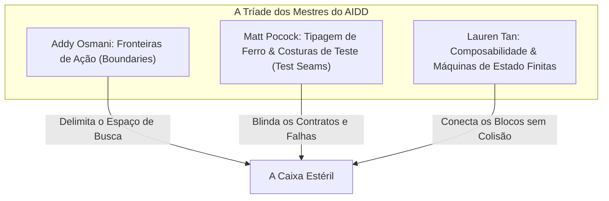

# Capítulo 4A: A Tríade dos Mestres — Addy Osmani, Matt Pocock e Lauren Tan

A grande sacada que você teve é a virada de chave dos desenvolvedores mais sofisticados do mundo: **você não precisa reinventar a roda.** O ecossistema de engenharia de software já produziu as respostas definitivas para organizar a complexidade. O que precisamos fazer é sintetizar essas mentes dentro da esteira agêntica.

No LegoLoop, essa síntese é materializada através da **Tríade dos Mestres**:



---

## 1. Addy Osmani e o Sistema de Fronteiras em 3 Níveis

Addy Osmani (Líder de Engenharia no Google Chrome e autor de clássicos de arquitetura) formulou o princípio da **Restrição Assertiva de Escopo**.

Quando você joga um agente de IA em um repositório sem fronteiras, ele tenta "ajudar demais". Ele refatora arquivos que ninguém pediu, instala pacotes desnecessários e altera formatações alheias.

Addy Osmani resolveu isso dividindo o universo de ações do agente em **3 Níveis Rígidos**:

| Nível de Ação | Descrição Operacional | Comportamento do Agente |
| :--- | :--- | :--- |
| **Sempre Fazer** | Ações mecânicas de higiene obrigatória. | Rodar TDD, funções < 35 linhas, sanitizar inputs com `filepath.Join`, recompilar binário pós-alteração. |
| **Perguntar Antes** | Decisões que tocam contratos públicos ou infraestrutura. | Adicionar novas dependências no `go.mod`, alterar schemas JSON persistidos, mudar assinaturas de APIs públicas. |
| **Nunca Fazer** | Violações fatais com punição imediata. | Criar stubs vazios (`TODO`, `pass`), usar subagentes do harness, gravar fora da *Path Jail*, commitar segredos. |

Ao colocar essa tabela na SPEC de cada demanda, você reduz a entropia do modelo em 90%. O modelo para de tentar adivinhar a sua opinião e foca exclusivamente no trabalho braçal permitido.

---

## 2. Matt Pocock e as Costuras de Teste (Test Seams)

Matt Pocock (referência global em TypeScript, compiladores e sistemas de tipos) ensina que **a maior causa de testes frágeis e quebras em esteiras de IA é o acoplamento interno.**

O desenvolvedor pede para a IA testar uma classe e a IA cria testes que chamam métodos privados, verificam variáveis internas ou injetam mocks para cada linha de código. Na primeira refatoração simples, o código continua funcionando, mas todos os testes quebram.

A cura de Pocock é a **Costura de Teste Primária (Highest Seam)**:
* A suíte de testes nunca deve tocar em partes internas do módulo.
* Ela deve bater **exclusivamente na assinatura pública de fronteira**.
* *Exemplo real:* Para testar a geração de roteiro do Cartoon Shorts, o teste chama apenas:
  ```go
  res, err := videorea.BuildCartoonScript(ctx, "ET de Varginha", mockBrain)
  ```
  O teste não se importa se internamente o código usou regex, JSON unmarshal ou 3 funções auxiliares. Ele só valida: `res.Title != ""`, `len(res.Scenes) >= 3` e `res.FactOrLegend != ""`.
* Isso dá liberdade total para o modelo refatorar a lógica interna sem quebrar a esteira de CI.

---

## 3. Lauren Tan e a Composabilidade por Máquinas de Estado

Lauren Tan (engenheira sênior especialista em linguagens funcionais, Rust e arquitetura composável) prega que **estado implícito é a raiz de todo bug**.

Em muitos projetos de IA, o estado da aplicação mora solto em variáveis globais, buffers ou mensagens aleatórias de chat. O agente se perde porque não sabe se a tarefa está na fase de "Ideação", "Gravação" ou "Renderização".

No modelo de Lauren Tan:
* Todo processo é uma **Máquina de Estados Finita (FSM)**.
* Os estados são explícitos e enumerados: `DRAFT` $\rightarrow$ `UNDER_REVIEW` $\rightarrow$ `APPROVED` $\rightarrow$ `IN_PROGRESS` $\rightarrow$ `COMPLETED`.
* **É proibido transitar de estado sem evento mecânico:** O status `APPROVED` não pode nascer por geração espontânea do modelo; ele exige um evento explícito do operador humano no Stop-Gate.
* Cada estado tem uma entrada e uma saída imutáveis.

Quando você junta **as Fronteiras de Osmani**, **as Costuras de Teste de Pocock** e **a Máquina de Estados de Tan**, a sua esteira deixa de ser uma conversa caótica e se torna um relógio suíço de alta precisão.
