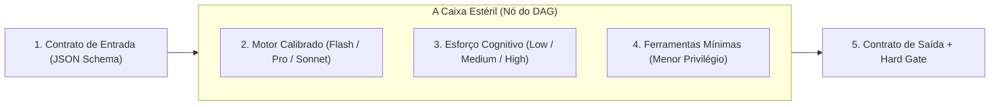

# Capítulo 4B: A Teoria dos Processos e DAGs — Tudo é Algoritmo

Você tocou no âmago da computação com uma pergunta aparentemente simples:  
*"Como eu faço um café? É um processo. Como se faz o pó do café? É outro processo. Tudo na vida é processo e algoritmo?"*

**Sim. Absolutamente tudo na engenharia de software é algoritmo.**

Um algoritmo nada mais é do que uma sequência finita, determinística e inequívoca de instruções que recebe uma entrada, executa transformações e produz uma saída previsível.

Fazer café não é um diálogo filosófico. Você não pode jogar água fria no pó e esperar que o café passe. Você não pode coar a água antes de moer o grão. Existe uma **dependência topológica estrita**:

$$\text{Grão} \xrightarrow{\text{Moer}} \text{Pó} \quad \text{e} \quad \text{Água} \xrightarrow{\text{Aquecer}} \text{Água Quente} \xrightarrow{\text{Filtrar}} \text{Café Pronto}$$

Em computação, essa cadeia tem um nome formal: **Grafo Acíclico Dirigido (DAG - Directed Acyclic Graph)**.

---

## O Colapso dos "Agentes Autônomos Abertos"

Entre 2023 e 2024, a internet foi inundada por frameworks como AutoGPT, BabyAGI e CrewAI, prometendo "agentes autônomos" que resolveriam qualquer problema sozinhos. 

O que aconteceu na prática? **Quase todos colapsaram em ambientes corporativos sérios.** 

Por quê? Porque um agente autônomo sem DAG opera em loop aberto:
1. Ele decide qual é o próximo passo baseado em um prompt genérico;
2. Ele se distrai com um arquivo irrelevante;
3. Ele entra em loop infinito gastando R$ 500 em tokens;
4. Ele tenta consertar o erro criando outro erro e apaga código funcional.

Em dezembro de 2024, a própria **Anthropic** (criadora do Claude) publicou o artigo divisor de águas *"Building Effective Agents"*, onde declarou com clareza cristalina:

> *"Os sistemas de maior sucesso na indústria não são agentes autônomos caóticos. São **Workflows Determinísticos em Grafo**, onde o código tradicional orquestra a sequência de passos e a IA é chamada apenas para executar tarefas específicas e delimitadas dentro de cada nó."*

---

## A Anatomia da Peça Lego em Caixa Estéril

No LegoLoop, nós traduzimos essa verdade na arquitetura da **Caixa Estéril da Peça Lego (LegoPiece)**.

Cada nó do seu DAG não é um chat aberto. Ele é uma caixa blindada com **5 parâmetros rigorosos**:

### 1. Contrato de Entrada Estrito (Input Contract)
O nó nunca recebe o histórico de chat inteiro. Ele recebe apenas um arquivo JSON formal (ex: `input.json`). Se faltar um campo obrigatório, a caixa **nem abre**.

### 2. Motor Cognitivo Calibrado (Model Routing)
Nem toda tarefa precisa do modelo mais caro:
* Para extrair links de um texto ou sanitizar strings: use **Gemini Flash-Lite** ou **Llama-3-8B local** (rápido, barato, 0 alucinação de estrutura).
* Para desenhar a arquitetura técnica e costuras de teste: use **Claude 3.5 Sonnet** ou **Gemini Pro** (profundo, reflexivo).
Usar modelo grande para tarefa burra queima dinheiro e aumenta o tempo de resposta; usar modelo pequeno para arquitetura gera código raso.

### 3. Esforço Cognitivo Ajustado (Cognitive Effort)
* `low`: transformações diretas (parser de data, tradução literal).
* `medium`: geração de código a partir de contratos BDD fechados.
* `high`: dissecação forense de engenharia reversa e resolução de ambiguidades.

### 4. Princípio do Menor Privilégio de Ferramentas (Least Privilege Tools)
Se um nó precisa apenas formatar um roteiro, **ele não pode ter acesso a `bash`, `delete_file` ou `browser_click`**.  
Carregar 30 ferramentas no contexto de um nó gasta milhares de tokens e aumenta drasticamente a chance de o modelo invocar a ferramenta errada. Cada nó recebe apenas as 1 ou 2 ferramentas estritamente necessárias para a sua função.

### 5. Contrato de Saída Validado com Hard Gate
A caixa só é dada como concluída quando o artefato de saída gerado passa na validação mecânica (`schema.Validate()`). Se o validador reprovar, a caixa cospe o erro de volta para o motor corrigir antes de tocar o próximo nó.
