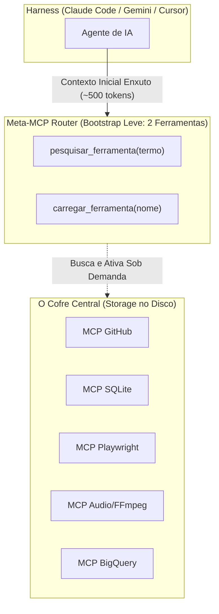

# Capítulo 4C: A Orquestração do Cofre Vivo — Unificando MCPs, Skills e Harnesses

Você fez um raio-X perfeito da sua dor atual:  
*"Eu tenho várias skills no SO, vários MCPs, vários scripts, vários hooks, vários gates... eu tenho tudo aqui! Mas não estou sabendo orquestrar e organizar de forma a usufruir disso tudo."*

Essa é a clássica **Síndrome do Cofre Abarrotado**.

Quando o desenvolvedor começa a criar ou baixar MCPs e Skills, o impulso natural é registrar tudo em todos os harnesses: instala 15 servidores MCP no Claude Code, mais 20 ferramentas no Gemini/Antigravity, mais 30 regras no Cursor e no Windsurf.

**O que acontece quando você faz isso?**

1. **Context Bloat Brutal:** Cada servidor MCP adiciona os schemas completos de suas ferramentas no início de TODA mensagem. Se você tem 20 MCPs com 5 ferramentas cada, são **100 schemas de ferramentas em JSON**. Antes mesmo de você digitar *"olá"*, 30.000 tokens da janela de contexto já foram devorados só com descrições de ferramentas!
2. **Colisão de Intenções (Tool Confusion):** O modelo vê 3 ferramentas que dizem "pesquisar arquivo" (`search_code`, `grep_search`, `find_files`). Ele fica confuso sobre qual chamar e começa a hesitar ou chamar ferramentas redundantes em loop.
3. **Custo e Lentidão Explosivos:** A inferência fica lenta e cada turno custa 10x mais caro.

---

## A Solução da Engenharia Moderna: Lazy Loading e o Meta-MCP Router

Você não carrega todas as ferramentas da sua oficina na sua mochila para trocar uma lâmpada. Você carrega uma chave de fenda. As outras ficam no armário e você só pega se precisar.

No ecossistema de ponta com IA, isso se chama **Lazy Loading de Ferramentas (Carregamento Preguiçoso)**.

O LegoLoop implementou essa solução de forma canônica através do **Meta-MCP Router**:



### Como Funciona na Prática:
1. No início da conversa, o agente é inicializado com **apenas duas ferramentas leves**:
   * `pesquisar_ferramenta`: busca no catálogo de MCPs do SO pelo nome ou especialidade.
   * `carregar_ferramenta`: injeta o schema da ferramenta específica no contexto daquele turno.
2. O contexto inicial cai de **40.000 tokens para míseros 500 tokens**. A atenção do modelo fica 100% livre para raciocinar sobre o seu código.
3. Se o agente precisar mexer no banco de dados, ele chama `carregar_ferramenta("sqlite")`. A ferramenta entra no contexto, ele executa a query e, ao mudar de nó no DAG, o contexto volta a ficar limpo.

---

## A Diferença Entre os Harnesses e o Princípio SSOT

Você perguntou: *"Como que eu registro um MCP no Gemini vs no Claude Code? Cada um é diferente?"*.

Sim, cada harness comercial tem a sua própria idiossincrasia:
* **Claude Desktop / Claude Code:** Usa `claude_desktop_config.json` ou flags de CLI com servidores STDIO via Node/Python.
* **Gemini / Antigravity:** Usa schemas declarativos em JSON dentro de pastas de configuração com suporte a reactive wakeup e sidecars.
* **Cursor / Windsurf:** Usa configurações no `.cursor/mcp.json` e extensões locais.

Se você tentar configurar cada um manualmente na mão, você vai enlouquecer. Em uma semana um fica desatualizado, na outra o caminho quebra.

### A Regra Inviolável: Single Source of Truth (SSOT)
A arquitetura do LegoLoop resolve isso com um princípio de governança estrito:
* Todas as suas peças (Skills, MCPs, Scripts, Hooks e Gates) moram em um único lugar canônico no repositório: na pasta `componentes/` (ou `skills/`).
* Você **nunca edita** a pasta de configuração do Claude ou do Gemini diretamente.
* Você roda um comando único de sincronização:
  ```bash
  legoloop sync-harnesses --apply
  ```
* O binário em Go lê o seu cofre canônico, calcula os hashes SHA-256 e projeta automaticamente as configurações para o Claude Code, Cursor, Windsurf e Antigravity.

Se você atualizar uma skill em um lugar, todos os harnesses recebem a versão atualizada instantaneamente. A complexidade do sistema operacional fica domada pelo código de sincronização.
