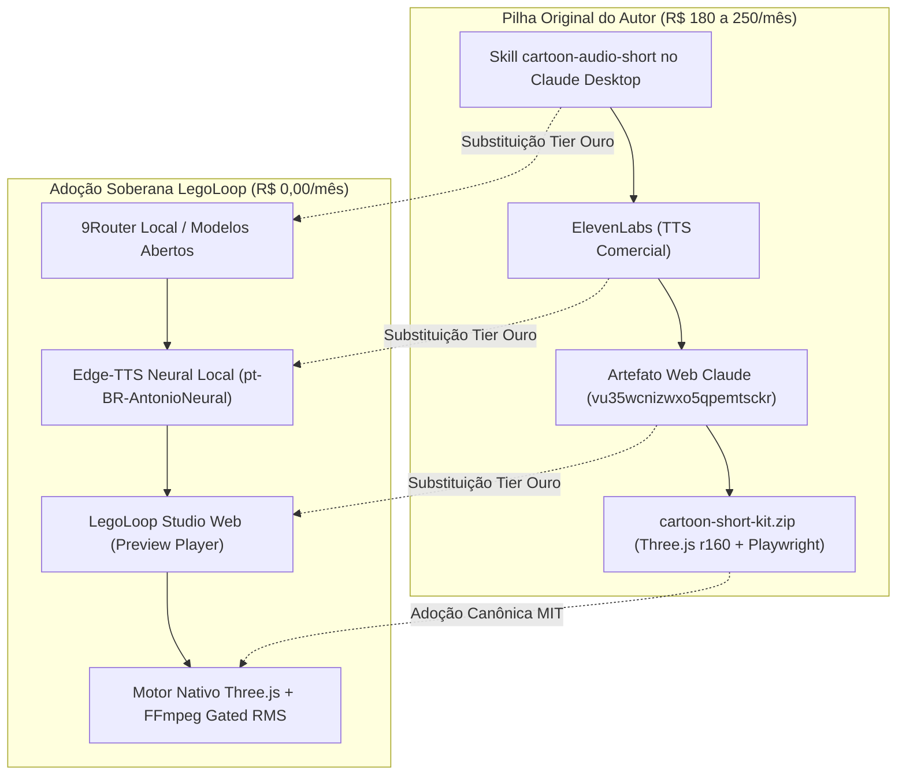

# Introdução ao Pipeline Cartoon Shorts

O formato de animação curta vertical (*Shorts*, *Reels*, *TikTok*) com estética cartoon e narrativa de curiosidades históricas ou científicas se consolidou como um dos maiores vetores de retenção orgânica na internet moderna.

No entanto, a cadeia de produção tradicional é cara e refém de assinaturas proprietárias: Claude Pro ($20/mês), ElevenLabs ($5 a $22/mês), somados a gargalos severos de quota de tokens e montagem manual em editores de vídeo.

O **LegoLoop Cartoon Shorts** é a materialização canônica e 100% soberana desse processo:
* **Custo Zero Fixo:** R$ 0,00/mês.
* **Autonomia Total:** Roteiros otimizados no ritmo de 3.7 palavras/segundo com checagem factual (*Verdade ou Lenda*), síntese neural brasileira de alta expressividade com Edge-TTS local (`pt-BR-AntonioNeural`), renderização 3D/2D procedural via Three.js r160 em resolução 1080x1920 a 30fps e mixagem determinística de áudio com trava *Gated RMS* a -6 dB via FFmpeg.
* **Tríade de Interfaces:** Executável via Linha de Comando (CLI), painel visual do Studio com player de preview integrado e invocação nativa no chat dos agentes via `/legoloop-cartoon-shorts`.


# Capítulo 1: A Origem & Dissecação Forense

O processo nasceu a partir da engenharia reversa do método apresentado pelo canal *Ideias Artificiais*, do criador Leo, em seu vídeo *"Essa skill pouco conhecida cria shorts virais com Claude"*.

A investigação forense conduzida pelo motor `legoloop video-rea` extraiu a verdade factual dos materiais disponibilizados:



## Os 4 Estágios do Método
1. **Intake & Ideação:** Oferta de 10 ideias numeradas estruturadas em: Título (5-8 palavras de alta curiosidade), Linha de Gancho (paradoxo afirmado como fato sem introdução), Twist irônico na última linha e checagem factual (*Verdade ou Lenda*).
2. **Roteiro em Ritmo Musical:** 3.7 palavras por segundo. Para vídeos de 20s = 75 palavras; para 30s = 110 palavras. Fórmula rígida: Hook $\rightarrow$ Setting $\rightarrow$ Escalada $\rightarrow$ Pivot de Mistério $\rightarrow$ Twist Final.
3. **Diretiva de Emoção:** O roteiro recebe anotações expressivas entre colchetes (`[reflexivo]`, `[respira fundo]`, `[pausa curta]`, `[animado]`, `[dá uma risadinha]`) para orientar a entonação da voz neural.
4. **Renderização 3D/2D Híbrida:** Personagens 2D em estilo *bean-head* montados em cartões com contorno de tinta preta, integrados em cenários 3D procedurais e renderizados frame a frame pelo Playwright.


# Capítulo 2: A Arquitetura Visual Three.js & Áudio Gated RMS

A estética distintiva do Cartoon Shorts baseia-se em uma fusão inovadora entre geometria tridimensional e ilustração clássica de quadrinhos.

## 1. O Shader de Tinta (Ink Contract) e Normal/Depth Pass
Ao contrário de animações 3D convencionais com iluminação realista, o motor utiliza um shader customizado em Three.js r160:
* **Normal/Depth Pass:** Em cada quadro, a cena é renderizada primeiro em um buffer que captura apenas as normais das superfícies e a profundidade relativa da câmera.
* **Detecção de Bordas (Sobel/Edge Detection):** Um shader pós-processamento traça linhas de contorno pretas com raio de 2.5px onde quer que haja um salto brusco de profundidade ou uma quina angular.
* **Texturas Pintadas (`paint.js`):** Pranchas de madeira, pedras, grama e azulejos são gerados proceduralmente em Canvas com costuras escuras e baixo contraste interno, garantindo que o traço externo se destaque.

## 2. A Lei do Áudio: Trava Gated RMS a -6 dB
Em vídeos curtos, o maior erro amador é colocar a trilha musical brigando com a voz do narrador.

O pipeline LegoLoop Cartoon Shorts impõe uma **Lei Física de Mixagem**:
* O nível de áudio da voz neural é medido em RMS fechado (*Gated RMS*).
* A trilha musical sintetizada é atenuada de forma precisa para ficar exatamente a **50% do volume da voz (-6.0 dB)**.
* Os efeitos sonoros (SFX) são limitados a picos de no máximo 0.7x o pico da fala.
* O arquivo final é processado pelo filtro `loudnorm` do FFmpeg, cravando **-14 LUFS** de sonoridade e limitador de pico (*true peak*) em **-1 dBFS**.


# Capítulo 3: O Motor de Roteiro & Síntese Soberana Edge-TTS

A alma do short está no gancho dos primeiros 3 segundos. Se a frase de abertura for previsível ou pedir para o usuário curtir o vídeo, a retenção colapsa para menos de 20%.

## A Fórmula do Gancho Imediato (No-Setup Hook)

O motor `BuildCartoonScript` do LegoLoop implementa a diretiva de **Impacto Imediato**:
* A primeira frase é um paradoxo afirmado com naturalidade histórica:
  > *"Uma cidade de Minas ficou famosa por um visitante que ninguém conseguiu provar que existiu."*
  > *"Cientistas deram a um remédio o nome do computador mais perigoso do cinema."*
* Não há saudações (*"Olá pessoal, bem-vindos ao meu canal"*). O vídeo começa com o acontecimento no primeiro frame (Frame 0).

## Síntese de Voz com Edge-TTS

Substituímos o ElevenLabs comercial pelo motor local **Edge-TTS 7.3.1**, utilizando a voz neural `pt-BR-AntonioNeural`:
* **Zero Custo:** Nenhuma cobrança de créditos ou limite de caracteres.
* **Expressividade:** As indicações de interpretação entre colchetes (`[reflexivo]`, `[animado]`) são filtradas para o arquivo de áudio enquanto preservam o timing de respiração e pausas naturais do narrador.
* **Hermetismo:** Em caso de interrupção ou falha de rede, o método remove qualquer arquivo corrompido, evitando áudios quebrados na montagem.


# Capítulo 4: Prática & Operação na Tríade Completa

O pipeline **LegoLoop Cartoon Shorts** oferece três portas de entrada com perfeita paridade operacional:

## 1. Operação via Linha de Comando (CLI)
A interface de terminal permite integração com scripts de automação, cron jobs e pipelines de lote:
```bash
# Execução direta informando o tema
legoloop cartoon-shorts --theme "O Enigma do ET de Varginha"

# Ajuste de duração e voz neural
legoloop cartoon-shorts --theme "A Invenção do Avião" --duration 25 --voice pt-BR-FranciscaNeural

# Validação do contrato em modo dry-run
legoloop cartoon-shorts --theme "Ouro Preto" --dry-run
```

## 2. Operação via Grafo DAG no Looping Engine
Execução sequencial por nós isolados em contexto estéril:
```bash
legoloop run loops/legoloop-cartoon-shorts/pipeline.dag.json
```

## 3. Invocação via Chat dos Agentes
Para criar um novo short em meio a qualquer sessão de desenvolvimento:
```text
/legoloop-cartoon-shorts Como o jogo GTA 6 vazou por uma TV de hotel?
```
O agente acionará o motor, gerará o roteiro de curiosidades com as cenas calibradas, sintetizará o áudio Edge-TTS e devolverá o arquivo `.mp4` compilado pronto para publicação.


