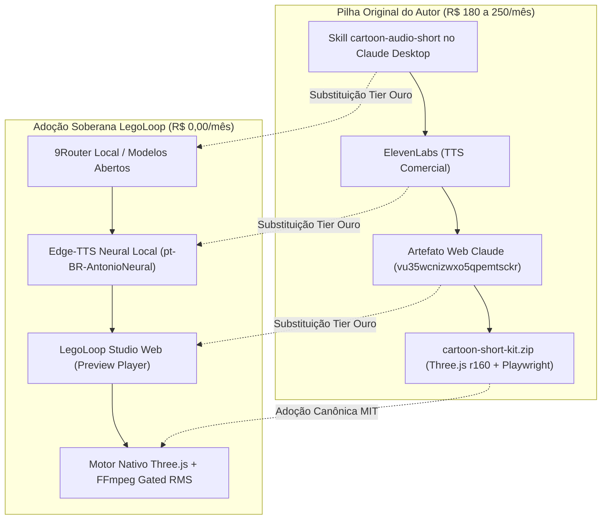

# Capítulo 1: A Origem & Dissecação Forense

O processo nasceu a partir da engenharia reversa do método apresentado pelo canal *Ideias Artificiais*, do criador Leo, em seu vídeo *"Essa skill pouco conhecida cria shorts virais com Claude"*.

A investigação forense conduzida pelo motor `legoloop video-rea` extraiu a verdade factual dos materiais disponibilizados:

## Os 4 Estágios do Método
1. **Intake & Ideação:** Oferta de 10 ideias numeradas estruturadas em: Título (5-8 palavras de alta curiosidade), Linha de Gancho (paradoxo afirmado como fato sem introdução), Twist irônico na última linha e checagem factual (*Verdade ou Lenda*).
2. **Roteiro em Ritmo Musical:** 3.7 palavras por segundo. Para vídeos de 20s = 75 palavras; para 30s = 110 palavras. Fórmula rígida: Hook $\rightarrow$ Setting $\rightarrow$ Escalada $\rightarrow$ Pivot de Mistério $\rightarrow$ Twist Final.
3. **Diretiva de Emoção:** O roteiro recebe anotações expressivas entre colchetes (`[reflexivo]`, `[respira fundo]`, `[pausa curta]`, `[animado]`, `[dá uma risadinha]`) para orientar a entonação da voz neural.
4. **Renderização 3D/2D Híbrida:** Personagens 2D em estilo *bean-head* montados em cartões com contorno de tinta preta, integrados em cenários 3D procedurais e renderizados frame a frame pelo Playwright.
