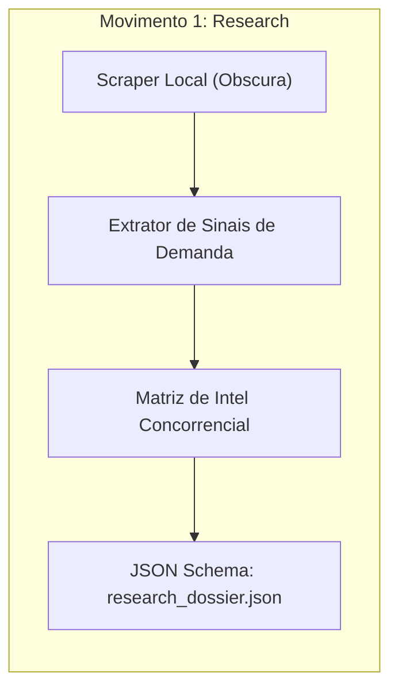
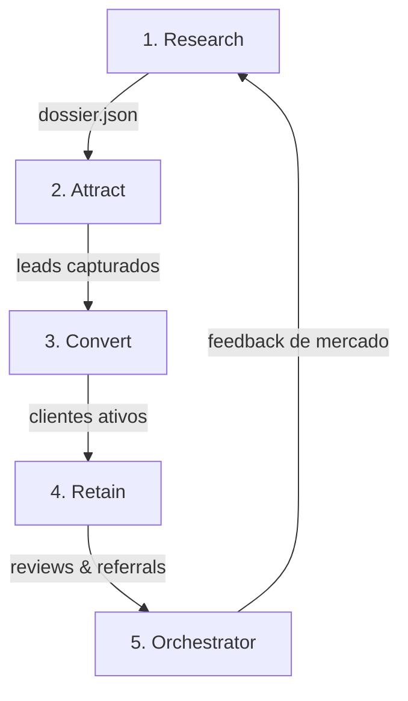

# Como ler este livro

## A quem este livro se destina

1. **Gestores de Tráfego e Profissionais de Growth:** Que precisam escalar geração de leads e qualificação instantânea sem contratar dezenas de ferramentas díspares.
2. **Engenheiros de IA e Arquitetos de Automação:** Que buscam garantias de determinismo, transição de estado sem perda de contexto e eliminação de custos recorrentes de API proprietária.
3. **Fundadores e Empreendedores B2B:** Que desejam entender o motor completo de prospecção, conversão e retenção como um ativo proprietário da empresa.

## O Manifesto da Soberania em Marketing com IA

#painel-teoria("LEI #1: MARKETING NÃO SÃO FERRAMENTAS, SÃO MOVIMENTOS", [
  Agentes de IA não devem ser tratados como robôs desconectados. Cada agente cumpre estritamente uma de cinco funções primordiais em um ciclo virtuoso: entender o mercado antes de gastar, atrair atenção qualificada, converter no menor tempo de resposta, reter clientes e alimentar continuamente o cérebro central.
])

#painel-alerta("LEI #2: PROIBIDO LOCK-IN EM SAAS PROPRIETÁRIO", [
  Plataformas de automação comercial cobram pedágios cumulativos. No LegoLoop, toda a inteligência cognitiva é ancorada em modelos abertos locais (Qwen, Llama) e roteamento eficiente com o 9Router, mantendo os dados de leads confidenciais e o custo operacional zerado.
])

# Parte I — Macro: A Ilusão dos 15 Agentes

## 1.1 O Mito do Sistema Hiper-Fragmentado

No mercado de inteligência artificial aplicada ao marketing, tornou-se comum o discurso de que uma empresa necessita de "15 agentes especializados": um para pesquisa de mercado, outro para SEO local, outro para Google Business Profile, outro para Instagram, outro para velocidade de resposta ao lead, outro para follow-up, e assim por diante.

Esse modelo fragmentado introduz falhas críticas:

* **Deriva de Contexto (Context Drift):** Informações colhidas pelo suposto "Agente de Pesquisa" se perdem antes de chegar ao "Agente de Copywriting".
* **Explosão de Custos:** Cada agente executa chamadas separadas com system prompts redundantes, gerando faturas exorbitantes em APIs fechadas.
* **Falta de Feedback Loop:** Quando um lead é convertido ou cancelado, o aprendizado não retroalimenta a etapa de prospecção.

| Abordagem Fragmentada (15 Agentes) | Abordagem Canônica LegoLoop (5 Movimentos) | Ganho Estrutural |
| :--------------------------------- | :----------------------------------------- | :--------------- |
| 15 system prompts clonados         | 1 DAG acíclica com JSON Schema estrito     | 80% menos tokens |
| Mensalidades SaaS (~R$ 1.200/mês)  | Stack local Tier Ouro (R$ 0,00/mês)        | Custo zero fixo  |
| Decisões soltas e alucinações      | Stop-gates de governança ISO               | Risco zero       |

---

## 1.2 Os 5 Movimentos do Funil Canônico

A desconstrução forense do vídeo prova que todo sistema sustentável de marketing resume-se a 5 operações determinísticas:

1. **Pesquisa (Research):** Conhecer o mercado antes de comprometer qualquer capital financeiro.
2. **Atração (Attract):** Estabelecer presença e autoridade onde os compradores já estão procurando ativamente.
3. **Conversão (Convert):** Transformar atenção dispersa em reuniões e vendas através do menor tempo de resposta (Speed-to-Lead).
4. **Retenção (Retain):** Manter o cliente engajado, capturar reviews espontâneos e criar programas orgânicos de indicação.
5. **Orquestração (Orchestrate):** Um cérebro analítico central que consolida a telemetria diária e retroalimenta o primeiro movimento.

# Parte II — Meso: Movimentos de Inteligência e Atração

## 2.1 Movimento 1: Pesquisa de Mercado e Sinais de Demanda

O primeiro nó do pipeline tem uma única missão: impedir que a empresa queime orçamento em suposições infundadas.

### Componentes Soberanos do Movimento:
* **Intel de Concorrentes:** Mapeamento de ofertas, precificação e gaps de atendimento dos competidores locais.
* **Sinais de Demanda:** Análise semântica de termos de busca em alta e dores recorrentes em fóruns e avaliações públicas.
* **Auditoria de Palavras-Chave:** Seleção das intenções de busca comerciais de fundo de funil.

#painel-sucesso("CONTRATO DE SAÍDA: research_dossier.json", [
  O resultado da etapa de pesquisa é um arquivo JSON imutável contendo os 3 principais diferenciais da concorrência, o teto de preço praticado na praça e a lista de 10 palavras-chave prioritárias. Nenhuma campanha é disparada sem este dossiê aprovado.
])

## 2.2 Movimento 2: Atração Orgânica e SEO Local

Com o dossiê de inteligência validado, o sistema executa o movimento de captura de tráfego orgânico de alta intenção.

### Pilares de Atração:
1. **Google Business Profile (GBP):** Otimização metódica de títulos de serviços, descrições ricas em semântica geo-localizada e postagens com palavras-chave de intenção imediata.
2. **Local SEO Estruturado:** Geração procedural de landing pages estáticas e leves (HTML/CSS puro) otimizadas com Schema.org (LocalBusiness, AggregateRating).
3. **Conteúdo em Formato Curto (Shorts / Carrosséis):** Sínteses visuais geradas a partir de templates de alta retenção para atrair o público topo de funil.

#painel-teoria("O PRINCÍPIO DA LOCALIDADE", [
  Em negócios locais e serviços especializados, o cliente compra de quem aparece primeiro no mapa do Google com mais de 50 avaliações 5 estrelas. O sistema prioriza a dominação do GBP antes de alocar verba em tráfego pago.
])

# Parte III — Meso: Conversão Rápida e Retenção Ativa

## 3.1 Movimento 3: Conversão e Speed-to-Lead

O fator determinante para a conversão de leads digitais não é o design da página, mas o tempo decorrido entre o envio do formulário e o primeiro contato humano/qualificado (a métrica de *Speed-to-Lead*).

### Protocolo de Conversão em 3 Fases:
* **Intake & Triagem:** Formulário semântico com validação instantânea via webhook.
* **Speed-to-Lead (< 60 segundos):** Disparo automatizado de mensagem WhatsApp / SMS personalizada contendo uma pergunta aberta de qualificação.
* **Qualificação Pré-Reunião:** Agente de triagem verifica orçamento, urgência e autoridade do lead antes de liberar a agenda do consultor.

#painel-perigo("O CUSTO DA DEMORA", [
  Leads contatados após 5 minutos têm uma probabilidade 8 vezes menor de qualificação em comparação àqueles contatados no primeiro minuto. O agente de Speed-to-Lead opera como daemon permanente no host.
])

## 3.2 Movimento 4: Retenção e Ciclos de Indicação

Clientes conquistados devem se transformar no canal de aquisição mais barato da empresa.

### A Esteira de Retenção:
1. **Follow-Up Pós-Serviço:** Checagem de satisfação em 24h e 7 dias após a conclusão do projeto.
2. **Coleta de Avaliações (Reviews Engine):** Disparo de link direto para o Google Reviews quando a nota interna de NPS for igual a 9 ou 10.
3. **Mecanismo de Indicação (Referral Loop):** Incentivo automático para clientes satisfeitos indicarem parceiros em troca de benefícios ou descontos recorrentes.

#painel-alerta("O LOOP VIRAL", [
  Cada novo review positivo conquistado no Google Reviews retroalimenta o Movimento 1 (Pesquisa), melhorando a autoridade no Movimento 2 (Atração) e barateando o CAC global da operação.
])

# Parte IV — Micro: Orquestração em DAG e Governança

## 4.1 O Cérebro Central do Sistema

O quinto movimento não cria conteúdo nem conversa com clientes: ele é o maestro que gerencia o fluxo de dados entre os 4 movimentos anteriores.

### Contrato do Grafo Acíclico Dirigido:
* **Entrada:** `market_brief.json`
* **Processamento:** 5 nós estéreis isolados
* **Saída:** `daily_marketing_report.json` com telemetria de leads, conversão, custo por aquisição e gargalos do funil.

# Parte V — Operação & Soberania Tier Ouro

## 5.1 Extinção de Mensalidades de Software

A tabela a seguir demonstra a eliminação total de SaaS comerciais proprietários identificados na matriz original:

| Ferramenta Proprietária | Função Original          | Substituto Tier Ouro LegoLoop | Economia Mensal |
| :---------------------- | :----------------------- | :---------------------------- | :-------------- |
| Claude Pro              | Geração e inteligência   | **9Router Local / Modelos Abertos** | R$ 110,00       |
| Zapier / Make Pro       | Orquestração de webhooks | **LegoLoop Orchestrix Local** | R$ 180,00       |
| GoHighLevel             | CRM e Speed-to-lead      | **Scripts Locais + SQLite**   | R$ 560,00       |
| **Custo Consolidado**   | **Pilha Comercial**      | **R$ 0,00 / mês**             | **R$ 850,00/mês** |

#painel-sucesso("CONCLUSÃO & REPRODUTIBILIDADE", [
  O pipeline de marketing multi-agente está canonizado como uma peça interoperável do LegoLoop. Qualquer operador pode disparar o ciclo completo através do comando `legoloop run loops/video-001-claude-marketing-system/pipeline.dag.json` sem depender de serviços externos.
])

