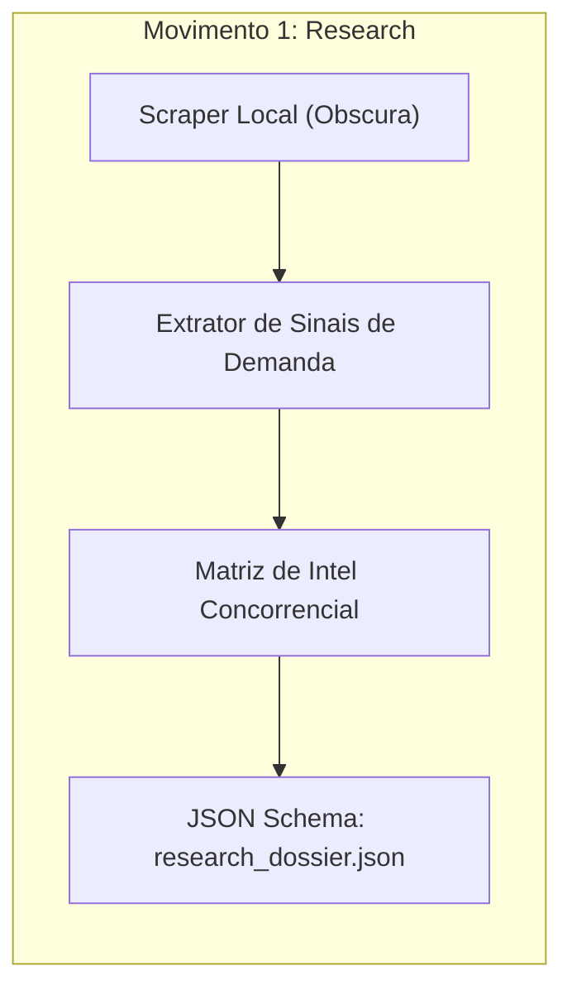

# Parte II — Meso: Movimentos de Inteligência e Atração

## 2.1 Movimento 1: Pesquisa de Mercado e Sinais de Demanda

O primeiro nó do pipeline tem uma única missão: impedir que a empresa queime orçamento em suposições infundadas.

### Componentes Soberanos do Movimento:
* **Intel de Concorrentes:** Mapeamento de ofertas, precificação e gaps de atendimento dos competidores locais.
* **Sinais de Demanda:** Análise semântica de termos de busca em alta e dores recorrentes em fóruns e avaliações públicas.
* **Auditoria de Palavras-Chave:** Seleção das intenções de busca comerciais de fundo de funil.

#painel-sucesso("CONTRATO DE SAÍDA: research_dossier.json", [
  O resultado da etapa de pesquisa é um arquivo JSON imutável contendo os 3 principais diferenciais da concorrência, o teto de preço praticado na praça e a lista de 10 palavras-chave prioritárias. Nenhuma campanha é disparada sem este dossiê aprovado.
])
