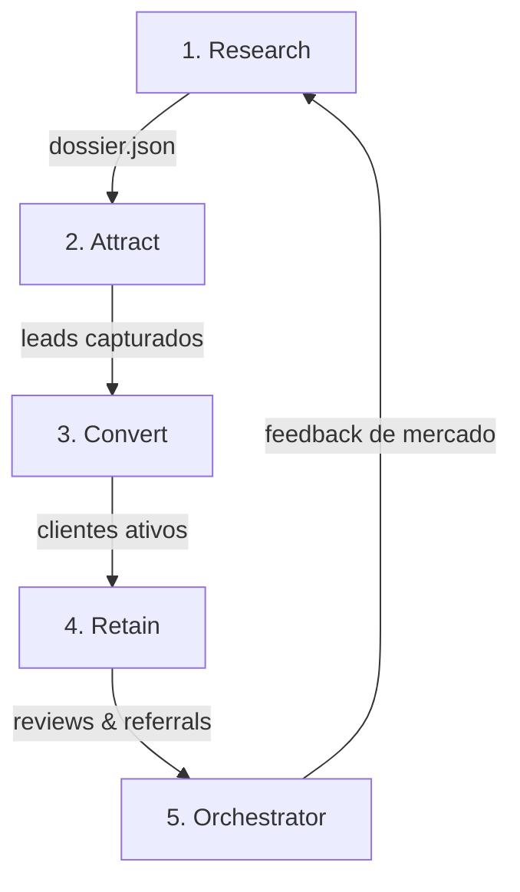

# Parte IV — Micro: Orquestração em DAG e Governança

## 4.1 O Cérebro Central do Sistema

O quinto movimento não cria conteúdo nem conversa com clientes: ele é o maestro que gerencia o fluxo de dados entre os 4 movimentos anteriores.

### Contrato do Grafo Acíclico Dirigido:
* **Entrada:** `market_brief.json`
* **Processamento:** 5 nós estéreis isolados
* **Saída:** `daily_marketing_report.json` com telemetria de leads, conversão, custo por aquisição e gargalos do funil.
