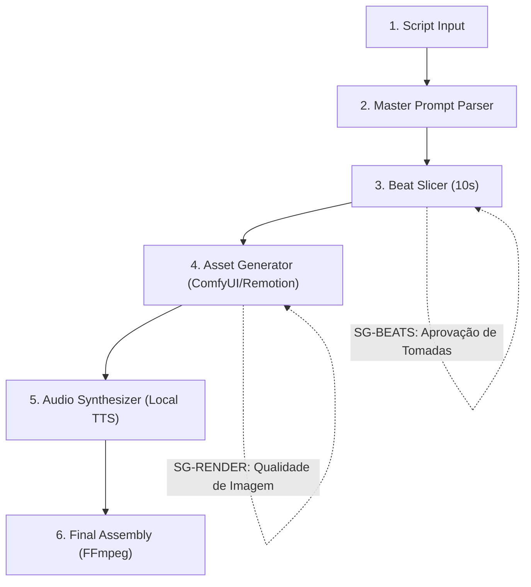

# Como ler este livro

## A quem este livro se destina

1. **Motion Designers e Animadores:** Que desejam acelerar sua produtividade eliminando tarefas braçais de animação vetorial básica.
2. **Criadores de Vídeo e Educadores:** Que necessitam ilustrar conceitos complexos com gráficos dinâmicos sem estourar o orçamento de produção.
3. **Desenvolvedores Full-Stack e Engenheiros de IA:** Que buscam construir esteiras automatizadas de geração de vídeo sob demanda.

#painel-teoria("O PARADIGMA PROCEDURAL", [
  Animação moderna não é sobre mover curvas de Bézier manualmente. É sobre definir regras geométricas estritas, paletas de cores padronizadas e disparar transições dinâmicas a partir de eventos narrativos precisos.
])


# Parte I — Macro: O Paradigma do Motion Procedural

## 1.1 A Crise do Motion Design Artesanal

Criar animações gráficas profissionais para explicar conceitos abstratos (tecnologia, finanças, dados) sempre foi um dos processos mais lentos e caros do mercado audiovisual:

* **Horas por Cena:** O designer gasta em média 4 horas para animar uma única cena de 10 segundos no After Effects.
* **Inconsistência Visual:** Ao utilizar múltiplos freelancers ou modelos de IA soltos, a identidade visual se perde completamente.
* **Dependência de SaaS:** Plataformas que geram vídeos em nuvem cobram créditos caros por segundo e impõem marcas d'água restritivas.

---

## 1.2 A Solução: A Metodologia do Master Prompt

A dissecação do método ReachMora estabelece três princípios fundamentais:

1. **Extração de Design Tokens:** Cores primárias, fontes, pesos de traço e raios de curvatura são extraídos de referências visuais e codificados em variáveis reutilizáveis.
2. **Master Prompt Estruturado:** Um prompt mestre paramétrico que aceita o resumo do roteiro e devolve especificações exatas de câmera, movimento e elementos de cena.
3. **Modularidade em Beats de 10 Segundos:** Roteiros não são renderizados como um bloco maciço; são fracionados em tomadas atômicas de 10 segundos perfeitamente sincronizadas com a locução.


# Parte II — Meso: Engenharia do Master Prompt

## 2.1 Anatomia de um Master Prompt Resiliente

O Master Prompt é a peça central que governa a coerência de todas as tomadas geradas:

```
[ESTILO VISUAL BASE]
Minimalist 3D isometric flat design, clean corporate palette (#0f172a, #8b5cf6, #ffffff).

[REGRAS DE CÂMERA]
Slow dynamic push-in, 45 degree top-down angle, isometric projection, zero chromatic aberration.

[PARÂMETROS DE MOVIMENTO]
Smooth spring animation, ease-out-cubic velocity curve, floating geometric cards.

[SLOT DE CENA]
Beat narrativo: {cena_descricao}
Palavra de ênfase: {palavra_chave}
```

#painel-sucesso("ZERO ALUCINAÇÃO DE ESTILO", [
  Ao fixar a paleta e os ângulos de câmera nas regras negativas do prompt, o modelo cognitivo é proibido de inventar novos estilos visuais no meio da narrativa.
])


## 2.2 Fatiamento de Roteiro em Beats Visuais

Um roteiro narrativo típico possui entre 120 e 150 palavras por minuto. O pipeline do LegoLoop calcula matematicamente a divisão em tomadas:

| Trecho do Roteiro (Voz) | Duração Estimada | Beat Visual Gerado |
| :---------------------- | :--------------- | :----------------- |
| "Quer criar motion graphics sem gastar horas no After Effects?" | 00:00 - 00:08 (8s) | Card flutuante 3D com cronômetro acelerado |
| "Neste tutorial, vou te mostrar o fluxo completo do Master Prompt..." | 00:08 - 00:18 (10s) | Desdobramento isométrico de 4 nós conectados |
| "Usaremos modelos locais e renderização em código a custo zero." | 00:18 - 00:28 (10s) | Gráfico de barras com economia financeira |

#painel-alerta("REGRA DE OURO DO TEMPO", [
  Nenhum beat visual pode ultrapassar 10 segundos. O cérebro humano perde a retenção visual se a cena permanecer estática por mais de 4 segundos sem movimento dinâmico de câmera.
])


# Parte III — Meso: Curadoria Soberana de Assets

## 3.1 Substituição de Serviços Proprietários

O criador original utiliza uma pilha comercial que inclui Google Flow, ElevenLabs e CapCut. A engenharia reversa do LegoLoop substitui cada nó por equivalentes Tier Ouro:

1. **Geração Visual (Substituindo Google Flow):** Orquestração local via ComfyUI com modelo FLUX ou geração procedural via Remotion/HTML Canvas.
2. **Voz Sintética (Substituindo ElevenLabs):** Piper TTS ou WhisperX com modelos neurais locais de alta fidelidade sem custo por caractere.
3. **Edição e Montagem (Substituindo CapCut):** Remotion CLI e FFmpeg para mesclagem determinística de áudio e vídeo em 1080p60.

#painel-teoria("SOBERANIA TOTAL", [
  A esteira opera 100% desconectada da internet, garantindo que projetos confidenciais de clientes nunca vazem para servidores em nuvem.
])


# Parte IV — Micro: Montagem Determinística e Código

## 4.1 Composição via Remotion e FFmpeg

A montagem final é orquestrada através de um script de timeline programática:

```typescript
import { Composition, Sequence } from 'remotion';
import { SceneCard } from './components/SceneCard';

export const MotionFlowComposition = () => {
  return (
    <Composition
      id="MasterMotion"
      component={SceneSequence}
      durationInFrames={1800} // 60s @ 30fps
      fps={30}
      width={1920}
      height={1080}
    />
  );
};
```

O comando de compilação headless do pipeline executa:
```bash
npx remotion render src/index.ts MasterMotion dist/final_render.mp4 --codec h264 --crf 18
```


## 4.2 Topologia DAG e Stop-Gates



### Stop-Gates Invioláveis:
* **SG-BEATS:** O operador aprova a lista de tomadas e palavras-chave antes de iniciar a renderização gráfica.
* **SG-RENDER:** Verificação de nitidez e ausência de artefatos visuais nos primeiros 3 segundos de cada clipe.


# Parte V — Operação & Governança

## 5.1 Telemetria de Produção e Custos

| Métrica de Produção | Fluxo Proprietário (Original) | Pipeline LegoLoop (Soberano) |
| :------------------ | :---------------------------- | :--------------------------- |
| Custo de Software   | R$ 180,00 / mês               | **R$ 0,00 / mês**            |
| Tempo de Render     | 15 min (Upload/Download nuvem)| **3.5 min (NVENC Local)**    |
| Resolução Máxima    | 1080p comprimido              | **4K ProRes / H.264 High**   |
| Direitos Autorais   | Termos de serviço de SaaS     | **100% Código Autoral**      |

#painel-sucesso("STATUS CANÔNICO", [
  O pipeline `video-002-reachmora-motion-flow` foi integrado ao ecossistema LegoLoop como ativo de primeira classe.
])


