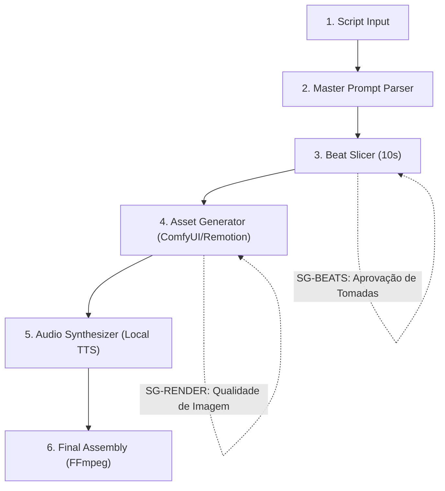

## 4.2 Topologia DAG e Stop-Gates

### Stop-Gates Invioláveis:
* **SG-BEATS:** O operador aprova a lista de tomadas e palavras-chave antes de iniciar a renderização gráfica.
* **SG-RENDER:** Verificação de nitidez e ausência de artefatos visuais nos primeiros 3 segundos de cada clipe.
