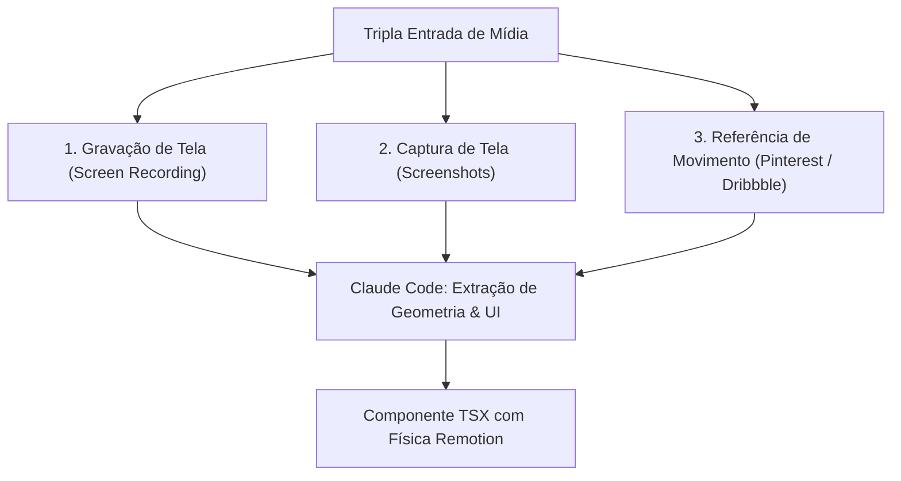
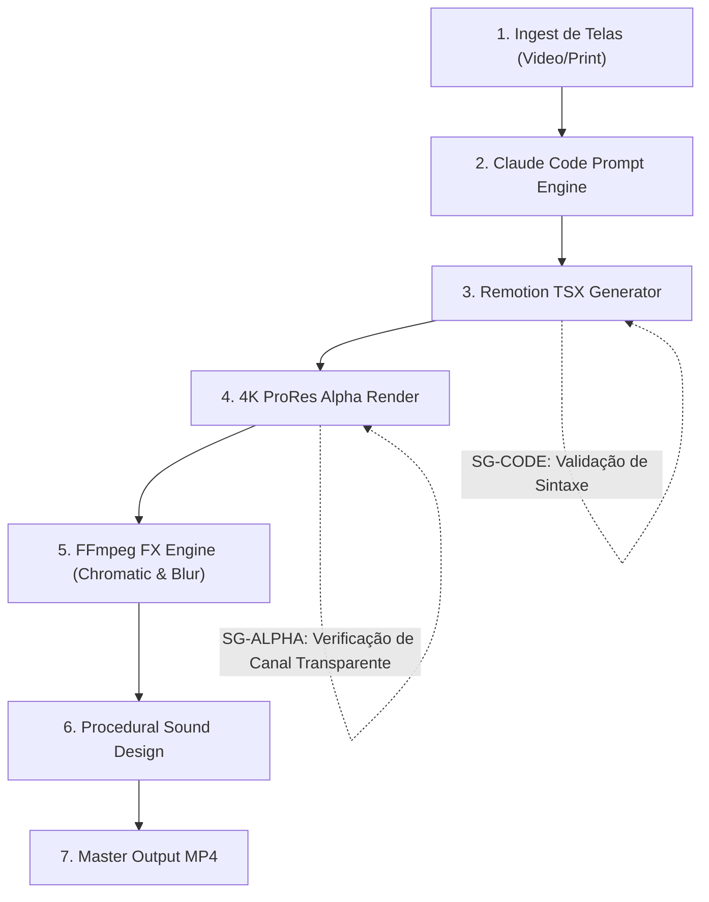

# Como ler este livro

## A quem este livro se destina

1. **Desenvolvedores Frontend e Engenheiros de Software:** Que desejam criar materiais promocionais e vídeos de produto utilizando suas ferramentas naturais (Node.js, React, Tailwind e Git).
2. **Editores Profissionais e Criadores de YouTube:** Que buscam um diferencial estético premium para elevar o valor percebido de seus tutoriais e vídeos técnicos.
3. **Agências e Produtoras Digitais:** Que precisam padronizar a produção de videografismos sem custos com plugins proprietários de After Effects.

#painel-teoria("A MORTE DOS KEYFRAMES MANUAIS", [
  Ajustar curvas de velocidade na mão em dezenas de camadas é um anacronismo. O Remotion utiliza funções de mola física (`spring()`) que calculam velocidade, amortecimento e massa matematicamente, produzindo um movimento orgânico impossível de obter manualmente sem horas de ajuste.
])


# Parte I — Macro: A Filosofia do Zero Keyframes

## 1.1 O Fim da Animação Tradicional

Durante décadas, o padrão da indústria para animações gráficas em vídeo foi o Adobe After Effects. Criar um elemento simples — como uma barra de pesquisa que surge na tela, digita um comando e se expande — exigia:

* Criação de camadas de forma vetoriais separadas;
* Marcação de dezenas de keyframes de posição, escala e opacidade;
* Ajuste manual no *Graph Editor* para simular aceleração e desaceleração;
* Qualquer alteração no texto ou nas dimensões exigia refazer a animação inteira.

---

## 1.2 Por que Código Supera Softwares Gráficos

O método de Matt Loui inverte completamente essa lógica:

1. **Reutilização Absoluta:** Um componente React animado pode ser instanciado 100 vezes com diferentes textos, imagens e dimensões sem reescrever a animação.
2. **Precisão Matemática:** O cálculo de frames é exato ao milissegundo, evitando artefatos de interpolação e perda de frames.
3. **Poder da IA como Programadora:** Modelos de código (Claude Code, Sonnet, Gemini Flash) entendem perfeitamente a API do Remotion e geram layouts complexos em segundos a partir de um prompt conciso.

| Dimensão Técnica | Animação em After Effects | Animação em Remotion + Claude |
| :--------------- | :------------------------ | :---------------------------- |
| Criação de Cena  | 45 minutos manuais        | 2 minutos via prompt          |
| Alteração de Texto| Refazer keyframes         | Mudar uma prop no JSON        |
| Renderização     | Bloqueia a máquina        | Headless via terminal         |
| Versionamento    | Binário `.aep` opaco      | Git puro com diff linha a linha |


# Parte II — Meso: A Tríade de Entradas de Matt Loui

## 2.1 Os Três Modos de Alimentação do Sistema

O grande segredo que impede as animações de parecerem "conteúdo genérico de IA" é que o modelo nunca inventa o layout do zero. O criador alimenta o Claude através de três modalidades estritas:



### 1. Gravação Real de Tela (Screen Recording):
O usuário grava um vídeo de 5 segundos demonstrando a ferramenta real funcionando. O modelo extrai os elementos da interface (botões, campos de busca, cursores do mouse) e recria a cena como código vetorial limpo.

### 2. Capturas de Tela (Screenshots):
Três ou quatro prints do fluxo de trabalho. O modelo organiza essas imagens em cartões 3D flutuantes com sombras suaves e transição escalonada.

### 3. Vídeo de Referência (Pinterest / Dribbble):
Um clipe de referência com uma tipografia cinética de alto padrão. O modelo analisa a aceleração e recria exatamente a mesma física no Remotion.


# Parte III — Meso: Engenharia de Código e Física de Molas

## 3.1 A Linha de Prompt Essencial

No vídeo dissecado, Matt Loui revela que 80% do resultado depende de uma instrução precisa dada ao Claude Code:

#painel-sucesso("A LINHA DE PROMPT MESTRA", [
  *"Create a Remotion component matching this reference. Use the `spring()` function with mass: 0.5, damping: 12, stiffness: 100 for all transitions. Keep dimensions modular via props and ensure a transparent background."*
])

### 3.2 O Poder da Física Spring

Em vez de interpolações lineares duras, o Remotion calcula o movimento através de física real:

```typescript
import { spring, useCurrentFrame, useVideoConfig } from 'remotion';

export const AnimatedCard = () => {
  const frame = useCurrentFrame();
  const { fps } = useVideoConfig();

  const scale = spring({
    frame,
    fps,
    config: {
      damping: 12,
      mass: 0.5,
      stiffness: 100,
    },
  });

  return (
    <div style={{ transform: `scale(${scale})` }} className="card-glass">
      <h2>Interface Real</h2>
    </div>
  );
};
```


# Parte IV — Meso: Render 4K e Canal Alpha

## 4.1 O Segredo da Transparência Perfeita

Para que as animações gráficas possam ser sobrepostas em qualquer vídeo de fundo sem mascaramentos imperfeitos ou telas pretas, a exportação deve conter o canal Alpha transparente.

### Configuração de Renderização Headless:
```bash
npx remotion render src/index.ts PromptBar dist/overlay.mov   --pixel-format yuva444p10le   --codec prores   --prores-profile 4444   --image-format png
```

#painel-alerta("POR QUE PRORES 4444?", [
  O formato ProRes 4444 preserva 100% da transparência com qualidade sem perdas (lossless) em 4K. O arquivo pode ser solto diretamente na timeline do CapCut, Premiere ou DaVinci sem qualquer conversão.
])


# Parte V — Micro: Acabamento e Sonorização

## 5.1 Os Três Efeitos de Acabamento de Matt Loui

No tutorial original, o criador gasta 5 minutos dentro do CapCut aplicando três efeitos manuais que transformam uma animação digital comum em uma peça cinematográfica:

1. **Aberração Cromática nas Bordas (Chromatic Edges):** Separação sutil dos canais RGB nas extremidades da tela, simulando a refração óptica de uma lente real de cinema.
2. **Blur Radial nos Cantos (Radial Blur 2):** Desfocamento sutil de vinheta circular que puxa o olhar do espectador para o centro dinâmico do vídeo.
3. **Sonorização na Frenagem (Sound Design):** Inserção sincronizada de efeitos sonoros de transição:
   * *Whoosh:* No início do movimento de aceleração;
   * *UI Pop / Click:* No momento exato em que a mola física atinge o ponto de frenagem;
   * *Line Sound / Swish:* Ao traçar linhas ou bordas.

---

## 5.2 A Substituição Soberana via FFmpeg Determinístico

O LegoLoop extirpa a necessidade de aplicar esses efeitos manualmente no CapCut Pro. Um script Python orquestra filtros de FFmpeg e mesclagem de áudio com precisão de frame:

```bash
ffmpeg -i overlay.mov -i fundo.mp4 -i whoosh.wav -i pop.wav   -filter_complex "[0:v]chromatic_aberration=0.002,radial_blur=radius=0.1[v_fx]; [1:v][v_fx]overlay=0:0[out_v]; [2:a]adelay=400|400[a1]; [3:a]adelay=750|750[a2]; [a1][a2]amix=inputs=2[out_a]"   -map "[out_v]" -map "[out_a]" -c:v libx264 -crf 17 dist/final_master.mp4
```


# Parte VI — Micro: Arquitetura DAG e Governança

## 6.1 Topologia do Grafo Acíclico Dirigido



### Stop-Gates Human-in-the-Loop:
* **SG-CODE:** Validação estática de TypeScript para garantir zero erros de tipagem antes de acionar a GPU.
* **SG-ALPHA:** Smoke test determinístico de 1 segundo para certificar que o fundo do vídeo é 100% transparente.


# Parte VII — Soberania & Conclusão

## 7.1 Balanço de Soberania e Economia

| Recurso Utilizado       | Solução Proprietária Original | Solução Soberana LegoLoop | Economia Mensal |
| :---------------------- | :---------------------------- | :------------------------ | :-------------- |
| Geração de Código       | Claude Pro (`US$ 20/mês`)     | **9Router Local (Custo $0)**| R$ 110,00       |
| Pós-Produção de Efeitos | CapCut Pro (`R$ 39/mês`)      | **FFmpeg Filtergraph**    | R$ 39,00        |
| Render de Animação      | After Effects (`US$ 35/mês`)  | **Remotion CLI Headless** | R$ 190,00       |
| **Custo Total**         | **Pilha Proprietária**        | **R$ 0,00 / mês**         | **R$ 339,00/mês**|

#painel-sucesso("CANONIZAÇÃO HOMOLOGADA", [
  O pipeline `video-003-mattloui-remotion-capcut` cumpre integralmente todas as Leis Invioláveis de Governança do LegoLoop. O livro didático, o contrato de DAG e a skill estão sincronizados e distribuídos em todos os harnesses.
])


