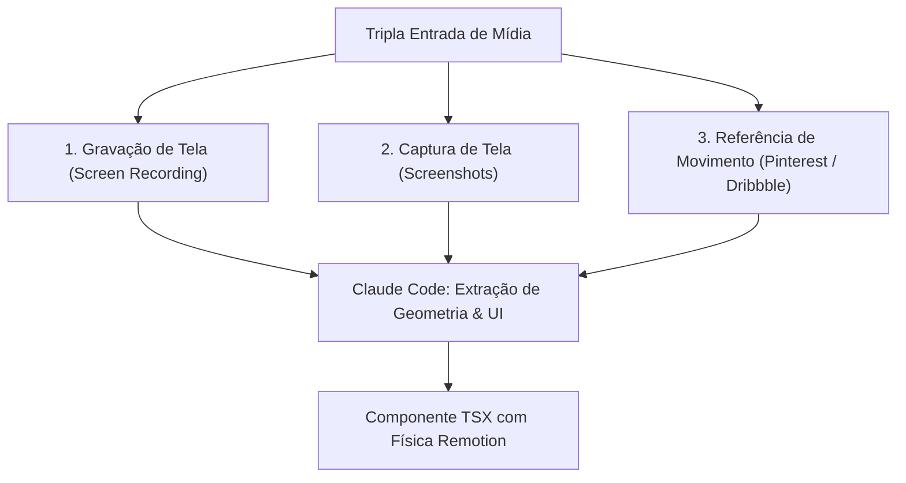

# Parte II — Meso: A Tríade de Entradas de Matt Loui

## 2.1 Os Três Modos de Alimentação do Sistema

O grande segredo que impede as animações de parecerem "conteúdo genérico de IA" é que o modelo nunca inventa o layout do zero. O criador alimenta o Claude através de três modalidades estritas:

### 1. Gravação Real de Tela (Screen Recording):
O usuário grava um vídeo de 5 segundos demonstrando a ferramenta real funcionando. O modelo extrai os elementos da interface (botões, campos de busca, cursores do mouse) e recria a cena como código vetorial limpo.

### 2. Capturas de Tela (Screenshots):
Três ou quatro prints do fluxo de trabalho. O modelo organiza essas imagens em cartões 3D flutuantes com sombras suaves e transição escalonada.

### 3. Vídeo de Referência (Pinterest / Dribbble):
Um clipe de referência com uma tipografia cinética de alto padrão. O modelo analisa a aceleração e recria exatamente a mesma física no Remotion.
