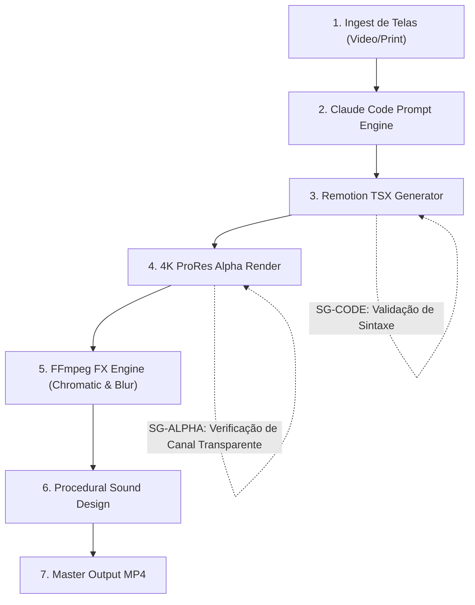

# Parte VI — Micro: Arquitetura DAG e Governança

## 6.1 Topologia do Grafo Acíclico Dirigido

### Stop-Gates Human-in-the-Loop:
* **SG-CODE:** Validação estática de TypeScript para garantir zero erros de tipagem antes de acionar a GPU.
* **SG-ALPHA:** Smoke test determinístico de 1 segundo para certificar que o fundo do vídeo é 100% transparente.
