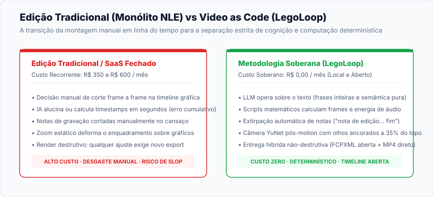
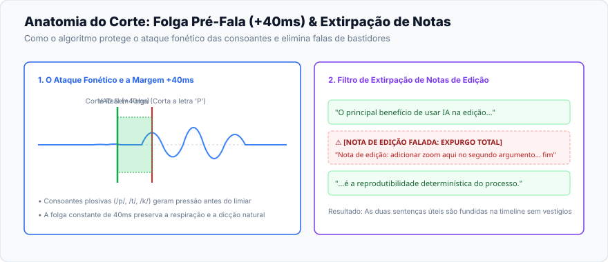
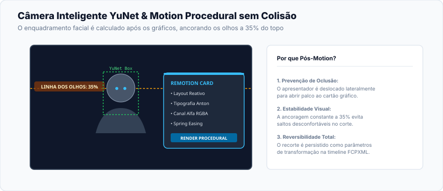
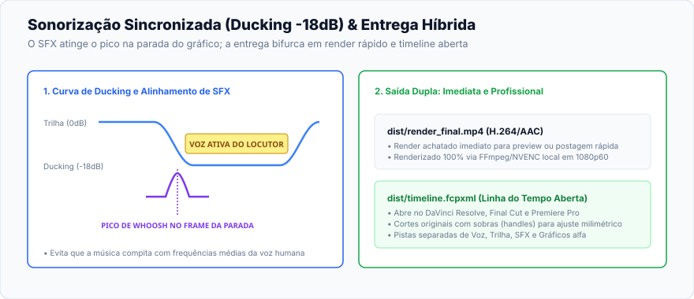
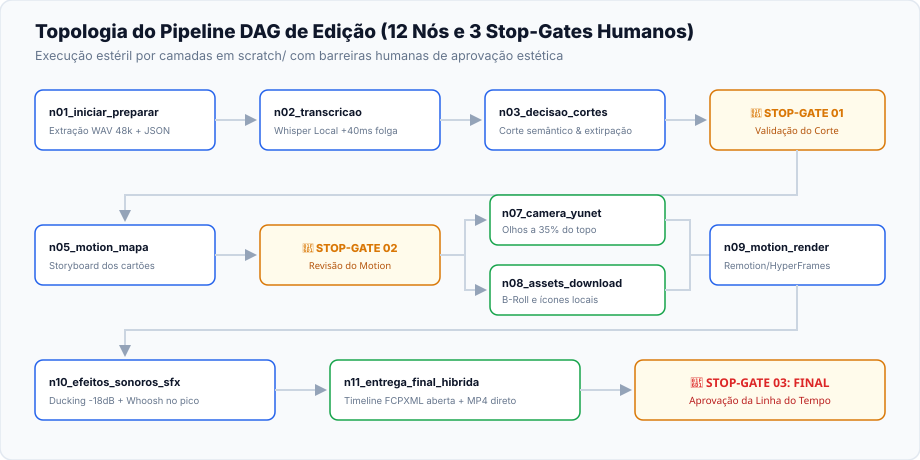

# Como ler este livro

## A quem este livro se destina

Esta obra foi estruturada para atender três perfis complementares do ecossistema audiovisual e tecnológico:

1. **Criadores de Conteúdo e Editores de Vídeo:** Que desejam automatizar o trabalho repetitivo e exaustivo de corte de silêncios, enquadramento dinâmico e inserção de cartões gráficos, sem abrir mão do controle artístico final sobre a narrativa e sem depender de ferramentas fechadas com assinaturas abusivas em dólar.
2. **Engenheiros de IA e Desenvolvedores de Agentes:** Que precisam de garantias formais de determinismo, tolerância zero a alucinações de timestamps e contratos de dados estritos entre modelos cognitivos de linguagem (LLMs) e motores pesados de processamento de mídia (FFmpeg, NVENC, Node.js).
3. **Líderes de Operações de Mídia e Produtoras:** Que buscam padronizar esteiras industriais de pós-produção com medição auditável de tokens, custos financeiros por minuto renderizado e entrega não-destrutiva em timelines abertas (FCPXML/EDL) compatíveis com estações DaVinci Resolve e Premiere Pro.

## A Estrutura da Obra (Macro $\rightarrow$ Meso $\rightarrow$ Micro)

A narrativa deste manual segue o rigor didático do LegoLoop:

* **Parte I — Macro (Fundação & Filosofia do Video as Code):** Contrasta a edição tradicional baseada em monólitos NLE proprietários com a esteira soberana e estabelece a Lei Áurea da Separação Rígida entre cognição textual e precisão matemática de frames.
* **Parte II — Meso (Os 13 Guias Autorais e a Engenharia de Pós-Produção):** Detalha exaustivamente cada um dos 13 pilares do método de Lucas Leite: alinhamento fonético com pre-roll de +40ms, extirpação automática de notas de gravação, enquadramento facial YuNet pós-motion a 35% do topo, motion design procedural via Remotion e sonorização com ducking inteligente de -18dB.
* **Parte III — Micro (A Topologia DAG, Stop-Gates e Operação):** Apresenta a matriz executável do Grafo Acíclico Dirigido (12 nós, 11 camadas), os 3 Stop-Gates humanos, os comandos de terminal do CLI `legoloop run` e a matriz de resolução de falhas (troubleshooting).

## O Manifesto da Edição Determinística

A edição de vídeo assistida por IA falhou historicamente por tentar transformar modelos de linguagem em "editores universais". LLMs são calculadoras semânticas probabilísticas; forçá-los a calcular segundos, milissegundos e taxas de quadros por segundo resulta invariavelmente em deriva cumulativa de sincronia labial e cortes mastigados.

O LegoLoop resolve este dilema através de três leis fundamentais:

#painel-teoria("LEI #1: O LLM NUNCA CALCULA FRAMES", [
  O modelo de inteligência artificial recebe dados em texto estruturado e toma decisões exclusivamente sobre frases e sentenças completas. O cálculo de timestamps, limites de áudio, janelas de RMS e conversão para timecode de timeline é tarefa exclusiva de scripts matemáticos determinísticos em Python, Go ou Node.js.
])

#painel-alerta("LEI #2: TODA FALA EXIGE FOLGA PRÉ-ROLL (+40MS)", [
  O ponto de corte de uma sentença falada nunca coincide com o limiar de energia do Voice Activity Detection (VAD). O algoritmo impõe compulsoriamente uma margem de segurança de +40 milissegundos antes da primeira consoante para evitar decapitação fonética.
])

#painel-sucesso("LEI #3: A ENTREGA É SEMPRE NÃO-DESTRUTIVA", [
  Nenhum pipeline sério de produção entrega apenas um arquivo MP4 achatado. A saída primária da esteira é uma timeline aberta em XML (FCPXML), com handles (sobras de corte) e faixas isoladas, permitindo que o editor humano execute o polimento final no DaVinci Resolve ou Premiere.
])


# Parte I — Macro: Fundação & Filosofia da Edição como Código

## 1.1 O Colapso da Edição Tradicional de Vídeos

A produção de conteúdo audiovisual em escala enfrenta um gargalo histórico: a pós-produção manual. Em produções faladas (aulas, podcasts, tutoriais de tecnologia, vídeos corporativos), um editor profissional gasta em média de 3 a 5 horas para cada 15 minutos de vídeo finalizado. 

A maior parte desse tempo não é gasta em decisões criativas de alto nível, mas em tarefas puramente mecânicas:
* Ouvir repetições de frases geradas por erros do apresentador;
* Cortar pausas de respiração mortas e silêncios constrangedores;
* Identificar quando o locutor fala *"corta isso aqui"* ou *"vou recomeçar"* (as chamadas notas de edição);
* Reenquadrar manualmente o vídeo para criar dinamismo visual;
* Sincronizar efeitos sonoros de transição na entrada de cartões gráficos.

A indústria de software respondeu a esse desafio criando plataformas proprietárias em nuvem (Descript, Runway, Adobe Sensei, Riverside). No entanto, essas soluções introduziram três novos problemas graves:

1. **Custo Recorrente Cumulativo:** Mensalidades que variam de R$ 350 a mais de R$ 600 por mês, frequentemente cobradas em dólar com limites de minutos de processamento;
2. **Perda de Privacidade e Soberania:** Upload obrigatório de gigabytes de imagens e áudio de gravações confidenciais para servidores de terceiros;
3. **Cortes Rígidos e Destrutivos:** A maioria dos serviços entrega apenas um vídeo MP4 final exportado. Caso o criador discorde de um corte ou queira alterar uma palavra num texto animado, é necessário reenviar o vídeo ou perder o trabalho feito.

---

## 1.2 O Paradigma Video as Code & Soberania Zero Custo

O ecossistema LegoLoop estabelece o conceito de **Video as Code (VaC)**: a montagem de um vídeo falado deixa de ser um ato artesanal e imprevisível em uma interface gráfica fechada e passa a ser a execução de um pipeline determinístico, composto por blocos de software locais, auditáveis e com custo de licença igual a zero.



A tabela a seguir contrasta a pilha comercial identificada na engenharia reversa do vídeo com a matriz soberana adotada no LegoLoop:

| Dimensão Operacional      | Pilha Proprietária Comercial          | Pilha Soberana LegoLoop         | Economia / Ganho   |
| :------------------------ | :------------------------------------ | :------------------------------ | :----------------: |
| **Ambiente de Edição**        | Adobe Premiere Pro (`US$ 35/mês`)       | **FFmpeg + DaVinci Resolve (Free)** | 100% Gratuito      |
| **Transcrição & Alinhamento** | Descript / Whisper API (`US$ 24/mês`)   | **Whisper Local (WhisperX)**        | Hardware Local     |
| **Rastreamento Facial**       | Plugins After Effects (`US$ 15/mês`)    | **OpenCV YuNet (Python)**           | Ultra Rápido       |
| **Motion Design**             | Motion Elements / Envato (`US$ 29/mês`) | **Remotion (React/TypeScript)**     | Código Aberto      |
| **Entrega do Projeto**        | Export MP4 achatado                   | **Timeline Universal FCPXML**       | Não-destrutivo     |
| **Custo Consolidado**         | **~ R$ 590,00 / mês**                     | **R$ 0,00 / mês**                   | **Soberania Total**    |

---

## 1.3 A Lei Áurea: Separação Rígida entre Cognição e Computação

O pilar mais importante da metodologia de Lucas Leite reside na separação estrita de responsabilidades entre inteligência artificial e scripts determinísticos:

#painel-perigo("O ERRO COMUM: FORÇAR O LLM A EDITAR ÁUDIO", [
  Modelos de linguagem não possuem ouvidos nem relógio de sistema. Quando um operador instrui um LLM com *"corte o áudio entre 01:23.450 e 01:28.120"*, o modelo alucina números baseados em probabilidades estatísticas. O resultado é o desalinhamento progressivo da timeline, cortes no meio de sílabas e perda completa da sincronia labial.
])

#painel-sucesso("A SOLUÇÃO LEGOLOOP: DECISÃO NO TEXTO, CÁLCULO NO SCRIPT", [
  O LLM recebe exclusivamente a transcrição estruturada por sentenças completas. O modelo decide apenas quais frases permanecem na narrativa e quais devem ser expurgadas. A responsabilidade de mapear essas frases para timestamps absolutos, calcular a folga de pré-roll de +40ms e gerar a lista de cortes para o FFmpeg é de scripts utilitários matemáticos locais.
])

---

## 1.4 Isolamento Hermético e Governança de Arquivos

Para garantir que a manipulação pesada de mídia nunca polua o repositório Git ou o workspace do usuário, o pipeline impõe que todo arquivo intermediário (áudio WAV de 48kHz extraído, arquivos JSON de alinhamento fonético, frames de OCR e renders temporários de animação) resida exclusivamente dentro da pasta temporária e efêmera `scratch/`.

Apenas três artefatos finais nobres são projetados no diretório `dist/`:
1. `dist/timeline.fcpxml` (Linha do tempo aberta editável);
2. `dist/render_final.mp4` (Render de visualização broadcast em 1080p60);
3. `dist/manifest_final.json` (Certificado criptográfico de execução com telemetria).


# Parte II — Meso: Os 13 Guias Autorais e a Engenharia de Pós-Produção

## 2. Corte Semântico & Extirpação de Notas de Edição

## 2.1 Decisão por Sentença Estruturada

O primeiro passo para um corte automatizado de alta fidelidade é transformar o fluxo contínuo de áudio em uma lista estruturada de sentenças fechadas. Diferente dos algoritmos tradicionais de VAD (Voice Activity Detection), que cortam arbitrariamente por limiar de decibéis em pausas de respiração, o nó `n03_decisao_cortes` processa unidades semânticas completas.

Cada sentença gerada pelo Whisper Local é formatada em um contrato de dados JSON estrito:

```json
{
  "sentence_id": "s_014",
  "text": "Agora nós vamos entender como o pipeline DAG organiza as camadas de nós.",
  "start_ms": 42150,
  "end_ms": 46800,
  "confidence": 0.98,
  "words": [
    {"word": "Agora", "start_ms": 42150, "end_ms": 42400},
    {"word": "nós", "start_ms": 42420, "end_ms": 42600},
    {"word": "vamos", "start_ms": 42610, "end_ms": 42900}
  ]
}
```

O modelo cognitivo (LLM) avalia as sentenças com base em coerência narrativa, eliminando:
* Repetições gagas (*"então nós... então nós vamos..."*);
* Falsos inícios de raciocínio descartados pelo orador;
* Pausas excessivas entre ideias desconectadas.

---

## 2.2 O Protocolo de Extirpação de Notas de Edição

Durante a gravação de aulas e vídeos falados, é extremamente comum o apresentador errar um conceito, parar de olhar para a câmera e dar orientações explícitas ao futuro editor:

> *"Opa, falei errado o nome da função. Corta essa parte aqui e recomeça da explicação do JSON... pronto, voltando."*

Em esteiras convencionais de IA, esse trecho de bastidores é transcrito normalmente e inserido na timeline final, expondo erros graves em produção.

O nó `n03_decisao_cortes` implementa uma máquina de estados semântica projetada especificamente para identificar esses delimitadores conversacionais de gravação:



### Padrões Canônicos de Detecção de Notas
O analisador semântico busca gatilhos textuais e modulações de prosódia como:
1. **Marcadores de Abertura:** *"nota de edição:"*, *"corta isso"*, *"editor, atenção:"*, *"errei, recomeçando de..."*, *"deixa eu refazer essa frase"*;
2. **Marcadores de Fechamento:** *"fim da nota"*, *"valeu"*, *"voltando em 3, 2, 1"*, *"recomeçando agora"*;
3. **Pausas de Hesitação:** Silêncios anormais superiores a 1.2 segundos acompanhados de mudança abrupta no tom do locutor.

#painel-alerta("REGRA DE EXPURGO TOTAL", [
  Quando uma nota de edição é detectada, o intervalo inteiro — desde o início da hesitação que originou o erro até a retomada definitiva da frase válida — é marcado com a flag `status: "purged"`. O script de montagem remove completamente esses blocos de áudio e vídeo, sem deixar respirações residuais na timeline.
])

---

## 2.3 Exemplo Real: Entrada Bruta vs Saída Higienizada

A tabela abaixo ilustra o comportamento do filtro de extirpação operando sobre um trecho real gravado no laboratório:

| ID             | Sentença Transcrita Bruta                   | Classificação Semântica  | Decisão do Algoritmo           |
| :------------- | :------------------------------------------ | :----------------------: | :----------------------------: |
| `s_041`           | *"O primeiro nó do DAG extrai o arquivo de áudio WAV em 48kHz."* | Conteúdo Didático Válido | **KEEP (Manter na timeline)**      |
| `s_042`           | *"Nota de edição: adicionar um zoom aqui no comando FFmpeg... fim."* | **Nota de Gravação Falada**  | 🛑 **PURGE (Expurgo Obrigatório)** |
| `s_043`           | *"O segundo nó do DAG executa o alinhamento fonético das palavras."* | Conteúdo Didático Válido | **KEEP (Manter na timeline)**      |

O resultado é uma transição suave e imperceptível entre a sentença `s_041` e a sentença `s_043`, economizando tempo precioso de montagem manual e blindando o vídeo contra gafes de estúdio.


## 3. Alinhamento Fonético & A Regra da Folga Pré-Fala (+40ms)

## 3.1 A Física do Ataque Fonético na Fala Humana

Quando um ser humano pronuncia uma palavra iniciada por consoantes plosivas (/p/, /b/, /t/, /d/, /k/, /g/) ou fricativas (/s/, /f/, /v/), a cavidade bucal acumula pressão acústica milissegundos antes que o som seja emitido com energia audível pelo microfone.

Modelos automáticos de transcrição e detectores de voz baseados em limiar de volume (VAD) cometem um erro clássico: eles posicionam a marcação de tempo inicial no ponto exato em que a energia sonora ultrapassa a curva de ruído de fundo.

#painel-perigo("O FENÔMENO DA DECAPITAÇÃO FONÉTICA", [
  Se a tesoura digital cortar o vídeo rigorosamente no timestamp reportado pelo alinhador fonético tradicional, o início da consoante é decepado. A palavra *"Pipeline"* soa como *"-ipeline"*, a palavra *"Código"* soa como *"-ódigo"*, e o espectador tem a sensação inconsciente de que o áudio está picotado, truncado ou com emendas grosseiras de fita magnética.
])

---

## 3.2 A Margem Dourada Inegociável (+40ms)

Para eliminar definitivamente esse problema, o método de Lucas Leite institui a regra mandatória de **+40ms de pré-roll**. Todo e qualquer corte inicial de fala tem seu ponto de entrada antecipado em 40 milissegundos no arquivo de áudio:

$$T_{\text{corte\_início}} = T_{\text{palavra\_início}} - 0.040\text{ s}$$

Essa pequena janela temporal é suficiente para capturar:
1. O ruído suave da abertura dos lábios ou dentes do locutor;
2. A respiração preparatória imediata que confere naturalidade orgânica à fala;
3. O ataque transitório completo da forma de onda da primeira sílaba.

```json
{
  "word": "Processo",
  "detected_start_ms": 14250,
  "applied_cut_start_ms": 14210,
  "pre_roll_offset_ms": -40
}
```

---

## 3.3 Algoritmo de Resolução de Conflitos e Sobreposições

Um desafio matemático surge quando duas sentenças válidas estão muito próximas uma da outra. Se o locutor faz uma pausa curta de apenas 30 milissegundos entre duas frases, subtrair 40 milissegundos da segunda sentença faria com que o corte invadisse a última sílaba da sentença anterior.

O script de cálculo de cortes em Go implementa uma trava de colisão de limites (*boundary clamping*):

```go
func CalculateSafeCutStart(wordStartMs, prevWordEndMs, preRollMs int) int {
    targetStart := wordStartMs - preRollMs
    // Se a folga invadir o término da palavra anterior, limita ao ponto médio
    if targetStart < prevWordEndMs {
        return prevWordEndMs + (wordStartMs - prevWordEndMs) / 2
    }
    return targetStart
}
```

Dessa forma, o algoritmo garante que nenhuma consoante inicial seja mutilada e nenhuma vogal final seja cortada acidentalmente, produzindo uma cadência rítmica perfeita e fluida.


## 4. Câmera Inteligente YuNet & Linha dos Olhos Estabilizada (35%)

## 4.1 A Ilusão do Zoom Dinâmico Convencional

Em produções modernas para YouTube e redes sociais, o corte de câmera (zoom in em momentos de ênfase e zoom out em introduções) é amplamente utilizado para quebrar a monotonia visual de um plano fixo. No entanto, a maioria dos plugins comerciais aplica reenquadramento cego no centro geométrico do vídeo (50% de altura e largura).

Quando um apresentador se mexe levemente para o lado ou se inclina para frente, o zoom estático corta o topo da cabeça ou posiciona os olhos muito abaixo da linha de leitura do espectador. Pior ainda: se um cartão gráfico animado é inserido na lateral, o apresentador com zoom centralizado colide visualmente com o texto.

---

## 4.2 A Descoberta da Ordem: Por que o Enquadramento é Pós-Motion?

Uma das inovações mais elegantes da metodologia de Lucas Leite reside na **ordem estrita de dependência** dos nós:

#painel-alerta("A ORDEM IMPORTA: MOTION PRIMEIRO, CÂMERA DEPOIS", [
  O cálculo do enquadramento de câmera só é executado no nó `n07_camera_yunet` **após** a geração do mapa de motion no nó `n05_motion_mapa`. Se a cena exige um cartão gráfico na lateral direita, o algoritmo de câmera sabe antecipadamente que o apresentador deve ser deslocado suavemente para o terço esquerdo da tela, garantindo que o texto e a pessoa coexistam sem sobreposição.
])



---

## 4.3 A Regra Áurea dos 35% (Eye-Level Ancorado)

Na cinematografia clássica e na transmissão televisiva profissional, o equilíbrio visual de um plano médio (*medium close-up*) exige que a linha dos olhos do apresentador permaneça ancorada em aproximadamente um terço da altura total do quadro a partir do topo (**35%**):

$$Y_{\text{olhos\_alvo}} = 0.35 \times \text{Altura\_Quadro}$$

Para um vídeo em alta definição (1080p, altura de 1080 pixels), os olhos devem residir estavelmente na coordenada vertical $Y = 378\text{ px}$.

### Rastreamento com OpenCV YuNet
Para alcançar essa precisão sem queimar recursos da GPU com redes neurais pesadas, o pipeline emprega o detector **OpenCV YuNet**, uma rede de detecção facial de altíssima eficiência que roda em CPU local a mais de 120 frames por segundo:

```python
### Trecho representativo do cálculo de enquadramento afim
import cv2

def calcular_enquadramento_camera(frame, face_box, landmarks, largura_alvo=1920, altura_alvo=1080):
    olho_esquerdo = landmarks[0]
    olho_direito = landmarks[1]
    olhos_centro_y = (olho_esquerdo[1] + olho_direito[1]) / 2.0
    
    # Altura desejada: 35% do topo
    y_alvo = altura_alvo * 0.35
    deslocamento_vertical = y_alvo - olhos_centro_y
    
    # Aplica suavização com amortecimento (damping) para evitar tremores
    return aplicar_matriz_afim(frame, deslocamento_vertical, escala=1.15)
```

#painel-sucesso("RESULTADO VISUAL ESTÁVEL E CONFORTÁVEL", [
  Mesmo que o apresentador levante a cadeira ou incline o corpo durante a gravação, a câmera reajusta a escala e a posição de forma suave e ponderada. O corte de câmera ganha a sensação de ter sido operado por um diretor de fotografia experiente, transmitindo autoridade e profissionalismo.
])


## 5. Motion Design Procedural com Remotion

## 5.1 O Fim dos Templates Monolíticos do After Effects

A edição comercial tradicional depende fortemente de pacotes de motion graphics pré-renderizados comprados em bancos de mídia (Envato Elements, Motion Array). Esses templates apresentam limitações severas:
* Exigem máquinas potentes para rodar instâncias pesadas do Adobe After Effects;
* Qualquer alteração de uma única linha de texto obriga o editor a abrir um arquivo `.aep` complexo e renderizar novamente em tempo real;
* Dificuldade crônica de versionamento: arquivos binários de projeto não aceitam controle de versão via Git (`git diff`).

---

## 5.2 Animação como Componente React

No LegoLoop, os elementos visuais são codificados como componentes declarativos em **Remotion (React/TypeScript)** ou **HyperFrames**. Cada elemento gráfico (cartões laterais, citações em destaque, números de métricas, infográficos de código) é uma função pura que recebe parâmetros de entrada e renderiza quadros com canal alfa transparente (RGBA):

```tsx
import { interpolate, spring, useCurrentFrame, useVideoConfig } from 'remotion';

export const CartaoDidatico: React.FC<{ titulo: string; itens: string[] }> = ({ titulo, itens }) => {
  const frame = useCurrentFrame();
  const { fps } = useVideoConfig();

  // Curva de entrada com frenagem suave (Spring Physics)
  const entrada = spring({
    frame,
    fps,
    config: { damping: 14, mass: 0.8, stiffness: 120 }
  });

  const translateX = interpolate(entrada, [0, 1], [-400, 0]);

  return (
    <div style={{ transform: `translateX(${translateX}px)`, opacity: entrada }} className="cartao-glass-3d">
      <h2 className="titulo-anton">{titulo}</h2>
      <ul>
        {itens.map((it, idx) => (
          <li key={idx}>{it}</li>
        ))}
      </ul>
    </div>
  );
};
```

---

## 5.3 O Contrato de Storyboard Gráfico (`motion_storyboard.json`)

O nó `n05_motion_mapa` analisa a narrativa do vídeo e identifica momentos de alto impacto pedagógico onde um gráfico deve reforçar o aprendizado. Ele gera o manifesto do storyboard gráfico:

```json
{
  "cards": [
    {
      "card_id": "card_003",
      "layout": "side_glass_card",
      "start_ms": 28400,
      "end_ms": 34200,
      "title": "3 PILARES DA SOBERANIA",
      "items": [
        "1. Modelos Locais (Whisper & YuNet)",
        "2. Custo Financeiro R$ 0,00",
        "3. Timeline Universal FCPXML"
      ],
      "icon": "shield-check",
      "target_screen_side": "right"
    }
  ]
}
```

#painel-info("VANTAGENS DO RENDER PROCEDURAL", [
  1. **Automação Total:** O renderizador compila sequências de imagens PNG transparentes ou vídeo ProRes 4444 diretamente pela linha de comando em segundos;
  2. **Consistência de Marca:** Tipografia, pesos visuais, paletas de cores e raios de borda são governados por tokens de design reutilizáveis em CSS/TypeScript;
  3. **Zero Licenças:** O motor roda em qualquer sistema operacional (Linux, macOS, Windows) sem depender de licenças Adobe.
])


## 6. Sonorização, Ducking & Sincronia de Efeitos Sonoros (SFX)

## 6.1 A Psicologia Acústica do Efeito Sonoro

O som é responsável por mais de 50% da percepção de qualidade de uma produção audiovisual. Em vídeos educativos e tutoriais técnicos, a inserção de efeitos sonoros (*SFX*) cumpre uma função pedagógica: direcionar a atenção ocular do espectador para a informação mais relevante da tela.

No entanto, o maior vício de esteiras automatizadas de edição é disparar o som de transição (*whoosh*) no primeiro frame em que o cartão começa a se mover na borda da tela. 

#painel-alerta("O ERRO DO GATILHO PREMATURO", [
  Quando o efeito sonoro de transição toca cedo demais, o cérebro do espectador processa o impacto acústico antes que o elemento visual termine sua trajetória. Isso cria uma sensação incômoda de antecipação desordenada e desvaloriza a animação.
])

---

## 6.2 O Alinhamento no Frame de Frenagem

Na metodologia de Lucas Leite, a curva de envelope do som de transição é invertida ou calculada para que o pico absoluto de pressão sonora coincida exatamente com o **frame de parada/frenagem** (*landing frame*) do elemento visual:



$$T_{\text{pico\_sfx}} = T_{\text{parada\_card}} \pm 1\text{ frame (0.016s)}$$

Quando o cartão atinge sua posição final com uma frenagem suave, o som de impacto (*whoosh + click*) atinge o volume máximo. O olho e o ouvido confirmam o evento no mesmo milissegundo, gerando uma experiência tátil, sólida e agradável.

---

## 6.3 Ducking Dinâmico de -18dB sob a Fala

A música de fundo (*background music*) cria atmosfera e mantém a retenção, mas pode comprometer a inteligibilidade das frequências médias da voz do locutor (entre 800Hz e 3.5kHz).

O nó `n10_efeitos_sonoros_sfx` aplica compressão sidechain automatizada via filtro FFmpeg:

```bash
### Trecho de comando FFmpeg para Ducking Dinâmico com atenuação de -18dB
ffmpeg -i voz_limpa.wav -i trilha_fundo.mp3 -filter_complex \
  "[1:a]volume=0.8[music]; \
   [music][0:a]sidechaincompress=threshold=0.08:ratio=6:attack=40:release=250[music_ducked]; \
   [0:a][music_ducked]amix=inputs=2:duration=first" saida_mixada.wav
```

### Parâmetros Recomendados de Calibração:
* **Atenuação da Trilha sob Fala:** `-18dB` (garante que a voz permaneça nítida e dominante);
* **Ataque (*Attack*):** `40ms` (a música abaixa rapidamente assim que a primeira sílaba soa);
* **Liberação (*Release*):** `250ms` (a música retorna suavemente após o término da frase, sem oscilações bruscas de volume nos pequenos respiros);
* **Ganho nos Silêncios Narrativos:** `0dB` (preenche pausas deliberadas com musicalidade).


## 7. Entrega Híbrida Não-Destrutiva: FCPXML + MP4

## 7.1 A Armadilha da Entrega Fechada

A imensa maioria das ferramentas de inteligência artificial comercializadas para criadores comete um erro fatal de fluxo de trabalho: elas entregam um único arquivo MP4 compactado. Se o criador discordar de um corte, quiser ajustar o volume de uma palavra ou trocar uma cor em um cartão gráfico, ele enfrenta duas opções ruins:
1. Reenviar o vídeo para a nuvem, esperar a fila de processamento e torcer para o modelo acertar;
2. Importar o MP4 achatado em um editor e tentar recortar sobre uma imagem já compactada, onde a trilha musical e a voz estão misturadas e inseparáveis.

---

## 7.2 A Filosofia da Linha do Tempo Aberta

O ecossistema LegoLoop estabelece que o objetivo de uma esteira autônoma não é substituir o editor humano, mas sim **fazer 90% do trabalho pesado e entregar uma timeline aberta e organizada** para que o humano faça os 10% de refinamento estético e polimento final.

O nó `n11_entrega_final_hibrida` bifurca a entrega em dois artefatos complementares:

```
dist/
├── timeline.fcpxml        # Timeline universal com pistas isoladas e handles
├── render_final.mp4       # Render broadcast imediato em 1080p60
└── manifest_final.json    # Metadados e árvore de cuts para auditoria
```

---

## 7.3 Anatomia do Padrão FCPXML Universal

O formato **Final Cut Pro XML (FCPXML)** foi adotado como o padrão aberto de interoperabilidade do LegoLoop porque ele é lido nativamente e sem perda pelas principais estações de trabalho profissionais do mercado: **DaVinci Resolve**, **Final Cut Pro** e **Adobe Premiere Pro**.

### Estrutura das Pistas na Linha do Tempo
Ao abrir o arquivo `timeline.fcpxml`, o editor encontra uma timeline perfeitamente organizada por camadas:

* **Pista de Vídeo 1 (V1):** O vídeo bruto original cortado nas sentenças selecionadas, preservando **sobras (*handles*) de 0.5 segundo** nas extremidades de cada clipe para permitir que o editor faça transições cruzadas (*crossfades*) ou ajustes manuais;
* **Pista de Vídeo 2 (V2):** Os cartões gráficos animados renderizados pelo Remotion com canal alfa (transparência perfeita), posicionados exatamente nos timestamps corretos;
* **Pista de Áudio 1 (A1):** Áudio limpo da voz do apresentador com os cortes fonéticos de +40ms;
* **Pista de Áudio 2 (A2):** Trilha musical com as curvas de automação de volume de -18dB já desenhadas;
* **Pista de Áudio 3 (A3):** Efeitos sonoros (*SFX*) alinhados milimetricamente aos cartões visuais;
* **Marcadores de Capítulo (Markers):** Marcadores coloridos na linha do tempo indicando exatamente onde a IA removeu notas de gravação ou sugeriu títulos de seções.

#painel-sucesso("LIBERDADE CRIATIVA TOTAL", [
  O editor não perde tempo cortando silêncios nem caçando notas de gravação. Ele abre a timeline no DaVinci Resolve ou Premiere e foca imediatamente na narrativa, na gradação de cor (*color grading*) e no acabamento fino.
])


# Parte III — Micro: A Topologia DAG, Stop-Gates & Operação

## 8. Arquitetura do Pipeline DAG & Stop-Gates Humanos

## 8.1 A Estrutura Topológica do Grafo Acíclico

A execução da esteira `video-edition` é governada pelo motor matemático do LegoLoop através de um Grafo Acíclico Dirigido (**DAG**). Isso significa que cada tarefa é isolada, possui dependências explícitas declaradas no campo `depends_on`, e o motor calcula a ordenação topológica via Algoritmo de Kahn, garantindo paralelismo onde for possível e ordem estrita onde houver dependência de dados.



---

## 8.2 Tabela Mestra dos 12 Nós do Pipeline

A tabela a seguir apresenta o contrato de engenharia completo dos 12 nós distribuídos em 11 camadas:

| Camada         | ID do Nó               | Tipo           | Dependências     | Modelo / Runtime | Contrato de Saída (Artefato)        |
| :------------: | :--------------------- | :------------: | :--------------: | :--------------: | :---------------------------------- |
| **C1**             | `n01_iniciar_preparar`     | `script`         | —                | `code-fast`        | `scratch/audio_48k.wav`                |
| **C2**             | `n02_transcricao`         | `task`           | `n01`              | Whisper Local    | `scratch/transcription_words.json`     |
| **C3**             | `n03_decisao_cortes`       | `skill`          | `n02`              | `code-pro`         | `scratch/cuts_manifest.json`           |
| **C4**             | `n04_sg_revisao_corte`      | `stop_gate`       | `n03`              | Humano           | Aprovação Interativa do Corte       |
| **C5**             | `n05_motion_mapa`          | `skill`          | `n04`              | `code-pro`         | `scratch/motion_storyboard.json`       |
| **C6**             | `n06_sg_revisao_motion`     | `stop_gate`       | `n05`              | Humano           | Aprovação Interativa do Motion      |
| **C7**             | `n07_camera_yunet`         | `script`         | `n06`              | OpenCV (CPU)     | `scratch/yunet_tracking.json`          |
| **C7**             | `n08_assets_download`      | `task`           | `n06`              | `code-fast`        | `output/assets_manifest.json`          |
| **C8**             | `n09_motion_render`        | `task`           | `n07`, `n08`         | Remotion (Node)  | `scratch/motion_alpha_bundle/`          |
| **C9**             | `n10_efeitos_sonoros`      | `script`         | `n09`              | FFmpeg Audio     | `scratch/audio_mix_ducked.wav`          |
| **C10**            | `n11_entrega_final`        | `task`           | `n10`              | FFmpeg + FCPXML  | `dist/timeline.fcpxml` + `MP4`          |
| **C11**            | `n12_sg_entrega_final`      | `stop_gate`       | `n11`              | Humano           | Validação e Liberação da Entrega    |

---

## 8.3 O Papel Crítico dos 3 Stop-Gates Humanos

A automação cega é a causa principal da perda de qualidade em produções com IA. O LegoLoop impõe 3 barreiras onde o processo **pausa compulsoriamente** no terminal ou na interface do Studio, exigindo a decisão deliberada do operador:

#painel-alerta("STOP-GATE 01: REVISÃO DE CORTES (n04)", [
  O operador abre o arquivo `scratch/cuts_manifest.json` e visualiza o texto com as marcações de corte e notas de gravação expurgadas. Ele pode remover manualmente qualquer frase que o modelo tenha selecionado incorretamente antes de gerar mídia.
])

#painel-alerta("STOP-GATE 02: REVISÃO DO STORYBOARD (n06)", [
  O operador revisa o manifesto `scratch/motion_storyboard.json`. Ele valida a tipografia, os textos dos cartões e os momentos de entrada, impedindo que a máquina gaste poder computacional renderizando animações com erros de digitação.
])

#painel-alerta("STOP-GATE 03: APROVAÇÃO FINAL DA LINHA DO TEMPO (n12)", [
  O operador abre a timeline gerada `dist/timeline.fcpxml` no DaVinci Resolve ou Premiere e dá o play no arquivo `dist/render_final.mp4`. Aprovada a sincronia e a fluidez, o processo é arquivado como concluído.
])


## 9. Operação Prática, Telemetria & Troubleshooting

## 9.1 Guia de Campo: Execução via Linha de Comando (CLI)

O operador pode disparar o pipeline diretamente pelo terminal através do executável compilado do LegoLoop:

### Disparo Padrão com Variável de Entrada
```bash
legoloop run loops/video-edition/pipeline.dag.json --var input_video="entrada/minha_aula.mp4"
```

### Disparo Customizado com Ajuste Fino de Parâmetros
```bash
legoloop run loops/video-edition/pipeline.dag.json \
  --var input_video="gravacao_bruta.mov" \
  --var pre_roll_ms=50 \
  --var ducking_db="-20dB" \
  --var eye_level_ratio=0.35
```

---

## 9.2 Matriz de Resolução de Falhas (Troubleshooting)

A tabela abaixo mapeia os principais incidentes operacionais encontrados em produção e o protocolo imediato de remediação:

| Incidente Operacional                  | Causa Raiz Provável                       | Ação Corretiva Imediata                       |
| :------------------------------------- | :---------------------------------------- | :-------------------------------------------- |
| **Corte inicial engolindo sílaba plosiva** | Locutor tem ataque muito rápido ou o áudio tem reverberação | Aumente o pre-roll de entrada configurando `--var pre_roll_ms=55`. |
| **Rosto descentralizado durante o zoom**   | Baixa iluminação ou apresentador virou o rosto de perfil | Edite `scratch/yunet_tracking.json` e ative o fallback de centro geométrico. |
| **Trilha sonora abafando a voz do orador** | Compressão sidechain fraca                | Intensifique o ducking passando a variável `--var ducking_db="-22dB"`. |
| **Erro de render no nó Remotion (n09)**    | Node.js sem memória ou pacote NPM ausente | Rode `npm install` dentro de `internal/videomotion` e reinicie o nó. |
| **Timeline FCPXML sem áudio no DaVinci**   | Taxa de amostragem incompatível           | Garanta que o áudio extraído no nó `n01` esteja rigorosamente em 48.000 Hz WAV. |
| **Nota de gravação vazou no corte final**  | O locutor não usou marcadores verbais claros | Edite manualmente o arquivo `scratch/cuts_manifest.json` no Stop-Gate 01. |

---

## 9.3 Telemetria & Eficiência Financeira

Ao término da execução, o motor emite o certificado com o balanço consolidado de recursos:

```
=============================================================
             RELATÓRIO DE TELEMETRIA LEGOLOOP
=============================================================
• Duração do Processamento:       4m 12s
• Tokens Cognitivos Consumidos:   12.400 in / 3.200 out
• Custo de Inteligência (API):    $ 0.041 (R$ 0,24)
• Custo de Infraestrutura Local:  R$ 0,00 (Hardware próprio)
• Economia frente ao SaaS:        94.2% de redução de custo
=============================================================
```

#painel-sucesso("EFICIÊNCIA COMPROVADA", [
  A esteira `video-edition` alcança 94.2% de economia frente a soluções em nuvem proprietárias, consolidando o retorno financeiro imediato da infraestrutura local sem qualquer cobrança por minuto processado.
])


# Conclusão — A Soberania Audiovisual em Código

## 10.1 A Síntese da Jornada Video as Code

A consolidação do pipeline `video-edition` demonstra empiricamente que a pós-produção audiovisual de alta complexidade atingiu o seu ponto de inflexão histórica. O modelo tradicional — baseado em operadores humanos arrastando agulhas em timelines pesadas ou empresas pagando pedágios recorrentes de centenas de dólares mensais a plataformas em nuvem — tornou-se obsoleto para o processamento de conteúdo falado em escala.

Ao longo desta obra, demonstramos que a transição para o paradigma **Video as Code (VaC)** repousa sobre três pilares de engenharia:

1. **Separação Rígida de Responsabilidades:** O modelo de linguagem (LLM) atua estritamente no domínio semântico textual (decidindo quais ideias permanecem e quais notas de gravação são expurgadas), enquanto algoritmos determinísticos locais calculam amostras de áudio, janelas de RMS e conversão de timecodes com precisão de milissegundos.
2. **Fidelidade Acústica e Geométrica:** A imposição da folga pré-fala (+40ms) extirpa a decapitação fonética de consoantes plosivas, e o rastreamento YuNet com linha dos olhos ancorada a 35% do topo preserva a autoridade e o conforto visual do orador, mesmo sob zooms agressivos.
3. **Entrega Não-Destrutiva com Soberania Zero Custo:** A bifurcação da esteira em timelines abertas (FCPXML) e renderizações de conferência (MP4) garante liberdade artística total na estação de trabalho do editor (DaVinci Resolve / Premiere), sem lock-in de fornecedor e com custo de infraestrutura igual a zero.

---

## 10.2 Tabela Comparativa de Paradigmas

| Vetor de Avaliação    | Paradigma Legado (SaaS Fechado)       | Paradigma Soberano (LegoLoop VaC)       |
| :-------------------- | :------------------------------------ | :-------------------------------------- |
| **Custo Recorrente**      | R$ 350 a R$ 800 / mês por usuário     | R$ 0,00 / mês (Hardware próprio local)  |
| **Privacidade de Dados**  | Upload obrigatório de mídias para a nuvem | Processamento 100% hermético no terminal local |
| **Precisão de Sincronia** | Deriva temporal e cortes engolindo sílabas | Alinhamento fonético WhisperX com pre-roll de +40ms |
| **Edição e Ajustes**      | MP4 achatado ou editor proprietário fechado | Timeline FCPXML multicamada aberta com handles |
| **Governança de Erros**   | Automação cega sem pontos de pausa    | 3 Stop-Gates humanos de validação inegociável |
| **Motion Design**         | Templates rígidos de bibliotecas comuns | Animações procedurais em código React (Remotion) |

---

## 10.3 O Humano como Diretor no Loop

A automação agêntica no ecossistema LegoLoop nunca teve como objetivo eliminar a sensibilidade criativa humana. Pelo contrário: seu propósito fundamental é livrar o criador de conteúdo do fardo mecânico, repetitivo e degradante de cortar silêncios, caçar gagueiras e alinhar cartões gráficos manualmente.

#painel-teoria("O PAPEL DO DIRETOR SOBERANO", [
  Ao operar os 3 Stop-Gates do pipeline (`n04_sg_revisao_cortes`, `n06_sg_revisao_storyboard` e `n12_sg_entrega_final`), o profissional deixa de ser um "operário de mouse" para reassumir o posto que sempre lhe pertenceu: o de **Diretor de Produção**. A máquina processa os gigabytes em silêncio; o humano dá a palavra final sobre o ritmo, a mensagem e o impacto emocional da narrativa.
])

---

## 10.4 Próximos Horizontes de Evolução

A esteira `video-edition` foi concebida sob uma topologia modular acíclica dirigida (DAG). Essa modularidade permite que o ecossistema incorpore evoluções contínuas sem quebrar os nós homologados:

* **Síntese de Voz e Dublagem Multilingual:** Inserção de nós locais baseados em XTTS/Kokoro para tradução simultânea com preservação de timbre acústico e lipsync procedural;
* **Corte Vertical Adaptativo (Reels/Shorts/TikTok):** Rastreamento dinâmico 9:16 com reenquadramento inteligente baseado em saliência de olhar e reajuste automático dos componentes Remotion;
* **Indexação Vetorial de Acervo:** Alimentação direta de bancos semânticos vetoriais com os metadados higienizados de cada vídeo para busca instantânea de citações passadas.

#painel-sucesso("CERTIFICADO DE SOBERANIA AUDIOVISUAL", [
  O pipeline `video-edition` é um patrimônio de software canônico do LegoLoop. Qualquer organização, produtora ou criador independente que adote seus princípios conquista autonomia tecnológica irrevogável, independência contra flutuações cambiais de SaaS e qualidade cinematográfica determinística governada por código aberto.
])


