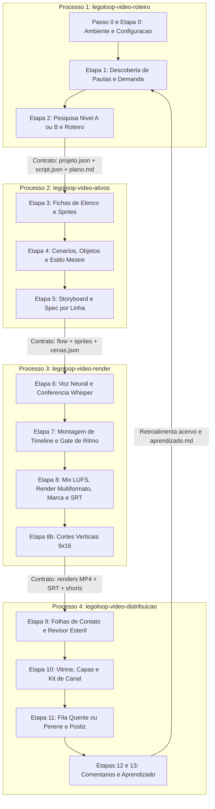

# Mapa Macro — Elevação e Canonização do Processo `legoloop-video-animado`

Data: 2026-11-24. Status: DRAFT (Visão Macro para guiar os ciclos `legoloop-ciclo`).
> **Renome (2026-11-27):** o macro `legoloop-video-diorama` passa a se chamar `legoloop-video-animado` (serve a qualquer estilo; diorama e so um estilo). Os 4 processos seguem o prefixo `video-`. Todos os processos do macro precisam ser canonizados (elementos completos).
Origem analisada: `C:\Users\trcnologia\Desktop\proj--historias-palitos`.

---

## 1. Visão Geral da Arquitetura no LegoLoop

Para evitar a fragmentação de 14 ciclos isolados e eliminar quebras de contrato entre etapas, as 14 Etapas originais (mais o Passo Zero) são consolidadas em **4 Processos autônomos e testáveis**, unidos ao final em **1 Macroprocesso composto** via `legoloop compor`:

1. **`legoloop-video-roteiro`** — Pré-voo, Configuração, Descoberta de Pauta e Roteiro Verificado (Passo 0 + Etapas 0, 1 e 2).
2. **`legoloop-video-ativos`** — Elenco, Estilo Mestre, Cenários, Sprites e Storyboard (Etapas 3, 4 e 5).
3. **`legoloop-video-render`** — Voz Neural Auditada, Alinhamento, Motor Diorama Autoral, Mixagem, Marca e Cortes Verticais (Etapas 6, 7, 8 e 8b).
4. **`legoloop-video-distribuicao`** — Revisão Cega Estéril, Vitrine, Fila Quente e Perene, Publicação Postiz, Comentários e Aprendizado (Etapas 9, 10, 11, 11b, 12 e 13).
5. **`legoloop-video-animado` (Composto)** — Orquestração ponta a ponta (`P1 -> P2 -> P3 -> P4`) integrada ao Looping Studio e registrada 5 de 5 na Espinha Dorsal.

---

## 2. Contrato Canônico Unificado de Pasta (`<projeto>/`)

Todas as divergências detectadas no projeto original são resolvidas por um contrato único de nomes e esquemas:

| Caminho Canônico | Papel Único (SSOT) | Divergência Eliminada |
| :--- | :--- | :--- |
| `projeto.json` | Configuração da Etapa 0, modo visual (`codigo`, `flow`, `hibrido`), formatos e UUID `flow_projeto` | Aposenta `project.json` legado da raiz |
| `marca.json` | Fontes, paleta, regras de texto, logo, vinhetas, voz padrão e política de legendas (`ativo_em: []` nos longos) | Alinha `PROCESSO.md` à decisão real de `.srt` externo |
| `script.json` | Roteiro estruturado (`title`, `idioma`, `estrutura`, `sources[]` com nível A ou B e data, `lines[]`) | Aposenta a menção conflitante a `roteiro.json` |
| `pronuncia.json` | Mapa fonético opcional aplicado apenas à síntese de voz | Mantido com conferência automática pós-áudio |
| `plano.md` | Tabela humana de batidas, elenco, cenários e dispositivos visuais | Mantido como espelho legível da autoria |
| `flow/` e `sprites/` | Imagens brutas geradas no Flow e recortes transparentes + descritores `.json` | Padroniza recorte via `rembg` + despill verde |
| `cenas.json` | Especificação determinística por linha para compilação da timeline | Torna explícita a ponte entre storyboard e motor |
| `audio/` e `data/lines.json` | `voice.wav`, `timings.json`, `soundtrack.wav` (-14 LUFS) e tempos alinhados por palavra e linha | Contrato imutável para motor, `.srt` e cortes |
| `timeline.json` | Grafo temporal de cenas, elenco, camadas, câmera e transições | Validado obrigatoriamente pelo Gate de ritmo |
| `renders/` e `renders/shorts/` | Versões numeradas `v1.mp4`, `v2.mp4`, `legenda.srt` e cortes `9:16` | Preserva histórico de versões sem sobrescrita |
| `review/` | Grades `sheet_NN.jpg` e pareceres `vN_parecer.json` do Revisor Estéril | Formaliza o artefato mecânico do revisor cego |
| `acervo/` | `acervo.json` (estoque e agenda), `temas.json` (antirrepetição) e `aprendizado.md` | Materializa os contratos antes inexistentes |

---

## 3. Refinamento Item a Item das 14 Etapas

### Processo 1 — `legoloop-video-roteiro`

| Etapa Original | Refinamento para Padrão Ouro no LegoLoop | Reuso do Cofre e Gates |
| :--- | :--- | :--- |
| **Passo 0** (Ambiente) | Verificador determinístico de dependências locais (Python/Go, FFmpeg, Chromium, Whisper, gitleaks e sonda opcional CDP `9333`) com saída JSON estrita | Gate: zero itens bloqueantes (`exit_code == 0`) |
| **Etapa 0** (Configuração) | Entrevista estruturada gravando `projeto.json` e `marca.json`; desmontagem opcional de vídeo de referência via `legoloop-video-rea` (extrai cadência real em `perfil_estilo.json`) | Reutiliza `legoloop-video-rea`; Stop-Gate no Looping Studio ou chat |
| **Etapa 1** (Descoberta) | Coleta de sinais de tendência e cálculo de vídeos fora da curva, cruzando obrigatoriamente com `acervo/temas.json` e `acervo/aprendizado.md` | Gate: descarte mecânico de temas repetidos ou sem lastro A/B; Stop-Gate de escolha |
| **Etapa 2** (Roteiro) | Geração em batidas causais ("mas"/"portanto"), gancho cronometrado (3 s curto, 20 s longo), validação mecânica de schema em `script.json` exigindo nível `A` (>=1) ou `B` (>=2) por afirmação numérica e marcador de alegação | Gate de schema + verificador lexical de alegações; Stop-Gate do roteiro |

### Processo 2 — `legoloop-video-ativos`

| Etapa Original | Refinamento para Padrão Ouro no LegoLoop | Reuso do Cofre e Gates |
| :--- | :--- | :--- |
| **Etapa 3** (Elenco) | Geração de 3 fichas por personagem (turnaround, expressões 3x2, poses 6x) com descrição imutável, recorte automático via `rembg` + despill e fatiamento automático de poses em `sprites/*.json` | Gate: canal alfa válido, dimensões mínimas e zero sobreposição; Stop-Gate de elenco |
| **Etapa 4** (Cenários e Objetos) | Suporte limpo ao caminho Código (cenários SVG 100% autorais, livres de código sem licença de `RobbiSkill`) e ao caminho Flow (`--ref`, fila resiliente com backoff e trava de `flow_projeto`) | Gate: mínimo de 1 cenário distinto a cada 2 linhas; Stop-Gate de quadros-teste |
| **Etapa 5** (Storyboard) | Composição dos quadros de cena e compilação assistida da especificação `cenas.json` (garantindo metáfora visual e >= 4 elementos móveis por linha) | Gate: cobertura de 100% das linhas de `script.json`; Stop-Gate de storyboard |

### Processo 3 — `legoloop-video-render`

| Etapa Original | Refinamento para Padrão Ouro no LegoLoop | Reuso do Cofre e Gates |
| :--- | :--- | :--- |
| **Etapa 6** (Voz) | Síntese com `pt-BR-ThalitaMultilingualNeural` + `pronuncia.json`, seguida de transcrição automática local (`faster-whisper`) comparando WER por linha para regravar apenas desvios fonéticos | Gate mecânico: divergência fonética acima do limiar bloqueia avanço |
| **Etapa 7** (Animação e Timeline) | Motor HTML/SVG reescrito de forma limpa e autoral no LegoLoop, adicionando suporte nativo a cortes `clip` (vídeo de fundo via FFmpeg) para o modo Híbrido ou Flow Vídeo, além do Gate de créditos antes de qualquer chamada paga | Reutiliza bases de `legoloop-video-motion` e `legoloop-web-qa`; Gate `check_timeline` (12–21 cortes/min, mediana 2,5–4 s); Stop-Gate da cena de 10 s |
| **Etapa 8** (Montagem e Marca) | Mixagem com ducking + catálogo de SFX por evento + normalização `-14 LUFS` / `-1,5 dB TP`, renderização multiformato (`16:9`, `9:16`, `1:1`) com cache por hash, vinhetas `marca.py` e `.srt` externo | Gate: duração áudio == vídeo, LUFS dentro de `-14 ± 0.5`, zero frames em branco |
| **Etapa 8b** (Cortes Curtos) | Seleção pontuada (0–10) de 3 a 8 trechos independentes, remontagem nativa em `9:16` com legenda queimada inteligente (posicionada fora da caixa do personagem) e cartão final | Gate: duração entre 15 s e 59 s e área segura vertical respeitada; Stop-Gate de cortes |

### Processo 4 — `legoloop-video-distribuicao`

| Etapa Original | Refinamento para Padrão Ouro no LegoLoop | Reuso do Cofre e Gates |
| :--- | :--- | :--- |
| **Etapa 9** (Revisão Dupla) | Extração de `sheet_NN.jpg`, comparação objetiva de ritmo (`PySceneDetect` / `legoloop-video-rea`) e execução de Nó isolado `orchestrix_hermetic` (Sterile Context) que recebe apenas vídeo/folhas + `script.json` + regras e grava `review/vN_parecer.json` | Gate: `parecer == "ENVIAR"`; Stop-Gate humano final do vídeo |
| **Etapa 10** (Vitrine) | Geração pontuada de 5 títulos e 3 capas por formato (`1280x720` sem texto de IA, canto inferior direito livre), kit de canal via `legoloop-canal-redc` e auditoria prévia das medidas oficiais em `redes.json` | Reutiliza `legoloop-canal-redc`; Gate: peso <= 2 MB e limites de caracteres verificados; Stop-Gate da vitrine |
| **Etapa 11 e 11b** (Acervo e Postiz) | Implementação real do agendador determinístico sobre `acervo/acervo.json` (fura-fila para pauta `quente` em 24–48 h com expiração automática; cadência e alerta de estoque mínimo para `perene`) integrado à API Postiz | Gate: visibilidade `private` por padrão, `containsSyntheticMedia` marcado e trava dupla para `public` |
| **Etapas 12 e 13** (Pós-publicação) | Coleta de comentários gerando fila de rascunhos sob aprovação humana e consolidação semanal de retenção/alcance em `acervo/aprendizado.md` | Stop-Gate obrigatório antes de qualquer resposta pública |

---

## 4. Saneamento Jurídico, Arquitetural e Integração ao Studio

1. **Independência total de `RobbiSkill/`:** todo código JS/HTML do motor (`engine.html`, `sets.js`, `puppet.js`, `layers.js`) será reimplementado de forma limpa, modular e testada dentro do LegoLoop sob licença própria, eliminando a restrição de publicação apontada na auditoria original.
2. **Substituição do painel avulso pelo Looping Studio:** em vez de criar um servidor web paralelo em `ferramentas/painel/`, os Stop-Gates e superfícies declarativas A2UI usam diretamente a infraestrutura oficial do Looping Studio (`legoloop studio`) e o fallback determinístico em chat/CLI.
3. **Zero Stubs e Governança Viva (Leis #1, #11 e #16):** nenhuma das funcionalidades listadas entra como casca vazia; cada Processo só fecha com `go test`, `funclen`, `taxlinter`, `cobertura`, `mutar`, `espinha verificar`, `legoloop upgrade` (Score >= 0.85) e `legoloop fechar`.

---

## 5. Sequência de Execução no LegoLoop

| Ordem | Alvo | Ciclo de Engenharia | Entrega Canônica |
| :--- | :--- | :--- | :--- |
| **Ciclo 1** | `legoloop-video-roteiro` | `legoloop-ciclo` (INTENT -> SPEC -> PLAN/ROUTE/DAG) -> TDD -> `upgrade` -> `fechar` | Processo 1 canonizado (5 de 5) + contratos `projeto.json` e `script.json` |
| **Ciclo 2** | `legoloop-video-ativos` | `legoloop-ciclo` -> TDD -> `upgrade` -> `fechar` | Processo 2 canonizado (5 de 5) + driver Flow resiliente, `rembg` e `cenas.json` |
| **Ciclo 3** | `legoloop-video-render` | `legoloop-ciclo` -> TDD -> `upgrade` -> `fechar` | Processo 3 canonizado (5 de 5) + motor diorama autoral, Whisper, mix e Shorts |
| **Ciclo 4** | `legoloop-video-distribuicao` | `legoloop-ciclo` -> TDD -> `upgrade` -> `fechar` | Processo 4 canonizado (5 de 5) + revisor estéril, vitrine, agendador e Postiz |
| **Ciclo 5** | `legoloop-video-animado` | `legoloop compor` encadeando Ciclos 1 a 4 + teste E2E completo + `fechar` | Macroprocesso composto homologado ponta a ponta com manual, livro e relatório |
