# 📘 MANUAL OPERACIONAL: LOOP IMPECCABLE DE DESIGN & SUB-LOOPS NO LEGOLOOP

> **Data:** 2026-11-01  
> **Autoridade:** Paul Bakaus (Upstream v4.7.0) / Ecossistema LegoLoop & AIDD  
> **Status:** Canônico  
> **Escopo:** Design de Interfaces, Sistemas de Tokens, Micro-Interações e Refinamento Visual

---

## 1. Visão Geral e Filosofia

A skill **Impeccable** é o padrão-ouro para design e engenharia visual de interfaces front-end dentro do ecossistema AIDD e do **LegoLoop**. Ela transforma implementações genéricas em entregas de nível *out-of-distribution* (produção de alto padrão, sem clichês de IA).

### Pilares Fundamentais:
1. **The Brief Wins (O Briefing Vence):** Respeite a estética, paleta, épocas e diretrizes definidas pelo usuário. Nunca redirecione uma interface para gosto pessoal arbitrário.
2. **Refinamento vs. Redesenho:**
   * **Refinamento:** Preserva a identidade, o comportamento e a copy existente. Foco em polimento, alinhamento e consistência.
   * **Redesenho:** Trata a interface antiga apenas como evidência/anti-referência e estabelece um novo mundo visual documentado.
3. **Piso de Qualidade Inegociável (`craft-floor.md`):** Antes de qualquer edição de UI (mesmo em ajustes pontuais), a leitura do piso de qualidade é mandatória. Ele proíbe gradientes sem contraste, bordas excessivas, tipografia desordenada e o uso de emojis na interface.
4. **Verificação Delimitada (*Bounded Pass*):** Evite loops abertos de auto-QA. Inspecione em lote (desktop e mobile simultaneamente), corrija os apontamentos em bloco único e finalize com no máximo mais uma checagem.

---

## 2. Os 4 Modos de Superfície

A ambição do design é pautada pelo **modo da tela**, e não pelo produto como um todo:

| Modo | Finalidade | Exemplos | Prioridade de Design |
| :--- | :--- | :--- | :--- |
| **Operate** | O visitante precisa completar uma tarefa | Dashboards, painéis admin, editores, configurações | Escaneabilidade, densidade coerente, expectativas nativas e contenção. A ambição se manifesta na precisão e não no exagero. |
| **Persuade** | O visitante precisa decidir e agir | Landing pages, marketing, telas de preços | Foco em conversão, hierarquia de valor, estética imersiva e tipografia expressiva. |
| **Read** | O visitante precisa compreender um conteúdo | Documentações, manuais, artigos, changelogs | Ritmo de leitura, contraste descansado, hierarquia tipográfica e ausência de distrações. |
| **Experience** | O visitante está imerso na própria obra | Portfólios, galerias, vitrines interativas | A interface recua para que o artefato/obra lidere a experiência desde a primeira dobra. |

---

## 3. O Loop Mestre de 5 Estágios (Fluxo I - Ciclo Completo)

O pipeline do Impeccable opera com **Gates Binários de Parada Obrigatória (P1 a P4)**:

```mermaid
flowchart TD
    subgraph Estagio1["Estágio 1: Contexto & Auditoria"]
        direction TB
        A1["Carregar PRODUCT.md e DESIGN.md"] --> A2["critique: Revisão Heurística de UX"]
        A2 --> A3["audit: Checagem Técnica (a11y, perf, viewport)"]
    end

    subgraph Estagio2["Estágio 2: Direção Visual"]
        direction TB
        B1["Classificar Modo (Operate/Persuade/Read/Experience)"] --> B2["shape: Planejar UX pré-código"]
        B2 --> B3["new-work: Preservar, Expandir ou Substituir"]
    end

    subgraph Estagio3["Estágio 3: Execução Cirúrgica"]
        direction TB
        C1["Leitura Obrigatória: craft-floor.md"] --> C2["Layout: Espaçamento e Ritmo"]
        C2 --> C3["Typeset: Hierarquia Tipográfica"]
        C3 --> C4["Colorize: Paleta Estratégica"]
        C4 --> C5["Harden & Clarify: Textos e Casos de Borda"]
    end

    subgraph Estagio4["Estágio 4: Verificação em Lote"]
        direction TB
        D1["Captura em Lote (Mobile 375px + Desktop)"] --> D2["polish: Acabamento Fino"]
        D2 --> D3["Revisão pelo impeccable-finish-reviewer"]
    end

    subgraph Estagio5["Estágio 5: Documentação & Entrega"]
        direction TB
        E1["document: Atualizar DESIGN.md com código real"] --> E2["extract: Isolar Design Tokens e Componentes"]
        E2 --> E3["Proposta de Entrega / PR"]
    end

    Estagio1 -->|Gate P1: Achados & Severidade| Estagio2
    Estagio2 -->|Gate P2: Direção Visual Aprovada| Estagio3
    Estagio3 -->|Gate P3: Antes/Depois por Item| Estagio4
    Estagio4 -->|Gate P4: Veredito VERIFIED| Estagio5
```



---

## 4. A Taxonomia dos 6 Sub-Loops Modulares

O Impeccable organiza seus ~25 comandos em 6 sub-loops operacionais reutilizáveis:

```
┌────────────────────────────────────────────────────────────────────────┐
│                   PIPELINE DE DESIGN IMPECCABLE                        │
├─────────────┬─────────────┬─────────────┬─────────────┬────────────────┤
│ Sub-Loop 1  │ Sub-Loop 2  │ Sub-Loop 3  │ Sub-Loop 4  │ Sub-Loop 5 & 6 │
│   AVALIAR   │  CONSTRUIR  │  MELHORAR   │   REFINAR   │ CORRIGIR/ITERAR│
└─────────────┴─────────────┴─────────────┴─────────────┴────────────────┘
```

### Sub-Loop 1: Avaliar (Evaluate)
* **Objetivo:** Radiografar o estado atual sem realizar alterações prematuras.
* **Comandos:**
  * `critique`: Revisão heurística de usabilidade, hierarquia de informação e carga cognitiva.
  * `audit`: Auditoria técnica automatizada e manual cobrindo acessibilidade (WCAG), performance de renderização e responsividade em múltiplos viewports.

### Sub-Loop 2: Construir & Direcionar (Build)
* **Objetivo:** Estabelecer as fundações conceituais e os contratos duráveis de produto antes de codificar.
* **Comandos:**
  * `init`: Captura o contexto durável da aplicação em `PRODUCT.md`.
  * `shape`: Planeja fluxos de tela e interações sem código prévio.
  * `document`: Gera a especificação `DESIGN.md` extraída da verdade do código.
  * `extract`: Garimpa tokens e componentes consolidados para o Design System.

### Sub-Loop 3: Melhorar (Enhance)
* **Objetivo:** Elevar a qualidade sensorial e tátil da interface através dos fundamentos visuais.
* **Comandos:**
  * `layout`: Corrige respiros, grids, alinhamento vertical e ritmo escaneável.
  * `typeset`: Ajusta proporção de fontes, contraste de pesos e escalonamento tipográfico.
  * `colorize`: Introduz paleta com significado semântico (evitando monocromatismo insosso ou carnaval de cores).
  * `animate`: Adiciona micro-interações funcionais com transições físicas suaves.
  * `delight`: Insere detalhes memoráveis e estados táteis discretos.
  * `overdrive`: Amplia a expressividade estética (reservado exclusivamente para modos *Persuade* ou *Experience*).

### Sub-Loop 4: Refinar (Refine)
* **Objetivo:** Blindar a interface para ambientes de missão crítica e prontidão para produção.
* **Comandos:**
  * `polish`: Passe de micropolimento e consistência geral antes da entrega.
  * `harden`: Tratamento completo de estados de erro, loading, internacionalização (i18n) e limites de dados.
  * `onboard`: Criação de fluxos de primeira execução (*empty states*) e boas-vindas.
  * `distill`: Remoção de complexidade visual desnecessária e elementos ruidosos.
  * `bolder` / `quieter`: Calibração do tom visual para aumentar contraste ou suavizar estimulação excessiva.

### Sub-Loop 5: Corrigir (Fix)
* **Objetivo:** Resolver fricções ergonômicas e falhas operacionais específicas.
* **Comandos:**
  * `clarify`: Refatoração da UX copy, microcopy, rótulos de botões e mensagens de validação.
  * `adapt`: Adequação cirúrgica a telas extremas (mobile compacto, ultra-wide e layouts nativos).
  * `optimize`: Diagnóstico e correção de gargalos de renderização na árvore de componentes.

### Sub-Loop 6: Iterar (Iterate)
* **Objetivo:** Exploração assistida de alternativas visuais em tempo real.
* **Comandos:**
  * `live`: Inspeção e seleção de elementos diretamente no navegador para variantes ao vivo.
  * `generate`: Criação de variações simultâneas de um elemento no navegador para decisão imediata.

---

## 5. Papéis e Agentes Upstream Especializados

Para garantir independência e evitar contaminação de contexto, o ecossistema upstream do Impeccable delega papéis autônomos:
1. **`impeccable_documenter`:** Responsável por analisar os arquivos de estilo e gerar a verdade factual em `DESIGN.md`.
2. **`impeccable_finish_reviewer`:** Atua como gatekeeper e diretor de arte intransigente no Estágio 4, julgando se o resultado alcançou a nota máxima ou necessita refações.
3. **`impeccable_asset_producer`:** Produz ícones e vetores SVG inline seguindo padrões semânticos (sem emojis e com `stroke="currentColor"`).
4. **`impeccable_manual_edit_applier`:** Aplica micro-ajustes pontuais derivados do relatório de auditoria.

---

## 6. Integração no LegoLoop

No LegoLoop, o pipeline Impeccable está integrado sob duas formas canônicas:

1. **Peça de Loop no Acervo (`loops/impeccable-design.loop.json`):**
   * Registrado como ativo de primeira classe do tipo `KindLoop`.
   * Encadeia os 6 sub-loops de forma determinística com contratos de entrada e saída.
2. **Template Canônico do Studio Canvas (`internal/studio/templates.go`):**
   * Disponível diretamente no menu de templates rápidos com ícone `palette`.
   * Permite instanciar a esteira completa no canvas visual com roteamento cognitivo inteligente pré-configurado.
