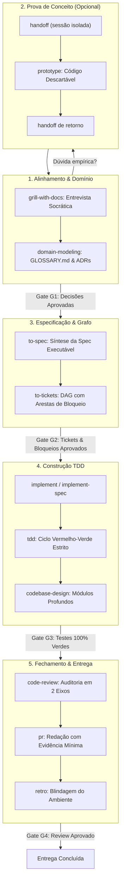

# 📘 MANUAL OPERACIONAL: PIPELINE DE RIGOR MATT POCOCK & SUB-LOOPS NO LEGOLOOP

> **Data:** 2026-11-01  
> **Autoridade:** Matt Pocock (Upstream MIT) / Ecossistema LegoLoop & AIDD  
> **Status:** Canônico  
> **Escopo:** Rigor de Engenharia, Modelagem de Domínio, TDD Estrito, Arquitetura de Módulos Profundos e Retroalimentação de Ambiente

---

## 1. Visão Geral e Filosofia

O método **Matt Pocock** é o padrão de engenharia focado em controle absoluto do desenvolvedor, modularidade profunda e feedback imediato no desenvolvimento auxiliado por agentes de IA. Ele substitui a geração cega de código por um ciclo disciplinado de alinhamento prévio, contratos estritos e testes como especificação executável.

### Pilares Fundamentais:
1. **Alinhar antes de Construir (*Grill Before Build*):** Nenhuma linha de código de produção deve ser gerada sem antes submeter a ideia a uma entrevista implacável que expõe premissas ocultas, casos de borda e ambiguidades de domínio.
2. **Desenvolvedor no Controle:** A IA opera em execuções curtas (3 a 5 passos), com gates de parada obrigatória. Ações críticas (push, PR, deploy, deleção) exigem autorização humana expressa.
3. **Módulos Profundos (*Deep Modules*):** Inspirado em John Ousterhout (*A Philosophy of Software Design*), prega interfaces estreitas e simples escondendo implementações ricas e robustas atrás de *seams* (costuras) desacopladas.
4. **Higiene Severa de Contexto (*Smart Zone*):** Modelos de linguagem degradam o raciocínio além da zona de clareza (~150k tokens). O alinhamento, a spec e os tickets ocorrem em janela única contínua; a implementação de cada ticket inicia em contexto limpo.
5. **Retroalimentação do Ambiente (*Retro on Environment*):** Retrospectivas não mudam código passado, mas sim as regras, linters, checagens automáticas e o `AGENTS.md`, blindando a sessão futura contra a repetição de erros.

---

## 2. O Loop Mestre de Rigor (Ideia $\to$ Produção)

O pipeline mestre segue o fluxo canônico de engenharia com gates binários de validação:



---

## 3. Os 6 Sub-Loops Modulares no LegoLoop

O LegoLoop decompõe o ecossistema Matt Pocock em 6 sub-loops operacionais, disponíveis como blocos conectáveis no Studio Canvas e em pipelines DAG:

```
┌────────────────────────────────────────────────────────────────────────┐
│                   PIPELINE DE RIGOR MATT POCOCK                        │
├─────────────┬─────────────┬─────────────┬─────────────┬────────────────┤
│ Sub-Loop 1  │ Sub-Loop 2  │ Sub-Loop 3  │ Sub-Loop 4  │ Sub-Loop 5 & 6 │
│  CONCEPÇÃO  │  EXPLORAÇÃO │ ESPECIFICA- │ CONSTRUÇÃO  │ DIAGNÓSTICO E  │
│  & DOMÍNIO  │  EMPÍRICA   │ ÇÃO & GRAFO │ CIRÚRGICA   │ FECHAMENTO/ENV │
└─────────────┴─────────────┴─────────────┴─────────────┴────────────────┘
```

### 🔹 Sub-Loop 1: Concepção, Grilling & Domínio
* **Objetivo:** Estabelecer vocabulário unívoco, desafiar premissas e registrar decisões arquiteturais antes de qualquer linha de código.
* **Habilidades Integradas:**
  * `grill-with-docs`: Entrevista socrática focada em repositório; produz rastro durável em `GLOSSARY.md` e ADRs.
  * `grill-me`: Variante *stateless* para alinhamento rápido sem dependência de pasta de projeto.
  * `grilling`: O primitivo algorítmico da entrevista (rodadas numeradas, divisão entre fatos do agente e decisões do usuário).
  * `domain-modeling`: Auditoria de termos sobrecarregados (ex.: "usuário", "conta") e documentação de decisões difíceis de reverter.
* **Artefatos de Saída:** `GLOSSARY.md`, `docs/intents/YYYY-MM-DD_INTENT_<TEMA>.md`, ADRs em `docs/adr/`.
* **Gate de Saída:** Todas as ambiguidades de domínio sanadas e aprovadas pelo desenvolvedor.

### 🔹 Sub-Loop 2: Exploração Empírica & Pesquisa
* **Objetivo:** Resolver dúvidas que apenas código executável ou pesquisa de fontes primárias podem sanar, sem poluir a árvore principal.
* **Habilidades Integradas:**
  * `prototype`: Criação de programa descartável em branch `prototype/<nome>` para testar modelos de estado ou sensações de UI.
  * `handoff`: Mecanismo estéril de passagem de contexto para nova pasta, harness ou sessão isolada.
  * `research`: Subagente de pesquisa profunda em segundo plano sobre documentações oficiais e fontes primárias.
* **Artefatos de Saída:** Relatório técnico com citações e protótipo referenciado na branch isolada.
* **Gate de Saída:** Resposta empírica comprovada e devolvida à sessão principal via `handoff`.

### 🔹 Sub-Loop 3: Especificação & Grafo de Dependências
* **Objetivo:** Sintetizar o consenso em especificação técnica formal e fatiá-la em grafo acíclico direcionado (DAG) de tarefas independentes.
* **Habilidades Integradas:**
  * `to-spec`: Consolida a discussão prévia em uma spec executável e determinística (sem re-entrevistar).
  * `to-tickets`: Quebra a spec em tickets verticais (*tracer-bullets*), cada um explicitando suas arestas de dependência e bloqueio (`blocked-by`).
  * `wayfinder`: Traçado de mapa de tickets de decisão para iniciativas nebulosas ou projetos *greenfield* de grande porte.
* **Artefatos de Saída:** `docs/specs/YYYY-MM-DD_SPEC_<TEMA>.md`, tickets em `.scratch/<feature>/issues/NN-slug.md` ou `docs/plans/`.
* **Gate de Saída:** DAG de tickets aprovado pelo usuário, com todas as arestas de bloqueio resolvidas.

### 🔹 Sub-Loop 4: Construção Cirúrgica & TDD
* **Objetivo:** Implementar o comportamento estritamente orientado a testes, com contextos isolados por ticket.
* **Habilidades Integradas:**
  * `implement`: Consome um ticket por vez a partir de uma janela de contexto limpa, atacando nós desbloqueados.
  * `implement-spec`: Orquestrador avançado que distribui múltiplos subagentes em paralelo sobre a fronteira de tarefas prontas, unificando em branch de integração.
  * `tdd`: Ciclo vermelho-verde-refatora (Red-Green-Refactor) estrito por fatia de comportamento; proibido mocks de produção e stubs vazios.
  * `codebase-design`: Vocabulário e princípios de módulos profundos, interfaces estreitas e *seams* desacoplados.
* **Artefatos de Saída:** Código de produção, testes unitários/integração e `docs/reports/TDD_REPORT.md`.
* **Gate de Saída:** Testes 100% verdes, sem testes enfraquecidos ou supressões de compilador.

### 🔹 Sub-Loop 5: Diagnóstico, Arquitetura & Triagem
* **Objetivo:** Solução cirúrgica de falhas complexas e manutenção contínua da saúde arquitetural da base de código.
* **Habilidades Integradas:**
  * `diagnosing-bugs`: Proíbe qualquer teorização antes de obter um loop de feedback reproduzível (um comando que falhe no bug). Corrige via teste de regressão.
  * `improve-codebase-architecture`: Varredura periódica em busca de módulos rasos e oportunidades de aprofundamento.
  * `triage`: Qualificação e enriquecimento de issues externas brutas antes de serem despachadas para agentes.
* **Artefatos de Saída:** Teste de regressão reproduzível, correção atômica e relatório de arquitetura.
* **Gate de Saída:** Falha reproduzida em vermelho, resolvida em verde e protegida contra regressões.

### 🔹 Sub-Loop 6: Auditoria em Dois Eixos, Entrega & Retroalimentação
* **Objetivo:** Revisão formal de conformidade, redação concisa de pull request e blindagem do ambiente operacional do agente.
* **Habilidades Integradas:**
  * `code-review`: Auditoria rigorosa em dois eixos ortogonais: Eixo 1 (*Standards* do repositório) e Eixo 2 (*Spec* da tarefa).
  * `pr`: Estrutura do PR com menor evidência visual necessária, comprovação antes/depois e classificação de risco (porta de mão única vs. mão dupla).
  * `retro`: Retrospectiva da sessão focada no ambiente: converte falhas mecânicas em verificações automáticas e divergências em regras de linter/`AGENTS.md`.
  * `wizard`: Geração de scripts interativos para etapas que exigem presença humana (tokens, senhas, portas de nuvem).
  * `wait-what`: Mecanismo de socorro em tempo de execução para re-explicar conceitos de forma clara sem jargões.
* **Artefatos de Saída:** `docs/reports/CODE_REVIEW.md`, corpo do PR e atualizações no `AGENTS.md`.
* **Gate de Saída:** Review aprovado sem notas bloqueadoras e ambiente atualizado.

---

## 4. Matriz de Roteamento Cognitivo & Modelos Recomendados

| Sub-Loop | Complexidade | Modelo Primário | Fallback Local | Justificativa |
|---|---|---|---|---|
| **1. Concepção & Grilling** | Alta (Socrática) | `sonnet` | `haiku` | Raciocínio socrático afiado e desafio de premissas. |
| **2. Exploração Empírica** | Média | `code-fast` | `qwen2.5-coder:7b` | Geração rápida de protótipos descartáveis e spikes. |
| **3. Especificação & Grafo** | Alta (Arquitetura) | `code-pro` | `llama3.1:8b` | Síntese determinística e decomposição formal de DAG. |
| **4. Construção TDD** | Média/Alta | `sonnet` | `qwen2.5-coder:7b` | Disciplina estrita de testes antes do código e zero stubs. |
| **5. Diagnóstico & Seams** | Alta | `sonnet` | `llama3.1:8b` | Isolamento analítico de bugs sutis e testes de regressão. |
| **6. Review & Retro** | Média | `code-fast` | `haiku` | Verificação binária de regras e melhoria contínua de ambiente. |

---

## 5. Higiene de Contexto & Fronteiras de Fase

A disciplina de gestão de memória de contexto no método Matt Pocock opera nas seguintes regras:

1. **Janela Unificada de Alinhamento:** Os passos 1 a 3 (`grilling` $\to$ `to-spec` $\to$ `to-tickets`) devem permanecer na **mesma sessão** para preservar o raciocínio compartilhado.
2. **Contexto Limpo por Ticket:** A implementação (`implement`) de cada nó do DAG deve ser executada em **sessão limpa** (`/clear`), consumindo exclusivamente o arquivo do ticket e o repositório.
3. **Decisão na Fronteira de Fase:**
   * **Continuar:** Se a fase atual for curta e o contexto estiver bem abaixo da *Smart Zone* (< 100k tokens).
   * **Limpar (`/clear`):** Quando a fase anterior terminou e o próximo ticket possui especificação auto-contida.
   * **Compactar (`/compact`):** Quando o diálogo de alinhamento estiver próximo ao limite e for necessário consolidar o estado antes de fatiar tickets.
   * **Handoff (`/handoff`):** Para bifurcações laterais, protótipos descartáveis ou transferência para outra máquina/harness.

---

## 6. Disponibilidade e Execução no LegoLoop

### 1. Template Integrado no Studio Canvas (`internal/studio/templates.go`)
O pipeline está disponível diretamente no LegoLoop Studio:
* **Menu de Templates:** Botão `Templates` no cabeçalho do Studio Canvas.
* **Card Canônico:** `Pipeline Matt Pocock (6 Sub-Loops)`.
* **Ícone:** `git`.
* **Composição Automática:** Carrega o grafo completo com nós de alinhamento, especificação, tickets, TDD, review e retroalimentação.

### 2. Declaração Declarativa de Loop (`loops/matt-pocock.loop.json`)
O arquivo declarativo DAG do LegoLoop pode ser executado via CLI:

```bash
# Execução direta via CLI do LegoLoop
legoloop run loops/matt-pocock.loop.json

# Visualização no Studio
legoloop studio
```

---

## 7. Relação Canônica de Sub-Skills Mapeadas

Todas as sub-skills upstream do Matt Pocock estão preservadas em:
📁 [aidd-pocock/upstream/skills/](file:///C:/Users/trcnologia/.gemini/antigravity-cli/skills/aidd-pocock/upstream/skills/)

* `engineering/`: `ask-matt`, `grill-with-docs`, `domain-modeling`, `codebase-design`, `to-spec`, `to-tickets`, `implement`, `implement-spec`, `tdd`, `code-review`, `diagnosing-bugs`, `improve-codebase-architecture`, `prototype`, `research`, `triage`, `wayfinder`, `pr`, `retro`, `wizard`, `setup-matt-pocock-skills`.
* `productivity/`: `grill-me`, `grilling`, `handoff`, `teach`, `to-questionnaire`, `wait-what`, `writing-for-agents`.
