# ♾️ MANUAL OPERACIONAL: MEGA PIPELINE LEGOLOOP (5 SUB-LOOPS)

> **Data:** 2026-11-01  
> **Autoridade:** Orquestrador Canônico AIDD & LegoLoop  
> **Status:** Canônico / Ativo  
> **Escopo:** Governança de Engenharia de Software, Decomposição em Micro-Tickets, Contexto Estéril (Orchestrix) e Stop-Gates

---

## 1. Visão Geral e Arquitetura

O **Mega Pipeline do LegoLoop** é o orquestrador mestre para desenvolvimento determinístico de software. Sua função é transformar qualquer demanda (de um briefing inicial até o fechamento de um projeto enterprise) em uma esteira de peças acopladas em um Grafo Acíclico Dirigido (DAG).

O pipeline é executado em **contexto estéril por bloco (Orchestrix cirúrgica)**: cada nó consome exclusivamente o artefato do nó predecessor, gera o seu artefato contratado e encerra seu ciclo de vida, eliminando a poluição de contexto (*context bloat*).

---

## 2. As 7 Leis Invioláveis do Mega Pipeline

> [!CAUTION]
> **TOLERÂNCIA ZERO PARA AFOBAÇÃO COGNITIVA & PULOS DE ETAPA:**  
> O agente é fisicamente proibido de gerar código de produção ou tocar em arquivos sem a aprovação explícita do usuário nos **Stop-Gates de Auditoria Humana**. A execução segue a ordem estrita: **INTENT ➔ SPEC ➔ PLAN ➔ ROUTE (JSON) ➔ BUILD TDD**.

1. **Zero Context Bloat (Orchestrix Cirúrgica por Bloco):** Nenhum bloco compartilha histórico ou memória com outro bloco. Cada nó nasce, processa seu I/O e morre.
2. **Stop-Gates de Auditoria Humana Obrigatórios:** Paradas obrigatórias entre concepção, planejamento e entre cada Épico de construção.
3. **A Tríade Inegociável de Planejamento:** O código só pode ser iniciado se existirem no disco três artefatos aprovados:
   * Especificação: `docs/specs/YYYY-MM-DD_SPEC_<TEMA>.md`
   * Plano Centralizado: `docs/plans/YYYY-MM-DD_PLAN_<TEMA>.md`
   * Rota Executável em Grafo: `docs/routes/YYYY-MM-DD_ROUTE_<TEMA>.json`
4. **Provider-Awareness & Roteamento Cognitivo com Clamping:** Seleção do modelo por complexidade real da tarefa com teto de esforço cognitivo (`--effort low|medium|high`).
5. **TDD Estrito & Zero Stubs:** Teste unitário falha obrigatoriamente antes do código de produção (Red ➔ Green ➔ Refactor). Proibição total de `TODO`, `pass` ou mocks falsos.
6. **Padronização ISO de Artefatos:** Todo arquivo em `docs/` deve usar o prefixo `YYYY-MM-DD_<NOME>.<ext>`.
7. **Idioma PT-BR & Executor Silencioso:** Comunicação e artefatos 100% em Português do Brasil com raciocínio interno telegráfico (Caveman Style).

---

## 3. Matriz Hierárquica de Decomposição & Roteamento Cognitivo

| Nível do Ticket | Escopo & Descrição | Payload / Contexto | Modelos Sugeridos | Effort Flag | Comportamento Esperado |
| :--- | :--- | :--- | :--- | :--- | :--- |
| **Épico (Macro)** | Concepção, arquitetura de sistemas, DAG global, contratos de interface e specs de alto nível | > 20k tokens | `Claude 3.7 Sonnet`, `Gemini 2.0 Pro` | `--effort high` | Análise profunda, avaliação de trade-offs, antecipação de falhas e design holístico |
| **Micro-ticket** | Módulo específico, suíte de testes TDD, endpoint de API ou tela de UI | 4k a 20k tokens | `Claude 3.5 Sonnet`, `Gemini 2.0 Flash`, `Qwen 2.5 Coder 32B` | `--effort medium` | Foco estrito no contrato de I/O, Red-Green cycle e zero efeitos colaterais |
| **Nano-ticket** | Correção cirúrgica de lint, renomeação de variáveis, assert pontual, tipagem, token CSS | < 4k tokens | `Gemini 2.0 Flash-Lite`, `Claude 3.5 Haiku`, `Ollama Local` | `--effort low` | Resposta instantânea, raciocínio mínimo, transformação direta |

---

## 4. O Fluxo dos 5 Sub-Loops Modulares

```mermaid
flowchart TD
    subgraph L1 ["Loop 1: Concepção & Alinhamento"]
        A1["Briefing / Entrevista Socrática"] --> A2["docs/intents/YYYY-MM-DD_INTENT_*.md"]
        A2 --> G1{"🛑 STOP-GATE HUMANO 01:<br/>Aprovação da Intenção"}
    end

    subgraph L2 ["Loop 2: Engenharia Reversa & Design Pass"]
        G1 -->|Aprovado| B1["Obscura / REA / Impeccable"]
        B1 --> B2["TOKENS.css / DESIGN.md / ESTRUTURA_REVERSA.json"]
        B2 --> G2{"🛑 STOP-GATE HUMANO 02:<br/>Aprovação Visual & Tokens"}
    end

    subgraph L3 ["Loop 3: Tríade de Planejamento"]
        G2 -->|Aprovado| C1["docs/specs/YYYY-MM-DD_SPEC_*.md"]
        C1 --> C2["docs/plans/YYYY-MM-DD_PLAN_*.md (Épicos ➔ Micro/Nano)"]
        C2 --> C3["docs/routes/YYYY-MM-DD_ROUTE_*.json (Grafo Executável)"]
        C3 --> G3{"🛑 STOP-GATE HUMANO 03:<br/>Aprovação da Tríade"}
    end

    subgraph L4 ["Loop 4: Construção TDD por Épico"]
        G3 -->|Aprovado| D1["Execução Estéril do Épico N"]
        D1 --> D2["TDD: Red ➔ Green ➔ Refactor"]
        D2 --> G4{"🛑 STOP-GATE HUMANO POR ÉPICO:<br/>Auditoria de Código do Épico"}
        G4 -->|Mais Épicos| D1
    end

    subgraph L5 ["Loop 5: Homologação E2E & Fechamento"]
        G4 -->|Todos Épicos OK| E1["Auditoria E2E Playwright / Testes Finais"]
        E1 --> E2["Recompilação Obrigatória (bin/legoloop.exe)"]
        E2 --> E3["docs/reports/YYYY-MM-DD_REPORT_*.md"]
        E3 --> G5{"🛑 STOP-GATE FINAL:<br/>Homologação & Entrega"}
    end
```

### Detalhamento dos Sub-Loops:

#### Loop 1: Concepção & Alinhamento de Intenção
* **Peças / Skills:** `interview`, `aidd-grill`.
* **Entrada:** Solicitação do usuário em linguagem natural.
* **Saída:** `docs/intents/YYYY-MM-DD_INTENT_<TEMA>.md`.
* **Stop-Gate 01:** O agente apresenta premissas e escopo e **para obrigatoriamente**, aguardando aprovação explícita.

#### Loop 2: Engenharia Reversa & Design Pass (Condicional)
* **Peças / Skills:** `obscura`, `aidd-rea`, `impeccable`.
* **Entrada:** URL, binário, mock ou tela existente.
* **Saída:** `DESIGN.md`, tokens de design ou `ESTRUTURA_REVERSA.json`.
* **Stop-Gate 02:** Verificação de conformidade visual, paleta ontológica e regra Zero Emojis.

#### Loop 3: Especificação de Engenharia & Tríade de Planejamento
* **Peças / Skills:** `aidd-spec`, `aidd-tickets`, `aidd-orchestrate-pipeline-creator`.
* **Entrada:** Intenção validada + Design System aprovado.
* **Saída (Tríade Inegociável):**
  1. `SPEC`: Especificação técnica com critérios binários de aceite.
  2. `PLAN`: Plano único com épicos, micro-tickets e nano-tickets.
  3. `ROUTE`: Grafo JSON formal determinístico (`YYYY-MM-DD_ROUTE_<TEMA>.json`).
* **Stop-Gate 03:** Aprovação mandatória da tríade antes de tocar em código.

#### Loop 4: Construção TDD Estrito por Épico
* **Peças / Skills:** `aidd-tdd`, `implementacao`.
* **Entrada:** Rota de execução formal e contratos do Épico ativo.
* **Operação:**
  * **Red:** Teste unitário é criado e falha.
  * **Green:** Código de produção mínimo para aprovar o teste.
  * **Refactor:** Limpeza, remoção de redundâncias e tipagem rigorosa.
* **Stop-Gate por Épico:** Pausa ao término de cada Épico para validação do usuário antes de iniciar o seguinte.

#### Loop 5: Homologação E2E, Recompilação & Fechamento
* **Peças / Skills:** `aidd-homologue`, `playwright`, `aidd-sessao`.
* **Entrada:** Código completo dos épicos finalizado.
* **Operação & Saída:**
  * Testes de ponta a ponta e auditoria de navegabilidade.
  * Recompilação obrigatória: `go build -o bin/legoloop.exe ./cmd/legoloop`.
  * Geração do relatório final `docs/reports/YYYY-MM-DD_REPORT_<TEMA>.md` e sincronização de sessão em `docs/sessions/`.
* **Stop-Gate Final:** Entrega ao usuário com evidências consolidadas.

---

## 5. Implementação no LegoLoop

1. **Loop Canônico no Acervo (`loops/mega-pipeline.loop.json`):**
   * Registrado com ID `mega-pipeline-loop`.
   * Encadeia os 5 sub-loops canônicos com verificação mecânica via gates de arquivos (`file_exists`).
2. **Template Integrado no Studio Canvas (`internal/studio/templates.go`):**
   * Disponível diretamente na biblioteca de templates com ícone `template`.
   * Permite arrastar para o canvas a esteira mestre completa e customizar o roteamento cognitivo por bloco.
