# 📘 MANUAL OPERACIONAL: PIPELINE DE WEB PERFORMANCE, QUALIDADE & ENGENHARIA ADDY OSMANI NO LEGOLOOP

> **Data:** 2026-11-02  
> **Autoridade:** Addy Osmani (Upstream MIT / Google Chrome Lead) & Ecossistema LegoLoop / AIDD  
> **Status:** Canônico  
> **Escopo:** Web Performance, Core Web Vitals, Desenvolvimento Orientado a Restrições, TDD Estrito, DevTools em Runtime Real, Auditoria Multi-Eixo, Hardening OWASP e Entrega Observável.

---

## 1. Visão Geral e Filosofia

O método **Addy Osmani** sintetiza mais de duas décadas de liderança na engenharia web do Google Chrome e na vanguarda do ecossistema JavaScript/Web. Ele combate tanto o achismo de desempenho quanto a proliferação desgovernada de código assistido por IA, impondo uma metodologia rigorosa ancorada em **medição empírica prévia**, **orçamentos inegociáveis de qualidade (performance budgets)** e **fatiamento vertical estrito**.

### Pilares Fundamentais:

1. **Medir antes de Otimizar (*Measure Before You Optimize*):**
   Sem números objetivos de baseline, otimizar é pura adivinhação. Toda otimização exige telemetria prévia (LCP, INP, CLS, TTFB, profiling de memória, tamanho de bundle) e validação posterior com prova de ganho.
2. **Desenvolvimento Orientado a Restrições (*Constraint-Driven Development*):**
   Limites arquiteturais, tetos de complexidade ciclomática e contratos de segurança não são sugestões: são barreiras ativas registradas em `CONSTRAINTS.md` que nenhum agente pode violar ou silenciar.
3. **Ancoragem na Documentação Oficial (*Source-Driven Development*):**
   IA não deve alucinar sintaxes ou comportamentos. Decisões de arquitetura, padrões e consumo de APIs devem se basear diretamente na documentação primária oficial das bibliotecas e frameworks utilizados.
4. **Fatiamento Fino e Prova por Testes (*Incremental TDD & Prove-It*):**
   Bugs exigem um teste vermelho (*Red*) reproduzindo a falha antes da correção pontual (*Green*). Features avançam em fatias atômicas e testadas, sem stubs e sem quebra de suíte.
5. **Runtime Real via DevTools & Auditoria em 5 Eixos:**
   Testes unitários e mocks estáticos não substituem a inspeção real no DOM, renderização de CSS, shifts visuais de layout, console errors e comportamento responsivo em viewport real. A revisão final avalia Correção, Arquitetura, Segurança, Performance e Manutenibilidade, acompanhada de contestação adversarial (*Doubt-Driven Development*).
6. **Entrega Observável e Segura (*Observability & Zero-Downtime Migration*):**
   O ciclo de vida encerra com rastreabilidade total (logs estruturados, métricas RED/USE, traces), plano de migração expand/contract e checklists de ship rigorosos.

---

## 2. O Loop Mestre de Engenharia (Ideia $\to$ Produção)

O pipeline mestre segue o fluxo canônico de engenharia com gates binários determinísticos de validação:

```mermaid
flowchart TD
    subgraph S1["1. Alinhamento & Contexto"]
        direction TB
        A1["using-agent-skills: Roteamento de Intenção"] --> A2["interview-me & idea-refine: Entrevista Socrática"]
        A2 --> A3["context-engineering: Escopo Cirúrgico & Baseline"]
    end

    subgraph S2["2. Restrições & Especificação"]
        direction TB
        B1["constraint-driven-development: CONSTRAINTS.md"] --> B2["spec-driven-development: Critérios de Aceite"]
        B2 --> B3["api-and-interface-design: Contratos OpenAPI & Tipagem"]
    end

    subgraph S3["3. Fatiamento & Planejamento"]
        direction TB
        C1["planning-and-task-breakdown: Grafo DAG de Tickets Verticais"]
    end

    subgraph S4["4. Construção TDD, Diagnóstico & UI"]
        direction TB
        D1["source-driven-development: Docs Primárias"] --> D2["test-driven-development: Ciclo Red-Green"]
        D2 --> D3["frontend-ui-engineering & incremental-implementation"]
        D3 -.-> D4["debugging-and-error-recovery: Causa Raiz"]
    end

    subgraph S5["5. Runtime Real, DevTools & Web Performance"]
        direction TB
        E1["browser-testing-with-devtools: Inspeção de Runtime"] --> E2["performance-optimization: Core Web Vitals & Profiling"]
    end

    subgraph S6["6. Auditoria Multi-Eixo, Hardening & Contestação"]
        direction TB
        F1["security-and-hardening: OWASP Top 10"] --> F2["doubt-driven-development: Contestação Adversarial"]
        F2 --> F3["code-simplification & code-review-and-quality"]
    end

    subgraph S7["7. Migração, Observabilidade & Ship"]
        direction TB
        G1["deprecation-and-migration: Expand/Contract"] --> G2["observability-and-instrumentation: Logs & Métricas"]
        G2 --> G3["ci-cd-and-automation, git-workflow & shipping-and-launch"]
    end

    S1 -->|Gate G1: Alvo e Intenção Aprovados| S2
    S2 -->|Gate G2: Spec e Orçamentos Fixados| S3
    S3 -->|Gate G3: DAG de Tickets e Testes Definidos| S4
    S4 -->|Gate G4: Suíte TDD 100% Verde| S5
    S5 -->|Gate G5: CWV e Runtime Auditados| S6
    S6 -->|Gate G6: Zero Bloqueios em Review| S7
    S7 --> Out["Entrega Canônica Concluída"]
```



---

## 3. Taxonomia Completa dos 8 Sub-Loops Modulares

O LegoLoop decompõe o ecossistema Addy Osmani em **8 sub-loops operacionais**, disponíveis como nós conectáveis no Studio Canvas e em esteiras DAG declarativas:

| Sub-Loop | Propósito & Responsabilidade | Skills Upstream Cobertas | Papéis, Receitas & Checklists | Entradas $\to$ Saídas Contratadas |
|---|---|---|---|---|
| **`osmani-alignment`** | Desambiguação de intenção, ideação socrática e isolamento cirúrgico de contexto. | • `using-agent-skills`<br>• `interview-me`<br>• `idea-refine`<br>• `context-engineering` | • Playbook I (DEFINIR)<br>• Checklist: `orchestration-patterns.md`<br>• Scripts: `idea-refiner.py`, `frameworks.md` | **In:** Ideia bruta ou demanda do usuário.<br>**Out:** `docs/intents/YYYY-MM-DD_INTENT_<SLUG>.md` com alvos resolvidos e baseline inicial. |
| **`osmani-spec-constraints`** | Definição inegociável de orçamentos de performance, barreiras de qualidade e contratos de interface. | • `constraint-driven-development`<br>• `spec-driven-development`<br>• `api-and-interface-design` | • Receitas: `/spec`, `/constraints`<br>• Playbook J (DOCUMENTAR)<br>• Templates: `CONSTRAINTS.md` | **In:** Artefato de Intenção validado.<br>**Out:** `docs/specs/YYYY-MM-DD_SPEC_<SLUG>.md` e `CONSTRAINTS.md` com performance budgets. |
| **`osmani-task-breakdown`** | Decomposição da spec em fatias verticais finas (*tracer-bullets*) ordenadas em grafo acíclico (DAG). | • `planning-and-task-breakdown` | • Receita: `/plan`<br>• Playbook K (PLANEJAR) | **In:** Spec funcional e contratos de interface.<br>**Out:** `docs/plans/YYYY-MM-DD_PLAN_<SLUG>.md` com grafo de dependência e testes por ticket. |
| **`osmani-incremental-build`** | Construção rigorosa guiada por documentação oficial, TDD Red-Green e implementação de UI acessível. | • `source-driven-development`<br>• `test-driven-development`<br>• `incremental-implementation`<br>• `frontend-ui-engineering` | • Papel: `test-engineer.md`<br>• Receitas: `/build`, `/test`<br>• Checklists: `testing-patterns.md`, `accessibility-checklist.md` (WCAG 2.1) | **In:** Fatias verticais do plano de tickets.<br>**Out:** Código de produção real sem stubs + testes unitários e de componente 100% verdes. |
| **`osmani-debugging-recovery`** | Isolamento metódico de causa raiz, reprodução e recuperação resiliente via teste de prova. | • `debugging-and-error-recovery`<br>• `test-driven-development` (*Prove-It*) | • Papel: `test-engineer.md`<br>• Playbook B (CORRIGIR) | **In:** Falha, stack trace ou regressão.<br>**Out:** Teste negativo falho pelo motivo exato $\to$ patch mínimo cirúrgico $\to$ suíte verde sem regressões. |
| **`osmani-performance-webperf`** | Medição empírica de Core Web Vitals (LCP, INP, CLS), profiling de memória e validação no DevTools. | • `browser-testing-with-devtools`<br>• `performance-optimization` | • Papel: `web-performance-auditor.md`<br>• Receita: `/webperf`<br>• Checklist: `performance-checklist.md`<br>• Guias: `metrics-guide.md`, `profiling-guide.md` | **In:** Aplicação/rota em runtime local.<br>**Out:** `docs/reports/YYYY-MM-DD_PERF_<SLUG>.md` com métricas objetivas antes/depois e auditoria de runtime. |
| **`osmani-review-hardening`** | Auditoria em 5 eixos, OWASP Top 10, contestação adversarial e simplificação sem perda semântica. | • `code-review-and-quality`<br>• `security-and-hardening`<br>• `doubt-driven-development`<br>• `code-simplification` | • Papéis: `code-reviewer.md`, `security-auditor.md`<br>• Receitas: `/review`, `/code-simplify`<br>• Checklists: `security-checklist.md`, `threat-modeling.md`<br>• Playbooks: A (AUDITAR), D (SIMPLIFICAR), F (PROTEGER) | **In:** Código construído e diff consolidado.<br>**Out:** Relatório de auditoria de 5 eixos, mitigação OWASP comprovada e diff limpo simplificado. |
| **`osmani-ship-lifecycle`** | Estratégia de migração sem downtime, observabilidade ativa, automação CI/CD e release final. | • `deprecation-and-migration`<br>• `observability-and-instrumentation`<br>• `documentation-and-adrs`<br>• `git-workflow-and-versioning`<br>• `ci-cd-and-automation`<br>• `shipping-and-launch` | • Receita: `/ship`<br>• Checklists: `observability-checklist.md`, `definition-of-done.md`<br>• Playbooks: G (ENTREGAR), H (MIGRAR), L (CICLO COMPLETO) | **In:** Código auditado e suíte de testes íntegra.<br>**Out:** ADRs registradas em `docs/adrs/`, instrumentação validada, commits semver e checklist de release 100%. |

---

## 4. Matriz de Roteamento Cognitivo, Modelos & Esforço

Cada estágio do pipeline opera com atribuição de modelo cognitivo e esforço cirúrgico para maximizar qualidade e economia severa de tokens:

| Sub-Loop | Papel Cognitivo Principal | Modelo Recomendado | Nível de Esforço | Justificativa Arquitetural |
|---|---|---|---|---|
| **`osmani-alignment`** | Raciocínio Dialético & Socrático | `Sonnet` / `Code-Pro` | Médio | Desambiguação precisa de intenção e eliminação de premissas ocultas. |
| **`osmani-spec-constraints`** | Síntese de Contratos & Restrições | `Sonnet` | Alto | Formulação de contratos de API e restrições de performance orçamentária. |
| **`osmani-task-breakdown`** | Planejamento de Grafos DAG | `Code-Pro` | Médio | Decomposição formal em fatias tracer-bullet com dependências estritas. |
| **`osmani-incremental-build`** | Engenharia de Código TDD | `Sonnet` | Alto | Implementação cirúrgica, zero stubs, conformidade a tipos e suíte verde. |
| **`osmani-debugging-recovery`** | Diagnóstico & Isolamento de Falhas | `Sonnet` | Alto | Análise de causa raiz e elaboração de testes de regressão determinísticos. |
| **`osmani-performance-webperf`** | Análise de Telemetria e Profiling | `Code-Pro` | Médio | Interpretação quantitativa de métricas de CWV, tracing de renderização e memória. |
| **`osmani-review-hardening`** | Auditoria Adversarial & Segurança | `Sonnet` | Alto | Verificação profunda em 5 eixos, OWASP e desafio adversarial de premissas. |
| **`osmani-ship-lifecycle`** | Governança, CI/CD & Documentação | `Code-Pro` | Baixo / Médio | Redação de ADRs, conferência de checklist e pipelines de automação. |

---

## 5. Higiene de Contexto & Fronteiras Estéreis

1. **Janela de Alinhamento (Fase 1 $\to$ 3):**
   A intenção, as restrições (`CONSTRAINTS.md`), a especificação e o plano de tickets ocorrem em janela de contexto progressiva.
2. **Contexto Estéril por Ticket (Fase 4):**
   Ao iniciar a implementação de cada ticket, a execução opera estritamente com o artefato de spec e as fronteiras do ticket. Não há vazamento de rascunhos anteriores.
3. **Padrão de Retomada (`ESTADO.md`):**
   Para tarefas de longa duração, mantém-se o arquivo de estado em `docs/osmani/<alvo>/ESTADO.md` contendo:
   - Estágio atual do pipeline;
   - Gates binários satisfeitos com evidência (`arquivo:linha` ou log);
   - Lista de tickets abertos e pendentes;
   - Permite troca de sessão sem perda de histórico factual.

---

## 6. Guia de Execução no LegoLoop

### Execução via CLI (Modo DAG Automatizado)
O pipeline completo pode ser executado pelo motor declarativo do LegoLoop:

```powershell
# Execução completa do loop Addy Osmani
legoloop run loops/addy-osmani.loop.json --verbose

# Execução pontual com injeção de parâmetros
legoloop run loops/addy-osmani.loop.json --param target_route="/checkout" --param perf_budget_lcp="2000ms"
```

### Execução no LegoLoop Studio (Canvas Visual)
1. Inicie o servidor do Studio:
   ```powershell
   legoloop studio
   ```
2. Abra a interface web em `http://localhost:3000`.
3. Navegue até o menu de **Templates** e selecione **"Addy Osmani Web Performance & Engineering Loop"**.
4. Visualize o grafo interativo com os 8 nós modulares e conectores de validação.
5. Dispare a execução nó a nó com inspeção dos artefatos em tempo real.
