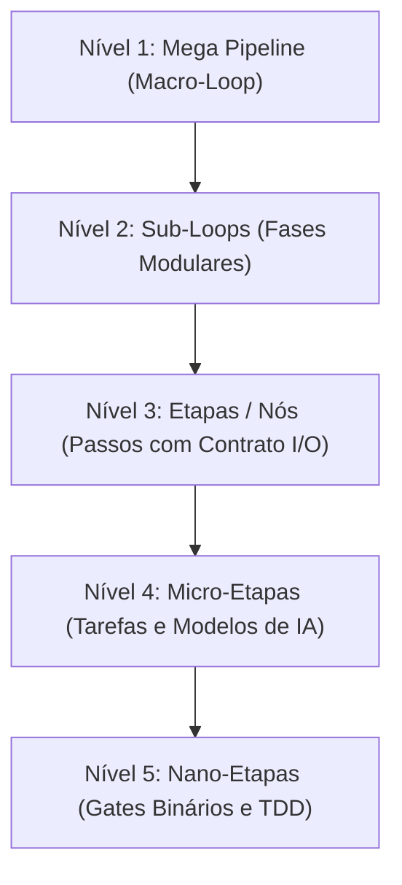
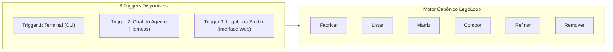

# 📘 GUIA DIDÁTICO BDD: DOMINANDO OS VERBOS E A GRANULARIDADE NO LEGOLOOP

> **Data:** 2026-11-07  
> **Status:** Canônico  
> **Padrão:** BDD (*Behavior-Driven Development* / Dado-Quando-Então)  
> **Público-alvo:** Desenvolvedores, Engenheiros de IA e Arquitetos de Software  
> **Alvo:** Ecossistema LegoLoop & AIDD  

---

## 1. Visão Geral: A Filosofia Lego

O **LegoLoop** transforma fluxos de trabalho de software e inteligência artificial em **blocos modulares componíveis** governados por um Grafo Acíclico Dirigido (DAG). 

Nada no LegoLoop é código estático ou monolítico: qualquer fluxo pode ser montado, desmontado, inspecionado, refinado ou recombinado sem efeitos colaterais nos demais blocos.

### Os 5 Níveis de Granularidade



| Nível | Escopo | O que você pode controlar | Exemplo Real |
| :--- | :--- | :--- | :--- |
| **1. Mega Pipeline** | Ciclo de vida completo do produto | Orquestração mestre, paralelismo de épicos, convergência de trabalho | Mega Pipeline LegoLoop de ponta a ponta |
| **2. Sub-Loops** | Módulos autônomos reutilizáveis | Injeção hierárquica, isolamento em `out/<subloop>/`, reuso entre projetos | Loop de Auditoria 4F, Loop de Design Impeccable |
| **3. Etapas (Nós)** | Contratos de entrada e saída | Troca de peças por reputação, substituição cirúrgica, dependências | `e01_planejamento` -> `e02_construcao` |
| **4. Micro-Etapas** | Unidades de execução cognitiva | Modelo de IA (`flash`, `pro`, `auto`), contexto estéril, ferramentas MCP | Prompt isolado do redator de testes sem contaminação |
| **5. Nano-Etapas** | Invariantes determinísticas de código | Asserções de teste unitário, thresholds de cobertura, gates `SG-*` | Limite de 35 linhas por função Go (`funclen`), `gofmt` |

---

## 2. Mapa dos Verbos e a Tríade de Triggers (Gatilhos de Entrada)

O LegoLoop **não se limita à linha de comando**. Todas as operações e verbos do ecossistema suportam **três triggers equivalentes de entrada**:



### Os Três Modos de Acionamento:

1. **Terminal (CLI):** Linha de comando direta (`legoloop <verbo> [flags]`), ideal para scripts, CI/CD, terminais rápidos e automação sem interface.
2. **Chat do Agente / Harness:** Diálogo em linguagem natural no editor preferido (Claude Code, Cursor, Windsurf, MIMO, Antigravity) utilizando as **skills canônicas** ou **slash commands** (ex: `/legoloop-fabricar`, `/legoloop-listar`). O agente interpreta o pedido e despacha a ação de forma estéril.
3. **LegoLoop Studio (Interface Gráfica):** Painel web visual interativo (`legoloop studio`), ideal para inspeção em tempo real de grafos DAG, visualização de cartões, clique de botões, modais assistidos e drag-and-drop.

---

## 3. Cenários BDD Didáticos (Casos de Uso Multi-Trigger)

Abaixo, cada cenário BDD demonstra **exatamente o mesmo comportamento esperado** sendo acionado pelas três vias disponíveis.

---

### Cenário BDD 1: Fabricar um Pipeline Novo do Zero

> **Objetivo:** O usuário tem uma necessidade de automação e precisa que o sistema crie toda a estrutura de governança automaticamente.

* **Dado que** o desenvolvedor precisa de um pipeline para "Auditar segurança de contratos inteligentes em Solidity",
* **Quando** ele aciona a fabricação por qualquer uma das vias:
  * **Via Terminal (CLI):**
    ```bash
    legoloop fabricar "auditoria-smart-contracts" --goal "Auditar vulnerabilidades reentrancy e overflow em Solidity" --category build --yes
    ```
  * **Via Chat do Agente (Harness):**
    ```markdown
    /legoloop-fabricar
    Prompt: "Crie um novo processo chamado 'auditoria-smart-contracts' focado em auditar 
    vulnerabilidades de reentrancy e overflow em Solidity, na categoria build."
    ```
  * **Via LegoLoop Studio (Interface Web):**
    1. Acessa a aba **Processos** e clica no botão **`+ Novo Processo`**.
    2. No formulário do modal, preenche:
       * **Nome:** `auditoria-smart-contracts`
       * **Categoria:** `build`
       * **Objetivo:** *Auditar vulnerabilidades reentrancy e overflow em Solidity*
    3. Clica em **"Fabricar Processo"**.
* **Então** o LegoLoop executa o motor hermético e produz 4 artefatos canônicos padronizados:
  1. `docs/intents/YYYY-MM-DD_INTENT_AUDITORIA_SMART_CONTRACTS.md` (Problema e motivação)
  2. `docs/specs/YYYY-MM-DD_SPEC_AUDITORIA_SMART_CONTRACTS.md` (Critérios de aceitação binários)
  3. `docs/plans/YYYY-MM-DD_PLAN_AUDITORIA_SMART_CONTRACTS.md` (Tickets em fatias verticais)
  4. `docs/routes/YYYY-MM-DD_ROUTE_AUDITORIA_SMART_CONTRACTS.json` (DAG formal executável)
* **E** o novo pipeline fica pronto para execução sem intervenção manual em código boilerplate.

---

### Cenário BDD 2: Inspecionar o Inventário com `listar`

> **Objetivo:** O usuário quer entender quais processos já existem no cofre, suas versões e em quais harnesses (Claude, Cursor, Windsurf, MIMO) eles estão vinculados.

* **Dado que** existem vários loops criados na máquina,
* **Quando** o usuário solicita a listagem:
  * **Via Terminal (CLI):**
    ```bash
    legoloop listar
    # Ou estruturado para pipelines:
    legoloop listar --json
    ```
  * **Via Chat do Agente (Harness):**
    ```markdown
    /legoloop-listar
    Prompt: "Liste todos os processos ativos no cofre do LegoLoop e verifique se há 
    harnesses descalibrados ou vínculos órfãos."
    ```
  * **Via LegoLoop Studio (Interface Web):**
    1. Acessa a seção **Processos** no menu lateral.
    2. Visualiza a grade de cartões com os processos, selos de versão (`@1.0.0`), badges de categoria e status dos harnesses vinculados com indicadores coloridos (`Claude [OK]`, `Cursor [OK]`).
* **Então** o sistema exibe a radiografia completa com:
  * Nome do processo e versão (`@1.0.0`)
  * Categoria (`build`, `reverse`, `web`, `mobile`)
  * Harnesses vinculados e estado dos links simbólicos
  * Vínculos órfãos ou advertências de sincronização
* **E** o desenvolvedor obtém visibilidade instantânea do ecossistema em qualquer um dos ambientes.

---

### Cenário BDD 3: Avaliar a Saúde das Peças com `matriz`

> **Objetivo:** Garantir que o pipeline utiliza apenas peças modernas e com alta reputação de engenharia antes de rodar uma entrega crítica.

* **Dado que** o desenvolvedor quer auditar a integridade das peças do ecossistema,
* **Quando** ele aciona a consulta da matriz:
  * **Via Terminal (CLI):**
    ```bash
    legoloop matriz --tier ouro
    ```
  * **Via Chat do Agente (Harness):**
    ```markdown
    /legoloop-matriz
    Prompt: "Consulte a matriz de peças do LegoLoop e me mostre apenas as ferramentas 
    de Tier Ouro com score >= 0.85 que podemos usar no pipeline."
    ```
  * **Via LegoLoop Studio (Interface Web):**
    1. Clica no item **Matriz de Peças** na navegação principal.
    2. Aplica o filtro de topo selecionando o chip **"Padrão Ouro"**.
    3. Inspeciona a tabela interativa contendo scores de reputação, cobertura de testes de mutação e conformidade com zero stubs.
* **Então** o sistema filtra e exibe apenas os componentes certificados (Score >= 0.85, sem stubs e com testes herméticos),
* **E** sinaliza claramente quais peças estão em nível **Bronze** ou defasadas, recomendando substituição cirúrgica.

---

### Cenário BDD 4: Compor um Sub-Loop em um Pipeline Existente

> **Objetivo:** O usuário possui um pipeline de construção e quer anexar a ele um sub-loop de homologação visual já existente.

* **Dado que** existe um pipeline mestre `pipeline-frontend` e um sub-loop homologador `aidd-homologue@1.0.0`,
* **Quando** o usuário conecta o sub-loop logo após a etapa de build (`e02`):
  * **Via Terminal (CLI):**
    ```bash
    legoloop compor pipeline-frontend aidd-homologue@1.0.0 --depende e02 --yes
    ```
  * **Via Chat do Agente (Harness):**
    ```markdown
    /legoloop-compor
    Prompt: "Componha o sub-loop 'aidd-homologue@1.0.0' dentro do 'pipeline-frontend', 
    fazendo-o depender da etapa 'e02'."
    ```
  * **Via LegoLoop Studio (Interface Web):**
    1. Abre o pipeline `pipeline-frontend` no visualizador de DAG interativo.
    2. Clica no botão **"+ Adicionar Sub-Loop"** ou arrasta o bloco `aidd-homologue` da gaveta lateral.
    3. Traça a aresta de conexão saindo de `e02` até o nó do sub-loop.
    4. Clica em **"Salvar Composição"**.
* **Então** o LegoLoop:
  1. Verifica se a junção criaria ciclos proibidos (`ErrCiclo`).
  2. Isola a saída do sub-loop na pasta confinada `out/aidd-homologue/`.
  3. Atualiza atomicamente os arquivos `.processo.json` e `.dag.json` do pipeline pai.
* **E** o sub-loop passa a ser executado como uma caixa-preta confiável dentro do macro-fluxo.

---

### Cenário BDD 5: Refinar Cirurgicamente uma Etapa Específica

> **Objetivo:** Uma etapa do pipeline está lenta ou usando uma ferramenta antiga e o usuário quer trocá-la sem recriar o pipeline.

* **Dado que** a etapa `e03_analise_estatica` está usando uma ferramenta obsoleta,
* **Quando** o usuário solicita a substituição atômica:
  * **Via Terminal (CLI):**
    ```bash
    legoloop refinar "auditoria-smart-contracts" --trocar e03_analise_estatica --por "slither-analyzer@2.0.0" --yes
    ```
  * **Via Chat do Agente (Harness):**
    ```markdown
    /legoloop-refinar
    Prompt: "No processo 'auditoria-smart-contracts', refine a etapa 'e03_analise_estatica' 
    substituindo-a pela peça 'slither-analyzer@2.0.0'."
    ```
  * **Via LegoLoop Studio (Interface Web):**
    1. Clica com o botão direito sobre o nó `e03_analise_estatica` no grafo do Studio.
    2. Seleciona a opção **"Refinar / Trocar Peça"** no menu de contexto.
    3. Escolhe `slither-analyzer@2.0.0` no catálogo de peças aptas sugerido pela matriz.
    4. Confirma a substituição no modal de validação de contratos.
* **Então** o LegoLoop:
  1. Valida se os contratos de entrada e saída da nova peça são compatíveis com os nós adjacentes.
  2. Substitui o nó no DAG preservando todas as conexões anteriores e posteriores.
  3. Incrementa a versão menor do processo (ex: de `@1.0.0` para `@1.1.0`).
* **E** nenhuma outra etapa do fluxo sofre qualquer alteração ou efeito colateral.

---

### Cenário BDD 6: Remover com Segurança e Rollback Garantido

> **Objetivo:** Um processo ou etapa não é mais necessário e deve ser excluído sem deixar resíduos nos editores ou quebrar links.

* **Dado que** o processo `experimento-legado` deve ser desativado,
* **Quando** o usuário aciona a remoção segura:
  * **Via Terminal (CLI):**
    ```bash
    # 1. Simulação prévia
    legoloop remover "experimento-legado" --dry-run
    # 2. Execução definitiva
    legoloop remover "experimento-legado" --force
    ```
  * **Via Chat do Agente (Harness):**
    ```markdown
    /legoloop-remover
    Prompt: "Remova o processo 'experimento-legado' com segurança, executando a 
    simulação primeiro e limpando os links simbólicos de todos os harnesses."
    ```
  * **Via LegoLoop Studio (Interface Web):**
    1. No card do processo `experimento-legado`, clica no ícone de engrenagem / três pontos e seleciona **"Remover Processo"**.
    2. O Studio abre o diálogo de **Impacto e Dry-Run**, listando arquivos e harnesses afetados.
    3. O usuário digita o nome do processo para confirmação e clica no botão vermelho **"Confirmar Remoção"**.
* **Então** o sistema exibe o relatório de desvinculação, limpa os symlinks nos harnesses (Claude, Cursor, etc.), arquiva os dados e gera uma cópia de segurança de rollback para restauração imediata se necessário.

---

### Cenário BDD 7: Personalizar Micro e Nano-Etapas no `ROUTE.json`

> **Objetivo:** Controlar o custo cognitivo e a velocidade de execução ajustando modelos de IA e limites por bloco.

* **Dado que** o arquivo de rota `docs/routes/YYYY-MM-DD_ROUTE_EXEMPLO.json` define a execução por nós,
* **Quando** o usuário ajusta as propriedades declarativas de um nó:
  * **Via Terminal / Editor de Código:**
    Abre o arquivo e edita diretamente:
    ```json
    {
      "id": "ticket-01",
      "titulo": "Gerar Casos de Teste Unitários",
      "modelo_cognitivo": "gemini-flash",
      "contexto_esteril": true,
      "mcps_permitidos": ["codebase-memory-mcp"],
      "stop_gates": ["SG-01-REVISAO-HUMANA"]
    }
    ```
  * **Via Chat do Agente (Harness):**
    ```markdown
    Prompt: "No arquivo de rota mais recente, configure o nó 'ticket-01' para usar o modelo 
    cognitivo 'gemini-flash', isolamento de contexto estéril e apenas a ferramenta 'codebase-memory-mcp'."
    ```
  * **Via LegoLoop Studio (Interface Web):**
    1. Clica no nó `ticket-01` no diagrama do Studio para abrir o painel lateral de **Propriedades da Etapa**.
    2. Seleciona o modelo no dropdown: `gemini-flash` (modo econômico).
    3. Ativa o switch **"Contexto Estéril"**.
    4. Marca apenas o MCP `codebase-memory-mcp` na lista de ferramentas e ativa o portão `SG-01-REVISAO-HUMANA`.
    5. Clica em **"Aplicar Alterações"**.
* **Então** na execução da Orchestrix:
  1. O nó executa com modelo ultrarrápido e econômico (`gemini-flash`).
  2. Carrega apenas as ferramentas necessárias (`codebase-memory-mcp`), sem poluir a janela de contexto.
  3. Pausa obrigatoriamente no portão humano `SG-01-REVISAO-HUMANA` antes de gravar no disco.

---

## 4. Tabela de Consulta Rápida: A Tríade de Triggers por Operação

| Ação Desejada | Nível | Trigger 1: Terminal (CLI) | Trigger 2: Chat do Agente | Trigger 3: LegoLoop Studio |
| :--- | :--- | :--- | :--- | :--- |
| **Criar processo do zero** | Macro | `legoloop fabricar "<nome>"` | `/legoloop-fabricar` ou prompt de intenção | Botão **`+ Novo Processo`** (modal com meta e categoria) |
| **Consultar inventário** | Macro | `legoloop listar [--json]` | `/legoloop-listar` ou prompt de auditoria | Aba **Processos** (cards visuais e status dos harnesses) |
| **Auditar reputação de peças** | Meso | `legoloop matriz [--tier ouro]` | `/legoloop-matriz` ou prompt de reputação | Aba **Matriz** (filtros interativos Ouro / Prata / Bronze) |
| **Encaixar sub-loop em pipeline** | Meso | `legoloop compor "<pai>" "<filho>"` | `/legoloop-compor` ou prompt de acoplamento | Arrastar bloco e traçar aresta de dependência no DAG |
| **Substituir etapa pontual** | Micro | `legoloop refinar "<alvo>"` | `/legoloop-refinar` ou prompt de refinamento | Botão direito no nó do grafo -> **Refinar / Trocar Peça** |
| **Remover processo com rollback** | Macro | `legoloop remover "<nome>"` | `/legoloop-remover` ou prompt de desativação | Menu de contexto do card -> **Remover** (com modal de impacto) |
| **Ajustar Modelo IA / Contexto** | Micro/Nano | Edição direta do `ROUTE.json` | Solicitação direta ao agente no chat | Painel lateral de propriedades do nó selecionado no grafo |
| **Compilar livro didático / PDF** | Macro | `legoloop legopress "<alvo>"` | `/legoloop-legopress` ou prompt de livro | Botão **"Exportar Livro Didático"** na barra de ferramentas |

---

## 5. Conclusão

Com a Tríade de Triggers integrada ao padrão BDD, o usuário compreende que o LegoLoop **não é apenas uma CLI**:
* Se estiver num ambiente de automação headless ou CI/CD, utiliza o **Terminal**.
* Se estiver programando em par com um modelo de linguagem no seu editor favorito, utiliza o **Chat do Agente**.
* Se preferir visão panorâmica, edição visual e clique intuitivo, utiliza o **LegoLoop Studio**.

Em qualquer um dos três caminhos, o comportamento contratado pelo BDD (**Dado-Quando-Então**) é idêntico, determinístico e auditável.
