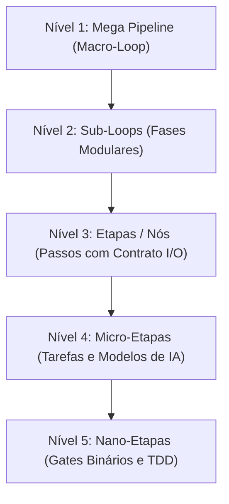
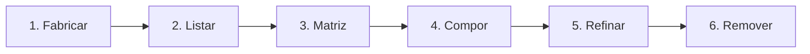

# 📘 GUIA DIDÁTICO BDD: DOMINANDO OS VERBOS E A GRANULARIDADE NO LEGOLOOP

> **Data:** 2026-11-07  
> **Status:** Canônico  
> **Padrão:** BDD (*Behavior-Driven Development* / Dado-Quando-Então)  
> **Público-alvo:** Desenvolvedores, Engenheiros de IA e Arquitetos de Software  
> **Alvo:** Ecossistema LegoLoop & AIDD  

---

## 1. Visão Geral: A Filosofia Lego

O **LegoLoop** transforma fluxos de trabalho de software e inteligência artificial em **blocos modulares componíveis** governados por um Grafo Acíclico Dirigido (DAG). 

Nada no LegoLoop é código estático ou monolítico: qualquer fluxo pode ser montado, desmontado, inspecionado, refinado ou recombinado sem efeitos colaterais nos demais blocos.

### Os 5 Níveis de Granularidade



| Nível | Escopo | O que você pode controlar | Exemplo Real |
| :--- | :--- | :--- | :--- |
| **1. Mega Pipeline** | Ciclo de vida completo do produto | Orquestração mestre, paralelismo de épicos, convergência de trabalho | Mega Pipeline LegoLoop de ponta a ponta |
| **2. Sub-Loops** | Módulos autônomos reutilizáveis | Injeção hierárquica, isolamento em `out/<subloop>/`, reuso entre projetos | Loop de Auditoria 4F, Loop de Design Impeccable |
| **3. Etapas (Nós)** | Contratos de entrada e saída | Troca de peças por reputação, substituição cirúrgica, dependências | `e01_planejamento` -> `e02_construcao` |
| **4. Micro-Etapas** | Unidades de execução cognitiva | Modelo de IA (`flash`, `pro`, `auto`), contexto estéril, ferramentas MCP | Prompt isolado do redator de testes sem contaminação |
| **5. Nano-Etapas** | Invariantes determinísticas de código | Asserções de teste unitário, thresholds de cobertura, gates `SG-*` | Limite de 35 linhas por função Go (`funclen`), `gofmt` |

---

## 2. Mapa dos 5 Verbos Canônicos



1. **`fabricar`**: Criação do zero a partir de uma intenção em linguagem natural.
2. **`listar`**: Radiografia completa do cofre e conexões ativas nos harnesses.
3. **`matriz`**: Classificação de reputação e aptidão de cada peça (Ouro, Prata, Bronze).
4. **`compor`**: Encaixe hierárquico de processos menores dentro de processos maiores.
5. **`refinar`**: Troca atômica de um passo sem quebrar o grafo.
6. **`remover`**: Desconexão segura e reversível de processos e vínculos.

---

## 3. Cenários BDD Didáticos (Casos de Uso)

---

### Cenário BDD 1: Fabricar um Pipeline Novo do Zero

> **Objetivo:** O usuário tem uma necessidade de automação e precisa que o sistema crie toda a estrutura de governança automaticamente.

* **Dado que** o desenvolvedor precisa de um pipeline para "Auditar segurança de contratos inteligentes em Solidity",
* **Quando** ele executa o comando de fabricação no terminal:
  ```bash
  legoloop fabricar "auditoria-smart-contracts" --goal "Auditar vulnerabilidades reentrancy e overflow em Solidity" --category build --yes
  ```
* **Então** o LegoLoop executa o motor hermético e produz 4 artefatos canônicos padronizados:
  1. `docs/intents/YYYY-MM-DD_INTENT_AUDITORIA_SMART_CONTRACTS.md` (Problema e motivação)
  2. `docs/specs/YYYY-MM-DD_SPEC_AUDITORIA_SMART_CONTRACTS.md` (Critérios de aceitação binários)
  3. `docs/plans/YYYY-MM-DD_PLAN_AUDITORIA_SMART_CONTRACTS.md` (Tickets em fatias verticais)
  4. `docs/routes/YYYY-MM-DD_ROUTE_AUDITORIA_SMART_CONTRACTS.json` (DAG formal executável)
* **E** o novo pipeline fica pronto para execução sem intervenção manual em código boilerplate.

---

### Cenário BDD 2: Inspecionar o Inventário com `listar`

> **Objetivo:** O usuário quer entender quais processos já existem no cofre, suas versões e em quais harnesses (Claude, Cursor, Windsurf, MIMO) eles estão vinculados.

* **Dado que** existem vários loops criados na máquina,
* **Quando** o usuário executa:
  ```bash
  legoloop listar
  ```
* **Então** o sistema exibe uma tabela detalhada com:
  * Nome do processo e versão (`@1.0.0`)
  * Categoria (`build`, `reverse`, `web`, `mobile`)
  * Harnesses vinculados (ex: `Claude Code [OK]`, `Cursor [OK]`)
  * Vínculos órfãos ou advertências de sincronização
* **E** permite inspecionar em formato estruturado usando `--json` para integrações automáticas.

---

### Cenário BDD 3: Avaliar a Saúde das Peças com `matriz`

> **Objetivo:** Garantir que o pipeline utiliza apenas peças modernas e com alta reputação de engenharia.

* **Dado que** o desenvolvedor quer auditar as peças do ecossistema antes de rodar uma entrega crítica,
* **Quando** ele executa:
  ```bash
  legoloop matriz --tier ouro
  ```
* **Então** o sistema filtra e exibe apenas os componentes com selo **Padrão Ouro** (Score >= 0.85, testes de mutação aprovados, zero stubs),
* **E** destaca peças defasadas ou em nível **Bronze** que devem ser substituídas no próximo ciclo de refinamento.

---

### Cenário BDD 4: Compor um Sub-Loop em um Pipeline Existente

> **Objetivo:** O usuário possui um pipeline de construção e quer anexar a ele um sub-loop de homologação visual já existente.

* **Dado que** existe um pipeline mestre `pipeline-frontend` e um sub-loop homologador `aidd-homologue@1.0.0`,
* **Quando** o usuário conecta o sub-loop logo após a etapa de build (`e02`):
  ```bash
  legoloop compor pipeline-frontend aidd-homologue@1.0.0 --depende e02 --yes
  ```
* **Então** o LegoLoop:
  1. Verifica se a junção criaria ciclos proibidos (`ErrCiclo`).
  2. Isola a saída do sub-loop na pasta confinada `out/aidd-homologue/`.
  3. Atualiza atomicamente os arquivos `.processo.json` e `.dag.json` do pipeline pai.
* **E** o sub-loop passa a ser executado como uma caixa-preta confiável dentro do macro-fluxo.

---

### Cenário BDD 5: Refinar Cirurgicamente uma Etapa Específica

> **Objetivo:** Uma etapa do pipeline está lenta ou usando uma ferramenta antiga e o usuário quer trocá-la sem recriar o pipeline.

* **Dado que** a etapa `e03_analise_estatica` está usando uma ferramenta obsoleta,
* **Quando** o usuário executa:
  ```bash
  legoloop refinar "auditoria-smart-contracts" --trocar e03_analise_estatica --por "slither-analyzer@2.0.0" --yes
  ```
* **Então** o LegoLoop:
  1. Valida se os contratos de entrada e saída da nova peça são compatíveis com os nós adjacentes.
  2. Substitui o nó no DAG preservando todas as conexões anteriores e posteriores.
  3. Incrementa a versão menor do processo (ex: de `@1.0.0` para `@1.1.0`).
* **E** nenhuma outra etapa do fluxo sofre qualquer alteração.

---

### Cenário BDD 6: Remover com Segurança e Rollback Garantido

> **Objetivo:** Um processo ou etapa não é mais necessário e deve ser excluído sem deixar resíduos nos editores ou quebrar links.

* **Dado que** o processo `experimento-legado` deve ser desativado,
* **Quando** o usuário executa primeiro em modo de simulação:
  ```bash
  legoloop remover "experimento-legado" --dry-run
  ```
* **Então** o sistema exibe tudo o que seria desvinculado (links nos harnesses, arquivos no cofre).
* **E quando** o usuário confirma com `legoloop remover "experimento-legado" --force`,
* **Então** o processo é desregistrado, os symlinks nos harnesses são limpos e uma cópia de segurança de rollback é gerada para restauração imediata se necessário.

---

### Cenário BDD 7: Personalizar Micro e Nano-Etapas no `ROUTE.json`

> **Objetivo:** Controlar o custo cognitivo e a velocidade de execução ajustando modelos de IA e limites por bloco.

* **Dado que** o arquivo de rota `docs/routes/YYYY-MM-DD_ROUTE_EXEMPLO.json` define a execução por nós,
* **Quando** o usuário abre o nó `ticket-01` e edita suas propriedades declarativas:
  ```json
  {
    "id": "ticket-01",
    "titulo": "Gerar Casos de Teste Unitários",
    "modelo_cognitivo": "gemini-flash",
    "contexto_esteril": true,
    "mcps_permitidos": ["codebase-memory-mcp"],
    "stop_gates": ["SG-01-REVISAO-HUMANA"]
  }
  ```
* **Então** na execução da Orchestrix:
  1. O nó executa com modelo ultrarrápido e econômico (`gemini-flash`).
  2. Carrega apenas as ferramentas necessárias (`codebase-memory-mcp`), sem poluir a janela de contexto.
  3. Pausa obrigatoriamente no portão humano `SG-01-REVISAO-HUMANA` antes de gravar no disco.

---

## 4. Tabela de Consulta Rápida (Cheat Sheet de Decisão)

| O que você quer fazer? | Nível | Comando Recomendado | Parâmetros Chave |
| :--- | :--- | :--- | :--- |
| **Criar um processo novo** | Macro | `legoloop fabricar "<nome>"` | `--goal "<desc>" --category <cat>` |
| **Consultar o que está instalado** | Macro | `legoloop listar` | `--json` para automações |
| **Verificar saúde e notas das peças** | Meso | `legoloop matriz` | `--tier ouro` ou `--tier prata` |
| **Encaixar um pipeline dentro de outro** | Meso | `legoloop compor "<pai>" "<filho>"` | `--depende <etapa> --yes` |
| **Substituir uma etapa com defeito** | Micro | `legoloop refinar "<nome>"` | `--trocar <id> --por <nova_peca>` |
| **Desinstalar com limpeza de links** | Macro | `legoloop remover "<nome>"` | `--dry-run` antes, `--force` depois |
| **Alterar modelo de IA / Tokens de um nó** | Micro/Nano | Edição direta no `ROUTE.json` | `"modelo_cognitivo": "pro\|flash"` |
| **Gerar livro didático / PDF do processo** | Macro | `legoloop legopress "<alvo>"` | Compilação via Typst determinístico |

---

## 5. Conclusão

Com essa arquitetura em BDD, o usuário não precisa decorar códigos internos do LegoLoop. Ele pensa exclusivamente em termos de **comportamento esperado**:
* **Qual é o meu estado atual?** (Dado)
* **Qual verbo de comando eu aciono?** (Quando)
* **Qual garantia determinística o sistema me devolve?** (Então)
