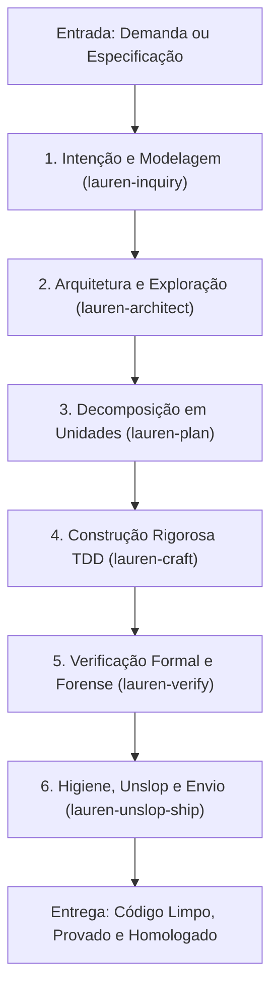

# 📘 MANUAL OPERACIONAL: PIPELINE DE RIGOR, MODELAGEM & ENGENHARIA LAUREN TAN (PSTACK) NO LEGOLOOP

> **Data:** 2026-11-09  
> **Autoridade:** Lauren Tan (@poteto - Upstream MIT) & Ecossistema LegoLoop / AIDD  
> **Status:** Canônico  
> **Escopo:** Rigor de Engenharia, Modelagem de Domínio, Princípios Invioláveis ("One-Rule Principles"), Prova no Artefato Real, Decomposição em Unidades Verificáveis, Eliminação de Slop e Entrega Blindada.

---

## 1. Visão Geral e Filosofia

O método **Lauren Tan (`pstack` / `poteto-mode`)** estabelece um padrão de trabalho obsessivo por qualidade, clareza e prova mecânica. A tese central é direta: *"Se quer ir rápido, vá fundo primeiro"*. Em vez de gerar grande volume de código descartável ou confiar em autorrelatos do modelo ("compila", "tudo certo"), o método exige menos código, de qualidade superior e com verificação no artefato real.

### Pilares Fundamentais:

1. **Modelar o Domínio Antes da Lógica (*Model the Domain*):**  
   Antes de escrever condicionais ou fluxos de negócio, estruture os dados essenciais (tipos fechados, máquinas de estado, coleções adequadas, invariantes). Estados ilegais tornam-se irrepresentáveis pelo próprio sistema de tipos.
2. **Provar no Artefato Real (*Prove It Works*):**  
   Dizer que "o código compila" ou confiar em fixtures parciais não conta. O trabalho só termina ao executar a funcionalidade contra o artefato real, medindo métricas concretas e validando saídas observáveis.
3. **Desafiar Premissas (*Attack the Premise*):**  
   Se duas ou mais correções falharem no mesmo portão de qualidade, não tente uma terceira correção sobre a mesma suposição. Escreva a premissa fundamental, teste-a diretamente e descarte suposições falsas.
4. **Subtrair Antes de Adicionar (*Subtract Before You Add*):**  
   Antes de adicionar camadas de abstração, sinalização ou novos módulos, remova peso morto, colapse chamadores desnecessários e reduza a carga cognitiva do leitor (*Minimize Reader Load*).
5. **Decomposição em Unidades Verificáveis (*Sequence Verifiable Units*):**  
   Demandas grandes são fatiadas em passos pequenos e independentes, cada um terminando em uma checagem automatizada antes de avançar para o próximo.
6. **Higiene Radical de Código & Anti-Slop (*Unslop & No Comments*):**  
   Prosa prolixa e comentários óbvios que apenas narram o código são banidos. O código deve ser autoexplicativo, com documentação técnica cirúrgica e commits rastreáveis.

---

## 2. O Loop Mestre de Engenharia (Ideia $\to$ Produção)

---

## 3. Taxonomia dos Sub-Loops Modulares

| Sub-Loop ID | Propósito Operacional | Ferramentas & Playbooks Subordinados | Artefato de Saída / Gate |
| :--- | :--- | :--- | :--- |
| `lauren-inquiry` | Enquadramento de intenção, eliminação de suposições e modelagem de tipos | `how`, `why`, `poteto-mode`, `interrogate` | `INTENT.md` e modelagem de tipos fechados |
| `lauren-architect` | Exploração do espaço de design, arena competitiva e prototipagem | `architect`, `arena`, `prototype`, `swarm` | `SPEC.md` com arquitetura comparada |
| `lauren-plan` | Decomposição sequencial de entregáveis e marcos de throughput | `multi-phase-plan`, `feature`, `orchestrate` | `PLAN.md` com grafo de tickets atômicos |
| `lauren-craft` | Implementação estrita TDD, tipagem forte e respeito a fronteiras | `tdd`, `typescript-best-practices`, `laziness-protocol` | Código real, testes verdes e zero stubs |
| `lauren-verify` | Verificação contra o artefato real, forense e prova de números | `correct`, `benchmark-checklist`, `runtime-forensics` | Relatório de testes, benchmarks e dados reais |
| `lauren-unslop-ship` | Remoção de comentários supérfluos, documentação técnica e PR blindado | `unslop`, `no-comments`, `technical-writing`, `shipping` | Diff polido, PR documentado e branch limpa |

---

## 4. Matriz de Roteamento Cognitivo

| Sub-Loop | Complexidade Cognitiva | Modelo Sugerido | Fallback | Esforço |
| :--- | :---: | :---: | :---: | :---: |
| `lauren-inquiry` | Média | `sonnet` | `haiku` | Médio |
| `lauren-architect` | Alta | `sonnet` | `code-pro` | Alto |
| `lauren-plan` | Média | `code-fast` | `haiku` | Baixo |
| `lauren-craft` | Alta | `sonnet` | `code-pro` | Alto |
| `lauren-verify` | Alta | `sonnet` | `qwen2.5-coder:7b` | Alto |
| `lauren-unslop-ship` | Baixa | `haiku` | `gemini-flash` | Baixo |

---

## 5. Higiene de Contexto e Fronteiras de Fase

1. **Contexto Estéril (Orchestrix):** Cada sub-loop recebe apenas as entradas necessárias do nó anterior (`INTENT`, `SPEC`, `PLAN` ou código compilado).
2. **Rotação e Descarte de Slop:** Antes de qualquer entrega ou revisão humana, os diffs passam por `unslop` e `no-comments` para remover ruído textual.
3. **Parada em Ações Irreversíveis:** Operações locais reversíveis avançam autonomamente; ações como push forçado, deploy ou destruição de dados exigem autorização humana explícita.

---

## 6. Guia de Execução no LegoLoop

### 6.1 Via Chat / CLI
* Disparar esteira completa:  
  `legoloop run lauren-tan`
* Inspecionar processo:  
  `legoloop listar`

### 6.2 Via Looping Studio (Canvas)
* Abrir o Studio: `legoloop studio`
* Selecionar no menu lateral o template **Pipeline Lauren Tan pstack (6 Sub-Loops)**
* Visualizar o grafo com os 6 nós encadeados e suas configurações de modelo e gates.
