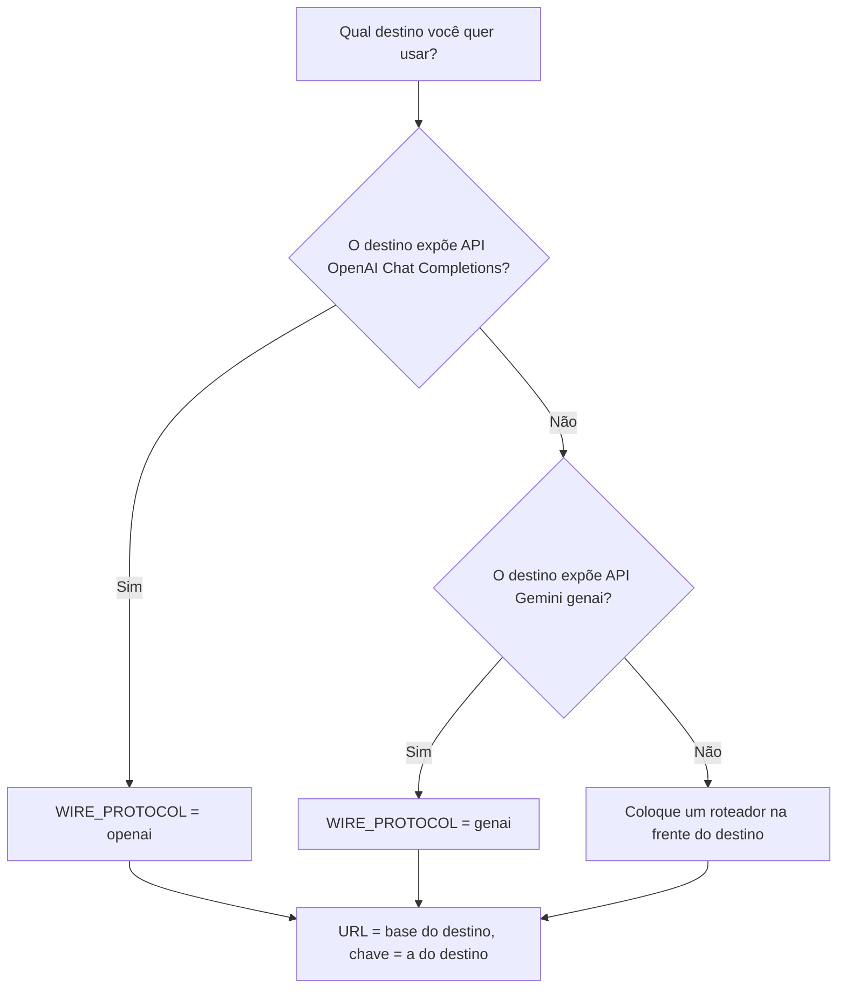

# MANUAL OPERACIONAL: GATEWAY DE LLM NO ANTIGRAVITY CLI (AGY) POR VARIÁVEIS DE AMBIENTE

> **Data:** 2026-11-13
> **Autoridade:** Ecossistema LegoLoop
> **Status:** Canônico
> **Escopo:** Como apontar o `agy` para um gateway de LLM (9Router ou outro) por variáveis de ambiente, sem trocar de conta Google. Três métodos: pelo sistema operacional, pela linha de comando e por pedido a um agente.
> **Livro Didático:** `docs/books/gateway-llm-agy/livro.json`
> **Fontes de verdade:** documentação do Google Cloud (Connect Antigravity to an Enterprise Gateway) · `auto-provider-onboarding/pkg/driver/driver.go` · `pkg/driver/exec.go` · memória `agy-bloqueio-gw`

---

## 1. Resultado e premissas corrigidas

O `agy` aceita um gateway de LLM configurado por variáveis de ambiente. O Google documenta esse recurso para gateways corporativos.
A chave guardada na variável é a chave que o gateway exige. Ela não precisa ser uma chave do Google.

Três premissas precisam de correção antes do uso.

| Premissa | Veredito | Prova |
| :--- | :--- | :--- |
| As variáveis `AGY_LLM_GATEWAY_*` existem e são documentadas pelo Google | Confirmado | Página "Connect Antigravity to an Enterprise Gateway" (Google Cloud) |
| Qualquer chave de qualquer provedor funciona | Parcial | O gateway precisa falar o protocolo `genai` ou `openai` (Chat Completions) |
| O uso é homologado e sem risco de violar o termo de serviço | **Não provado** | A página do Google não cita termo de serviço nem gateway de terceiros |

O que está provado sobre risco:

- O rodízio de contas Google causou o bloqueio de duas contas (memória `agy-bloqueio-gw`, 10/11/2026).
- O gateway por variável de ambiente não lê nem troca a conta Google. Ele só muda o destino das chamadas de modelo.
- Quem usa o gateway não pode estar logado com conta Google ao mesmo tempo (Google Cloud, seção "Providers, accounts, and terms").

Este manual não afirma que o uso com gateway de terceiros é aprovado pelo Google. Quem decide usar assume essa dúvida.

---

## 2. Variáveis de ambiente

| Variável | Obrigatória | Função |
| :--- | :---: | :--- |
| `AGY_LLM_GATEWAY_URL` | Sim | URL HTTPS do gateway |
| `AGY_LLM_GATEWAY_API_KEY` | Sim | Chave que o gateway exige |
| `AGY_LLM_GATEWAY_WIRE_PROTOCOL` | Não | `genai` (padrão) ou `openai` |
| `AGY_LLM_GATEWAY_CA_CERT` | Não | Caminho do pacote de certificados raiz |
| `AGY_LLM_GATEWAY_MODELS` | Não | Lista de modelos permitidos, separada por vírgula |
| `AGY_LLM_GATEWAY_HEADERS` | Não | Cabeçalhos HTTP extras no formato `CHAVE: VALOR` |

Regras de precedência (Google Cloud):

1. O arquivo `admin_settings.json` do administrador vence a variável de ambiente.
2. No JetBrains e no Zed, defina as variáveis no campo `env` do agente. Defina também `"auth": { "type": "gateway" }` em `~/.gemini/antigravity-acp/settings.json`.
3. O protocolo `openai` não funciona no servidor ACP (JetBrains e Zed). Nesses editores use `genai`.
4. O `agy` na web não aceita gateway.
5. Programas abertos pelo menu Iniciar ou pelo Dock não leem o perfil do shell.

---

## 3. Qual chave usar

A chave é a do gateway que você escolheu. O quadro mostra o que o gateway precisa oferecer.

| Tipo de destino | `WIRE_PROTOCOL` | `URL` | Chave |
| :--- | :---: | :--- | :--- |
| 9Router (VPS da empresa) | `openai` | `https://roteador.signa-docs.com/v1` | chave do 9Router |
| Provedor com API compatível com OpenAI | `openai` | URL base `/v1` do provedor | chave do provedor |
| Gateway que fala Gemini (genai) | `genai` | URL do gateway | chave do gateway |
| Roteador próprio (por exemplo LiteLLM) | `openai` | URL do roteador | chave do roteador |

Regra de decisão:



Um provedor que não fala nenhum dos dois protocolos não funciona direto. Ponha um roteador na frente dele.

---

## 4. Método A: pelo sistema operacional

### 4.1 Windows, pela janela gráfica

1. Pressione `Win + R`, digite `rundll32 sysdm.cpl,EditEnvironmentVariables` e confirme.
2. Na seção **Variáveis de usuário**, clique em **Novo**.
3. Crie `AGY_LLM_GATEWAY_URL` com a URL do gateway.
4. Crie `AGY_LLM_GATEWAY_WIRE_PROTOCOL` com `openai` ou `genai`.
5. Crie `AGY_LLM_GATEWAY_API_KEY` com a chave.
6. Clique em **OK** nas duas janelas.
7. Feche todos os terminais e abra um novo.

Para trocar de chave: abra a mesma janela, selecione a variável, clique em **Editar** e troque o valor.
Para desligar o gateway: apague as três variáveis e abra um terminal novo.

### 4.2 Windows, pelo PowerShell

```powershell
[Environment]::SetEnvironmentVariable('AGY_LLM_GATEWAY_URL','https://SEU-GATEWAY/v1','User')
[Environment]::SetEnvironmentVariable('AGY_LLM_GATEWAY_WIRE_PROTOCOL','openai','User')
[Environment]::SetEnvironmentVariable('AGY_LLM_GATEWAY_API_KEY','<SUA_CHAVE>','User')
```

Não use `setx` para chaves longas. O `setx` corta valores acima de 1024 caracteres.

Para desligar:

```powershell
'AGY_LLM_GATEWAY_URL','AGY_LLM_GATEWAY_WIRE_PROTOCOL','AGY_LLM_GATEWAY_API_KEY' |
  ForEach-Object { [Environment]::SetEnvironmentVariable($_, $null, 'User') }
```

### 4.3 macOS e Linux

Acrescente ao `~/.bashrc` ou ao `~/.zshrc`:

```bash
export AGY_LLM_GATEWAY_URL="https://SEU-GATEWAY/v1"
export AGY_LLM_GATEWAY_WIRE_PROTOCOL="openai"
export AGY_LLM_GATEWAY_API_KEY="<SUA_CHAVE>"
```

Depois rode `source ~/.zshrc` (ou `~/.bashrc`). Para desligar, apague as três linhas e abra um terminal novo.

### 4.4 Verificação sem mostrar a chave

```powershell
foreach($n in 'AGY_LLM_GATEWAY_URL','AGY_LLM_GATEWAY_WIRE_PROTOCOL','AGY_LLM_GATEWAY_API_KEY'){
  "$n definida: $([bool][Environment]::GetEnvironmentVariable($n,'User'))" }
```

Nunca imprima o valor da chave. Impressão em terminal ou em chat expõe a chave.

---

## 5. Método B: pela linha de comando

### 5.1 Só na sessão atual (não persiste)

PowerShell:

```powershell
$env:AGY_LLM_GATEWAY_URL = 'https://SEU-GATEWAY/v1'
$env:AGY_LLM_GATEWAY_WIRE_PROTOCOL = 'openai'
$env:AGY_LLM_GATEWAY_API_KEY = $env:MINHA_CHAVE
agy
```

Bash:

```bash
AGY_LLM_GATEWAY_URL="https://SEU-GATEWAY/v1" AGY_LLM_GATEWAY_WIRE_PROTOCOL=openai \
AGY_LLM_GATEWAY_API_KEY="$MINHA_CHAVE" agy
```

O terminal fecha e as variáveis somem. Use esse modo para teste.

### 5.2 Persistente, com o `gw` desta máquina

O `gw` grava as três variáveis no ambiente do usuário. Ele lê a chave de `NINEROUTER_KEY` (`pkg/driver/driver.go`, `SetRoute`).

| Comando | Efeito |
| :--- | :--- |
| `gw agy 9router` | grava `AGY_LLM_GATEWAY_*` e o combo no `agy` |
| `gw agy 9router --combo <nome>` | escolhe o combo |
| `gw agy off` | apaga as três variáveis e volta ao uso direto do `agy` |
| `gw agy` | mostra a rota atual |

Sem `NINEROUTER_KEY` no ambiente, `gw agy 9router` falha com erro. Não existe mais chave embutida no código.

Em qualquer caso, abra um terminal novo depois do comando. Terminais abertos mantêm o ambiente antigo.

---

## 6. Método C: por pedido a um agente

Um agente (harness) altera as variáveis quando você descreve o que quer. O agente não deve receber a chave no texto do pedido.

### 6.1 Regras

1. Guarde a chave antes, em uma variável do sistema (por exemplo `NINEROUTER_KEY` ou `MINHA_CHAVE`).
2. Escreva o nome da variável no pedido. Nunca escreva o valor.
3. Peça confirmação só com `definida: True/False`.
4. Instale o hook `leak-scan`, que bloqueia saídas com segredo (`docs/manuals/2026-11-05_MANUAL_HOOKS_HARNESSES_SO.md`).
5. Peça que o agente faça cópia antes de editar arquivos de configuração.

### 6.2 Modelos de pedido

Ligar:

```text
Configure o agy para usar o gateway em https://SEU-GATEWAY/v1 com protocolo openai.
Leia a chave da variável de ambiente MINHA_CHAVE e grave AGY_LLM_GATEWAY_URL,
AGY_LLM_GATEWAY_WIRE_PROTOCOL e AGY_LLM_GATEWAY_API_KEY no ambiente do usuário.
Não imprima o valor da chave. Ao final, mostre só "definida: True/False" de cada variável.
```

Trocar de chave:

```text
Troque o valor de AGY_LLM_GATEWAY_API_KEY pelo conteúdo da variável MINHA_CHAVE_NOVA.
Não imprima a chave. Confirme só com "definida: True/False".
```

Desligar:

```text
Apague AGY_LLM_GATEWAY_URL, AGY_LLM_GATEWAY_WIRE_PROTOCOL e AGY_LLM_GATEWAY_API_KEY
do ambiente do usuário. Confirme com "definida: False" para as três.
```

Depois de qualquer pedido, abra um terminal novo e teste (seção 7).

---

## 7. Validação

| Teste | Comando | Resultado esperado |
| :--- | :--- | :--- |
| Variáveis definidas | seção 4.4 | `definida: True` nas três |
| Gateway responde | `Invoke-WebRequest -UseBasicParsing -Uri <URL>/models -Headers @{Authorization="Bearer $env:MINHA_CHAVE"}` | HTTP 200 |
| `agy` usa o gateway | terminal novo, `agy -p "ok"` | resposta vem do gateway |

Prova desta máquina (13/11/2026):

| Fato | Prova |
| :--- | :--- |
| Gateway do 9Router responde | `/v1/models` com HTTP 200 |
| `agy` respondeu pelo 9Router | confirmação do usuário em terminal novo |

---

## 8. Solução de problemas

| Sintoma | Causa provável | Ação |
| :--- | :--- | :--- |
| `agy` ignora o gateway | terminal aberto antes da mudança | abra um terminal novo |
| `agy` ignora o gateway em máquina gerenciada | `admin_settings.json` vence a variável | peça ao administrador |
| Erro de protocolo | `WIRE_PROTOCOL` errado | `openai` para Chat Completions, `genai` para Gemini |
| JetBrains ou Zed não usam o gateway | faltam `auth.type = gateway` e o campo `env` | seção 2, regra 2 |
| HTTP 401 ou 403 | chave inválida ou revogada | troque a chave (seção 4 ou 6) |
| Erro de certificado | CA privada | defina `AGY_LLM_GATEWAY_CA_CERT` |
| `gw agy 9router` falha | `NINEROUTER_KEY` ausente | defina a variável e abra terminal novo |

---

## 9. Limites e proibições

Estas regras vêm da lição do bloqueio de 10/11/2026 (memória `agy-bloqueio-gw`) e do código atual.

1. Proibido o rodízio de contas Google por código. O `gw` bloqueia `agy next`, `agy failover`, `agy devNN`, `agy sync`, `agy wincred`, `agy probe --all` e `agy refresh all`.
2. O `gw agy exec` não troca de conta em erro 429 (`maxFailoverRetries = 0`).
3. O wrapper `agy.cmd` chama o `agy.exe` direto. O `gw harness sync-wrappers` não gera wrapper do `agy`.
4. Nunca grave chave em código, em log, em commit ou em resposta de chat.
5. Chave que apareceu em saída de comando está comprometida. Revogue e gere outra no painel do gateway.
6. Não verificado: a política do Google sobre gateway de terceiros. A página do Google Cloud não a descreve.

---

## 10. Fontes

- Google Cloud, "Connect Antigravity to an Enterprise Gateway": https://docs.cloud.google.com/gemini/enterprise/docs/ai-developer-tools/connect-enterprise-gateway
- Google Cloud, "Configure an enterprise gateway for Google Antigravity": https://docs.cloud.google.com/gemini/enterprise/docs/ai-developer-tools/deploy-enterprise-gateway
- Portkey, "Google Antigravity" (guia de terceiros, protocolo `openai`): https://portkey.ai/docs/integrations/libraries/antigravity
- Código local: `Desktop/03_scripts_e_ferramentas/auto-provider-onboarding/pkg/driver/driver.go`, `exec.go`, `cmd/gw/main.go`
