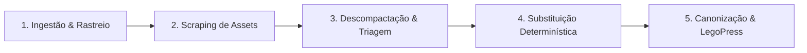

# 📘 Manual Metodológico: Engenharia Reversa e Canonização de Pipelines de Vídeo

> **Meta-Processo LegoLoop:** Da ingestão de conteúdo audiovisual externo até a materialização de um pipeline canônico, determinístico, multi-aspecto e governado por livro didático.

---

## 1. Visão Geral do Método

O objetivo deste meta-processo é transformar qualquer vídeo tutorial, técnica autoral ou asset proprietário de motion design (como os distribuídos por criadores no YouTube) em um **pipeline canônico acíclico (DAG)** integrado ao LegoLoop.

A metodologia baseia-se no princípio fundamental: **"Video is Code"** — todo efeito visual (vidro 3D, tipografia cinética, corte de respiração, auto-framing) pode e deve ser expresso como código procedural aberto, eliminando dependências de softwares fechados ou plataformas SaaS de terceiros.



---

## 2. Fase 1: Ingestão de URL e Extração de Metadados

1. **Captura do Alvo Audiovisual:**
   * Utilizar `yt-dlp` ou curl para extrair a stream de áudio (`.wav` 48kHz PCM 16-bit) e o vídeo bruto (`.mp4`).
   * Extrair transcrição original (legendas VTT/SRT) via ferramentas de Whisper ou API para confronto de vocabulário.
2. **Decomposição Estrutural:**
   * Mapear os pontos de virada narrativa (Hooks, Desenvolvimentos, CTAs).
   * Identificar o BPM médio da fala e padrões de respiro do locutor.

---

## 3. Fase 2: Varredura de Assets com Playwright MCP / Obscura

1. **Navegação Não-Intrusiva:**
   * Localizar links de descrição do vídeo (Notion, Google Drive, Gumroad, GitHub).
   * Usar Playwright MCP ou Obscura (Rust Headless com V8) em modo stealth para acessar os repositórios de distribuição.
2. **Download e Verificação Criptográfica:**
   * Baixar os pacotes distribuídos (arquivos `.skill`, `.zip`, presets de After Effects/Premiere).
   * Calcular o hash SHA-256 de cada ativo para garantir rastreabilidade histórica.

---

## 4. Fase 3: Descompactação Cirúrgica e Triagem Modular

Arquivos `.skill` são essencialmente arquivos ZIP contendo diretórios semânticos. A triagem deve classificar os ativos em 4 pilares:

```
scratch/alvo-reverso/
├── audio/          # Scripts de silêncio, alinhamento Whisper e perfis de EQ
├── visual/         # Presets de vidro, blur, motion CSS e tipografia
├── generation/     # Prompts para geradores de imagem/vídeo
└── templates/      # Estruturas de legenda e cartões informativos
```

**Regra de Ouro:** Isolar o que é **estilo visual** (reutilizável) do que é **ferramenta proprietária** (a ser substituída).

---

## 5. Fase 4: Substituição de Motores Proprietários por Soluções Determinísticas

Nenhum pipeline LegoLoop pode depender de serviços pagos ou APIs proprietárias com risco de lock-in ou quebra.

| Dependência Original | Substituto Canônico LegoLoop | Benefício |
| :--- | :--- | :--- |
| **Higgsfield / Pika** | Google AI Studio + Fallback Procedural | Custo zero, determinismo e alta fidelidade |
| **After Effects / Premiere** | Remotion / CSS3 3D / FFmpeg | Render por código, CLI e versionamento Git |
| **Cortes manuais em NLE** | Detector de energia RMS + Silero VAD | Corte a -30dB com 40ms de margem pré-ataque |
| **Legendas proprietárias** | Words.json milimétrico + Anton Kinetic | Sincronia perfeita palavra por palavra |

---

## 6. Fase 5: Montagem do Grafo DAG e Integração CLI

1. **Criação do Loop DAG (`loops/<nome>/pipeline.dag.json`):**
   * Definir nós acíclicos com camadas estritas (`layers`).
   * Associar comandos CLI nativos: `["legoloop", "<modulo>", "<subcomando>"]`.
   * Configurar modo de roteamento: `suggested`.
2. **Exposição de Subcomandos CLI (`internal/cli`):**
   * Garantir que cada nó do pipeline possa ser testado e executado isoladamente via terminal.

---

## 7. Fase 6: O Livro Didático Canônico (LegoPress)

Nenhum pipeline é considerado entregue no LegoLoop sem o seu **Livro Didático de Uso**:

1. **Manifesto `livro.json`:**
   * Estrutura formal com os 5 capítulos fundamentais (Fundação, Arquitetura, Passo a Passo, Receitas Multi-Aspecto e Rotina de Atualização).
2. **Governança por Diff (`Diff Updater`):**
   * Sempre que o código Go, o DAG ou os shaders forem atualizados, o subloop LegoPress roda uma verificação dos diffs e sugere atualizações no livro didático correspondente.
