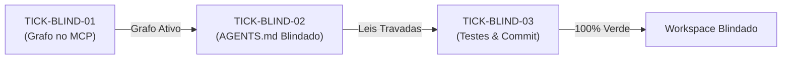

# 🗺️ PLAN: Micro-Tickets de Blindagem Canônica do Workspace

> **Referência:** `docs/specs/2026-10-31_SPEC_BLINDAGEM_WORKSPACE.md`  
> **Status:** Concluído com Sucesso  
> **Metodologia:** Looping Engineering & Decomposição em Fatias Verticais  

---

## 1. Decomposição de Micro/Nano-Tickets

| Ticket | Nível | Escopo & Arquivo Alvo | Critérios de Aceitação Associados | Status |
|---|:---:|---|---|:---:|
| **TICK-BLIND-01** | Micro | **Grafo Semântico:** Invocar `call_mcp_tool` no servidor `codebase-memory-mcp` para indexar o projeto `LegoLoop` e validar busca de símbolo. | CA-GRAFO-01, CA-GRAFO-02, CA-GRAFO-03 | ✅ Concluído |
| **TICK-BLIND-02** | Nano | **Governança do Agente:** Editar `AGENTS.md` inserindo Rule 10, Lei Graph-First, Proibição de Polling e links canônicos para `docs/specs/` e `docs/plans/`. | CA-GOV-01, CA-GOV-02, CA-GOV-03, CA-GOV-04 | ✅ Concluído |
| **TICK-BLIND-03** | Nano | **Validação & Commit:** Executar `go test ./...`, validar conformidade estrita e realizar commit semântico rastreado. | CA-INT-01, CA-INT-02 | ✅ Concluído |

---

## 2. Ordem de Execução & Handoffs

---

## 3. Protocolo de Transição (Gate para o Build)

Após sua aprovação, o executor inicia imediatamente pelo **TICK-BLIND-01** de forma sequencial e cirúrgica.
