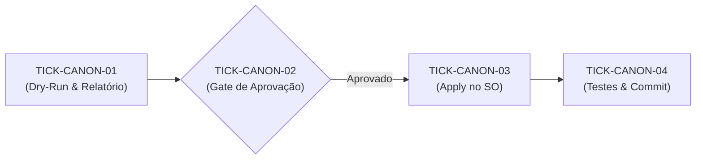

# 🗺️ PLAN: Execução da Canonização Global do Sistema Operacional

> **Referência:** `docs/specs/2026-10-31_SPEC_CANONIZACAO_SO.md`  
> **Status:** Concluído com Sucesso  
> **Metodologia:** Looping Engineering com Gate de Consentimento  

---

## 1. Decomposição de Tickets

| Ticket | Nível | Escopo & Ação | Critérios de Aceitação | Status |
|---|:---:|---|---|:---:|
| **TICK-CANON-01** | Micro | **Fase 1 (Dry-Run):** Rodar `legoloop canonize` em modo passivo sobre `.gemini`, `.claude` e `.agents`. Gravar telemetria em `docs/reports/2026-10-31_RELATORIO_DRY_RUN_CANONIZACAO.json`. | CA-CANON-01, CA-CANON-02, CA-CANON-03 | ✅ Concluído |
| **TICK-CANON-02** | Gate | **Auditoria & Aprovação:** Apresentar relatório quantitativo (arquivos escaneados, duplicatas encontradas, bytes a liberar) e aguardar o aval para aplicação real. | Gate Humano | ✅ Concluído |
| **TICK-CANON-03** | Micro | **Fase 2 (Apply):** Executar `legoloop canonize --apply` com direcionamento ao cofre `~/.aidd/canonical`. | CA-CANON-04, CA-CANON-05 | ✅ Concluído |
| **TICK-CANON-04** | Nano | **Validação & Commit:** Executar `go test ./...` e registrar commit semântico do relatório. | CA-CANON-06 | ✅ Concluído |

---

## 2. Fluxo da Esteira

---

## 3. Próximo Passo Imediato

Iniciar a execução do **TICK-CANON-01** (Dry-Run passivo).
