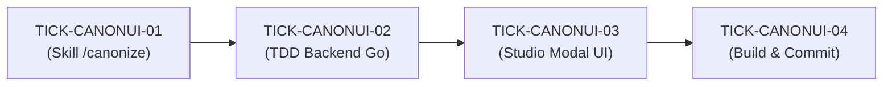

# 🗺️ PLAN: Micro-Tickets de Canonização Sob Demanda (Skill & Studio UI)

> **Referência:** `docs/specs/SPEC_CANONIZE_SKILL_UI.md`  
> **Status:** Pronto para Início da Execução  
> **Metodologia:** TDD Estrito & Looping Engineering  

---

## 1. Decomposição de Micro-Tickets

| Ticket | Nível | Escopo & Arquivos Alvo | Critérios Associados | Status |
|---|:---:|---|---|:---:|
| **TICK-CANONUI-01** | Nano | **Skill & Slash Command:** Registrar `/canonize` em `~/.gemini/config/skills/aidd-legoloop-mega-pipeline/SKILL.md` com instruções do protocolo de Dry-Run ➔ Confirmação ➔ Apply. | CA-SKILL-01, CA-SKILL-02 | ⏳ Pendente |
| **TICK-CANONUI-02** | Micro | **Backend Go (TDD):** Criar `internal/studio/canon_api_test.go` (Red) e implementar rotas `GET /api/canon/status` e `POST /api/canon/run` em `internal/studio/` (Green). | CA-API-01, CA-API-02, CA-API-03 | ⏳ Pendente |
| **TICK-CANONUI-03** | Micro | **Studio Frontend:** Adicionar botão `[ Cofre Canônico ]` na barra do Studio e modal de visualização/disparo de canonização por volume (`app.js`, `index.html`, `style.css`). | CA-UI-01, CA-UI-02, CA-UI-03 | ⏳ Pendente |
| **TICK-CANONUI-04** | Nano | **Validação & Recompilação:** Executar `go test ./...`, recompilar `bin/legoloop.exe` no PATH e sincronizar commit no GitHub. | CA-INT-01 | ⏳ Pendente |

---

## 2. Ordem de Execução

---

## 3. Próximo Passo Imediato

Iniciar a execução pelo **TICK-CANONUI-01** (Atualização da Skill Canônica).
