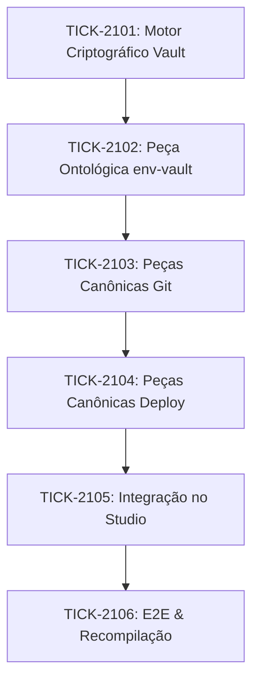

# 🗺️ PLAN_EP21: Cofre de Credenciais (`env-vault`) & Peças de Operações Git e Deploy

> **Status:** Pronto para Execução TDD  
> **Data:** 2026-11-01  
> **Épico:** ÉPICO 21  
> **Tríade:** [SPEC](../specs/2026-11-01_SPEC_EP21_COFRE_CREDENCIAIS_E_PECAS_GIT_DEPLOY.md) · [ROUTE](../routes/2026-11-01_ROUTE_EP21_COFRE_CREDENCIAIS_E_PECAS_GIT_DEPLOY.json)

---

## 1. Fatiamento em Nano-Tickets (TDD Estrito)

| Ticket | Escopo | Arquivos Afetados | Gate de Verificação |
|---|---|---|---|
| **TICK-2101** | Motor Criptográfico AES-256-GCM, Persistência e Sanitização de Logs | `internal/vault/vault.go`, `internal/vault/vault_test.go` | `go test -v ./internal/vault/...` |
| **TICK-2102** | Peça Ontológica `env-vault` e Bloco de Segurança | `internal/graph/ontology.go`, `internal/graph/graph_test.go` | `go test -v ./internal/graph/...` |
| **TICK-2103** | Peças Canônicas Git (`git-commit`, `git-merge`, `git-tag-release`) | `internal/graph/ontology.go`, `internal/graph/graph_test.go` | `go test -v ./internal/graph/...` |
| **TICK-2104** | Peças Canônicas Deploy (`deploy-docker`, `deploy-vps`, `deploy-vercel`) | `internal/graph/ontology.go`, `internal/graph/graph_test.go` | `go test -v ./internal/graph/...` |
| **TICK-2105** | Integração na API do Studio e Suporte Visual no Canvas | `internal/studio/pieces.go`, `internal/studio/pieces_test.go` | `go test -v ./internal/studio/...` |
| **TICK-2106** | Validação E2E, Recompilação do Binário e Relatório Final | `bin/legoloop.exe`, `docs/reports/` | `go test ./...` e `go build` |

---

## 2. Mapa de Dependências

