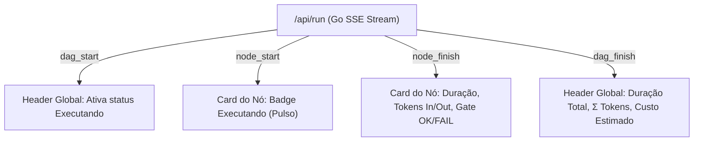

# 🗺️ PLAN_EP22: Telemetria em Tempo Real (Por Card e Header Global no Canvas)

> **Status:** Pronto para Execução TDD  
> **Data:** 2026-11-01  
> **Épico:** ÉPICO 22  
> **Tríade:** [SPEC](../specs/2026-11-01_SPEC_EP22_TELEMETRIA_TEMPO_REAL_CANVAS.md) · [ROUTE](../routes/2026-11-01_ROUTE_EP22_TELEMETRIA_TEMPO_REAL_CANVAS.json)

---

## 1. Fatiamento em Nano-Tickets (TDD Estrito)

| Ticket | Escopo | Arquivos Afetados | Gate de Verificação |
|---|---|---|---|
| **TICK-2201** | Métricas Enriquecidas no Backend SSE (`duration_ms`, `tokens`, `cost_est`) | `internal/studio/run_api.go`, `internal/studio/run_api_test.go` | `go test -v -run TestRunAPI ./internal/studio/...` |
| **TICK-2202** | Header Global e Faixa de Telemetria nos Cards no Canvas | `internal/studio/static/index.html`, `internal/studio/static/style.css` | `go test -v -run TestStatic ./internal/studio/...` |
| **TICK-2203** | Conexão SSE e Renderização em Tempo Real no Canvas e Cards | `internal/studio/static/app.js`, `internal/studio/static/icons.js` | `go test -v -run TestCanvas ./internal/studio/...` |
| **TICK-2204** | Blindagem Zero Emojis & Testes de Integridade de UI | `internal/studio/emojis_test.go`, `internal/studio/ui_logic_test.go` | `go test -v -run TestZeroEmojis ./internal/studio/...` |
| **TICK-2205** | Validação Global da Suíte, Recompilação e Relatório Final | `bin/legoloop.exe`, `docs/reports/` | `go test ./...` e `go build` |

---

## 2. Diagrama de Fluxo de Telemetria

