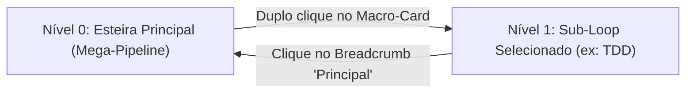

# 🗺️ PLAN_EP23: Sub-grafos em Mega-Pipelines (Drill-Down, Breadcrumbs e Copy-on-Write)

> **Status:** Pronto para Execução TDD  
> **Data:** 2026-11-01  
> **Épico:** ÉPICO 23  
> **Tríade:** [SPEC](../specs/2026-11-01_SPEC_EP23_SUBGRAFOS_DRILLDOWN_BREADCRUMBS.md) · [ROUTE](../routes/2026-11-01_ROUTE_EP23_SUBGRAFOS_DRILLDOWN_BREADCRUMBS.json)

---

## 1. Fatiamento em Nano-Tickets (TDD Estrito)

| Ticket | Escopo | Arquivos Afetados | Gate de Verificação |
|---|---|---|---|
| **TICK-2301** | Estrutura HTML e CSS dos Macro-Cards e Breadcrumbs no Canvas | `internal/studio/static/index.html`, `internal/studio/static/style.css` | `go test -v -run TestCanvasPageWiring ./internal/studio/...` |
| **TICK-2302** | Motor de Drill-Down, Pilha de Navegação e Retorno | `internal/studio/static/app.js`, `internal/studio/static/inspector.js` | `go test -v -run TestCanvasEventWiring ./internal/studio/...` |
| **TICK-2303** | Blindagem Zero Emojis e Testes de Integridade de Interface | `internal/studio/emojis_test.go`, `internal/studio/static_test.go` | `go test -v -run TestZeroEmojis ./internal/studio/...` |
| **TICK-2304** | Validação Global da Suíte, Recompilação e Relatório Final | `bin/legoloop.exe`, `docs/reports/` | `go test ./...` e `go build` |

---

## 2. Fluxo de Navegação Hierárquica

