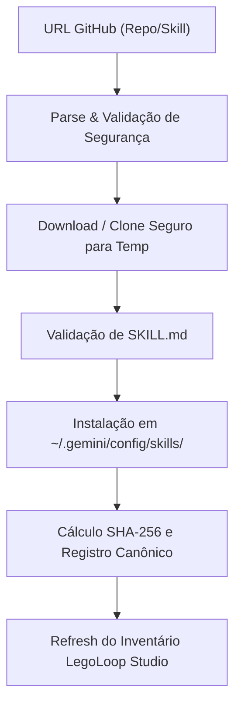

# 🗺️ PLAN_EP24: Importador Global do GitHub com Canonização HDSM & Fork/Versionamento

> **Status:** Pronto para Execução TDD  
> **Data:** 2026-11-01  
> **Épico:** ÉPICO 24  
> **Tríade:** [SPEC](../specs/2026-11-01_SPEC_EP24_IMPORTADOR_GITHUB_E_FORK_CANONIZACAO.md) · [ROUTE](../routes/2026-11-01_ROUTE_EP24_IMPORTADOR_GITHUB_E_FORK_CANONIZACAO.json)

---

## 1. Fatiamento em Nano-Tickets (TDD Estrito)

| Ticket | Escopo | Arquivos Afetados | Gate de Verificação |
|---|---|---|---|
| **TICK-2401** | Motor de Importação GitHub e Hashing SHA-256 | `internal/canon/importer.go`, `internal/canon/importer_test.go` | `go test -v -run TestImport ./internal/canon/...` |
| **TICK-2402** | Endpoint de Importação no Studio (`POST /api/assets/import`) | `internal/studio/assets_api.go`, `internal/studio/assets_api_test.go` | `go test -v -run TestAssetImport ./internal/studio/...` |
| **TICK-2403** | Endpoint de Fork Copy-on-Write (`POST /api/loops/{id}/fork`) | `internal/studio/loops_api.go`, `internal/studio/loops_api_test.go` | `go test -v -run TestLoops ./internal/studio/...` |
| **TICK-2404** | Comando CLI `legoloop import` | `internal/cli/commands.go`, `internal/cli/cli_test.go` | `go test -v -run TestCLI ./internal/cli/...` |
| **TICK-2405** | UI no Studio (Botão/Modal de Importação) e Recompilação | `internal/studio/static/`, `bin/legoloop.exe` | `go test ./...` e `go build` |

---

## 2. Diagrama de Fluxo de Importação e Canonização

