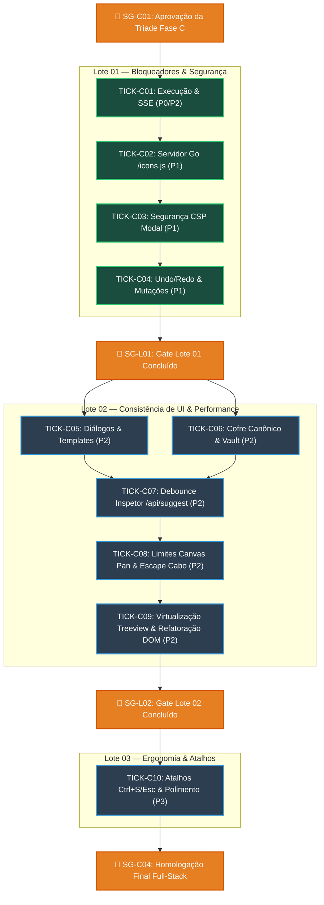

# 🗺️ Plano Master de Execução (Plan) — Esteira de Correção Full-Stack LegoLoop

> **Prefixo ISO Canônico:** `2026-11-02_PLAN_ESTEIRA_CORRECOES_LEGOLOOP.md`  
> **Sessão:** `d4cfbcb7-ebf7-4f59-8d77-7c13903afc72`  
> **Status:** Proposto para Homologação (Stop-Gate SG-C01)  
> **Tríade:** [`docs/intents/2026-11-02_INTENT_ESTEIRA_CORRECOES_LEGOLOOP.md`](file:///C:/Users/trcnologia/Desktop/LegoLoop/docs/intents/2026-11-02_INTENT_ESTEIRA_CORRECOES_LEGOLOOP.md) | [`docs/specs/2026-11-02_SPEC_ESTEIRA_CORRECOES_LEGOLOOP.md`](file:///C:/Users/trcnologia/Desktop/LegoLoop/docs/specs/2026-11-02_SPEC_ESTEIRA_CORRECOES_LEGOLOOP.md)

---

## 1. Topologia do Grafo DAG de Execução

---

## 2. Dicionário de Nós & Contratos Estéreis

### Nó C05 — Diálogos & Templates (`BUG-CONFIRM-01`, `BUG-TMPL-01`)
* **Modelo / Modo:** `flash` (esforço: `low`) | Execução paralela com C06.
* **Entrada:** `internal/studio/static/inventory.js`, `internal/studio/static/app.js`.
* **Critérios de Teste:** `TestConfirmDialogMessageParam` e `TestTemplatesFallbackWithoutDoubleName`.
* **Saída:** `scratch/C05_confirm_templates.json`.

### Nó C06 — Cofre Canônico (`BUG-VAULT-01`, `BUG-VAULT-03`)
* **Modelo / Modo:** `pro` (esforço: `medium`) | Execução paralela com C05.
* **Entrada:** `internal/studio/static/app.js`.
* **Critérios de Teste:** `TestVaultRendersGroupsList` e `TestVaultApplyResetsDisabledInFinally`.
* **Saída:** `scratch/C06_vault_ui.json`.

### Nó C07 — Concorrência & Debounce (`BUG-INSP-01`)
* **Modelo / Modo:** `pro` (esforço: `high`) | Depende de C05 e C06.
* **Entrada:** `internal/studio/static/inspector.js`.
* **Critérios de Teste:** `TestInspectorSuggestDebounceAndAbort`.
* **Saída:** `scratch/C07_inspector_debounce.json`.

### Nó C08 — Limites de Canvas & Conexões (`BUG-CANVAS-02`, `BUG-EDGE-01`)
* **Modelo / Modo:** `pro` (esforço: `medium`) | Depende de C07.
* **Entrada:** `internal/studio/static/app.js`.
* **Critérios de Teste:** `TestCanvasPanClamping` e `TestEscapeCancelsLinking`.
* **Saída:** `scratch/C08_canvas_edge.json`.

### Nó C09 — Virtualização de Treeview & Refatoração DOM (`BUG-PALETTE-02`, `BUG-ITEM-MODAL-01`)
* **Modelo / Modo:** `pro` (esforço: `high`) | Depende de C08.
* **Entrada:** `internal/studio/static/palette.js`, `internal/studio/static/components/lego-item-modal.js`.
* **Critérios de Teste:** `TestPaletteTreeviewChunking` e `TestItemModalNoMassiveInnerHTML`.
* **Saída:** `scratch/C09_treeview_dom.json`.

### Nó C10 — Atalhos & Ergonomia (`BUG-KEY-01`, `BUG-KEY-02`, `BUG-PALETTE-01`, `BUG-CANVAS-03`, `BUG-VAULT-02`)
* **Modelo / Modo:** `pro` (esforço: `medium`) | Depende do Gate SG-L02.
* **Entrada:** `internal/studio/static/app.js`.
* **Critérios de Teste:** `TestKeyboardShortcutsCtrlSEsc` e `TestPaletteDropCenterOffset`.
* **Saída:** `scratch/C10_shortcuts_ergonomics.json`.
