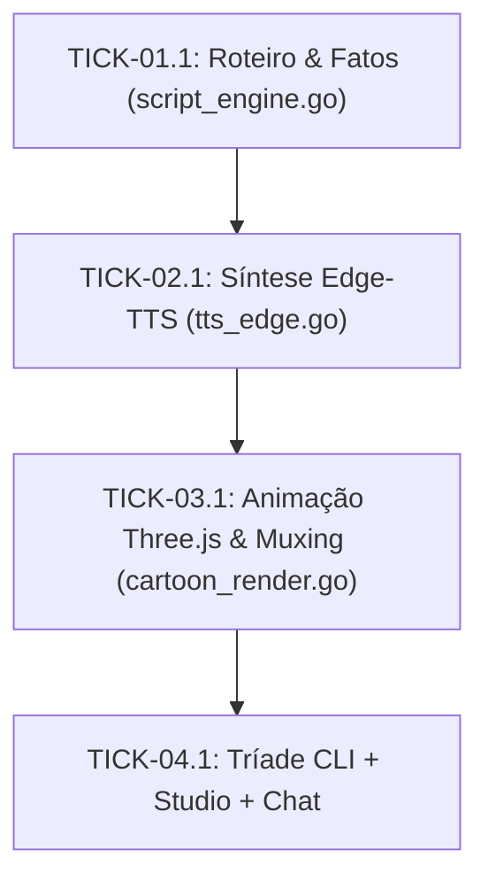

# 🗺️ PLAN: Pipeline Canônico LegoLoop Cartoon Shorts (legoloop-cartoon-shorts)

> **Status:** Aprovado pelo Usuário  
> **Data:** 2026-11-09  
> **Versão:** 1.0.0  
> **Autor:** LegoLoop (Video-REA Engine)  
> **Iniciativa:** Soberania Audiovisual Local Tier Ouro  
> **Referência da Intenção:** [docs/intents/2026-11-09_INTENT_LEGOLOOP_CARTOON_SHORTS.md](../intents/2026-11-09_INTENT_LEGOLOOP_CARTOON_SHORTS.md)  
> **Referência da Especificação:** [docs/specs/2026-11-09_SPEC_LEGOLOOP_CARTOON_SHORTS.md](../specs/2026-11-09_SPEC_LEGOLOOP_CARTOON_SHORTS.md)  
> **Espelho Executável JSON:** [docs/routes/2026-11-09_ROUTE_LEGOLOOP_CARTOON_SHORTS.json](../routes/2026-11-09_ROUTE_LEGOLOOP_CARTOON_SHORTS.json)  
> **Template:** TEMPLATE_PLAN.md v2.2.0 (espelha TEMPLATE_ROUTE.json v2.2.0)  

---

## 1. Estratégia de Execução & Governança de Loteamento

* **Engine:** `orchestrix_hermetic` (execução estéril por bloco, sem context bloat)
* **Nível de Supervisão:** `micro`
* **Permissão de Subagentes:** `false` (AGENTS.md, regra 4: subprocessos estéreis)
* **TDD Estrito:** `true` (Red ➔ Green ➔ Refactor obrigatório antes de qualquer código de produção)
* **Limite de Workers Paralelos:** `1` (sequencial determinístico)
* **Timeout Padrão por Bloco:** `180s`
* **Política de Rollback:** global `abort_pipeline`; por nó `stash_changes`

---

## 2. Mapa Geral de Épicos & Rastreabilidade de Critérios

| Épico ID | Nome do Épico | Total Tickets | Critérios de Aceite Cobertos | Natureza Dominante |
|---|---|---|---|---|
| **E01** | Motor de Roteiro & Fatos Históricos | 1 | `AC-E01.1`, `AC-E01.2` | `micro` |
| **E02** | Síntese Soberana Edge-TTS com Emoção | 1 | `AC-E02.1`, `AC-E02.2` | `micro` |
| **E03** | Animação Three.js & Muxing Gated RMS | 1 | `AC-E03.1`, `AC-E03.2` | `macro` |
| **E04** | Tríade Completa de Interfaces (CLI, Studio, Chat) | 1 | `AC-E04.1`, `AC-E04.2` | `micro` |

---

## 3. Decomposição Estruturada de Tickets (Espelho 1:1 com ROUTE.json)

### Épico 01 — Motor de Roteiro & Fatos Históricos

#### Ticket `TICK-01.1` — Geração de Roteiro 3.7 palavras/s com Tags de Emoção
* **Iniciativa:** `Soberania Audiovisual Local Tier Ouro` | **Épico:** `E01` | **Nature:** `micro` | **Tipo:** `unit_task` | **Modo de Execução:** `tdd_red_green` | **Status:** `PENDING`
* **Dependências:** `[]`
* **Isolamento:**
  * **Workspace:** `local`
  * **Executor:** `orchestrix_hermetic`
  * **Subagentes Permitidos:** `false`
  * **Write Boundary:** `strict` (`internal/videorea/script_engine.go`, `internal/videorea/script_engine_test.go`)
* **Roteamento Cognitivo:**
  * **Modo:** `suggested` | **Harness:** `9router` | **Model:** `code-pro` | **Esforço:** `medium`
* **Orçamento de Tokens:** `16000 input` / `600 output` | **Timeout:** `180s`
* **Contrato de Execução:**
  * **Arquivo Alvo:** `internal/videorea/script_engine.go`
  * **Critérios AC Atendidos:** `AC-E01.1`, `AC-E01.2`
  * **Comando de Teste:** `go test -count=1 -run TestBuildCartoonScript ./internal/videorea/...`

---

### Épico 02 — Síntese Soberana Edge-TTS com Emoção

#### Ticket `TICK-02.1` — Síntese de Áudio Neural com Anotações de Emoção
* **Iniciativa:** `Soberania Audiovisual Local Tier Ouro` | **Épico:** `E02` | **Nature:** `micro` | **Tipo:** `unit_task` | **Modo de Execução:** `tdd_red_green` | **Status:** `PENDING`
* **Dependências:** `["TICK-01.1"]`
* **Isolamento:**
  * **Workspace:** `local`
  * **Executor:** `orchestrix_hermetic`
  * **Subagentes Permitidos:** `false`
  * **Write Boundary:** `strict` (`internal/videorea/tts_edge.go`, `internal/videorea/tts_edge_test.go`)
* **Roteamento Cognitivo:**
  * **Modo:** `suggested` | **Harness:** `9router` | **Model:** `code-fast` | **Esforço:** `low`
* **Orçamento de Tokens:** `8000 input` / `500 output` | **Timeout:** `180s`
* **Contrato de Execução:**
  * **Arquivo Alvo:** `internal/videorea/tts_edge.go`
  * **Critérios AC Atendidos:** `AC-E02.1`, `AC-E02.2`
  * **Comando de Teste:** `go test -count=1 -run TestSynthesizeEdgeTTS ./internal/videorea/...`

---

### Épico 03 — Animação Three.js & Muxing Gated RMS

#### Ticket `TICK-03.1` — Renderização Visual 1080x1920 e Muxing Determinístico
* **Iniciativa:** `Soberania Audiovisual Local Tier Ouro` | **Épico:** `E03` | **Nature:** `macro` | **Tipo:** `unit_task` | **Modo de Execução:** `tdd_red_green` | **Status:** `PENDING`
* **Dependências:** `["TICK-02.1"]`
* **Isolamento:**
  * **Workspace:** `local`
  * **Executor:** `orchestrix_hermetic`
  * **Subagentes Permitidos:** `false`
  * **Write Boundary:** `strict` (`internal/videorea/cartoon_render.go`, `internal/videorea/cartoon_render_test.go`)
* **Roteamento Cognitivo:**
  * **Modo:** `suggested` | **Harness:** `9router` | **Model:** `code-pro` | **Esforço:** `high`
* **Orçamento de Tokens:** `24000 input` / `800 output` | **Timeout:** `240s`
* **Contrato de Execução:**
  * **Arquivo Alvo:** `internal/videorea/cartoon_render.go`
  * **Critérios AC Atendidos:** `AC-E03.1`, `AC-E03.2`
  * **Comando de Teste:** `go test -count=1 -run TestRenderCartoonScenes ./internal/videorea/...`

---

### Épico 04 — Tríade Completa de Interfaces (CLI, Studio, Chat)

#### Ticket `TICK-04.1` — Exposição CLI, Studio Player e Skill de Chat
* **Iniciativa:** `Soberania Audiovisual Local Tier Ouro` | **Épico:** `E04` | **Nature:** `micro` | **Tipo:** `unit_task` | **Modo de Execução:** `tdd_red_green` | **Status:** `PENDING`
* **Dependências:** `["TICK-03.1"]`
* **Isolamento:**
  * **Workspace:** `local`
  * **Executor:** `orchestrix_hermetic`
  * **Subagentes Permitidos:** `false`
  * **Write Boundary:** `strict` (`internal/cli/cartoon_shorts.go`, `internal/cli/cartoon_shorts_test.go`)
* **Roteamento Cognitivo:**
  * **Modo:** `suggested` | **Harness:** `9router` | **Model:** `code-fast` | **Esforço:** `medium`
* **Orçamento de Tokens:** `12000 input` / `600 output` | **Timeout:** `180s`
* **Contrato de Execução:**
  * **Arquivo Alvo:** `internal/cli/cartoon_shorts.go`
  * **Critérios AC Atendidos:** `AC-E04.1`, `AC-E04.2`
  * **Comando de Teste:** `go test -count=1 -run TestCartoonShortsCLI ./internal/cli/...`

---

## 4. Grafo de Precedência DAG

