# 🗺️ PLAN: Oitavo Verbo Canônico `dissecar` — Plano de Execução Tracer Bullet Exaustivo

> **Status:** Aprovado pelo Usuário  
> **Data:** 2026-11-10  
> **Versão:** 1.0.0  
> **Autor:** Antigravity AI + Engenheiro Líder (VSA Tracer Bullet + Matt Pocock)  
> **Iniciativa:** I08 — Verbo e Processo de Dissecação Universal do LegoLoop  
> **Referência da Intenção:** [docs/intents/2026-11-10_INTENT_DISSECAR.md](../intents/2026-11-10_INTENT_DISSECAR.md)  
> **Referência da Especificação:** [docs/specs/2026-11-10_SPEC_DISSECAR.md](../specs/2026-11-10_SPEC_DISSECAR.md)  
> **Espelho Executável JSON:** [docs/routes/2026-11-10_ROUTE_DISSECAR.json](../routes/2026-11-10_ROUTE_DISSECAR.json)  
> **Template:** TEMPLATE_PLAN.md v2.2.0 (espelha TEMPLATE_ROUTE.json v2.2.0)  

---

## 1. Estratégia de Execução & Governança de Loteamento

* **Engine:** `orchestrix_hermetic` (execução estéril por Ticket, sem context bloat)
* **Nível de Supervisão:** `micro`
* **Permissão de Subagentes:** `false` (AGENTS.md, regra 4: execução direta em blocos estéreis)
* **TDD Estrito:** `true` (Red ➔ Green ➔ Refactor obrigatório antes de qualquer código de produção)
* **Limite de Workers Paralelos:** `1`
* **Timeout Padrão por Ticket:** `45s`
* **Política de Rollback:** global `abort_pipeline`; por nó `stash_changes`

---

## 2. Mapa Geral de Épicos & Rastreabilidade de Critérios

| Épico ID | Nome do Épico | Total Tickets | Critérios de Aceite Cobertos | Natureza Dominante |
|---|---|---|---|---|
| **E01** | Motor Estático, Resolução e Governança (`internal/dissecar`) | 8 | `AC-E01.1`, `AC-E01.2`, `AC-E01.3`, `AC-E01.4`, `AC-E01.5`, `AC-E01.6`, `AC-E01.7`, `AC-E01.8` | `deterministic` |
| **E02** | Subcomando CLI Go (`internal/cli`) | 3 | `AC-E02.1`, `AC-E02.2`, `AC-E02.3`, `AC-E02.4` | `deterministic` |
| **E03** | Studio Web, Nós 3D e Tríade Visual (`internal/studio`) | 3 | `AC-E03.1`, `AC-E03.2`, `AC-E03.3`, `AC-E03.4` | `deterministic` |
| **E04** | Governança Canônica, Skill e Fechamento | 3 | `AC-E04.1`, `AC-E04.2` | `deterministic` |

---

## 3. Grafo de Dependência dos Tickets (Mermaid)

```mermaid
flowchart TD
    T11["TICK-01.1: Tipos e Ficha"] --> T12["TICK-01.2: Resolver e Path Jail"]
    T12 --> T13["TICK-01.3: Extrator AST"]
    T13 --> T14["TICK-01.4: Extrator Env e Syscalls"]
    T14 --> T15["TICK-01.5: Auditoria e Stubs"]
    T15 --> T16["TICK-01.6: Síntese DAG Reverso"]
    T16 --> T17["TICK-01.7: Síntese Tríade Motion"]
    T17 --> T18["TICK-01.8: Orquestrador e Cache"]
    T18 --> SG1{"SG-E01: Stop-Gate Motor"}

    SG1 --> T21["TICK-02.1: CLI Subcomando"]
    T21 --> T22["TICK-02.2: CLI JSON Headless"]
    T22 --> T23["TICK-02.3: CLI E2E Binário"]
    T23 --> SG2{"SG-E02: Stop-Gate CLI"}

    SG2 --> T31["TICK-03.1: Studio Endpoints REST"]
    T31 --> T32["TICK-03.2: Studio UI e Canvas 3D"]
    T32 --> T33["TICK-03.3: Studio 4 Ações de Ciclo"]
    T33 --> SG3{"SG-E03: Stop-Gate Studio"}

    SG3 --> T41["TICK-04.1: Skill Canônica ASD-STE100"]
    T41 --> T42["TICK-04.2: Loop Canônico"]
    T42 --> T43["TICK-04.3: Recompilação Fresca"]
    T43 --> SGF{"SG-FINAL: Fechamento"}
```

---

## 4. Detalhamento Factual dos Tickets de Execução

### Épico 01: Motor Estático, Resolução e Governança (`internal/dissecar`)

#### Ticket `TICK-01.1`: Tipos e Estrutura da Ficha Anatômica
* **Natureza:** `deterministic` · **Tipo:** `unit_task` · **Spec Ref:** `AC-E01.2`
* **Timeout:** `30s` · **Token Budget:** `1000` tokens · **Roteamento:** `code-fast`
* **Write Boundary:** `internal/dissecar/tipos.go`, `internal/dissecar/tipos_test.go`
* **Context In:** `docs/specs/2026-11-10_SPEC_DISSECAR.md`
* **Context Out:** `internal/dissecar/tipos.go`
* **TDD Seam (Red):** `TestTipos_ValidacaoFicha` falha exigindo validação de schema e valores válidos de `Profundidade` e `TipoAlvo`.
* **Implementação (Green):** Definir structs `Opcoes`, `FichaAnatomica`, `MetricasAnatomia`, `TopologiaGrafo`, `AuditoriaGov` e validações em `tipos.go`.
* **Teste de Mutação:** Forçar retorno de erro falso em `Opcoes.Validar()` e verificar falha no teste.
* **Critério de Saída:** `go test -run TestTipos ./internal/dissecar/...` com exit code 0.
* **Rollback:** `git checkout HEAD -- internal/dissecar/tipos*.go`

#### Ticket `TICK-01.2`: Resolvedor, Path Jail e Detecção de Alvo
* **Natureza:** `deterministic` · **Tipo:** `unit_task` · **Spec Ref:** `AC-E01.1`
* **Timeout:** `30s` · **Token Budget:** `1000` tokens · **Roteamento:** `code-fast`
* **Write Boundary:** `internal/dissecar/resolver.go`, `internal/dissecar/resolver_test.go`
* **Context In:** `internal/dissecar/tipos.go`
* **Context Out:** `internal/dissecar/resolver.go`
* **TDD Seam (Red):** `TestResolver_PathJail` falha quando alvos com `../` tentam escapar da raiz ou ler `/etc/passwd`.
* **Implementação (Green):** Implementar `ResolverAlvo()` com `filepath.Clean`, verificação de raízes autorizadas e detecção de tipo por extensão/frontmatter.
* **Teste de Mutação:** Desabilitar a checagem de `strings.HasPrefix` no resolver e provar que o teste de segurança quebra.
* **Critério de Saída:** `go test -run TestResolver ./internal/dissecar/...` com exit code 0.
* **Rollback:** `git checkout HEAD -- internal/dissecar/resolver*.go`

#### Ticket `TICK-01.3`: Extrator Anatômico e AST Parser
* **Natureza:** `deterministic` · **Tipo:** `unit_task` · **Spec Ref:** `AC-E01.3`
* **Timeout:** `45s` · **Token Budget:** `1500` tokens · **Roteamento:** `code-fast`
* **Write Boundary:** `internal/dissecar/extrator.go`, `internal/dissecar/extrator_test.go`
* **Context In:** `internal/dissecar/resolver.go`
* **Context Out:** `internal/dissecar/extrator.go`
* **TDD Seam (Red):** `TestExtrator_GoAST` falha se não extrair declarações de funções, structs e métricas de linhas reais.
* **Implementação (Green):** Implementar parsing léxico via `go/parser` para Go e regex determinístico de nós para scripts PowerShell e Bash.
* **Teste de Mutação:** Alterar contador de linhas de comentário para retornar 0 fixo e verificar quebra do teste.
* **Critério de Saída:** `go test -run TestExtrator ./internal/dissecar/...` com exit code 0.
* **Rollback:** `git checkout HEAD -- internal/dissecar/extrator*.go`

#### Ticket `TICK-01.4`: Mapeador de Variáveis de Ambiente e Syscalls
* **Natureza:** `deterministic` · **Tipo:** `unit_task` · **Spec Ref:** `AC-E01.4`
* **Timeout:** `30s` · **Token Budget:** `1000` tokens · **Roteamento:** `code-fast`
* **Write Boundary:** `internal/dissecar/extrator_env.go`, `internal/dissecar/extrator_env_test.go`
* **Context In:** `internal/dissecar/extrator.go`
* **Context Out:** `internal/dissecar/extrator_env.go`
* **TDD Seam (Red):** `TestExtrator_EnvVarsSyscalls` falha se não catalogar variáveis `$env:VAR` ou chamadas `exec.Command`.
* **Implementação (Green):** Varredura de AST e padrões regex para identificar acessos a variáveis de ambiente e comandos de SO.
* **Teste de Mutação:** Omitir extração de variáveis iniciadas por `9ROUTER` e comprovar falha.
* **Critério de Saída:** `go test -run TestExtrator_EnvVarsSyscalls ./internal/dissecar/...` com exit code 0.
* **Rollback:** `git checkout HEAD -- internal/dissecar/extrator_env*.go`

#### Ticket `TICK-01.5`: Auditoria de Governança, Stubs e Taxonomia
* **Natureza:** `deterministic` · **Tipo:** `unit_task` · **Spec Ref:** `AC-E01.5`
* **Timeout:** `30s` · **Token Budget:** `1000` tokens · **Roteamento:** `code-fast`
* **Write Boundary:** `internal/dissecar/governanca.go`, `internal/dissecar/governanca_test.go`
* **Context In:** `internal/dissecar/extrator_env.go`, `internal/taxonomy`
* **Context Out:** `internal/dissecar/governanca.go`
* **TDD Seam (Red):** `TestGovernanca_DeteccaoStubs` falha se `TODO` ou termos proibidos não rebaixarem a pontuação para < 0.85.
* **Implementação (Green):** Integrar com `internal/taxonomy` para checar vocabulário proibido e varrer tokens de stubs, emitindo o score ponderado.
* **Teste de Mutação:** Forçar nota fixa de 1.00 e validar que o teste falha imediatamente.
* **Critério de Saída:** `go test -run TestGovernanca ./internal/dissecar/...` com exit code 0.
* **Rollback:** `git checkout HEAD -- internal/dissecar/governanca*.go`

#### Ticket `TICK-01.6`: Síntese de Grafo DAG por Engenharia Reversa
* **Natureza:** `deterministic` · **Tipo:** `unit_task` · **Spec Ref:** `AC-E01.7`
* **Timeout:** `45s` · **Token Budget:** `1500` tokens · **Roteamento:** `code-fast`
* **Write Boundary:** `internal/dissecar/sintese_dag.go`, `internal/dissecar/sintese_dag_test.go`
* **Context In:** `internal/dissecar/governanca.go`
* **Context Out:** `internal/dissecar/sintese_dag.go`
* **TDD Seam (Red):** `TestSinteseDAG_Validacao` falha se o DAG sintetizado não cumprir o schema canônico v2.2.0.
* **Implementação (Green):** Mapear blocos funcionais do código em nós de DAG encadeados com `depends_on`, gates e inputs/outputs contratuais.
* **Teste de Mutação:** Inserir dependência circular artificial no DAG sintetizado e provar que o teste quebra.
* **Critério de Saída:** `go test -run TestSinteseDAG ./internal/dissecar/...` com exit code 0.
* **Rollback:** `git checkout HEAD -- internal/dissecar/sintese_dag*.go`

#### Ticket `TICK-01.7`: Síntese da Tríade Visual de Motion Graphics
* **Natureza:** `deterministic` · **Tipo:** `unit_task` · **Spec Ref:** `AC-E01.8`
* **Timeout:** `45s` · **Token Budget:** `1500` tokens · **Roteamento:** `code-fast`
* **Write Boundary:** `internal/dissecar/sintese_motion.go`, `internal/dissecar/sintese_motion_test.go`
* **Context In:** `internal/dissecar/sintese_dag.go`
* **Context Out:** `internal/dissecar/sintese_motion.go`
* **TDD Seam (Red):** `TestSinteseMotion_TriadeEDesignSystem` falha se os arquivos gerados contiverem emojis ou cores fora do padrão `#131312`/`#d9480f`.
* **Implementação (Green):** Sintetizar `motion_graph.json`, bundle autônomo `anatomia.html` e vetor animado `anatomia.svg` com Three.js/PixelFX embutidos.
* **Teste de Mutação:** Injetar emoji na renderização SVG e comprovar falha mecânica no teste.
* **Critério de Saída:** `go test -run TestSinteseMotion ./internal/dissecar/...` com exit code 0.
* **Rollback:** `git checkout HEAD -- internal/dissecar/sintese_motion*.go`

#### Ticket `TICK-01.8`: Orquestrador Dissecar, Cache e Markdown
* **Natureza:** `deterministic` · **Tipo:** `unit_task` · **Spec Ref:** `AC-E01.6`
* **Timeout:** `45s` · **Token Budget:** `1500` tokens · **Roteamento:** `code-fast`
* **Write Boundary:** `internal/dissecar/dissecar.go`, `internal/dissecar/dissecar_test.go`
* **Context In:** `internal/dissecar/sintese_motion.go`
* **Context Out:** `internal/dissecar/dissecar.go`
* **TDD Seam (Red):** `TestDissecar_FluxoCompleto` falha se o relatório `ANATOMIA.md` e `ficha_anatomica.json` não forem persistidos em `docs/anatomias/<slug>/`.
* **Implementação (Green):** Orquestrar todo o pipeline do motor, gerenciar cache SHA-256 e compilar o relatório Markdown.
* **Teste de Mutação:** Omitir a gravação da `ficha_anatomica.json` e verificar falha.
* **Critério de Saída:** `go test -run TestDissecar_FluxoCompleto ./internal/dissecar/...` com exit code 0.
* **Rollback:** `git checkout HEAD -- internal/dissecar/dissecar*.go`

#### `SG-E01`: Stop-Gate do Motor
* **Tipo:** `stop_gate` · **Roteamento:** `human`
* **Condição:** Suíte completa de `internal/dissecar` passando com 100% verde e zero stubs.

---

### Épico 02: Subcomando CLI Go (`internal/cli`)

#### Ticket `TICK-02.1`: Subcomando CLI e Flags
* **Natureza:** `deterministic` · **Tipo:** `unit_task` · **Spec Ref:** `AC-E02.1`
* **Timeout:** `45s` · **Token Budget:** `1500` tokens · **Roteamento:** `code-fast`
* **Write Boundary:** `internal/cli/dissecar.go`, `internal/cli/dissecar_test.go`
* **Context In:** `internal/dissecar/dissecar.go`
* **Context Out:** `internal/cli/dissecar.go`
* **TDD Seam (Red):** `TestCLIDissecar_Flags` falha na leitura das flags `--profundidade`, `--json`, `--formato`, `--motion` e `--saida`.
* **Implementação (Green):** Implementar o parser de flags e a renderização da tabela ANSI com saída de alto contraste.
* **Teste de Mutação:** Inverter condição de erro em flag inválida e provar quebra.
* **Critério de Saída:** `go test -run TestCLIDissecar_Flags ./internal/cli/...` com exit code 0.
* **Rollback:** `git checkout HEAD -- internal/cli/dissecar*.go`

#### Ticket `TICK-02.2`: Modo Headless JSON e Tratamento de Erros
* **Natureza:** `deterministic` · **Tipo:** `unit_task` · **Spec Ref:** `AC-E02.2`
* **Timeout:** `30s` · **Token Budget:** `1000` tokens · **Roteamento:** `code-fast`
* **Write Boundary:** `internal/cli/dissecar_json_test.go`
* **Context In:** `internal/cli/dissecar.go`
* **Context Out:** `internal/cli/dissecar_json_test.go`
* **TDD Seam (Red):** `TestCLIDissecar_JSONHeadless` falha se o stdout contiver caracteres de escape ANSI ou mensagens informativas no modo `--json`.
* **Implementação (Green):** Garantir que `--json` emite estritamente JSON puro no stdout e redireciona logs para o stderr.
* **Teste de Mutação:** Imprimir mensagem informativa no stdout no modo JSON e comprovar falha no parser do teste.
* **Critério de Saída:** `go test -run TestCLIDissecar_JSONHeadless ./internal/cli/...` com exit code 0.
* **Rollback:** `git checkout HEAD -- internal/cli/dissecar_json_test.go`

#### Ticket `TICK-02.3`: Registro do Subcomando e Teste E2E do Binário
* **Natureza:** `deterministic` · **Tipo:** `unit_task` · **Spec Ref:** `AC-E02.3`
* **Timeout:** `45s` · **Token Budget:** `1500` tokens · **Roteamento:** `code-fast`
* **Write Boundary:** `internal/cli/commands.go`, `internal/cli/dissecar_binary_test.go`
* **Context In:** `internal/cli/dissecar.go`
* **Context Out:** `internal/cli/commands.go`
* **TDD Seam (Red):** `TestCLIDissecar_BinaryE2E` falha ao rodar `legoloop dissecar --help` e verificar presença do verbo na lista oficial.
* **Implementação (Green):** Registrar subcomando `dissecar` em `internal/cli/commands.go` conectando aos comandos de topo do LegoLoop.
* **Teste de Mutação:** Desregistrar comando em `commands.go` e comprovar exit code 2.
* **Critério de Saída:** `go test -run TestCLIDissecar_BinaryE2E ./internal/cli/...` com exit code 0.
* **Rollback:** `git checkout HEAD -- internal/cli/commands.go internal/cli/dissecar_binary_test.go`

#### `SG-E02`: Stop-Gate do CLI
* **Tipo:** `stop_gate` · **Roteamento:** `human`
* **Condição:** Subcomando CLI testado e aprovado em execução real.

---

### Épico 03: Studio Web, Nós 3D e Tríade Visual (`internal/studio`)

#### Ticket `TICK-03.1`: Endpoints REST `/api/dissecar`
* **Natureza:** `deterministic` · **Tipo:** `unit_task` · **Spec Ref:** `AC-E03.1`
* **Timeout:** `45s` · **Token Budget:** `1500` tokens · **Roteamento:** `code-fast`
* **Write Boundary:** `internal/studio/dissecar_handler.go`, `internal/studio/dissecar_handler_test.go`
* **Context In:** `internal/dissecar/dissecar.go`, `internal/studio/server.go`
* **Context Out:** `internal/studio/dissecar_handler.go`
* **TDD Seam (Red):** `TestStudio_DissecarEndpoint` falha em requisições POST `/api/dissecar` sem autenticação correta ou corpo válido.
* **Implementação (Green):** Implementar handler HTTP seguro com `secure`, limites de taxa e conexão direta com o motor `internal/dissecar`.
* **Teste de Mutação:** Retornar HTTP 500 fixo e provar que o teste quebra.
* **Critério de Saída:** `go test -run TestStudio_DissecarEndpoint ./internal/studio/...` com exit code 0.
* **Rollback:** `git checkout HEAD -- internal/studio/dissecar_handler*.go`

#### Ticket `TICK-03.2`: Interface do Studio, Botões SVG e Canvas 3D
* **Natureza:** `deterministic` · **Tipo:** `ui_task` · **Spec Ref:** `AC-E03.2`
* **Timeout:** `60s` · **Token Budget:** `2000` tokens · **Roteamento:** `code-fast`
* **Write Boundary:** `internal/studio/static/index.html`, `internal/studio/static/app.js`, `internal/studio/static/style.css`
* **Context In:** `internal/studio/dissecar_handler.go`
* **Context Out:** `internal/studio/static/app.js`
* **TDD Seam (Red):** Teste de assets estáticos falha se `index.html` ou `app.js` contiverem emojis ou se faltar o container `#canvas-anatomia`.
* **Implementação (Green):** Adicionar botão de bisturi em SVG proprietário nos cards, modal de dissecação e container Canvas 3D com Three.js/PixelFX.
* **Teste de Mutação:** Remover container `#canvas-anatomia` e provar falha.
* **Critério de Saída:** Testes estáticos do Studio aprovados com exit code 0.
* **Rollback:** `git checkout HEAD -- internal/studio/static/`

#### Ticket `TICK-03.3`: Integração das 4 Ações de Ciclo de Vida
* **Natureza:** `deterministic` · **Tipo:** `ui_task` · **Spec Ref:** `AC-E03.4`
* **Timeout:** `45s` · **Token Budget:** `1500` tokens · **Roteamento:** `code-fast`
* **Write Boundary:** `internal/studio/static/components/dissecar-modal.js`
* **Context In:** `internal/studio/static/app.js`
* **Context Out:** `internal/studio/static/components/dissecar-modal.js`
* **TDD Seam (Red):** Smoke test falha se os botões "Instalar no Cofre", "Executar DAG", "Elevar Padrão Ouro" e "Exportar" não dispararem seus endpoints.
* **Implementação (Green):** Criar WebComponent `dissecar-modal.js` com os disparadores e feedback visual em toast.
* **Teste de Mutação:** Omitir listener do botão "Instalar no Cofre" e comprovar falha.
* **Critério de Saída:** Testes de componentes do Studio verdes com exit code 0.
* **Rollback:** `git checkout HEAD -- internal/studio/static/components/dissecar-modal.js`

#### `SG-E03`: Stop-Gate do Studio
* **Tipo:** `stop_gate` · **Roteamento:** `human`
* **Condição:** Studio Web operando com Canvas 3D e ações validadas pelo usuário.

---

### Épico 04: Governança Canônica, Skill e Fechamento

#### Ticket `TICK-04.1`: Skill Canônica em ASD-STE100 Puro
* **Natureza:** `deterministic` · **Tipo:** `skill` · **Spec Ref:** `AC-E04.1`
* **Timeout:** `30s` · **Token Budget:** `1000` tokens · **Roteamento:** `code-fast`
* **Write Boundary:** `skills/legoloop-dissecar/SKILL.md`
* **Context In:** `docs/specs/2026-11-10_SPEC_DISSECAR.md`
* **Context Out:** `skills/legoloop-dissecar/SKILL.md`
* **TDD Seam (Red):** `legoloop instalar-skills --dry-run` falha se houver marcações `[S]`, `[T]`, `[E]` ou violações taxonômicas no Markdown.
* **Implementação (Green):** Escrever `skills/legoloop-dissecar/SKILL.md` em conformidade com o template v2.0.0 em ASD-STE100 puro.
* **Teste de Mutação:** Inserir tag artificial `[S]` no corpo da skill e validar falha no teste de linter.
* **Critério de Saída:** `go run ./cmd/legoloop instalar-skills --dry-run` com exit code 0.
* **Rollback:** `git checkout HEAD -- skills/legoloop-dissecar/SKILL.md`

#### Ticket `TICK-04.2`: Loop Canônico `loops/legoloop-dissecar`
* **Natureza:** `deterministic` · **Tipo:** `loop` · **Spec Ref:** `AC-E04.1`
* **Timeout:** `30s` · **Token Budget:** `1000` tokens · **Roteamento:** `code-fast`
* **Write Boundary:** `loops/legoloop-dissecar/pipeline.dag.json`, `loops/legoloop-dissecar/legoloop-dissecar.loop.json`
* **Context In:** `skills/legoloop-dissecar/SKILL.md`
* **Context Out:** `loops/legoloop-dissecar/pipeline.dag.json`
* **TDD Seam (Red):** `legoloop validate` falha se o grafo contiver ciclos ou nós desconectados.
* **Implementação (Green):** Projetar o grafo DAG em `loops/legoloop-dissecar/pipeline.dag.json` e o manifesto de loop correspondente.
* **Teste de Mutação:** Remover nó `n01` das dependências de `n02` e verificar erro de nó desconectado.
* **Critério de Saída:** `go run ./cmd/legoloop validate loops/legoloop-dissecar/pipeline.dag.json` com exit code 0.
* **Rollback:** `git checkout HEAD -- loops/legoloop-dissecar/`

#### Ticket `TICK-04.3`: Recompilação Fresca do Binário
* **Natureza:** `deterministic` · **Tipo:** `script` · **Spec Ref:** `AC-E04.2`
* **Timeout:** `60s` · **Token Budget:** `1000` tokens · **Roteamento:** `code-fast`
* **Write Boundary:** `bin/legoloop.exe`
* **Context In:** `cmd/legoloop/main.go`
* **Context Out:** `bin/legoloop.exe`
* **TDD Seam (Red):** O binário atual não responde ao comando `dissecar --help`.
* **Implementação (Green):** Executar `go build -o bin/legoloop.exe ./cmd/legoloop` e `go install ./cmd/legoloop`.
* **Teste de Mutação:** N/A (compilação Go oficial).
* **Critério de Saída:** `bin/legoloop.exe dissecar --help` retorna exit code 0.
* **Rollback:** `git checkout HEAD -- bin/legoloop.exe`

#### `SG-FINAL`: Stop-Gate Final de Homologação
* **Tipo:** `stop_gate` · **Roteamento:** `human`
* **Condição:** Emissão do relatório de fechamento em `docs/reports/` e aprovação do usuário.