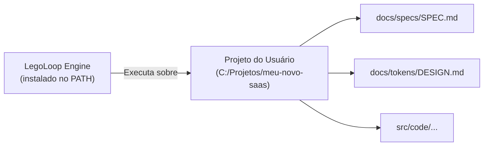
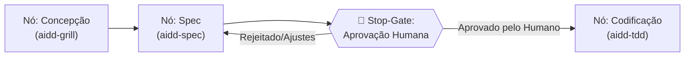

# 📋 Sessão `ac7dc5b4-f96f-42ae-a267-ab86d100bd88` — Histórico Completo de Diálogos

> **Projeto:** `LegoLoop` | **Branch:** `master` | **Harness Ativo:** `antigravity-cli`  
> **Tokens Consumidos:** Input: `238.141` | Thinking: `1.508` | Output: `11.580`  
> **Total de Turnos:** `4` | **Data:** `01/11/2026`  

### 🔄 Comandos de Restauração da Sessão
```bash
# Antigravity CLI (agy)
agy --conversation ac7dc5b4-f96f-42ae-a267-ab86d100bd88 --model gemini-3.8-flash-high --dangerously-skip-permissions

# Claude Code
claude --resume ac7dc5b4-f96f-42ae-a267-ab86d100bd88 --dangerously-skip-permissions --chrome --model opus

# OpenCode
opencode --session ac7dc5b4-f96f-42ae-a267-ab86d100bd88 --pure --auto --agent -m opencode/big-pickle

# Mimo
mimo --session ac7dc5b4-f96f-42ae-a267-ab86d100bd88 --pure -m xiaomi-token-plan-sgp/mimo-v2.6-flash --trust

# OMP
omp --resume ac7dc5b4-f96f-42ae-a267-ab86d100bd88 --auto-approve --model nemotron-3-ultra-550B-A55B

# Hermes
hermes --resume ac7dc5b4-f96f-42ae-a267-ab86d100bd88 --yolo
```

---

## 💬 Turno 1 — `2026-11-01T15:09:40Z`

### 👤 User Prompt
```
Eu preciso que você responda para mim o seguinte, hoje o que o projeto Lego Loop realmente faz e entrega para o usuário?
```

### 🤖 Model Response
O **LegoLoop** é um orquestrador de engenharia de software em Go (binário único `legoloop.exe`, zero dependências externas) projetado para **transformar o desenvolvimento com agentes de IA em esteiras modulares (estilo N8N)** com **isolamento estéril de contexto** e **altíssima economia de tokens**.

Em vez de manter conversas monolíticas de 100k+ tokens em um chat, o LegoLoop executa cada etapa em um subprocesso fechado que consome apenas o necessário (2k a 5k tokens), lê o artefato do disco, gera a entrega e encerra.

---

### O que ele realmente entrega e faz hoje na prática:

| Pilar | O que entrega ao usuário |
|---|---|
| **1. Looping Studio Visual** (`legoloop studio`) | Canvas Web local (`http://127.0.0.1:7878`) para desenhar pipelines conectando blocos (Reconhecimento, Engenharia Reversa, Design, TDD, Specs). Exporta e materializa diretamente em `pipeline.dag.json`. |
| **2. Orchestrix por Bloco** (`legoloop run`) | Motor de execução estéril em DAG. Roda nós de forma sequencial ou paralela sem contaminação de contexto entre eles. |
| **3. Roteamento de Modelos & Harnesses** (`legoloop doctor`) | Detecta e roteia nós para múltiplos executores instalados no SO: **9Router** (centenas de modelos remotos), **Ollama** local, **Claude CLI** (`claude -p`), **Antigravity** (`agy`), **MiMo**, **OMP** e scripts locais. |
| **4. Quality Gates Determinísticos** (`legoloop validate`) | Trava a esteira caso critérios rígidos não sejam cumpridos entre um nó e outro (ex.: `file_exists`, `has_pattern`, `word_count`, `has_acceptance_criteria`, `exit_code == 0`). |
| **5. Roteador de Rota Ótima** (`legoloop route`) | Grafo ontológico (Dijkstra) que calcula automaticamente a cadeia de blocos necessária para transformar uma entrada em uma saída (ex.: de `URL` $\to$ `Spec` executável). |
| **6. Canonizador de Workspace** (`legoloop canonize`) | Localiza arquivos duplicados (via SHA-256) em múltiplos projetos e unifica via symlinks/hardlinks com rollback automático, economizando espaço em disco sem quebrar ferramentas. |

---

### Resumo do valor entregue

1. **Previsibilidade:** Seu processo de engenharia vira um grafo rastreável, e não uma conversa caótica de chat.
2. **Economia Financeira e de Contexto:** Reduz em até **90%** o gasto de tokens ao descartar o contexto a cada nó e delegar tarefas triviais para modelos menores ou scripts locais.
3. **Qualidade Garantida por Gates:** Nenhuma etapa seguinte executa se a anterior não passou nos critérios de aceite do gate.

---

## 💬 Turno 2 — `2026-11-01T15:26:51Z`

### 👤 User Prompt
```
Então vamos pensar, o usuário criou o loop ali dentro do lego loop, do estúdio. Ele consegue executar esse loop dentro do próprio estúdio, ou ele pode utilizar esse loop criado. Quando eu perguntei da entrega é justamente isso, né? Quando um loop é criado. como que o usuário vai poder executar esse loop? E aí a gente tinha pensado em algumas formas de execução, diretamente dentro do próprio estúdio, através de um botão executa, mas se for dessa forma a gente vai perder a questão de como é que o usuário vai interagir e startar esse loop? A gente tem ali os gatilhos, os triggers, que vão startar o loop, mas é como que a gente vai colocar esse loop em produção, vamos dizer assim. E aí a outra forma que a gente pensou é Quando o usuário clica em materializar loop, essa acho que é a pergunta. Quando o usuário clica em materializar loop, como que esse loop entregue ao usuário para o usuário utilizar? Cria-se uma skill que faz todo o roteamento e tem toda a estrutura já formada? Aí eu não consegui entender. Você consegue me explicar melhor?
```

### 🤖 Model Response
Quando você monta um fluxo no **LegoLoop Studio** e clica em **"Materializar Loop"**, o sistema realiza uma compilação formal do grafo e entrega o loop de três formas complementares para execução.

---

### 1. O que acontece exatamente ao clicar em "Materializar Loop"?

1. **Validação Estrita:** O backend em Go verifica o grafo do Canvas:
   * Valida se não há ciclos infinitos (Kahn DAG).
   * Valida se os tipos de artefatos batem nas conexões (ex.: um nó que consome `Artifact:Spec` está de fato ligado a quem produz `Spec`).
2. **Geração do Contrato Canônico (`pipeline.dag.json`):**
   * O Studio grava na raiz do seu projeto o arquivo **`pipeline.dag.json`**.
   * Esse arquivo é a **Fonte Única da Verdade (SSOT)**: contém a ordem dos nós, os gates de aceitação, os modelos de IA roteados para cada nó e as variáveis de entrada.
3. **Persistência no Cofre de Loops (`.loop.json`):**
   * O loop também pode ser salvo no acervo canônico (`~/.aidd/canonical/loops/<id>.loop.json`).
   * A partir desse momento, ele aparece na categoria **"Loops"** na barra lateral do Studio como um **Sub-Loop (Macro-peça Lego)**, permitindo que você aninhe esteiras complexas dentro de outros pipelines maiores.

---

### 2. Como o usuário executa esse loop na prática?

Existem **3 formas reais de execução**, desenhadas para cenários diferentes:

#### Forma A: Diretamente no próprio Studio (Visual & Debug)
* **Como funciona:** O Studio possui a API `POST /api/run` com streaming **SSE (Server-Sent Events)**.
* **A experiência:** Ao clicar em **"Executar"** na barra superior do Studio:
  * Abre-se um painel para informar os parâmetros do gatilho (ex.: `idea="Criar SaaS de Clínica"` ou `url="https://site.com"`).
  * Conforme o motor do LegoLoop executa em background, os nós no Canvas **acendem em tempo real**:
    * 🟡 **Amarelo:** executando em contexto isolado;
    * 🟢 **Verde:** concluído com sucesso (mostrando tokens consumidos, modelo usado e tempo);
    * 🔴 **Vermelho:** reprovado no Quality Gate (ex.: o arquivo gerado não cumpriu os critérios binários).

#### Forma B: Em "Produção" via CLI / Automação (Headless / CI / Cron)
* **Como funciona:** Sem precisar do navegador ou Studio aberto, o binário nativo executa o DAG:
  ```bash
  legoloop run pipeline.dag.json --var idea="Meu Projeto" --parallel 4
  ```
* **Como os gatilhos (triggers) entram aqui:**
  * **Trigger Manual:** Rodado sob demanda no terminal ou script.
  * **Trigger Cron / File Watcher:** O binário ou um agendador do SO (cron/systemd/task scheduler) vigia alterações ou horários e dispara o comando.
  * **Trigger Kanban (GitHub):** Uma GitHub Action ou webhook dispara o runner quando um card muda de coluna.

#### Forma C: Através dos Agentes de IA (Via Skill no Chat)
> *"Cria-se uma skill que faz todo o roteamento e tem toda a estrutura já formada?"*

**Sim, exatamente esse é o elo com o ecossistema AIDD (Antigravity, Claude Code, etc.):**

1. Você não precisa que o LLM programe código do zero nem mantenha um chat gigante de 150k tokens.
2. A skill mestre (ou uma gerada para o seu pipeline) encapsula o disparo do LegoLoop:
   * Quando você pede no chat: `"/executar pipeline de engenharia reversa para https://alvo.com"`, o agente **não tenta fazer as etapas manualmente no chat**.
   * A skill roda em background o comando `legoloop run pipeline.dag.json --var url="..."`.
   * O LegoLoop executa cada nó em processo estéril (gastando apenas 2k tokens por nó via Ollama, 9Router ou Claude CLI).
   * O agente no chat recebe apenas o **relatório final e os artefatos prontos**, blindando seu contexto contra desperdício de tokens e falhas cognitivas.

---

### Resumo

* **Materializar** = Gera o contrato executável `pipeline.dag.json` no disco e registra o loop como peça reutilizável.
* **Executar no Studio** = Para inspeção visual passo a passo com feedback em tempo real no Canvas.
* **Colocar em Produção** = Rodar `legoloop run` via CLI, Cron/Watchers ou via Slash Commands/Skills dentro dos seus agentes de IA.

---

## 💬 Turno 3 — `2026-11-01T16:29:32Z`

### 👤 User Prompt
```
ainda há clarificacoes:
materializar, executar e colocar em produção são coisas totalmente diferentes, certo? Por que? O projeto em suma ele materializa pipelines, certo? Ou seja, ele gera pipelines dentro de toda a concepção, as estratégias, as metodologias definidas já dentro do Lego Loop, certo? A execução dentro do estúdio não é uma execução real, é apenas uma execução de expensão. Vamos dizer assim, estou certo? Já a execução no mundo real ou no dia a dia do desenvolvedor vai acontecer dentro dos seus agentes ou do terminal, é isso, certo? Então, por exemplo, o usuário abriu o estúdio, criou um loop ou um pipeline de engenharia reversa para sites. Ele nomeou esse pipeline como engenharia redsights executou ali para ver como que o fluxo corre legal ele material e clicou no botão de materializar aí eis a questão esse pipeline já vai estar quando ele clica em materializar esse pipeline vai estar construído certo com todas as regras com todas as diretrizes com tudo que e o tabelecido dentro do legoloupe, todos os contratos, enfim, com tudo. E aí ele abre o anti-grabbit, ou cloud code, e em linguagem natural ele fala lá no chat. Utilizar o pipeline de engenharia de site para fazer a engenharia de tal site, do site ABC. Visto que tudo está a nível de sistema operacional e é universal dentro do ambiente do usuário, pipeline no background é acionado automaticamente conforme foi criado, certo? fazendo as suas paradas interativas, fazendo entregando seus artefatos, seguindo os gates, roteando, enfim. O pipeline é executado conforme ele for construído. É isso?
```

### 🤖 Model Response
**Você compreendeu exatamente a essência da arquitetura.** A sua leitura está **100% correta**. 

Separar esses três conceitos é o que diferencia o LegoLoop de ferramentas de chat comuns.

---

### 1. A Tríade: Três coisas completamente diferentes

| Conceito | O que é de verdade | Onde acontece |
|---|---|---|
| **Materializar** | **Compilação de Engenharia.** Transforma o desenho visual em um contrato formal estrito (`pipeline.dag.json` ou `.loop.json`), com tipos de dados amarrados, Quality Gates definidos e modelos roteados. | No Studio (Canvas $\to$ Disco) |
| **Executar** | **Processamento em Sandbox.** O motor Go lê o DAG, sobe subprocessos estéreis (2k a 5k tokens), valida os gates e gera os artefatos. | No Runner (`legoloop run` ou `/api/run`) |
| **Colocar em Produção** | **Adoção no Fluxo de Trabalho.** Tornar esse pipeline um ativo universal do seu SO, acionável via agentes de chat (Antigravity/Claude Code), terminal, cron ou CI/CD. | No Sistema Operacional (`PATH` + Agentes) |

---

### 2. A execução dentro do Studio é "de bancada" (Inspeção)

A execução no Studio é real (ele de fato chama os modelos e testa os gates via SSE), **mas o propósito dela ali é de bancada de testes / homologação**:
* Serve para você ver as luzes acenderem (verde/vermelho), verificar se algum gate quebrou, medir quanto tempo e tokens aquele nó gastou e ajustar o desenho.
* **Nenhum desenvolvedor vai deixar uma aba de navegador aberta o dia todo** para rodar seus fluxos de trabalho do cotidiano. O Studio é a **prancheta de design e teste de fumaça**.

---

### 3. O "Mundo Real": O caso prático com Antigravity / Claude Code

O cenário que você descreveu com o pipeline `engenharia-redsights` é **o padrão-ouro do ecossistema AIDD**:

1. **No Studio:** Você desenhou e materializou o pipeline `engenharia-redsights`. O contrato foi gravado no disco/cofre universal (`~/.aidd/canonical/loops/` ou no repositório).
2. **No Chat (Antigravity / Claude Code):** Você abre o chat e diz:
   > *"Execute a engenharia reversa do site https://exemplo.com usando o pipeline engenharia-redsights."*
3. **O que o Agente faz:**
   * O agente **não tenta fazer as etapas manualmente no chat** (o que consumiria 150.000 tokens e geraria alucinações).
   * Ele simplesmente roda em background no terminal:
     ```bash
     legoloop run engenharia-redsights.loop.json --var url="https://exemplo.com"
     ```
4. **O que o LegoLoop faz no SO:**
   * Executa bloco por bloco em processos estéreis (usando 9Router, Ollama ou scripts locais).
   * Valida os gates (se a extração do DOM falhou, o pipeline aborta antes de gastar modelo caro de design).
   * Respeita paradas interativas (Stop-Gates humanos), caso o pipeline exija aprovação.
5. **O Retorno:** O agente no chat recebe apenas o aviso de conclusão:
   > *"Pipeline concluído com sucesso. Artefatos gerados em `docs/specs/` e `docs/tokens/`. Total consumido: 3.400 tokens."*

---

### Conclusão

* **O Studio** é a **fábrica de esteiras** (onde você projeta e inspeciona visualmente).
* **O LegoLoop** é o **motor de execução no SO** (leve, determinístico e cirúrgico).
* **O Agente (Antigravity/Claude)** é o **piloto em linguagem natural** que aciona essas esteiras sem inchar a conversa.

---

## 💬 Turno 4 — `2026-11-01T16:40:09Z`

### 👤 User Prompt
```
Agora só uma dúvida em relação aos artefatos gerados aqui foi a última coisa que você colocou uma das últimas frases aqui então por exemplo no exemplo lá da engenharia reverse legal executou tudo no background o agente recebeu lá o recebeu que pipeline foi concluído com sucesso e aí a A pergunta é a dúvida, né? A clarificação. Onde os artefatos serão gerados? Ele não pode ser gerado dentro do projeto LEGO Loup, certo? Então se o usuário está criando um projeto novo e ele está fazendo uma engenharia reversa de repente os artefatos precisam ser criados dentro desse projeto. É isso mesmo? Ou isso a gente pode desenhar também e criar talvez peças. Por exemplo, tem algumas questões aqui que eu até anotei. Peça de estopagem humana, ou seja, entre o pode colocar uma pecinha de stop, stop para aprovação humana. Aí nós teríamos também esse stop, esse stop não, aí nós teríamos a configuração de onde os artefatos serão girados. Aí eu não sei, é só uma colocação. Então clarifique aí pra mim.
```

### 🤖 Model Response
Você tocou em dois pontos centrais de **arquitetura de software** e **governança de IA**. As suas colocações estão corretíssimas e são essenciais para o uso no dia a dia.

---

### 1. Onde os artefatos são gerados? (Isolamento de Workspaces)

**Você tem toda razão: o projeto LegoLoop NUNCA deve ser poluído com os artefatos dos projetos dos usuários.** O LegoLoop é apenas a *engine* (o motor/ferramenta instalada no seu SO), como se fosse o compilador `gcc`, o `node` ou o `docker`.

Hoje, o LegoLoop resolve isso através do conceito de **`workdir` (Diretório de Trabalho Alvo)**:



#### Como isso funciona na prática:
1. **Via Terminal ou Agente (Antigravity/Claude Code):**
   Se o agente ou você estiver com o terminal aberto dentro da pasta `C:\Projetos\meu-novo-saas` e disparar:
   ```bash
   legoloop run pipeline.dag.json
   # ou explicitamente:
   legoloop run pipeline.dag.json --workdir "C:\Projetos\meu-novo-saas"
   ```
   O motor executa em sandbox e grava todos os artefatos **dentro do seu projeto alvo**.
2. **Via Studio Visual:**
   Você pode iniciar o Studio apontando para o seu projeto:
   ```bash
   legoloop studio --project "C:\Projetos\meu-novo-saas"
   ```
   O Studio passa a ler e gravar os artefatos e o `pipeline.dag.json` diretamente dentro da pasta desse projeto.
3. **Caminho configurável por nó:**
   No contrato do LegoLoop, cada nó possui o campo `output.artifact`. Você pode definir caminhos relativos como:
   * `docs/specs/2026-11-01_SPEC.md`
   * `frontend/tokens/colors.json`
   * `backend/src/domain/user.go`

---

### 2. A "Peça de Estopagem Humana" (Human-in-the-Loop / Stop-Gate)

Essa sua anotação é **ouro puro** e resolve o maior problema de agentes autônomos: a **afobação cognitiva** (quando a IA sai implementando 50 arquivos de código em cima de uma especificação com a qual você nem concordou).

#### Como essa peça se encaixa na esteira:



#### Como ela funciona nos dois ambientes:

1. **No Chat (Antigravity / Claude Code / CLI):**
   * O pipeline executa a concepção e gera a `SPEC.md`.
   * Ao atingir a peça de **Stop-Gate**, o runner do LegoLoop **pausa o processo** e notifica o agente:
     > *"Pipeline pausado em [Stop-Gate: Aprovação de Spec]. A especificação foi gerada em `docs/specs/SPEC.md`. Revise o documento. Deseja aprovar para prosseguir para a fase de TDD? (Sim / Não / Ajustar)"*
   * O pipeline só avança para a escrita de código após o seu comando afirmativo no chat.

2. **No Studio Visual:**
   * O nó de Stop-Gate acende em **Laranja pulsante ("Aguardando Aprovação")**.
   * Ao clicar nele, abre-se um modal com o preview do artefato gerado e dois botões:
     * `[ ✅ Aprovar & Continuar Esteira ]`
     * `[ 🔄 Solicitar Refatoração ]`

---

### Resumo das duas clarificações

1. **Local dos Artefatos:** Ficam estritamente dentro do diretório do projeto alvo (`--workdir`), nunca na pasta do LegoLoop. Os caminhos são relativos e customizáveis por nó no Canvas.
2. **Stop-Gate Humano:** Uma peça de controle essencial entre blocos críticos, que trava a esteira até que o desenvolvedor humano audite o artefato e autorize a próxima fase.

---
