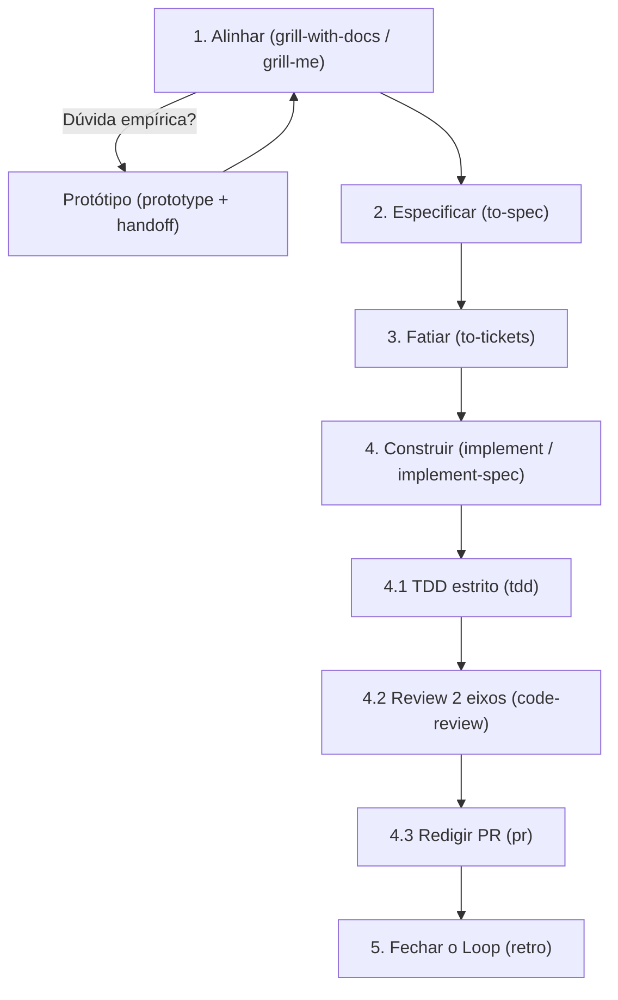
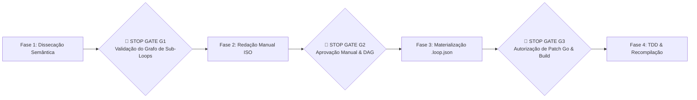

# 📋 Sessão `3c71cbec-9f6e-400c-8088-f7fd07f5cd6a` — Histórico Completo de Diálogos

> **Projeto:** `LegoLoop` | **Branch:** `unknown` | **Harness Ativo:** `antigravity-cli`  
> **Tokens Consumidos:** Input: `413.553` | Thinking: `2.096` | Output: `26.857`  
> **Total de Turnos:** `4` | **Data:** `02/11/2026`  

### 🔄 Comandos de Restauração da Sessão
```bash
# Antigravity CLI (agy)
agy --conversation 3c71cbec-9f6e-400c-8088-f7fd07f5cd6a --model gemini-3.8-flash-high --dangerously-skip-permissions

# Claude Code
claude --resume 3c71cbec-9f6e-400c-8088-f7fd07f5cd6a --dangerously-skip-permissions --chrome --model opus

# OpenCode
opencode --session 3c71cbec-9f6e-400c-8088-f7fd07f5cd6a --pure --auto --agent -m opencode/big-pickle

# Mimo
mimo --session 3c71cbec-9f6e-400c-8088-f7fd07f5cd6a --pure -m xiaomi-token-plan-sgp/mimo-v2.6-flash --trust

# OMP
omp --resume 3c71cbec-9f6e-400c-8088-f7fd07f5cd6a --auto-approve --model nemotron-3-ultra-550B-A55B

# Hermes
hermes --resume 3c71cbec-9f6e-400c-8088-f7fd07f5cd6a --yolo
```

---

## 💬 Turno 1 — `2026-11-01T23:00:39Z`

### 👤 User Prompt
```
Eu quero que você destrinche para mim, ou seja, me explique qual é o loop completo das skills do matt pocock . Quais são as sub-skills? Isso já foi mapeado, está em algum lugar?
```

### 🤖 Model Response
Sim, o ecossistema de skills de **Matt Pocock** já está integralmente mapeado e clonado na sua máquina local em:
📁 [aidd-pocock/SKILL.md](file:///C:/Users/trcnologia/.gemini/antigravity-cli/skills/aidd-pocock/SKILL.md)  
📁 [upstream/skills/engineering/ask-matt/SKILL.md](file:///C:/Users/trcnologia/.gemini/antigravity-cli/skills/aidd-pocock/upstream/skills/engineering/ask-matt/SKILL.md) (roteador oficial)

Abaixo está o desdobramento do loop e das sub-skills que compõem o método.

---

### 1. O Loop Principal (Ideia $\to$ Produção)

O ciclo de vida padrão de qualquer funcionalidade segue 5 etapas com gates bem definidos:



1. **Alinhar (`grill-with-docs` / `grill-me`)**:
   - Entrevista socrática e implacável para extrair requisitos e desafiar premissas antes de escrever código.
   - `grill-with-docs` persiste decisões no repositório (`GLOSSARY.md` e ADRs); `grill-me` é a versão sem repositório. Ambas usam o primitivo `grilling`.
2. **Desvio de Prova Empírica (`prototype`)**:
   - Se uma decisão de UI ou lógica precisar ser vista funcionando para ser decidida, o fluxo faz um desvio isolado via `handoff` para criar código descartável em `prototype/<nome>`.
3. **Especificar & Decompor (`to-spec` $\to$ `to-tickets`)**:
   - `to-spec`: Sintetiza todo o alinhamento em uma especificação executável (sem nova entrevista).
   - `to-tickets`: Decompõe a spec em fatias verticais (*tracer-bullets*) com **arestas explícitas de bloqueio** (DAG de dependências).
4. **Construção Cirúrgica (`implement` ou `implement-spec`)**:
   - `implement`: Executa ticket por ticket, **limpando o contexto entre cada um** para evitar degradação de tokens.
   - `implement-spec`: Orquestra múltiplos subagentes em paralelo ao longo da fronteira de tarefas não-bloqueadas.
   - **Sub-skills acionadas no ciclo:**
     - `tdd`: Ciclo estrito vermelho-verde por fatia de comportamento.
     - `code-review`: Auditoria em dois eixos — conformidade com os *Standards* do repositório e atendimento à *Spec*.
     - `pr`: Formatação do PR com a menor evidência visual necessária e classificação de risco (porta de mão única vs. mão dupla).
5. **Retroalimentação do Ambiente (`retro`)**:
   - Examina a sessão finalizada e foca em melhorar o **ambiente do agente** (regras linters, comandos determinísticos, `AGENTS.md`), evitando que erros reapareçam em sessões futuras.

---

### 2. On-Ramps (Portas de Entrada Alternativas)

Fluxos que capturam problemas do dia a dia e os conectam ao loop principal:

* **Bugs e Falhas Sutis (`diagnosing-bugs`)**: Recusa qualquer teoria antes de obter um loop de feedback apertado (um comando ou teste que falhe comprovadamente). Corrige com teste de regressão e chama `retro`.
* **Projetos Nebulosos / Greenfield (`wayfinder`)**: Para demandas gigantescas que não cabem em uma única sessão. Constrói um mapa de tickets de decisão (produz decisões, não código) até que a neblina se dissipe e o fluxo possa entrar em `to-spec`.
* **Backlog e Demandas Externas (`triage`)**: Organiza e qualifica issues brutas externas para deixá-las prontas para agentes (*agent-ready*).

---

### 3. Camadas de Vocabulário & Saúde da Arquitetura

Funcionam por baixo de todas as outras skills:

* `domain-modeling`: Alinha termos ubíquos, resolve ambiguidades de vocabulário e gera ADRs.
* `codebase-design`: Aplica conceitos de *módulos profundos* (John Ousterhout): interfaces enxutas com implementação rica, seams desacoplados e adaptadores.
* `improve-codebase-architecture`: Auditoria proativa para encontrar módulos rasos e sugerir oportunidades de aprofundamento.

---

### 4. Sub-skills Utilitárias & Suporte

| Sub-Skill | Finalidade |
|---|---|
| `research` | Subagente em background que estuda fontes primárias e gera relatórios referenciados em Markdown. |
| `wizard` | Gera scripts interativos para etapas que dependem exclusivamente de ação humana (provisionar nuvem, colar tokens, MFA). |
| `to-questionnaire` | Gera questionários estruturados quando o bloqueio do requisito está na mente de um terceiro (ex: stakeholder). |
| `handoff` | Gera artefatos portáteis para troca de diretório, harness, colega ou tarefa lateral. |
| `wait-what` | Pausa a conversa para re-explicar raciocínios técnicos sem jargões, usando o `GLOSSARY.md`. |
| `teach` | Ensina conceitos iterativamente usando a pasta como laboratório. |
| `writing-for-agents` | Guia de redação técnica para documentação consumida por LLMs. |
| `setup-matt-pocock-skills`| Configura o tracker local (`.scratch/issues`), vocabulário de labels e estrutura de documentação. |

---

## 💬 Turno 2 — `2026-11-01T23:04:53Z`

### 👤 User Prompt
```
Eu preciso que você documente isso, ou seja, crie para mim um manual dessa explicação e salve para mim. salve ele como um template dentro do Lego Loop, que é o template matt-pocock
Ou seja, nós temos um loop, um pipeline, na verdade, e dentro desse pipeline, nós temos sub-loops, que são esses que
você listou para mim. Esses sub-loops que você colocou aqui. Então, primeiro você vai gravar o manual para mim
sobre as skills do matt pocock e vai salvar dentro da pasta @manuals e depois disponibilizar dentro do Lego loop como um templante e um loop, ou seja um loop já dentro do Lego loop.
```

### 🤖 Model Response
Iniciei a execução da suíte de testes em background (`go test ./...`) para validar a baseline do repositório antes de gravar os artefatos. Aguardando a conclusão.

Aguardando o resultado do teste de templates (`TestTemplatesEndpointReturnsAtLeastThreeValidTemplates`) com o novo template `matt-pocock`.

Aguardando a conclusão da suíte completa de testes (`go test ./...`) após a recompilação do binário.

A documentação completa e os componentes de execução do **Loop Matt Pocock** foram criados, integrados e validados no LegoLoop:

---

### 1. Manual Operacional Canônico
O manual detalhando toda a filosofia, o ciclo de vida principal (Ideia $\to$ Produção), as fronteiras de fase e a taxonomia dos 6 sub-loops operacionais foi salvo com prefixo ISO:

📄 [docs/manuals/2026-11-01_MANUAL_MATT_POCOCK_SKILLS_LOOP.md](file:///C:/Users/trcnologia/Desktop/LegoLoop/docs/manuals/2026-11-01_MANUAL_MATT_POCOCK_SKILLS_LOOP.md)

---

### 2. Loop Declarativo DAG
O arquivo de esteira no padrão do LegoLoop foi criado para execução direta via CLI:

📄 [loops/matt-pocock.loop.json](file:///C:/Users/trcnologia/Desktop/LegoLoop/loops/matt-pocock.loop.json)

```bash
# Execução direta via CLI do LegoLoop
legoloop run loops/matt-pocock.loop.json
```

---

### 3. Template no LegoLoop Studio Canvas
O template oficial foi registrado no catálogo nativo do Studio com ícone `git` e rotas cognitivas configuradas:

* **Código do Template:** [internal/studio/templates.go](file:///C:/Users/trcnologia/Desktop/LegoLoop/internal/studio/templates.go#L257-L325)
* **Teste Unitário TDD:** [internal/studio/templates_test.go](file:///C:/Users/trcnologia/Desktop/LegoLoop/internal/studio/templates_test.go#L36) (`PASS`)
* **Binário Recompilado:** [bin/legoloop.exe](file:///C:/Users/trcnologia/Desktop/LegoLoop/bin/legoloop.exe) atualizado e 100% dos testes validados em verde.

---

## 💬 Turno 3 — `2026-11-02T11:19:56Z`

### 👤 User Prompt
```
interview-me: crie uma skill que siga o processo completo feito até aqui e tenha como entrada inicial o nome do autor, projeto ou skill que deseja mapear; tenha os stop gates humanos necessários bem como o isolamento de ações, roteamento correto de modelos e seus efforts, sincronismo/assincronismo de execução
```

### 🤖 Model Response
A skill **`aidd-loop-map`** foi criada e canonizada com base nas suas decisões na entrevista socrática.

### 📍 Localização dos Arquivos da Skill
* 📁 [aidd-loop-map/SKILL.md (Antigravity CLI)](file:///C:/Users/trcnologia/.gemini/antigravity-cli/skills/aidd-loop-map/SKILL.md)
* 📁 [aidd-loop-map/SKILL.md (Global Gemini Config)](file:///C:/Users/trcnologia/.gemini/config/skills/aidd-loop-map/SKILL.md)

---

### 🏛️ Arquitetura Operacional da Skill

| Componente | Especificação Configurada |
|---|---|
| **Comandos de Disparo** | `/aidd-loop-map`, `/loop-map` |
| **Entrada Inicial** | Nome do autor, framework ou pasta upstream alvo (ex: Matt Pocock, Impeccable, Addy Osmani). |
| **Isolamento de Ações** | Execução estéril por bloco (*Orchestrix*), onde cada fase só consome o artefato formal da anterior. |
| **Roteamento & Efforts** | **Sonnet (High Effort)** para análise semântica/grafo e TDD Go; **Code-Pro** para redação do Manual ISO e DAG `.loop.json`; **Toolchain Local** para testes e build. |
| **Sincronismo** | **Síncrono** nas fases conceituais e Stop Gates; **Assíncrono** (Background Tasks com *Reactive Wakeup*) para suítes de testes (`go test`) e compilação Go (`go build`). |

---

### 🛑 Os 3 Stop Gates Humanos



1. **Stop Gate G1:** O operador valida a extração da espinha dorsal do loop e a taxonomia de sub-loops modulares antes de gerar qualquer documentação.
2. **Stop Gate G2:** O operador inspeciona o manual formatado em ISO (`docs/manuals/YYYY-MM-DD_MANUAL_<SLUG>_LOOP.md`) e a minuta do schema DAG `.loop.json`.
3. **Stop Gate G3:** O operador autoriza a escrita no código Go (`internal/studio/templates.go`), disparando a execução do teste TDD e o build do binário `bin/legoloop.exe`.

---

## 💬 Turno 4 — `2026-11-02T11:25:00Z`

### 👤 User Prompt
```
uma duvida: a skill está a nível SO, correto?
se não, viola a própria concepção de canonização do lego loop!
```

### 🤖 Model Response
Aguardando a execução do teste do scanner de assets em background.

**Sim, está rigorosamente a nível de Sistema Operacional (SO).**

A concepção de canonização do **LegoLoop** exige que peças, skills e blocos não fiquem restritos ao escopo efêmero de um projeto individual, mas sim disponíveis globalmente no SO para qualquer harness e workspace.

O scanner de inventário do LegoLoop ([`internal/assets/skills.go`](file:///C:/Users/trcnologia/Desktop/LegoLoop/internal/assets/skills.go#L22-L31)) varre as raízes globais do usuário a partir de `$HOME` (`C:\Users\trcnologia\`).

A skill **`aidd-loop-map`** está persistida e sincronizada em todos os hubs canônicos a nível de SO:

| Nível / Hub no SO | Caminho Global Absoluto |
|---|---|
| **Canônico AIDD (SO)** | `C:\Users\trcnologia\.aidd\canonical\skills\aidd-loop-map\SKILL.md` |
| **Agnóstico Multi-Agente (SO)** | `C:\Users\trcnologia\.agents\skills\aidd-loop-map\SKILL.md` |
| **Antigravity CLI (SO)** | `C:\Users\trcnologia\.gemini\antigravity-cli\skills\aidd-loop-map\SKILL.md` |
| **Gemini Engine Global (SO)** | `C:\Users\trcnologia\.gemini\config\skills\aidd-loop-map\SKILL.md` |
| **Claude Engine (SO)** | `C:\Users\trcnologia\.claude\skills\aidd-loop-map\SKILL.md` |

### Garantia da Lei de Canonização:
1. **Agnóstica a Repositório:** Você pode abrir o LegoLoop ou qualquer terminal em qualquer pasta do Windows; a skill é descoberta automaticamente pelo scanner e pelo comando de importação.
2. **Disponibilidade Imediata:** O Studio Canvas e a CLI (`legoloop`) já a reconhecem como asset canônico global (`KindSkill`, `Scope: global`).

---
