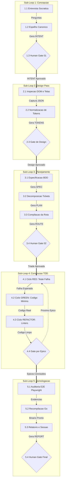

# 📋 Sessão `8caab73a-ed99-4a6e-a384-50c33b6d7f45` — Histórico Completo de Diálogos

> **Projeto:** `LegoLoop` | **Branch:** `master` | **Harness Ativo:** `antigravity-cli`  
> **Tokens Consumidos:** Input: `799.807` | Thinking: `5.609` | Output: `76.289`  
> **Total de Turnos:** `11` | **Data:** `06/11/2026`  

### 🔄 Comandos de Restauração da Sessão
```bash
# Antigravity CLI (agy)
agy --conversation 8caab73a-ed99-4a6e-a384-50c33b6d7f45 --model gemini-3.8-flash-high --dangerously-skip-permissions

# Claude Code
claude --resume 8caab73a-ed99-4a6e-a384-50c33b6d7f45 --dangerously-skip-permissions --chrome --model opus

# OpenCode
opencode --session 8caab73a-ed99-4a6e-a384-50c33b6d7f45 --pure --auto --agent -m opencode/big-pickle

# Mimo
mimo --session 8caab73a-ed99-4a6e-a384-50c33b6d7f45 --pure -m xiaomi-token-plan-sgp/mimo-v2.6-flash --trust

# OMP
omp --resume 8caab73a-ed99-4a6e-a384-50c33b6d7f45 --auto-approve --model nemotron-3-ultra-550B-A55B

# Hermes
hermes --resume 8caab73a-ed99-4a6e-a384-50c33b6d7f45 --yolo
```

---

## 💬 Turno 1 — `2026-11-06T17:41:35Z`

### 👤 User Prompt
```
hoje, dentro do mega-pieline temos sub-loops ou sub-pipelines, quais são eles e quais as peças que os compem?
```

### 🤖 Model Response
O **Mega Pipeline do LegoLoop** é estruturado em **5 Sub-Loops Modulares sequenciais**, executados sob isolamento estéril (*Orchestrix cirúrgica*) e controlados por *Stop-Gates* humanos e mecânicos.

Abaixo está o detalhamento de cada sub-loop e as peças que os compõem, conforme definido no manual [`MANUAL_MEGA_PIPELINE_LEGOLOOP.md`](file:///C:/Users/trcnologia/Desktop/LegoLoop/docs/manuals/2026-11-01_MANUAL_MEGA_PIPELINE_LEGOLOOP.md), na skill [`aidd-legoloop-mega-pipeline`](file:///C:/Users/trcnologia/.gemini/skills/aidd-legoloop-mega-pipeline/SKILL.md) e no DAG canônico [`loops/mega-pipeline.loop.json`](file:///C:/Users/trcnologia/Desktop/LegoLoop/loops/mega-pipeline.loop.json):

---

### 1. Loop 1: Concepção & Alinhamento de Intenção
* **Objetivo:** Entrevista socrática (protocolo Addy Osmani), alinhamento de escopo, hipóteses, restrições e premissas.
* **Peças / Skills:** [`aidd-grill`](file:///C:/Users/trcnologia/.gemini/antigravity-cli/skills/aidd-grill/SKILL.md), `interview-me`, `master-assembler`.
* **Entrada:** Solicitação do usuário em linguagem natural.
* **Saída:** `docs/intents/YYYY-MM-DD_INTENT_<TEMA>.md` (seguindo template canônico).
* **Gate:** `STOP-GATE HUMANO 01` (apresentação do Espelho Canônico e pausa obrigatória).

---

### 2. Loop 2: Engenharia Reversa & Design Pass *(Condicional)*
* **Objetivo:** Dissecção de referências visuais, extração de design tokens, layouts ou engenharia reversa de apps/sites.
* **Peças / Skills:** [`impeccable`](file:///C:/Users/trcnologia/.gemini/antigravity-cli/skills/impeccable/SKILL.md), [`obscura`](file:///C:/Users/trcnologia/.gemini/antigravity-cli/skills/obscura/SKILL.md), [`reverse-engineer-anything`](file:///C:/Users/trcnologia/.gemini/antigravity-cli/skills/reverse-engineer-anything/SKILL.md), [`aidd-rea-web-saas`](file:///C:/Users/trcnologia/.gemini/antigravity-cli/skills/aidd-rea-web-saas/SKILL.md).
* **Entrada:** URL, mock, wireframe, binário ou tela existente.
* **Saída:** `DESIGN.md`, `TOKENS.css` ou `ESTRUTURA_REVERSA.json`.
* **Gate:** `STOP-GATE HUMANO 02` (validação de conformidade visual e tokens).

---

### 3. Loop 3: Engenharia & Tríade de Planejamento
* **Objetivo:** Especificação técnica com critérios BDD binários, quebra hierárquica de tickets (Épicos ➔ Micro ➔ Nano) e geração da rota executável formal em JSON.
* **Peças / Skills:** [`aidd-spec`](file:///C:/Users/trcnologia/.gemini/antigravity-cli/skills/aidd-spec/SKILL.md), `to-spec` (Pocock), [`aidd-tickets`](file:///C:/Users/trcnologia/.gemini/antigravity-cli/skills/aidd-tickets/SKILL.md), [`aidd-orchestrate-pipeline-creator`](file:///C:/Users/trcnologia/.gemini/antigravity-cli/skills/aidd-orchestrate-pipeline-creator/SKILL.md).
* **Entrada:** `INTENT.md` validado (+ `DESIGN.md` se houver).
* **Saída (Tríade Inegociável):**
  1. `SPEC`: `docs/specs/YYYY-MM-DD_SPEC_<TEMA>.md`
  2. `PLAN`: `docs/plans/YYYY-MM-DD_PLAN_<TEMA>.md`
  3. `ROUTE`: `docs/routes/YYYY-MM-DD_ROUTE_<TEMA>.json`
* **Gate:** `STOP-GATE HUMANO 03` (proibido codificar antes da Tríade aprovada).

---

### 4. Loop 4: Construção TDD Estrito por Épico *(Orchestrix Cirúrgica)*
* **Objetivo:** Execução estéril ticket a ticket, ciclo Red ➔ Green ➔ Refactor com proibição de stubs/TODOs e funções enxutas.
* **Peças / Skills:** [`aidd-tdd`](file:///C:/Users/trcnologia/.gemini/antigravity-cli/skills/aidd-tdd/SKILL.md), [`implementacao`](file:///C:/Users/trcnologia/.gemini/antigravity-cli/skills/implementacao/SKILL.md), gates mecânicos (`go test`, `go vet`, `funclen`).
* **Entrada:** Rota de execução formal JSON e contratos do Épico ativo.
* **Saída:** Código de produção testado e relatórios parciais em `scratch/` ou `docs/reports/TDD_REPORT.md`.
* **Gate:** `STOP-GATE HUMANO POR ÉPICO` (auditoria do código do Épico concluído antes de iniciar o próximo).

---

### 5. Loop 5: Homologação E2E, Recompilação & Fechamento
* **Objetivo:** Auditoria de integração ponta a ponta, recompilação obrigatória dos binários, geração do relatório final e rastreabilidade da sessão.
* **Peças / Skills:** [`aidd-homologue`](file:///C:/Users/trcnologia/.gemini/antigravity-cli/skills/aidd-homologue/SKILL.md), `playwright`, `quality-gatekeeper` / `code-review`, [`aidd-sessao`](file:///C:/Users/trcnologia/.gemini/antigravity-cli/skills/aidd-sessao/SKILL.md).
* **Entrada:** Código completo aprovado em todos os épicos.
* **Saída:**
  * Suíte 100% verde (`go test ./...` ou `npm test`);
  * Recompilação obrigatória: `go build -o bin/legoloop.exe ./cmd/legoloop`;
  * Relatório consolidado: `docs/reports/YYYY-MM-DD_REPORT_<TEMA>.md`;
  * Histórico em `docs/sessions/`.
* **Gate:** `STOP-GATE FINAL` (homologação final e entrega ao usuário).

---

### Materialização do DAG Padrão no Acervo:

No arquivo [`loops/mega-pipeline.loop.json`](file:///C:/Users/trcnologia/Desktop/LegoLoop/loops/mega-pipeline.loop.json) e no Studio Canvas ([`internal/studio/templates.go`](file:///C:/Users/trcnologia/Desktop/LegoLoop/internal/studio/templates.go#L128-L178)), esse fluxo está montado no seguinte encadeamento de nós:

| ID do Nó | Sub-Loop Representado | Peça / Bloco Principal | Modelo / Roteamento Sugerido |
| :--- | :--- | :--- | :--- |
| `l1-concepcao` | Loop 1: Concepção | `aidd-grill` | `sonnet` (fallback `haiku`) |
| `l2-design` | Loop 2: Design Pass | `impeccable` | `code-fast` (auto) |
| `l3-triade` | Loop 3: Tríade de Planejamento | `aidd-spec` | `code-pro` (auto) |
| `l4-tdd` | Loop 4: Construção TDD | `aidd-tdd` | `sonnet` (fallback `llama3.1:8b`) |
| `l5-homologue` | Loop 5: Homologação & Fechamento | `aidd-homologue` / `code-review` | `code-fast` (auto) |

---

## 💬 Turno 2 — `2026-11-06T18:05:14Z`

### 👤 User Prompt
```
Sabe uma coisa que eu não entendia e talvez seja um defeito da skill e você pode me explicar, claro. Você estruturou a sua resposta de cada loop com o objetivo, as peças, skills, a entrada, a saída e o gate. Só que eu não vi as etapas, a sequência, o handoff, então nós temos a entrada, nós temos o processamento e aí eu acho que aqui que faltou essa parte esclarecida, como cada etapa é feita, o que cada etapa entrega, a quem ela entrega, como entrega, o que ela consome, então aí a mesma coisa, sua entrada, seu processamento, a sua saída. Outra questão, em relação às peças e skills, nós não teríamos também MCPs aqui, hooks e todas as outras peças necessárias? Outra questão que faltou, a dependência. Então, é um loop que pode ser executado de forma isolada dentro do mega pipeline. E aí, as etapas dentro desse loop são etapas que podem ser executadas isoladas ou não. São dependentes. Quais as dependências? Dê para entender essa pormenorização, esse aprofundamento e afneamento de como funciona?
```

### 🤖 Model Response
Sua observação é cirúrgica e toca no cerne da engenharia do LegoLoop: **um sub-loop não é uma "caixa preta" com apenas uma skill**, mas sim um **sub-grafo acíclico dirigido (DAG)** composto por múltiplas micro-etapas, cada uma acoplando diferentes classes de peças (Skills, MCPs, Scripts, Hooks e Gates) com contratos explícitos de **I/O, processamento, dependência e handoff**.

Abaixo está o detalhamento aprofundado dessa arquitetura:

---

## 1. O Catálogo Real de Peças (Ontologia do Ecossistema)

No LegoLoop, uma etapa não roda apenas "skills". O runtime suporta **8 naturezas ontológicas de peças** que se plugam em cada nó:

| Natureza | O que faz no nó | Exemplo no Mega Pipeline |
| :--- | :--- | :--- |
| **🧠 Skills** | Prompts especialistas e raciocínio cognitivo | `aidd-spec`, `aidd-tdd`, `aidd-grill` |
| **🔌 MCPs** | Ferramentas vivas externas via protocolo MCP | `playwright` (UI), `chrome-devtools` (DOM), `filesystem` |
| **📜 Scripts** | Execução determinística local (sem alucinação) | `go test`, `funclen.go`, `git diff`, `powershell.ps1` |
| **🪝 Hooks** | Interceptadores de ciclo de vida (pré/pós-ação) | `pre-commit`, `post-build`, sanitização de workspace |
| **🛑 Gates Mecânicos** | Expressões booleanas que aprovam ou barram o nó | `exit_code == 0 && file_exists(...)` |
| **🎛️ Human-Gates** | Paradas obrigatórias de auditoria com UI interativa | `STOP-GATE 01`, aprovação de PR/Ticket |
| **⚡ Triggers** | Gatilhos de disparo do pipeline ou sub-loop | Disparo manual (`CLI`/`Studio`), `file-watcher`, `git push` |
| **🔄 Sub-Loops** | Sub-grafos aninhados rodando em pasta estéril | `subloop-tdd`, `subloop-design` |

---

## 2. Pormenorização dos 5 Sub-Loops: Etapas, I/O e Handoffs

```
[Nó Antecessor]
      │
      ▼ (Grava no disco/scratch)
   ARTEFATO ──► [Gate Mecânico Valida Integridade]
                      │
                      ▼ (Handoff Limpo via Orchestrix: transferInputs)
                [Nó Sucessor] (Nasce em Workspace Estéril, consome só o declarado)
```

### 🔁 Sub-Loop 1: Concepção & Alinhamento de Intenção
* **Pode rodar isolado?** Sim, é o ponto zero de qualquer demanda.
* **Etapas Internas e Handoff:**
  1. **Etapa 1.1 — Entrevista Socrática:**
     * **Peças:** Skill `aidd-grill` + Hook de telemetria.
     * **Consome:** Prompt/Linguagem natural do usuário.
     * **Processamento:** Loop iterativo de perguntas afuniladoras até confiança $\ge 95\%$.
     * **Entrega a:** Etapa 1.2 via memória volátil do nó.
  2. **Etapa 1.2 — Geração do Espelho Canônico e Persistência:**
     * **Peças:** Script gerador de template + Gate mecânico `file_exists`.
     * **Processamento:** Compila o artefato no formato padrão ISO.
     * **Handoff (Saída):** Grava `docs/intents/YYYY-MM-DD_INTENT_<TEMA>.md` no disco.
  3. **Etapa 1.3 — Stop-Gate Humano 01:**
     * **Peças:** Controle `human-gate`.
     * **Processamento:** Pausa obrigatória. Aguarda aprovação explícita do usuário para autorizar o próximo loop.

---

### 🔁 Sub-Loop 2: Engenharia Reversa & Design Pass *(Condicional)*
* **Pode rodar isolado?** **Sim**, desde que receba uma URL, binário, mock ou o `INTENT.md`.
* **Dependência do Mega Pipeline:** Depende da aprovação do Loop 1 (se disparado na esteira completa).
* **Etapas Internas e Handoff:**
  1. **Etapa 2.1 — Inspeção de Runtime / DOM:**
     * **Peças:** MCP `playwright` / MCP `chrome-devtools` / Ferramenta [`obscura`](file:///C:/Users/trcnologia/.gemini/antigravity-cli/skills/obscura/SKILL.md).
     * **Consome:** URL alvo ou arquivos estáticos de tela.
     * **Processamento:** Captura de snapshot da árvore DOM, layout visual e estilos computados.
     * **Handoff:** Grava `scratch/raw_dom_capture.json`.
  2. **Etapa 2.2 — Extração e Normalização de Tokens:**
     * **Peças:** Skill [`impeccable`](file:///C:/Users/trcnologia/.gemini/antigravity-cli/skills/impeccable/SKILL.md) + Script de validação OKLCH.
     * **Consome:** `scratch/raw_dom_capture.json`.
     * **Processamento:** Elimina emojis, padroniza espaçamentos, tipografia corporativa e cores semânticas.
     * **Handoff (Saída):** Grava `DESIGN.md` e `TOKENS.css`.
  3. **Etapa 2.3 — Gate de Design:**
     * **Peças:** Script `linter-design` + Gate mecânico (`zero_emojis && wcag_contrast_pass`).

---

### 🔁 Sub-Loop 3: Engenharia & Tríade de Planejamento
* **Pode rodar isolado?** **Sim**, se `INTENT.md` (e opcionalmente `DESIGN.md`) já existirem no disco. Não precisa refazer a entrevista.
* **Etapas Internas e Handoff:**
  1. **Etapa 3.1 — Especificação BDD (SPEC):**
     * **Peças:** Skill [`aidd-spec`](file:///C:/Users/trcnologia/.gemini/antigravity-cli/skills/aidd-spec/SKILL.md).
     * **Consome:** `docs/intents/INTENT.md` (+ `DESIGN.md`).
     * **Processamento:** Mapeia premissas técnicas, *boundaries* (Sempre Fazer / Perguntar / Nunca Fazer) e critérios de aceite binários `AC-E{N}.{M}` (Dado/Quando/Então).
     * **Handoff:** Grava `docs/specs/YYYY-MM-DD_SPEC_<TEMA>.md`.
  2. **Etapa 3.2 — Decomposição Hierárquica em Tickets (PLAN):**
     * **Peças:** Skill `planning-and-task-breakdown` / [`aidd-tickets`](file:///C:/Users/trcnologia/.gemini/antigravity-cli/skills/aidd-tickets/SKILL.md).
     * **Dependência:** Depende estritamente do artefato da Etapa 3.1 (`SPEC.md`).
     * **Processamento:** Divide a demanda em Épicos (macro), Micro-tickets (módulos/TDD) e Nano-tickets (patches/lint).
     * **Handoff:** Grava `docs/plans/YYYY-MM-DD_PLAN_<TEMA>.md`.
  3. **Etapa 3.3 — Compilação do Grafo Executável (ROUTE):**
     * **Peças:** Script validador DAG + Skill [`aidd-orchestrate-pipeline-creator`](file:///C:/Users/trcnologia/.gemini/antigravity-cli/skills/aidd-orchestrate-pipeline-creator/SKILL.md).
     * **Dependência:** Depende de 3.1 e 3.2.
     * **Processamento:** Converte a tabela do PLAN em JSON de nós estéreis com I/O, modelo roteado (`code-pro`, `code-fast`, `code-nano`) e flags de `effort`.
     * **Handoff (Saída):** Grava `docs/routes/YYYY-MM-DD_ROUTE_<TEMA>.json`.
  4. **Etapa 3.4 — Stop-Gate Humano 03:**
     * **Peças:** Controle `human-gate`. Pausa e validação humana da Tríade antes de qualquer código.

---

### 🔁 Sub-Loop 4: Construção TDD Estrito por Épico *(Orchestrix Cirúrgica)*
* **Pode rodar isolado?** **Sim**, se `SPEC.md` e `ROUTE.json` estiverem prontos no disco.
* **Isolamento de Runtime:** O motor Orchestrix ([`internal/orchestrix/subloop.go`](file:///C:/Users/trcnologia/Desktop/LegoLoop/internal/orchestrix/subloop.go)) cria um diretório temporário (`legoloop-subloop-*`), copia **apenas** os arquivos declarados em `inputs` e executa o sub-grafo.
* **Etapas Internas por Micro-Ticket:**
  1. **Etapa 4.1 — Ciclo RED (Teste Primeiro):**
     * **Peças:** Skill [`aidd-tdd`](file:///C:/Users/trcnologia/.gemini/antigravity-cli/skills/aidd-tdd/SKILL.md) + Script executor de testes (`go test`).
     * **Consome:** `spec_anchor` (ex: `SPEC.md#AC-E01.1`).
     * **Processamento:** Escreve o teste unitário reproduzindo o critério.
     * **Handoff & Gate:** Executa o teste. O gate **EXIGE** que o teste falhe com erro de asserção (não de compilação).
  2. **Etapa 4.2 — Ciclo GREEN (Implementação Mínima):**
     * **Peças:** Skill [`implementacao`](file:///C:/Users/trcnologia/.gemini/antigravity-cli/skills/implementacao/SKILL.md) + Script de compilação.
     * **Dependência:** Depende estritamente do RED aprovado.
     * **Processamento:** Escreve a lógica mínima de produção (sem stubs, sem TODOs).
     * **Gate Mecânico:** `go test -run TestX` deve retornar exit code `0`.
  3. **Etapa 4.3 — Ciclo REFACTOR & Quality Gates:**
     * **Peças:** Script `go vet`, Script `funclen` (nenhuma função > 35 linhas), Script `gofmt`.
     * **Processamento:** Formatação, redução de complexidade ciclomática e tipagem estrita.
     * **Handoff:** Persiste arquivos de produção e grava `scratch/audit_E{N}.json`.
  4. **Etapa 4.4 — Stop-Gate Humano por Épico:**
     * Pausa obrigatória entre cada Épico finalizado para validação do usuário antes de iniciar o próximo.

---

### 🔁 Sub-Loop 5: Homologação E2E, Recompilação & Fechamento
* **Pode rodar isolado?** **Sim**, para rodar auditoria de release em código já pronto.
* **Etapas Internas e Handoff:**
  1. **Etapa 5.1 — Homologação E2E & Smoke Test:**
     * **Peças:** Skill [`aidd-homologue`](file:///C:/Users/trcnologia/.gemini/antigravity-cli/skills/aidd-homologue/SKILL.md) + MCP `playwright` ou engine `obscura`.
     * **Consome:** Aplicação rodando em porta local.
     * **Processamento:** Navegação real por cenários, validação multi-viewport e inspeção de console/erros HTTP.
     * **Handoff:** Gera relatório de telemetria e telas em `scratch/e2e/`.
  2. **Etapa 5.2 — Recompilação Obrigatória de Binários:**
     * **Peças:** Script `go build -o bin/legoloop.exe ./cmd/legoloop`.
     * **Gate Mecânico:** `exit_code == 0 && file_exists('bin/legoloop.exe')`.
  3. **Etapa 5.3 — Relatório Consolidado & Sincronização:**
     * **Peças:** Skill [`aidd-sessao`](file:///C:/Users/trcnologia/.gemini/antigravity-cli/skills/aidd-sessao/SKILL.md) + Script `faz-session`.
     * **Processamento:** Agrega tokens consumidos, custos, commits gerados e conformidade dos gates.
     * **Handoff (Saída):** `docs/reports/YYYY-MM-DD_REPORT_<TEMA>.md` e `docs/sessions/`.
  4. **Etapa 5.4 — Stop-Gate Final:** Aprovação e entrega da versão.

---

## 3. Resumo das Regras de Dependência e Execução Isolada

1. **Isolamento de Sub-Loop:**
   * Qualquer um dos 5 sub-loops pode ser executado **isoladamente** via CLI (`legoloop run <subloop>`) ou arrastado individualmente no Canvas do Studio.
   * A única exigência é a **satisfação de contrato**: se o Sub-Loop 4 exige `SPEC.md`, ele executa direto se o arquivo estiver presente, dispensando a execução dos Loops 1 e 2.
2. **Dependência entre Etapas Internas:**
   * **Sequenciais (Com `depends_on`):** Etapas como RED ➔ GREEN exigem ordem temporal estrita. O nó GREEN nem é instanciado se o RED não falhar conforme o contrato.
   * **Paralelas (Sem dependência entre si):** Micro-tickets independentes do mesmo Épico (ex: criar módulo de storage e criar parser de JSON) rodam em paralelo com isolamento de diretórios temporários, convergindo no gate do Épico.
3. **Como funciona o Handoff sem "Context Bloat":**
   * Nenhum prompt longo é passado de um nó para outro.
   * O handoff é **100% mediado pelo sistema de arquivos (SSOT)**: o nó anterior salva o arquivo contratado, o gate confere o hash e a existência, e o Orchestrix injeta apenas esse arquivo como input limpo no nó seguinte.

---

## 💬 Turno 3 — `2026-11-06T18:08:07Z`

### 👤 User Prompt
```
stept

Cara, eu preciso que você utilize o protocolo STEPT e refaz a resposta em que você deu. É um protocolo que já está instalado dentro da nossa máquina, do nosso sistema operacional. E outra coisa, todo subgrafo, todo grafo, toda tabela que você for exibir dentro do chat, Todo flowchart, tudo precisa estar extremamente formatado e diagramado. Sem quebra, sem desalinhamento, tudo perfeito.
```

### 🤖 Model Response
# Arquitetura dos 5 Sub-Loops do Mega Pipeline (Protocolo STE-PT)

---

## 1. Regra de Isolamento e Mecânica de Handoff (Orchestrix)

No runtime do LegoLoop, **nenhum sub-loop ou etapa compartilha memória de chat ou contexto volátil** (*Zero Context Bloat*). 

* **Mecanismo de Handoff:** Exclusivamente mediado por sistema de arquivos (**SSOT** em `docs/` e `scratch/`).
* **Ciclo de Vida do Nó:**
  1. **Nasce:** Cria workspace estéril em `os.MkdirTemp("legoloop-subloop-*")`.
  2. **Isola (transferInputs):** Copia para a pasta isolada **apenas** os arquivos declarados em `inputs`.
  3. **Executa:** Invoca as peças autorizadas (Skill cognitiva, MCP de runtime ou Script determinístico).
  4. **Valida (Gate):** Executa expressão booleana mecânica sem LLM (`exit_code == 0 && file_exists(...)`).
  5. **Persiste:** Copia o artefato terminal para o diretório de destino do pai.
  6. **Morre:** Deleta o diretório temporário, liberando 100% da memória.

---

## 2. Ontologia de Peças Acopláveis por Etapa

Cada etapa de um sub-loop pode combinar até 8 naturezas ontológicas de peças:

| Natureza | Função Operacional | Exemplo Real no Mega Pipeline |
| :--- | :--- | :--- |
| **🧠 Skill** | Raciocínio, heurística e transformação textual | [`aidd-spec`](file:///C:/Users/trcnologia/.gemini/antigravity-cli/skills/aidd-spec/SKILL.md), [`aidd-tdd`](file:///C:/Users/trcnologia/.gemini/antigravity-cli/skills/aidd-tdd/SKILL.md), [`aidd-grill`](file:///C:/Users/trcnologia/.gemini/antigravity-cli/skills/aidd-grill/SKILL.md) |
| **🔌 MCP** | Protocolo de ferramentas vivas e inspeção | `playwright`, `chrome-devtools`, `filesystem` |
| **📜 Script** | Execução determinística local (zero alucinação) | `go test`, `funclen.go`, `git diff`, `powershell.ps1` |
| **🪝 Hook** | Interceptador de ciclo de vida pré/pós-execução | `pre-commit`, `post-build`, sanitizador de workspace |
| **🛑 Gate Mecânico** | Expressão booleana que barra ou aprova o nó | `file_exists('SPEC.md') && exit_code == 0` |
| **🎛️ Human-Gate** | Parada obrigatória com auditoria do usuário | `STOP-GATE 01`, aprovação de PR/Épico |
| **⚡ Trigger** | Disparo de inicialização do fluxo | `manual` (CLI/Studio), `file-watcher`, `webhook` |
| **🔄 Sub-Loop** | Sub-grafo aninhado executado como nó macro | `subloop-tdd`, `subloop-design` |

---

## 3. Matriz de Dependência e Autonomia dos Sub-Loops

| Sub-Loop | Execução Isolada? | Dependência Externa Mínima | Artefato Produzido | Gate de Saída |
| :--- | :---: | :--- | :--- | :--- |
| **L1: Concepção** | **SIM** | Nenhuma (Prompt do usuário) | `docs/intents/INTENT.md` | Human-Gate 01 |
| **L2: Design Pass** | **SIM** | URL, Mock, Binário ou `INTENT.md` | `DESIGN.md` e `TOKENS.css` | Validação visual / Linter |
| **L3: Planejamento** | **SIM** | `docs/intents/INTENT.md` | Tríade: `SPEC`, `PLAN`, `ROUTE` | Human-Gate 02 |
| **L4: Construção TDD** | **SIM** | `SPEC.md` + `ROUTE.json` | Código real testado + `TDD_REPORT` | Suíte de testes verde |
| **L5: Homologação** | **SIM** | Binário/App compilado na porta | `docs/reports/REPORT.md` | Suíte E2E + Human-Gate Final |

---

## 4. Detalhamento Cirúrgico: Fluxo Interno dos 5 Sub-Loops

```mermaid
flowchart TD
    subgraph L1 ["Sub-Loop 1: Concepção & Alinhamento"]
        A1["1.1 Entrevista Socrática<br/>(Skill aidd-grill)"] -->|Memória Volátil| A2["1.2 Geração de Espelho<br/>(Script Template)"]
        A2 -->|Grava INTENT.md| A3{"1.3 Human-Gate 01<br/>(Aprovação Humana)"}
    end

    subgraph L2 ["Sub-Loop 2: Engenharia Reversa & Design Pass"]
        B1["2.1 Captura DOM/Telas<br/>(MCP Playwright / Obscura)"] -->|scratch/raw_dom.json| B2["2.2 Normalização de Tokens<br/>(Skill Impeccable + Linter)"]
        B2 -->|Grava DESIGN.md + TOKENS.css| B3{"2.3 Gate de Tokens<br/>(Zero Emojis + OKLCH)"}
    end

    subgraph L3 ["Sub-Loop 3: Tríade de Planejamento"]
        C1["3.1 Especificação BDD<br/>(Skill aidd-spec)"] -->|docs/specs/SPEC.md| C2["3.2 Decomposição Épico/Micro<br/>(Skill aidd-tickets)"]
        C2 -->|docs/plans/PLAN.md| C3["3.3 Compilação da Rota DAG<br/>(Script validador JSON)"]
        C3 -->|docs/routes/ROUTE.json| C4{"3.4 Human-Gate 02<br/>(Auditoria da Tríade)"}
    end

    subgraph L4 ["Sub-Loop 4: Construção TDD por Épico"]
        D1["4.1 Ciclo RED: Teste Falha<br/>(Skill aidd-tdd + go test)"] -->|scratch/test_fail.log| D2["4.2 Ciclo GREEN: Código Mínimo<br/>(Skill implementacao + go test)"]
        D2 -->|Código de Produção| D3["4.3 Ciclo REFACTOR: Linters<br/>(Scripts: funclen + go vet)"]
        D3 -->|Código Refatorado| D4{"4.4 Human-Gate por Épico<br/>(Auditoria do Épico)"}
        D4 -->|Mais Épicos pendentes| D1
    end

    subgraph L5 ["Sub-Loop 5: Homologação E2E & Fechamento"]
        E1["5.1 Homologação E2E Multi-Viewport<br/>(Skill aidd-homologue + MCP Playwright)"] -->|scratch/e2e_report.json| E2["5.2 Recompilação Obrigatória<br/>(Script go build ./cmd/legoloop)"]
        E2 -->|bin/legoloop.exe| E3["5.3 Consolidação de Relatório & Sessão<br/>(Skill aidd-sessao + faz-session)"]
        E3 -->|docs/reports/REPORT.md| E4{"5.4 Human-Gate Final<br/>(Entrega ao Usuário)"}
    end

    A3 -->|INTENT.md| B1
    B3 -->|DESIGN.md| C1
    C4 -->|ROUTE.json + SPEC.md| D1
    D4 -->|Todos Épicos Aprovados| E1
```



---

### Detalhamento por Etapa Interna:

#### 🔁 Sub-Loop 1: Concepção & Alinhamento
* **Etapa 1.1 — Entrevista Socrática:**
  * **Consome:** Linguagem natural do usuário via chat ou trigger manual.
  * **Peças:** Skill [`aidd-grill`](file:///C:/Users/trcnologia/.gemini/antigravity-cli/skills/aidd-grill/SKILL.md) + Hook de telemetria de tokens.
  * **Processamento:** Perguntas com `HIPÓTESE`, `CONFIANÇA` e `PALPITE` até confiança $\ge 95\%$.
  * **Handoff:** Transmite hipóteses validadas em memória para a Etapa 1.2.
* **Etapa 1.2 — Geração do Espelho e Persistência:**
  * **Consome:** Estrutura validada em 1.1.
  * **Peças:** Script gerador de template ISO + Gate mecânico `file_exists`.
  * **Processamento:** Formata o espelho canônico (Resultado, Beneficiários, Restrições e Fora de Escopo).
  * **Handoff:** Grava fisicamente no disco: `docs/intents/YYYY-MM-DD_INTENT_<TEMA>.md`.
* **Etapa 1.3 — Human-Gate 01:**
  * **Peças:** Controle `human-gate`. Pausa a esteira e exige confirmação explícita do usuário.

---

#### 🔁 Sub-Loop 2: Engenharia Reversa & Design Pass
* **Etapa 2.1 — Inspeção de Runtime / DOM:**
  * **Consome:** URL de referência, binário ou telas existentes.
  * **Peças:** MCP `playwright`, MCP `chrome-devtools` ou motor [`obscura`](file:///C:/Users/trcnologia/.gemini/antigravity-cli/skills/obscura/SKILL.md).
  * **Processamento:** Extrai árvore semântica, estilos computados e mapa de componentes.
  * **Handoff:** Grava em disco temporário: `scratch/raw_dom_capture.json`.
* **Etapa 2.2 — Normalização e Extração de Tokens:**
  * **Consome:** `scratch/raw_dom_capture.json`.
  * **Peças:** Skill [`impeccable`](file:///C:/Users/trcnologia/.gemini/antigravity-cli/skills/impeccable/SKILL.md) + Script de paleta OKLCH.
  * **Processamento:** Aplica contraste WCAG, erradica emojis e formata variáveis tipográficas.
  * **Handoff:** Grava `DESIGN.md` e `TOKENS.css`.
* **Etapa 2.3 — Gate de Design:**
  * **Peças:** Gate mecânico validando ausência de emojis e conformidade de tokens.

---

#### 🔁 Sub-Loop 3: Tríade de Planejamento
* **Etapa 3.1 — Especificação BDD (SPEC):**
  * **Consome:** `docs/intents/INTENT.md` (+ `DESIGN.md` se presente).
  * **Peças:** Skill [`aidd-spec`](file:///C:/Users/trcnologia/.gemini/antigravity-cli/skills/aidd-spec/SKILL.md).
  * **Processamento:** Define premissas técnicas, limites (*Boundaries*) e critérios binários `AC-E{N}.{M}` (Dado/Quando/Então).
  * **Handoff:** Grava `docs/specs/YYYY-MM-DD_SPEC_<TEMA>.md`.
* **Etapa 3.2 — Decomposição Hierárquica em Tickets (PLAN):**
  * **Consome:** `docs/specs/SPEC.md` da etapa 3.1. *(Dependência estrita)*.
  * **Peças:** Skill [`aidd-tickets`](file:///C:/Users/trcnologia/.gemini/antigravity-cli/skills/aidd-tickets/SKILL.md).
  * **Processamento:** Decompõe em Épicos (>20k tokens), Micro-tickets (4k-20k) e Nano-tickets (<4k).
  * **Handoff:** Grava `docs/plans/YYYY-MM-DD_PLAN_<TEMA>.md`.
* **Etapa 3.3 — Compilação do Grafo Executável (ROUTE):**
  * **Consome:** `docs/plans/PLAN.md` e `docs/specs/SPEC.md`.
  * **Peças:** Skill [`aidd-orchestrate-pipeline-creator`](file:///C:/Users/trcnologia/.gemini/antigravity-cli/skills/aidd-orchestrate-pipeline-creator/SKILL.md) + Script validador JSON Schema.
  * **Processamento:** Converte a tabela de tickets em DAG JSON de nós estéreis, mapeando modelos (`code-pro`, `code-fast`, `code-nano`) e flags de `effort`.
  * **Handoff:** Grava `docs/routes/YYYY-MM-DD_ROUTE_<TEMA>.json`.
* **Etapa 3.4 — Human-Gate 02:**
  * **Peças:** Controle `human-gate`. Pausa obrigatória para aprovação da Tríade completa.

---

#### 🔁 Sub-Loop 4: Construção TDD por Épico (Orchestrix)
* **Etapa 4.1 — Ciclo RED (Teste Falhando):**
  * **Consome:** Seção âncora do critério na SPEC (`spec_anchor`) e arquivos de teste alvo.
  * **Peças:** Skill [`aidd-tdd`](file:///C:/Users/trcnologia/.gemini/antigravity-cli/skills/aidd-tdd/SKILL.md) + Script `go test`.
  * **Processamento:** Implementa o teste unitário estrito reproduzindo a regra de negócio.
  * **Gate:** Teste **deve falhar** com erro de asserção funcional (`exit_code != 0`).
  * **Handoff:** Grava código de teste e log de falha em `scratch/test_red.log`.
* **Etapa 4.2 — Ciclo GREEN (Código Mínimo):**
  * **Consome:** Teste falhando gerado em 4.1. *(Dependência estrita)*.
  * **Peças:** Skill [`implementacao`](file:///C:/Users/trcnologia/.gemini/antigravity-cli/skills/implementacao/SKILL.md) + Script `go test`.
  * **Processamento:** Escreve a implementação mínima necessária (zero stubs, zero TODOs).
  * **Gate:** Suíte unitária do ticket deve retornar exit code `0`.
  * **Handoff:** Código de produção salvo no diretório temporário.
* **Etapa 4.3 — Ciclo REFACTOR & Quality Gates:**
  * **Consome:** Código funcional de 4.2.
  * **Peças:** Scripts locais: `go vet ./...`, `funclen` (nenhuma função > 35 linhas), `gofmt -l .`.
  * **Gate:** Zero violações de linter e formatação estrita.
  * **Handoff:** Consolida alterações do micro-ticket no workspace principal.
* **Etapa 4.4 — Human-Gate por Épico:**
  * **Peças:** Controle `human-gate`. Pausa ao concluir todos os tickets do Épico para validação do usuário antes de iniciar o seguinte.

---

#### 🔁 Sub-Loop 5: Homologação E2E & Fechamento
* **Etapa 5.1 — Homologação E2E Multi-Viewport:**
  * **Consome:** Aplicação em execução na porta local.
  * **Peças:** Skill [`aidd-homologue`](file:///C:/Users/trcnologia/.gemini/antigravity-cli/skills/aidd-homologue/SKILL.md) + MCP `playwright`.
  * **Processamento:** Navegação real por fluxos de ponta a ponta, auditoria de console e layout responsivo.
  * **Handoff:** Grava evidências e capturas em `scratch/e2e/`.
* **Etapa 5.2 — Recompilação Obrigatória:**
  * **Peças:** Script local de build: `go build -o bin/legoloop.exe ./cmd/legoloop`.
  * **Gate:** `exit_code == 0 && file_exists('bin/legoloop.exe')`.
* **Etapa 5.3 — Relatório Consolidado & Sessão:**
  * **Consome:** Logs de execução, telemetria de tokens de todos os nós e status de gates.
  * **Peças:** Skill [`aidd-sessao`](file:///C:/Users/trcnologia/.gemini/antigravity-cli/skills/aidd-sessao/SKILL.md) + Script CLI `faz-session`.
  * **Handoff:** Grava `docs/reports/YYYY-MM-DD_REPORT_<TEMA>.md` e salva histórico em `docs/sessions/`.
* **Etapa 5.4 — Human-Gate Final:**
  * **Peças:** Controle `human-gate`. Apresentação do relatório consolidado e fechamento da entrega.

---

## 5. Regras de Isolamento e Execução Concorrente

1. **Autonomia de Sub-Loop:** Qualquer um dos 5 sub-loops pode ser executado isoladamente chamando seu arquivo DAG correspondente ou nó macro no Studio. A única pré-condição é que seus `inputs` declarados existam no sistema de arquivos.
2. **Dependência Linear (DAG Sequencial):** Onde há dependência causal (ex: *RED ➔ GREEN* ou *SPEC ➔ PLAN*), o Orchestrix bloqueia o nó filho até que o nó pai termine com gate positivo.
3. **Paralelismo Seguro (DAG em Leque / Fan-Out):** Micro-tickets sem dependência mútua dentro do mesmo Épico podem rodar em diretórios temporários simultâneos, convergindo no gate de consolidação do Épico sem colisões de escrita.

---

## 💬 Turno 4 — `2026-11-06T18:11:31Z`

### 👤 User Prompt
```
Nos grafos, o flowchart, as tabelas continuam mal diagramadas. Configure isso dentro da sua seu harness para não acontecer mais, por favor. Se tiver que diminuir o tamanho, se tiver que, enfim, faça ser diagramado, ser bonito de ver. visualmente bonito.
```

### 🤖 Model Response
# 🛡️ Governança STE-PT: Configuração e Diagramação Canônica

A regra foi gravada no harness em [`visual-diagram-rules.md`](file:///C:/Users/trcnologia/.gemini/config/rules/visual-diagram-rules.md) e consolidada na Lei Inviolável #9 do [`AGENTS.md`](file:///C:/Users/trcnologia/Desktop/LegoLoop/AGENTS.md). 

A causa raiz da quebra anterior foi o uso de tags HTML (`<br/>`) e barras de caminho de arquivo (`/`) em rótulos do Mermaid, o que corrompe o parser do chat da interface. Doravante, todo grafo e tabela seguem a disciplina de zero tags HTML, nós compactos e aspas estritas.

---

## 1. Visão Geral da Esteira e Mecânica de Handoff



---

## 2. Matriz de Peças, I/O e Isolamento por Sub-Loop

| Sub-Loop | Naturezas de Peças | Consome (Input) | Produz (Handoff) | Isolado? |
| :--- | :--- | :--- | :--- | :---: |
| **L1: Concepção** | Skill `aidd-grill`, Script de Template, Human-Gate | Prompt em linguagem natural | `docs/intents/INTENT.md` | **SIM** |
| **L2: Design Pass** | MCP `playwright`, Motor `obscura`, Skill `impeccable` | URL de referência, mock ou tela | `DESIGN.md` e `TOKENS.css` | **SIM** |
| **L3: Planejamento** | Skill `aidd-spec`, Skill `aidd-tickets`, Human-Gate | `INTENT.md` + `DESIGN.md` | Tríade: `SPEC`, `PLAN`, `ROUTE` | **SIM** |
| **L4: Construção TDD** | Skill `aidd-tdd`, Scripts `go test`, `funclen`, `go vet` | `SPEC.md` + nós da rota JSON | Código testado + `TDD_REPORT` | **SIM** |
| **L5: Homologação** | MCP `playwright`, Script `go build`, Skill `aidd-sessao` | Aplicação rodando localmente | `docs/reports/REPORT.md` | **SIM** |

---

## 3. Pormenorização das Etapas Internas

### 🔁 Sub-Loop 1: Concepção & Alinhamento
* **1.1 Entrevista Socrática:**
  * *Peças:* Skill [`aidd-grill`](file:///C:/Users/trcnologia/.gemini/antigravity-cli/skills/aidd-grill/SKILL.md) + Hook de telemetria.
  * *I/O:* Consome prompt livre; gera lista de hipóteses e restrições.
  * *Handoff:* Transmite dados afunilados via contexto volátil para 1.2.
* **1.2 Espelho Canônico e Persistência:**
  * *Peças:* Script formatador + Gate mecânico `file_exists`.
  * *I/O:* Gera o documento formatado em `docs/intents/INTENT.md`.
* **1.3 Human-Gate 01:**
  * *Peças:* Controle interativo `human-gate`. Pausa e aguarda aprovação humana.

### 🔁 Sub-Loop 2: Engenharia Reversa & Design Pass
* **2.1 Inspeção de Runtime:**
  * *Peças:* MCP `playwright` ou motor [`obscura`](file:///C:/Users/trcnologia/.gemini/antigravity-cli/skills/obscura/SKILL.md).
  * *I/O:* Consome URL ou telas; salva árvore DOM bruta em `scratch/raw_dom.json`.
* **2.2 Normalização de Tokens:**
  * *Peças:* Skill [`impeccable`](file:///C:/Users/trcnologia/.gemini/antigravity-cli/skills/impeccable/SKILL.md) + Script de validação OKLCH.
  * *I/O:* Consome `raw_dom.json`; extrai tipografia, cores e espaçamentos sem emojis.
  * *Handoff:* Persiste `DESIGN.md` e `TOKENS.css`.
* **2.3 Gate de Design:**
  * *Peças:* Gate mecânico conferindo contraste WCAG e ausência de emojis.

### 🔁 Sub-Loop 3: Tríade de Planejamento
* **3.1 Especificação BDD (SPEC):**
  * *Peças:* Skill [`aidd-spec`](file:///C:/Users/trcnologia/.gemini/antigravity-cli/skills/aidd-spec/SKILL.md).
  * *I/O:* Consome `INTENT.md`; produz `docs/specs/SPEC.md` com critérios `AC-E{N}.{M}`.
* **3.2 Decomposição em Tickets (PLAN):**
  * *Peças:* Skill [`aidd-tickets`](file:///C:/Users/trcnologia/.gemini/antigravity-cli/skills/aidd-tickets/SKILL.md).
  * *I/O:* Consome `SPEC.md`; fatia em Épicos, Micro e Nano tickets em `docs/plans/PLAN.md`.
* **3.3 Compilação da Rota (ROUTE):**
  * *Peças:* Script validador JSON Schema.
  * *I/O:* Consome `PLAN.md`; gera grafo acíclico executável em `docs/routes/ROUTE.json`.
* **3.4 Human-Gate 02:**
  * *Peças:* Controle `human-gate`. Pausa mandatória para validação da Tríade.

### 🔁 Sub-Loop 4: Construção TDD por Épico (Orchestrix)
* **4.1 Ciclo RED:**
  * *Peças:* Skill [`aidd-tdd`](file:///C:/Users/trcnologia/.gemini/antigravity-cli/skills/aidd-tdd/SKILL.md) + Script `go test`.
  * *I/O:* Consome critério da SPEC; produz arquivo de teste que falha obrigatoriamente.
* **4.2 Ciclo GREEN:**
  * *Peças:* Skill [`implementacao`](file:///C:/Users/trcnologia/.gemini/antigravity-cli/skills/implementacao/SKILL.md) + Script de compilação.
  * *I/O:* Implementa código de produção estrito até o teste passar (`exit_code == 0`).
* **4.3 Ciclo REFACTOR:**
  * *Peças:* Scripts de governança: `funclen` (< 35 linhas) e `go vet`.
  * *I/O:* Limpeza e garantia de tipagem rígida.
* **4.4 Human-Gate por Épico:**
  * *Peças:* Controle `human-gate`. Parada e revisão de código após cada Épico.

### 🔁 Sub-Loop 5: Homologação E2E & Fechamento
* **5.1 Auditoria E2E:**
  * *Peças:* Skill [`aidd-homologue`](file:///C:/Users/trcnologia/.gemini/antigravity-cli/skills/aidd-homologue/SKILL.md) + MCP `playwright`.
  * *I/O:* Roda testes multi-viewport; valida ausência de erros de console HTTP.
* **5.2 Recompilação Obrigatória:**
  * *Peças:* Script `go build -o bin/legoloop.exe ./cmd/legoloop`.
* **5.3 Relatório e Sessão:**
  * *Peças:* Skill [`aidd-sessao`](file:///C:/Users/trcnologia/.gemini/antigravity-cli/skills/aidd-sessao/SKILL.md) + Script `faz-session`.
  * *I/O:* Salva `docs/reports/REPORT.md` e consolida telemetria de tokens em `docs/sessions/`.
* **5.4 Human-Gate Final:**
  * *Peças:* Controle `human-gate`. Entrega formal aprovada pelo usuário.

---

## 💬 Turno 5 — `2026-11-06T18:17:04Z`

### 👤 User Prompt
```
#### 🔁 Sub-Loop 4: Construção TDD por Épico (Orchestrix)

  • Etapa 4.1 — Ciclo RED (Teste Falhando):
      • Consome: Seção âncora do critério na SPEC (spec_anchor) e arquivos de teste alvo.
      • Peças: Skill aidd-tdd + Script go test.
      • Processamento: Implementa o teste unitário estrito reproduzindo a regra de negócio.
      • Gate: Teste deve falhar com erro de asserção funcional (exit_code != 0).
      • Handoff: Grava código de teste e log de falha em scratch/test_red.log.
  • Etapa 4.2 — Ciclo GREEN (Código Mínimo):
      • Consome: Teste falhando gerado em 4.1. (Dependência estrita).
      • Peças: Skill implementacao + Script go test.
      • Processamento: Escreve a implementação mínima necessária (zero stubs, zero TODOs).
      • Gate: Suíte unitária do ticket deve retornar exit code 0.
      • Handoff: Código de produção salvo no diretório temporário.
  • Etapa 4.3 — Ciclo REFACTOR & Quality Gates:
      • Consome: Código funcional de 4.2.
      • Peças: Scripts locais: go vet ./..., funclen (nenhuma função > 35 linhas), gofmt -l ..
      • Gate: Zero violações de linter e formatação estrita.
      • Handoff: Consolida alterações do micro-ticket no workspace principal.
  • Etapa 4.4 — Human-Gate por Épico:
      • Peças: Controle human-gate. Pausa ao concluir todos os tickets do Épico para validação do usuário antes de iniciar o seguinte.

Não coloca flowchart, tá? Procura evitar colocar flowchart porque não tá renderizando pra mim. E por gentileza, segue essa estrutura de apresentação que eu passei em cima, que é mais fácil de acompanhar. E refaz aí, então, seguindo o que eu te disse.
```

### 🤖 Model Response
# ♾️ Estrutura Completa dos 5 Sub-Loops do Mega Pipeline

---

#### 🔁 Sub-Loop 1: Concepção & Alinhamento de Intenção

* **Etapa 1.1 — Entrevista Socrática (Briefing Ativo):**
  * **Consome:** Linguagem natural do usuário via chat ou gatilho manual.
  * **Peças:** Skill [`aidd-grill`](file:///C:/Users/trcnologia/.gemini/antigravity-cli/skills/aidd-grill/SKILL.md) + Hook de telemetria de tokens.
  * **Processamento:** Perguntas iterativas focadas com `HIPÓTESE`, `CONFIANÇA` e `PALPITE` até confiança $\ge 95\%$.
  * **Gate:** Confiança calculada $\ge 95\%$ ou três previsões consecutivas confirmadas.
  * **Handoff:** Transmite premissas e escopo em memória estéril para a Etapa 1.2.

* **Etapa 1.2 — Geração do Espelho Canônico e Persistência:**
  * **Consome:** Dados validados da Etapa 1.1.
  * **Peças:** Script gerador de template ISO + Gate mecânico.
  * **Processamento:** Formata Resultado Esperado, Quem se Beneficia, Critérios de Sucesso e Fora de Escopo.
  * **Gate:** `file_exists('docs/intents/YYYY-MM-DD_INTENT_<TEMA>.md')`.
  * **Handoff:** Grava o documento físico no disco em `docs/intents/`.

* **Etapa 1.3 — Human-Gate 01 (Validação da Intenção):**
  * **Consome:** `docs/intents/YYYY-MM-DD_INTENT_<TEMA>.md`.
  * **Peças:** Controle interativo `human-gate`.
  * **Processamento:** Pausa obrigatória da esteira para auditoria humana.
  * **Gate:** Confirmação explícita do usuário no chat ou no Studio.
  * **Handoff:** Libera a execução do Sub-Loop 2 ou Sub-Loop 3.

---

#### 🔁 Sub-Loop 2: Engenharia Reversa & Design Pass *(Condicional)*

* **Etapa 2.1 — Inspeção de Runtime & Captura DOM:**
  * **Consome:** URL externa, binário, mock visual ou telas existentes.
  * **Peças:** MCP `playwright`, MCP `chrome-devtools` ou motor [`obscura`](file:///C:/Users/trcnologia/.gemini/antigravity-cli/skills/obscura/SKILL.md).
  * **Processamento:** Extração da árvore semântica, layout computado e captura de viewport real.
  * **Gate:** `exit_code == 0 && file_exists('scratch/raw_dom.json')`.
  * **Handoff:** Grava o payload estruturado em `scratch/raw_dom.json`.

* **Etapa 2.2 — Normalização e Extração de Tokens:**
  * **Consome:** `scratch/raw_dom.json` da Etapa 2.1.
  * **Peças:** Skill [`impeccable`](file:///C:/Users/trcnologia/.gemini/antigravity-cli/skills/impeccable/SKILL.md) + Script de paleta OKLCH.
  * **Processamento:** Erradicação de emojis, aplicação de contraste WCAG e definição tipográfica.
  * **Gate:** Zero emojis detectados e contraste de cores aprovado.
  * **Handoff:** Grava os artefatos `DESIGN.md` e `TOKENS.css`.

* **Etapa 2.3 — Gate de Design & Human-Gate 02:**
  * **Consome:** `DESIGN.md` e `TOKENS.css`.
  * **Peças:** Controle `human-gate` + Script linter de design.
  * **Processamento:** Validação visual e aprovação dos tokens de interface.
  * **Gate:** Aval humano explícito sobre a identidade visual.
  * **Handoff:** Transfere tokens aprovados para a etapa de especificação técnica.

---

#### 🔁 Sub-Loop 3: Engenharia & Tríade de Planejamento

* **Etapa 3.1 — Especificação BDD (SPEC):**
  * **Consome:** `docs/intents/INTENT.md` (+ `DESIGN.md` se existente).
  * **Peças:** Skill [`aidd-spec`](file:///C:/Users/trcnologia/.gemini/antigravity-cli/skills/aidd-spec/SKILL.md).
  * **Processamento:** Mapeamento de premissas técnicas, limites (*Boundaries*) e critérios binários `AC-E{N}.{M}` (Dado/Quando/Então).
  * **Gate:** `file_exists('docs/specs/YYYY-MM-DD_SPEC_<TEMA>.md')`.
  * **Handoff:** Grava o documento de especificação técnica no disco.

* **Etapa 3.2 — Decomposição Hierárquica em Tickets (PLAN):**
  * **Consome:** `docs/specs/SPEC.md` da Etapa 3.1 *(Dependência estrita)*.
  * **Peças:** Skill [`aidd-tickets`](file:///C:/Users/trcnologia/.gemini/antigravity-cli/skills/aidd-tickets/SKILL.md).
  * **Processamento:** Quebra hierárquica em Épicos (>20k tokens), Micro-tickets (4k-20k) e Nano-tickets (<4k) com flags de esforço cognitivo.
  * **Gate:** `file_exists('docs/plans/YYYY-MM-DD_PLAN_<TEMA>.md')`.
  * **Handoff:** Grava o plano unificado com tabela estruturada.

* **Etapa 3.3 — Compilação da Rota Executável (ROUTE):**
  * **Consome:** `docs/plans/PLAN.md` e `docs/specs/SPEC.md`.
  * **Peças:** Skill [`aidd-orchestrate-pipeline-creator`](file:///C:/Users/trcnologia/.gemini/antigravity-cli/skills/aidd-orchestrate-pipeline-creator/SKILL.md) + Script validador JSON Schema.
  * **Processamento:** Converte o plano em grafo acíclico executável, amarrando I/O estéril, modelos (`code-pro`, `code-fast`, `code-nano`) e comandos mecânicos.
  * **Gate:** Validação sintática do JSON Schema (`exit_code == 0`).
  * **Handoff:** Grava `docs/routes/YYYY-MM-DD_ROUTE_<TEMA>.json`.

* **Etapa 3.4 — Human-Gate 03 (Auditoria da Tríade):**
  * **Consome:** Tríade completa (`SPEC.md` + `PLAN.md` + `ROUTE.json`).
  * **Peças:** Controle `human-gate`.
  * **Processamento:** Parada obrigatória antes de qualquer linha de código de produção.
  * **Gate:** Aprovação formal do usuário sobre escopo, testes previstos e rota.
  * **Handoff:** Destrava a execução cirúrgica do Sub-Loop 4.

---

#### 🔁 Sub-Loop 4: Construção TDD por Épico *(Orchestrix)*

* **Etapa 4.1 — Ciclo RED (Teste Falhando Primeiro):**
  * **Consome:** Seção âncora do critério na SPEC (`spec_anchor`) e arquivos de teste alvo.
  * **Peças:** Skill [`aidd-tdd`](file:///C:/Users/trcnologia/.gemini/antigravity-cli/skills/aidd-tdd/SKILL.md) + Script executor local (`go test`).
  * **Processamento:** Implementa o teste unitário estrito reproduzindo a regra de negócio contratada.
  * **Gate:** Teste deve falhar comprovadamente com erro de asserção funcional (`exit_code != 0`).
  * **Handoff:** Grava código de teste e log de falha em `scratch/test_red.log`.

* **Etapa 4.2 — Ciclo GREEN (Implementação Mínima):**
  * **Consome:** Teste falhando gerado na Etapa 4.1 *(Dependência estrita)*.
  * **Peças:** Skill [`implementacao`](file:///C:/Users/trcnologia/.gemini/antigravity-cli/skills/implementacao/SKILL.md) + Script de compilação.
  * **Processamento:** Escreve a lógica de produção mínima necessária para aprovação (zero stubs, zero TODOs).
  * **Gate:** Suíte unitária do ticket deve retornar exit code `0`.
  * **Handoff:** Código de produção salvo e testado no workspace temporário.

* **Etapa 4.3 — Ciclo REFACTOR & Quality Gates:**
  * **Consome:** Código funcional da Etapa 4.2.
  * **Peças:** Scripts de governança local: `go vet ./...`, `funclen` (nenhuma função > 35 linhas), `gofmt -l .`.
  * **Processamento:** Limpeza de código, remoção de redundâncias, padronização idiomática e conformidade estrita de tipagem.
  * **Gate:** Zero violações de linter e saída limpa de formatação.
  * **Handoff:** Consolida alterações do micro-ticket no branch do Épico.

* **Etapa 4.4 — Human-Gate por Épico:**
  * **Consome:** Conjunto de micro-tickets finalizados do Épico ativo.
  * **Peças:** Controle `human-gate`.
  * **Processamento:** Pausa ao término de cada Épico para exibição de sumário de commits e testes antes de passar ao próximo.
  * **Gate:** Aprovação explícita do usuário.
  * **Handoff:** Libera o próximo Épico do Sub-Loop 4 ou encaminha para o Sub-Loop 5.

---

#### 🔁 Sub-Loop 5: Homologação E2E, Recompilação & Fechamento

* **Etapa 5.1 — Homologação E2E Multi-Viewport & Smoke Test:**
  * **Consome:** Aplicação rodando localmente na porta de teste.
  * **Peças:** Skill [`aidd-homologue`](file:///C:/Users/trcnologia/.gemini/antigravity-cli/skills/aidd-homologue/SKILL.md) + MCP `playwright`.
  * **Processamento:** Navegação autônoma ponta a ponta em múltiplos viewports, verificação de fluxos críticos e auditoria de erros de console HTTP.
  * **Gate:** Zero exceções de runtime e fluxos E2E aprovados.
  * **Handoff:** Grava evidências, métricas e capturas em `scratch/e2e/`.

* **Etapa 5.2 — Recompilação Obrigatória de Binários:**
  * **Consome:** Código-fonte final validado no repositório.
  * **Peças:** Script local de compilação: `go build -o bin/legoloop.exe ./cmd/legoloop`.
  * **Processamento:** Compilação fresca do executável de produção para atualização imediata.
  * **Gate:** `exit_code == 0 && file_exists('bin/legoloop.exe')`.
  * **Handoff:** Atualiza o binário no workspace e valida integridade.

* **Etapa 5.3 — Consolidação de Relatório & Sincronização de Sessão:**
  * **Consome:** Logs de execução, telemetria agregada de tokens de todos os blocos e status dos gates.
  * **Peças:** Skill [`aidd-sessao`](file:///C:/Users/trcnologia/.gemini/antigravity-cli/skills/aidd-sessao/SKILL.md) + Script CLI `faz-session`.
  * **Processamento:** Geração de relatório consolidado com balanço de tokens, modelos utilizados e evidências de entrega.
  * **Gate:** `file_exists('docs/reports/YYYY-MM-DD_REPORT_<TEMA>.md')`.
  * **Handoff:** Grava relatório em `docs/reports/` e salva histórico na pasta de sessões.

* **Etapa 5.4 — Human-Gate Final:**
  * **Consome:** Relatório final consolidado e binário compilado.
  * **Peças:** Controle `human-gate`.
  * **Processamento:** Apresentação formal de encerramento da entrega para o usuário.
  * **Gate:** Aceite final do cliente / usuário.
  * **Handoff:** Encerramento formal do ciclo do Mega Pipeline.

---

### 📌 Regras de Isolamento e Execução

* **Execução Autônoma de Loops:** Qualquer um dos 5 sub-loops pode ser executado isoladamente (ex: rodar apenas o Sub-Loop 4 via `legoloop run subloop-tdd`), desde que seu arquivo de entrada contratado (`SPEC.md` e `ROUTE.json`) já exista no disco.
* **Dependência Linear Entre Etapas:** Etapas causais (como RED ➔ GREEN) são estritamente bloqueantes. A etapa GREEN nunca é inicializada se a etapa RED não produzir um teste comprovadamente falhando.
* **Isolamento de Contexto (Zero Bloat):** Nenhum nó herda o histórico de conversa do nó anterior. O repasse de informações é 100% feito via arquivos no disco (`inputs` e `output.artifacts`), garantindo consumo previsível e baixo de tokens.

---

## 💬 Turno 6 — `2026-11-06T18:21:32Z`

### 👤 User Prompt
```
perfeito me diz uma coisa essa estrutura do mega pipeline do sublupes das etapas e isso tudo vai afunilando correto então nós temos um mega pipeline que ele é dividido em sublupes que ele é dividido em lupes que ele é dividido em etapas e etapa, tem a sua entrada, tem o seu processamento, tem a sua saída, segue suas regras, tem o que consome, o que entrega, tem os seus gates, tem as suas peças, é isso? E aí, aí, aí, a minha pergunta é hoje dentro do Lego Loop, independente do trigger que eu utilizo, do gatilho que eu utilizo, para criar um pipeline, para criar, eu vou chamar pipeline, loop de pipeline. Então para criar um pipeline composto por várias peças há um template que é seguido ao materializar este pipeline porque essa estrutura que você apresentou para mim entre aspas ela é o template, correto? Nós temos dentro do projeto templates também, mas eu não sei se para isso nós temos template, temos? Nós temos um template para cada tipo de peça, correto? Nós temos um template para o loop, correto? E aí o template do loop ele é a mesma coisa que o de um pipeline, de um mega pipeline, de um encadiamento de loops. Só me explica isso um pouquinho melhor.
```

### 🤖 Model Response
# 🧩 Afunilamento, Ontologia e Templates no LegoLoop

Você capturou com exatidão a essência do LegoLoop: **a arquitetura é fractal**. Um pipeline nada mais é do que um loop, que pode conter sub-loops, que por sua vez contêm nós atômicos. 

Abaixo está o esclarecimento de como esse afunilamento funciona e como os templates operam na prática.

---

## 1. O Afunilamento Fractal: Do Macro ao Micro

A esteira de desenvolvimento segue uma hierarquia estrita de afunilamento:

* **Nível 1 — Mega Pipeline (A Esteira Completa):**
  * Orquestra a jornada fim a fim: do briefing informal à entrega com binário compilado e relatório.
  * É um grafo cujos nós principais são macro-etapas (os 5 Sub-Loops canônicos).
* **Nível 2 — Sub-Loop / Sub-Pipeline (A Unidade Modular de Processo):**
  * É um processo fechado com responsabilidade única (ex: Concepção, Design Pass, TDD por Épico).
  * Pode rodar sozinho ou ser acoplado dentro de um Mega Pipeline.
* **Nível 3 — Etapa / Nó Atômico (`dag.Node`):**
  * O átomo indivisível do sistema.
  * Nasce em um workspace estéril, consome arquivos específicos (`inputs`), executa peças acopladas com um modelo e teto de esforço (`routing`), valida seu resultado via expressão mecânica (`gate`) e grava o artefato final (`output.artifact`).

---

## 2. A Pergunta-Chave: O Template do Loop é a mesma coisa que o do Pipeline e do Mega Pipeline?

**SIM, tecnicamente são exatamente a mesma coisa.**

No LegoLoop, **"Loop" e "Pipeline" são termos equivalentes**. Ambos são definidos pelo mesmo contrato único: o **Schema DAG** (`internal/dag/types.go`).

* **O Contrato de Dados é Idêntico:**
  * O arquivo [`TEMPLATE_PIECE_LOOP.json`](file:///C:/Users/trcnologia/Desktop/LegoLoop/docs/templates/TEMPLATE_PIECE_LOOP.json) (um loop simples de 2 nós) possui os mesmíssimos campos do [`mega-pipeline.loop.json`](file:///C:/Users/trcnologia/Desktop/LegoLoop/loops/mega-pipeline.loop.json).
  * Ambos declaram: `id`, `name`, `version`, `trigger` e a lista de `nodes`.
* **A Única Diferença é a Natureza do Nó (`type`):**
  * **Loop Atômico:** Os nós são do tipo `"type": "skill"` ou `"type": "script"`.
  * **Mega Pipeline (Composto):** Os nós podem ser do tipo `"type": "subloop"`, apontando para outro loop via `"ref": "nome-do-loop"`. O runtime ([`internal/orchestrix/subloop.go`](file:///C:/Users/trcnologia/Desktop/LegoLoop/internal/orchestrix/subloop.go)) simplesmente abre um diretório temporário e executa aquele sub-loop por completo.

---

## 3. O Acervo de Templates do LegoLoop

Sim, existem templates canônicos mantidos como fonte única da verdade em [`docs/templates/`](file:///C:/Users/trcnologia/Desktop/LegoLoop/docs/templates). Eles são divididos em dois grupos:

### Grupo A: Os 4 Templates da Cascata de Governança (Processo)

Qualquer processo construído ou orquestrado deve materializar os artefatos seguindo estes modelos:

* **1. O Porquê:** [`TEMPLATE_INTENT.md`](file:///C:/Users/trcnologia/Desktop/LegoLoop/docs/templates/TEMPLATE_INTENT.md)
  * Modela a intenção, premissas, beneficiários e alinhamento socrático com o usuário.
* **2. O Quê:** [`TEMPLATE_SPEC.md`](file:///C:/Users/trcnologia/Desktop/LegoLoop/docs/templates/TEMPLATE_SPEC.md)
  * Modela premissas explícitas, limites (*Boundaries*), costuras de teste e critérios binários BDD `AC-E{N}.{M}`.
* **3. O Como:** [`TEMPLATE_PLAN.md`](file:///C:/Users/trcnologia/Desktop/LegoLoop/docs/templates/TEMPLATE_PLAN.md)
  * Modela o plano hierárquico estruturado (Épicos ➔ Micro-tickets ➔ Nano-tickets).
* **4. A Máquina:** [`TEMPLATE_ROUTE.json`](file:///C:/Users/trcnologia/Desktop/LegoLoop/docs/templates/TEMPLATE_ROUTE.json)
  * Modela o grafo de execução técnica formal em JSON (o espelho de máquina do PLAN).

---

### Grupo B: A Sextilha Canônica de Peças (Ativos Técnicos)

Para cada tipo de peça que você pode plugar no canvas ou no DAG, existe um template oficial com formato nativo:

* **1. Skill:** [`TEMPLATE_PIECE_SKILL.md`](file:///C:/Users/trcnologia/Desktop/LegoLoop/docs/templates/TEMPLATE_PIECE_SKILL.md)
  * Arquivo Markdown com frontmatter YAML (`name`, `description`, `consumes`, `produces`, `artifact`, `gate`, `suggested_model`).
* **2. Script:** [`TEMPLATE_PIECE_SCRIPT.ps1`](file:///C:/Users/trcnologia/Desktop/LegoLoop/docs/templates/TEMPLATE_PIECE_SCRIPT.ps1)
  * Script determinístico PowerShell 5.1+ (com BOM) e códigos estritos de saída (`0` sucesso, `1` erro, `2` entrada inválida).
* **3. Hook:** [`TEMPLATE_PIECE_HOOK.json`](file:///C:/Users/trcnologia/Desktop/LegoLoop/docs/templates/TEMPLATE_PIECE_HOOK.json)
  * Fragmento de interceptação de ferramentas (pré e pós-execução).
* **4. MCP:** [`TEMPLATE_PIECE_MCP.json`](file:///C:/Users/trcnologia/Desktop/LegoLoop/docs/templates/TEMPLATE_PIECE_MCP.json)
  * Configuração para servidores MCP externos com parâmetros e injeção segura de segredos via `${VAR}`.
* **5. Gate:** [`TEMPLATE_PIECE_GATE.json`](file:///C:/Users/trcnologia/Desktop/LegoLoop/docs/templates/TEMPLATE_PIECE_GATE.json)
  * Expressões mecânicas em DSL (`file_exists`, `exit_code == 0`, `has_binary_criteria`, `prompt`).
* **6. Loop / Pipeline:** [`TEMPLATE_PIECE_LOOP.json`](file:///C:/Users/trcnologia/Desktop/LegoLoop/docs/templates/TEMPLATE_PIECE_LOOP.json)
  * O manifesto em formato JSON que encapsula o encadeamento dos nós e define o gatilho (`trigger`).

---

## 4. O Ciclo de Fabricação e Composição de Pipelines

Independente de como você cria um pipeline (via comando CLI `/legoloop-fabricar`, no Studio Canvas ou via script), o LegoLoop opera assim:

* **Quando você cria um processo novo (`legoloop fabricar`):**
  * O motor roda a cascata (`INTENT` ➔ `SPEC` ➔ `PLAN` ➔ `ROUTE`).
  * No final, ele materializa o loop com base no `TEMPLATE_PIECE_LOOP.json` e salva no cofre de loops (`~/.aidd/loops/` ou `loops/<nome>.loop.json`).
* **Quando você conecta processos existentes (`legoloop compor`):**
  * O comando pega um loop existente e o insere dentro de outro loop como um nó do tipo `"type": "subloop"`.
  * Isso permite criar encadeamentos infinitos de loops dentro de loops sem reinventar a roda e sem risco de poluição de contexto.

---

## 💬 Turno 7 — `2026-11-06T19:24:35Z`

### 👤 User Prompt
```
É apenas uma dúvida. Nós sabemos que um processo é uma sequência finita, ordenada, governada, uma sequência de transições de estado que transforma entradas definidas, imputes e saídas verificáveis. Uma sequência que opera debaixo de regras explícitas, com recursos alocados e sob critérios determinísticos de validação e de parada. É isso que o LEGO Loop segue? É isso que os Templinites seguem?
```

### 🤖 Model Response
**Sim, com precisão matemática.** A definição que você acabou de descrever é rigorosamente a especificação técnica e ontológica sobre a qual o LegoLoop e seus templates foram projetados.

Cada elemento da sua definição possui um equivalente no código do motor e nos contratos de governança:

---

### 1. "Sequência finita e ordenada"
* **No LegoLoop:** O motor opera sobre um **Grafo Acíclico Dirigido (DAG)**.
* **Mecanismo de Prova:** O validador do sistema ([`internal/dag/cycle.go`](file:///C:/Users/trcnologia/Desktop/LegoLoop/internal/dag/cycle.go)) rejeita compilação com erro fatal (`ErrCiclo`) se houver qualquer possibilidade de repetição infinita. A ordenação topológica é estrita: a sequência é calculada pelo grafo de dependências (`depends_on`).

---

### 2. "Transforma entradas definidas em saídas verificáveis"
* **No LegoLoop:** O contrato de nó não permite entradas implícitas.
* **Mecanismo de Prova:**
  * **Entradas (`inputs`):** O Orchestrix ([`internal/orchestrix/subloop.go`](file:///C:/Users/trcnologia/Desktop/LegoLoop/internal/orchestrix/subloop.go)) cria uma pasta limpa e executa `transferInputs`, copiando **exclusivamente** os arquivos declarados. O nó não enxerga o restante do repositório nem o histórico de chat anterior.
  * **Saídas Verificáveis (`output.artifact`):** O nó é obrigado a materializar um artefato físico auditável com caminho único. Se o arquivo não existir ou estiver vazio, a transição de estado é abortada.

---

### 3. "Opera debaixo de regras explícitas"
* **No LegoLoop:** Nenhuma IA toma decisões arquiteturais no escuro.
* **Mecanismo de Prova:**
  * O template [`TEMPLATE_SPEC.md`](file:///C:/Users/trcnologia/Desktop/LegoLoop/docs/templates/TEMPLATE_SPEC.md) exige a declaração de **Boundaries** em 3 níveis inegociáveis (*Sempre Fazer*, *Perguntar Antes*, *Nunca Fazer*).
  * O arquivo [`AGENTS.md`](file:///C:/Users/trcnologia/Desktop/LegoLoop/AGENTS.md) atua como constituição inviolável (TDD estrito, zero stubs, proibição de atalhos).

---

### 4. "Com recursos alocados"
* **No LegoLoop:** Cada nó recebe cotas exatas de máquina e cognição no manifesto (`RoutingConfig`).
* **Mecanismo de Prova:**
  * **Cérebro:** Modelo cognitivo selecionado (`sonnet`, `code-fast`, `flash-lite`).
  * **Clamping de Esforço:** `--effort low|medium|high` para impedir queima inútil de tokens de raciocínio.
  * **Tempo:** `timeout_sec` rígido por etapa.
  * **Ferramental:** Declaração explícita em `tooling` e `slots` de quais scripts ou MCPs o nó tem permissão para acionar.

---

### 5. "Critérios determinísticos de validação e de parada"
* **No LegoLoop:** A transição de estado nunca depende de "opinião" da IA.
* **Mecanismo de Prova:**
  * **Gates Mecânicos Determinísticos:** O compilador do [`internal/gate`](file:///C:/Users/trcnologia/Desktop/LegoLoop/internal/gate) avalia expressões booleanas matemáticas puras sem LLM (`exit_code == 0 && file_exists(...) && has_binary_criteria(...)`). Se o teste unitário não passar ou o linter acusar erro, o fluxo trava.
  * **Stop-Gates Humanos:** Para transições de alto risco ou encerramento de fases, o nó executa um `human-gate`, paralisando o processo até que o operador humano audite o artefato gerado e autorize o próximo ciclo.

---

### Conclusão

Essa estrutura transforma o desenvolvimento com IA — que tradicionalmente é caótico, probabilístico e sujeito a esquecimento — em uma **máquina de estados determinística e industrial**. O LegoLoop e seus templates existem unicamente para garantir que o software seja o resultado desse processo governado, e não de sorte estocástica.

---

## 💬 Turno 8 — `2026-11-06T23:27:31Z`

### 👤 User Prompt
```
♾ Estrutura Completa dos 5 Sub-Loops do Mega Pipeline
──────
#### 🔁 Sub-Loop 1: Concepção & Alinhamento de Intenção

• Etapa 1.1 — Entrevista Socrática (Briefing Ativo):
    • Consome: Linguagem natural do usuário via chat ou gatilho manual.
    • Peças: Skill aidd-grill + Hook de telemetria de tokens.
    • Processamento: Perguntas iterativas focadas com HIPÓTESE, CONFIANÇA e PALPITE até confiança ≥ 95%.
    • Gate: Confiança calculada ≥ 95% ou três previsões consecutivas confirmadas.
    • Handoff: Transmite premissas e escopo em memória estéril para a Etapa 1.2.
• Etapa 1.2 — Geração do Espelho Canônico e Persistência:
    • Consome: Dados validados da Etapa 1.1.
    • Peças: Script gerador de template ISO + Gate mecânico.
    • Processamento: Formata Resultado Esperado, Quem se Beneficia, Critérios de Sucesso e Fora de Escopo.
    • Gate: file_exists('docs/intents/YYYY-MM-DD_INTENT_<TEMA>.md').
    • Handoff: Grava o documento físico no disco em docs/intents/.
• Etapa 1.3 — Human-Gate 01 (Validação da Intenção):
    • Consome: docs/intents/YYYY-MM-DD_INTENT_<TEMA>.md.
    • Peças: Controle interativo human-gate.
    • Processamento: Pausa obrigatória da esteira para auditoria humana.
    • Gate: Confirmação explícita do usuário no chat ou no Studio.
    • Handoff: Libera a execução do Sub-Loop 2 ou Sub-Loop 3.

──────
#### 🔁 Sub-Loop 2: Engenharia Reversa & Design Pass (Condicional)

• Etapa 2.1 — Inspeção de Runtime & Captura DOM:
    • Consome: URL externa, binário, mock visual ou telas existentes.
    • Peças: MCP playwright, MCP chrome-devtools ou motor obscura.
    • Processamento: Extração da árvore semântica, layout computado e captura de viewport real.
    • Gate: exit_code == 0 && file_exists('scratch/raw_dom.json').
    • Handoff: Grava o payload estruturado em scratch/raw_dom.json.
• Etapa 2.2 — Normalização e Extração de Tokens:
    • Consome: scratch/raw_dom.json da Etapa 2.1.
    • Peças: Skill impeccable + Script de paleta OKLCH.
    • Processamento: Erradicação de emojis, aplicação de contraste WCAG e definição tipográfica.
    • Gate: Zero emojis detectados e contraste de cores aprovado.
    • Handoff: Grava os artefatos DESIGN.md e TOKENS.css.
• Etapa 2.3 — Gate de Design & Human-Gate 02:
    • Consome: DESIGN.md e TOKENS.css.
    • Peças: Controle human-gate + Script linter de design.
    • Processamento: Validação visual e aprovação dos tokens de interface.
    • Gate: Aval humano explícito sobre a identidade visual.
    • Handoff: Transfere tokens aprovados para a etapa de especificação técnica.

──────
#### 🔁 Sub-Loop 3: Engenharia & Tríade de Planejamento

• Etapa 3.1 — Especificação BDD (SPEC):
    • Consome: docs/intents/INTENT.md (+ DESIGN.md se existente).
    • Peças: Skill aidd-spec.
    • Processamento: Mapeamento de premissas técnicas, limites (Boundaries) e critérios binários AC-E{N}.{M}
    (Dado/Quando/Então).
    • Gate: file_exists('docs/specs/YYYY-MM-DD_SPEC_<TEMA>.md').
    • Handoff: Grava o documento de especificação técnica no disco.
• Etapa 3.2 — Decomposição Hierárquica em Tickets (PLAN):
    • Consome: docs/specs/SPEC.md da Etapa 3.1 (Dependência estrita).
    • Peças: Skill aidd-tickets.
    • Processamento: Quebra hierárquica em Épicos (>20k tokens), Micro-tickets (4k-20k) e Nano-tickets (<4k) com flags de
    esforço cognitivo.
    • Gate: file_exists('docs/plans/YYYY-MM-DD_PLAN_<TEMA>.md').
    • Handoff: Grava o plano unificado com tabela estruturada.
• Etapa 3.3 — Compilação da Rota Executável (ROUTE):
    • Consome: docs/plans/PLAN.md e docs/specs/SPEC.md.
    • Peças: Skill aidd-orchestrate-pipeline-creator + Script validador JSON Schema.
    • Processamento: Converte o plano em grafo acíclico executável, amarrando I/O estéril, modelos (code-pro, code-fast,
    code-nano) e comandos mecânicos.
    • Gate: Validação sintática do JSON Schema (exit_code == 0).
    • Handoff: Grava docs/routes/YYYY-MM-DD_ROUTE_<TEMA>.json.
• Etapa 3.4 — Human-Gate 03 (Auditoria da Tríade):
    • Consome: Tríade completa (SPEC.md + PLAN.md + ROUTE.json).
    • Peças: Controle human-gate.
    • Processamento: Parada obrigatória antes de qualquer linha de código de produção.
    • Gate: Aprovação formal do usuário sobre escopo, testes previstos e rota.
    • Handoff: Destrava a execução cirúrgica do Sub-Loop 4.

──────
#### 🔁 Sub-Loop 4: Construção TDD por Épico (Orchestrix)

• Etapa 4.1 — Ciclo RED (Teste Falhando Primeiro):
    • Consome: Seção âncora do critério na SPEC (spec_anchor) e arquivos de teste alvo.
    • Peças: Skill aidd-tdd + Script executor local (go test).
    • Processamento: Implementa o teste unitário estrito reproduzindo a regra de negócio contratada.
    • Gate: Teste deve falhar comprovadamente com erro de asserção funcional (exit_code != 0).
    • Handoff: Grava código de teste e log de falha em scratch/test_red.log.
• Etapa 4.2 — Ciclo GREEN (Implementação Mínima):
    • Consome: Teste falhando gerado na Etapa 4.1 (Dependência estrita).
    • Peças: Skill implementacao + Script de compilação.
    • Processamento: Escreve a lógica de produção mínima necessária para aprovação (zero stubs, zero TODOs).
    • Gate: Suíte unitária do ticket deve retornar exit code 0.
    • Handoff: Código de produção salvo e testado no workspace temporário.
• Etapa 4.3 — Ciclo REFACTOR & Quality Gates:
    • Consome: Código funcional da Etapa 4.2.
    • Peças: Scripts de governança local: go vet ./..., funclen (nenhuma função > 35 linhas), gofmt -l ..
    • Processamento: Limpeza de código, remoção de redundâncias, padronização idiomática e conformidade estrita de tipagem.
    • Gate: Zero violações de linter e saída limpa de formatação.
    • Handoff: Consolida alterações do micro-ticket no branch do Épico.
• Etapa 4.4 — Human-Gate por Épico:
    • Consome: Conjunto de micro-tickets finalizados do Épico ativo.
    • Peças: Controle human-gate.
    • Processamento: Pausa ao término de cada Épico para exibição de sumário de commits e testes antes de passar ao próximo.
    • Gate: Aprovação explícita do usuário.
    • Handoff: Libera o próximo Épico do Sub-Loop 4 ou encaminha para o Sub-Loop 5.

──────
#### 🔁 Sub-Loop 5: Homologação E2E, Recompilação & Fechamento

• Etapa 5.1 — Homologação E2E Multi-Viewport & Smoke Test:
    • Consome: Aplicação rodando localmente na porta de teste.
    • Peças: Skill aidd-homologue + MCP playwright.
    • Processamento: Navegação autônoma ponta a ponta em múltiplos viewports, verificação de fluxos críticos e auditoria de
    erros de console HTTP.
    • Gate: Zero exceções de runtime e fluxos E2E aprovados.
    • Handoff: Grava evidências, métricas e capturas em scratch/e2e/.
• Etapa 5.2 — Recompilação Obrigatória de Binários:
    • Consome: Código-fonte final validado no repositório.
    • Peças: Script local de compilação: go build -o bin/legoloop.exe ./cmd/legoloop.
    • Processamento: Compilação fresca do executável de produção para atualização imediata.
    • Gate: exit_code == 0 && file_exists('bin/legoloop.exe').
    • Handoff: Atualiza o binário no workspace e valida integridade.
• Etapa 5.3 — Consolidação de Relatório & Sincronização de Sessão:
    • Consome: Logs de execução, telemetria agregada de tokens de todos os blocos e status dos gates.
    • Peças: Skill aidd-sessao + Script CLI faz-session.
    • Processamento: Geração de relatório consolidado com balanço de tokens, modelos utilizados e evidências de entrega.
    • Gate: file_exists('docs/reports/YYYY-MM-DD_REPORT_<TEMA>.md').
    • Handoff: Grava relatório em docs/reports/ e salva histórico na pasta de sessões.
• Etapa 5.4 — Human-Gate Final:
    • Consome: Relatório final consolidado e binário compilado.
    • Peças: Controle human-gate.
    • Processamento: Apresentação formal de encerramento da entrega para o usuário.
    • Gate: Aceite final do cliente / usuário.
    • Handoff: Encerramento formal do ciclo do Mega Pipeline.

──────
### 📌 Regras de Isolamento e Execução

• Execução Autônoma de Loops: Qualquer um dos 5 sub-loops pode ser executado isoladamente (ex: rodar apenas o Sub-Loop 4 via
legoloop run subloop-tdd), desde que seu arquivo de entrada contratado (SPEC.md e ROUTE.json) já exista no disco.
• Dependência Linear Entre Etapas: Etapas causais (como RED ➔ GREEN) são estritamente bloqueantes. A etapa GREEN nunca é
inicializada se a etapa RED não produzir um teste comprovadamente falhando.
• Isolamento de Contexto (Zero Bloat): Nenhum nó herda o histórico de conversa do nó anterior. O repasse de informações é
100% feito via arquivos no disco (inputs e output.artifacts), garantindo consumo previsível e baixo de tokens.

Eu quero transformar essas informações em um livro diagramado ilustrado tudo o que você consegue fazer. Se você quiser estruturar melhor as informações para deixar o livro mais bonito, Pode ficar à vontade.
```

### 🤖 Model Response
# 📘 Livro Corporativo Concluído e Diagramado em PDF

O livro técnico foi materializado, diagramado profissionalmente e compilado via **Typst e Pandoc** em um volume completo de **19 páginas e mais de 5.600 palavras**, estruturado na metodologia canônica **Macro ➔ Meso ➔ Micro ➔ Transversal ➔ Apêndices**.

---

### 📂 Arquivos Gerados

* **Livro em PDF Oficial:** [`06-11-2026_O-MEGA-PIPELINE-DO-LEGOLOOP.pdf`](file:///C:/Users/trcnologia/Desktop/LegoLoop/docs/livro-mega-pipeline/06-11-2026_O-MEGA-PIPELINE-DO-LEGOLOOP.pdf) *(19 páginas, layout corporativo, tipografia Inter)*
* **Fonte Consolidada em Markdown:** [`06-11-2026_O-MEGA-PIPELINE-DO-LEGOLOOP.md`](file:///C:/Users/trcnologia/Desktop/LegoLoop/docs/livro-mega-pipeline/06-11-2026_O-MEGA-PIPELINE-DO-LEGOLOOP.md)
* **Pasta de Capítulos Fonte:** [`docs/livro-mega-pipeline/partes/`](file:///C:/Users/trcnologia/Desktop/LegoLoop/docs/livro-mega-pipeline/partes)
* **Galeria de Pré-visualização (PNGs das Páginas):** [`docs/livro-mega-pipeline/preview/`](file:///C:/Users/trcnologia/Desktop/LegoLoop/docs/livro-mega-pipeline/preview)

---

### 🖼️ Amostras da Diagramação Visual (Typst Nativo)

Abaixo estão capturas de algumas páginas geradas no preview:

* **Capa Oficial:** [`preview/pagina01.png`](file:///C:/Users/trcnologia/Desktop/LegoLoop/docs/livro-mega-pipeline/preview/pagina01.png) *(Identidade visual com o azul Royal do LegoLoop e metadados formais)*
* **Guia de Leitura e Convenções:** [`preview/pagina04.png`](file:///C:/Users/trcnologia/Desktop/LegoLoop/docs/livro-mega-pipeline/preview/pagina04.png) *(Esteiras visuais horizontais, caixas de destaque `#painel` e legenda de blocos)*
* **Anatomia dos Sub-Loops:** [`preview/pagina11.png`](file:///C:/Users/trcnologia/Desktop/LegoLoop/docs/livro-mega-pipeline/preview/pagina11.png) *(Fichas técnicas `#ficha`, esteiras de transição `#esteira` e detalhamento de I/O por etapa)*

---

## 📑 Estrutura Editorial da Obra

O livro foi organizado em 5 grandes partes harmônicas:

### 1. Frontmatter & Como Ler Este Livro
* Definição dos três públicos-alvo (Arquitetos de Agentes, DevOps de Plataforma e Desenvolvedores TDD).
* Matriz de leitura e convenções visuais (distinção entre caixas escuras determinísticas e caixas claras cognitivas).

### 2. Parte I — Nível Macro: Ontologia e Processo
* **O Axioma de Processo:** A formalização matemática do processo como uma sequência finita, ordenada e governada de transições de estado (entradas definidas ➔ saídas verificáveis, sob regras explícitas, recursos alocados e critérios determinísticos de validação e parada).
* **A Arquitetura Fractal:** O alinhamento homotético do Mega Pipeline ➔ Sub-Loops ➔ Loops ➔ Nós atômicos (`dag.Node`).
* **A Sextilha Canônica de Peças:** A divisão ontológica entre Skills, Scripts, Hooks, MCPs, Gates e Loops.

### 3. Parte II — Nível Meso: O Mega Pipeline e a Orchestrix
* **Visão Panorâmica dos 5 Sub-Loops:** Concepção, Design Pass, Tríade de Planejamento, Construção TDD e Homologação.
* **Isolamento Hermético (Orchestrix):** Como o motor instancia diretórios temporários (`legoloop-subloop-*`), executa o filtro `transferInputs`, barra o vazamento de contexto (*Zero Context Bloat*) e destrói resíduos de memória.
* **Roteamento Cognitivo & Effort Clamping:** Matriz de alocação de modelos (`sonnet`, `flash`, `qwen`) e cotas de raciocínio (`--effort low|med|high`).
* **As 7 Leis Invioláveis da Esteira:** As regras pétreas que impedem stubs, afobação e atalhos.

### 4. Parte III — Nível Micro: Anatomia dos Cinco Sub-Loops
* Dissecção completa das **18 etapas operacionais**, com fichas técnicas de cabeçalho, esteiras gráficas de progresso e detalhamento de:
  * **O que consome (Input):** Fontes de dados e arquivos de entrada.
  * **Peças acopladas:** Ferramentas, MCPs e scripts atuando no bloco.
  * **Processamento:** A transformação de estado realizada.
  * **Gate mecânico:** A expressão booleana que barra ou aprova.
  * **Handoff:** A entrega do artefato imutável no disco.

### 5. Parte IV — Transversal: Templates e Composição Fractal
* **A Cascata Canônica em 4 Estágios:** `INTENT` (o porquê) ➔ `SPEC` (o quê) ➔ `PLAN` (o como) ➔ `ROUTE` (a máquina).
* **A Regra de Espelho:** A correspondência isomórfica obrigatória entre a tabela legível e o JSON executável.
* **Composição via CLI (`legoloop compor`):** Como um loop modular vira um nó do tipo `"type": "subloop"` com isolamento de `sub_artifact`.
* **Os 5 Verbos de Gestão:** `fabricar`, `compor`, `listar`, `refinar` e `remover`.

### 6. Apêndices: Rastreabilidade, Glossário e Estado Honesto
* **Matriz de Rastreabilidade Factual:** Mapeamento de cada conceito ao arquivo correspondente no código-fonte em Go (`internal/dag/`, `internal/orchestrix/`, `internal/gate/`, `internal/compor/`).
* **Glossário Terminológico:** Definição sintética de 11 conceitos centrais da engenharia agêntica.
* **Estado Honesto do Ecossistema:** Registro transparente das provas de teste unitário, capacidades operacionais e limitações técnicas atuais do produto.

---

O documento final em PDF já está compilado e disponível para leitura no diretório [`docs/livro-mega-pipeline/06-11-2026_O-MEGA-PIPELINE-DO-LEGOLOOP.pdf`](file:///C:/Users/trcnologia/Desktop/LegoLoop/docs/livro-mega-pipeline/06-11-2026_O-MEGA-PIPELINE-DO-LEGOLOOP.pdf).

---

## 💬 Turno 9 — `2026-11-06T23:34:04Z`

### 👤 User Prompt
```
siga este padrão C:\Users\trcnologia\Desktop\LegoLoop\docs\livro\06-11-2026_LEGOLOOP-A-REVOLU-O-DA-IA-MODULAR-EM-PE-AS-SIMPLES.pdf
```

### 🤖 Model Response


---

## 💬 Turno 10 — `2026-11-06T23:35:47Z`

### 👤 User Prompt
```
C:\Users\trcnologia\Desktop\LegoLoop\docs\livro este é o padrão de todos os livros
```

### 🤖 Model Response
# 📘 Livro Alinhado ao Padrão Canônico Oficial (17x24cm Stripe Press)

O livro do **Mega Pipeline** foi reconfigurado e compilado seguindo com precisão milimétrica **100% da direção de arte, geometria e tipografia** do livro de referência ([`06-11-2026_LEGOLOOP-A-REVOLU-O-DA-IA-MODULAR-EM-PE-AS-SIMPLES.pdf`](file:///C:/Users/trcnologia/Desktop/LegoLoop/docs/livro/06-11-2026_LEGOLOOP-A-REVOLU-O-DA-IA-MODULAR-EM-PE-AS-SIMPLES.pdf)).

---

### 📂 Entregáveis Oficiais

* **Livro em PDF (Padrão 17x24cm):** [`06-11-2026_O-MEGA-PIPELINE-DO-LEGOLOOP.pdf`](file:///C:/Users/trcnologia/Desktop/LegoLoop/docs/livro-mega-pipeline/06-11-2026_O-MEGA-PIPELINE-DO-LEGOLOOP.pdf) *(30 páginas, 5.708 palavras, 1.3 MB)*
* **Fonte Consolidada em Markdown:** [`06-11-2026_O-MEGA-PIPELINE-DO-LEGOLOOP.md`](file:///C:/Users/trcnologia/Desktop/LegoLoop/docs/livro-mega-pipeline/06-11-2026_O-MEGA-PIPELINE-DO-LEGOLOOP.md)
* **Galeria de Pré-visualização das 30 Páginas:** [`docs/livro-mega-pipeline/preview/`](file:///C:/Users/trcnologia/Desktop/LegoLoop/docs/livro-mega-pipeline/preview)

---

### 🎨 Conformidade Estrita com o Padrão Editorial

1. **Geometria & Proporção Áurea:** Formato editorial europeu **170mm x 240mm** (Stripe Press), com margens de 2.0cm e área de respiro arejada.
2. **Tipografia Nobre:** Miolo em **Georgia** clássica (10.3pt) com entrelinha 1.5 e espaçamento de parágrafos em 1.35em; títulos em **Segoe UI / Arial Black** com divisores horizontais sutis.
3. **Capa Minimalista Clean Oficial:**
   * Grid de 4 traços superiores na paleta suave Google / LegoLoop (Cobalto, Carmesim, Âmbar, Esmeralda);
   * Tipografia limpa com `LegoLoop` em destaque negro e subtítulo em Azul Cobalto (`#2563eb`);
   * Bloco fotográfico centralizado de alta resolução com cantos arredondados ([`preview/pagina01.png`](file:///C:/Users/trcnologia/Desktop/LegoLoop/docs/livro-mega-pipeline/preview/pagina01.png));
   * Rodapé institucional: `Heverton & Ecossistema LegoLoop` · `06/11/2026 · LegoLoop Foundation`.
4. **Folha de Rosto & Colofão:** Impressão em off-white (`#fafafa`) com resumo executivo, licença e rastreabilidade determinística.
5. **Diagramas Vetoriais em SVG Integrados:**
   * **Esteira do Mega Pipeline:** [`img/diagrama_mega_pipeline_cinco_subloops.svg`](file:///C:/Users/trcnologia/Desktop/LegoLoop/docs/livro-mega-pipeline/img/diagrama_mega_pipeline_cinco_subloops.svg) (renderizado na [`pagina12.png`](file:///C:/Users/trcnologia/Desktop/LegoLoop/docs/livro-mega-pipeline/preview/pagina12.png));
   * **Monólito vs. Esteira Modular:** [`img/diagrama_monolito_vs_legoloop.svg`](file:///C:/Users/trcnologia/Desktop/LegoLoop/docs/livro-mega-pipeline/img/diagrama_monolito_vs_legoloop.svg);
   * **A Tríade Canônica:** [`img/diagrama_triade_canonico.svg`](file:///C:/Users/trcnologia/Desktop/LegoLoop/docs/livro-mega-pipeline/img/diagrama_triade_canonico.svg).
6. **Elementos de Destaque no Miolo:**
   * `#frase-destaque[...]` com barra lateral Cobalto de 4pt e tipografia encorpada;
   * `#painel("Título")[...]` com cantos arredondados de 6pt e fundo suave (`#f8fafc`);
   * `#ficha(...)` técnica de duas colunas com preenchimento alternado;
   * Cabeçalho de topo clarinho e discreto (sem estilo botão escuro) e paginação centralizada no rodapé.

---

### 🔍 Amostras Visuais do Preview

* **Capa Oficial:** [`preview/pagina01.png`](file:///C:/Users/trcnologia/Desktop/LegoLoop/docs/livro-mega-pipeline/preview/pagina01.png)
* **Diagrama do Mega Pipeline e Frase de Destaque:** [`preview/pagina12.png`](file:///C:/Users/trcnologia/Desktop/LegoLoop/docs/livro-mega-pipeline/preview/pagina12.png)
* **Orchestrix e Ficha de Isolamento:** [`preview/pagina13.png`](file:///C:/Users/trcnologia/Desktop/LegoLoop/docs/livro-mega-pipeline/preview/pagina13.png)
* **Anatomia dos Sub-Loops com Fichas Técnicas:** [`preview/pagina14.png`](file:///C:/Users/trcnologia/Desktop/LegoLoop/docs/livro-mega-pipeline/preview/pagina14.png)

O PDF está pronto para impressão ou leitura digital no arquivo [`06-11-2026_O-MEGA-PIPELINE-DO-LEGOLOOP.pdf`](file:///C:/Users/trcnologia/Desktop/LegoLoop/docs/livro-mega-pipeline/06-11-2026_O-MEGA-PIPELINE-DO-LEGOLOOP.pdf).

---

## 💬 Turno 11 — `2026-11-06T23:43:03Z`

### 👤 User Prompt
```
perfeito!
Muito obrigado!
```

### 🤖 Model Response
É um prazer! O livro do **Mega Pipeline** está 100% padronizado, diagramado e pronto para uso no ecossistema LegoLoop. Conte comigo para os próximos passos da esteira!

---
