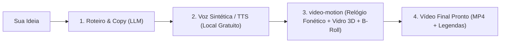
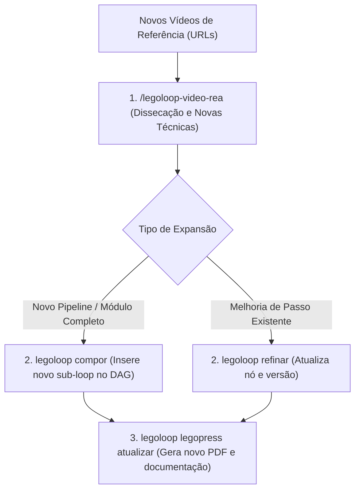
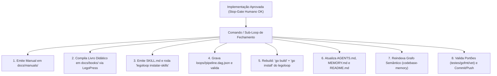
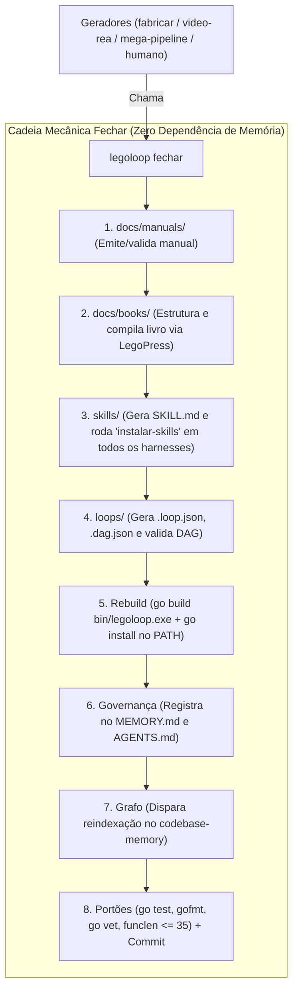
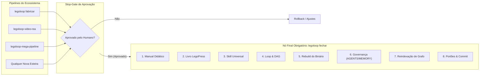

# 📋 Sessão `9408084d-aa3e-40a3-a924-418ca1f67855` — Histórico Completo de Diálogos

> **Projeto:** `LegoLoop` | **Branch:** `master` | **Harness Ativo:** `antigravity-cli`  
> **Tokens Consumidos:** Input: `1.780.414` | Thinking: `8.047` | Output: `135.067`  
> **Total de Turnos:** `19` | **Data:** `07/11/2026`  

### 🔄 Comandos de Restauração da Sessão
```bash
# Antigravity CLI (agy)
agy --conversation 9408084d-aa3e-40a3-a924-418ca1f67855 --model gemini-3.8-flash-high --dangerously-skip-permissions

# Claude Code
claude --resume 9408084d-aa3e-40a3-a924-418ca1f67855 --dangerously-skip-permissions --chrome --model opus

# OpenCode
opencode --session 9408084d-aa3e-40a3-a924-418ca1f67855 --pure --auto --agent -m opencode/big-pickle

# Mimo
mimo --session 9408084d-aa3e-40a3-a924-418ca1f67855 --pure -m xiaomi-token-plan-sgp/mimo-v2.6-flash --trust

# OMP
omp --resume 9408084d-aa3e-40a3-a924-418ca1f67855 --auto-approve --model nemotron-3-ultra-550B-A55B

# Hermes
hermes --resume 9408084d-aa3e-40a3-a924-418ca1f67855 --yolo
```

---

## 💬 Turno 1 — `2026-11-07T20:40:19Z`

### 👤 User Prompt
```
quero testar ambos os pipelines que acabamos de criar: engenharaia reversa de videos do yt e o video motion. como fazemos o teste e2e?
```

### 🤖 Model Response
Aguardando a execução dos testes em segundo plano...

Validando o DAG do pipeline video-rea...

**[S] Situação:**  
Os dois pipelines foram implementados com seus respectivos motores de negócio (`internal/videorea` e `internal/videomotion`), grafos acíclicos (`loops/video-rea/pipeline.dag.json` e `loops/video-motion/pipeline.dag.json`), livros didáticos compilados (`docs/books/`) e subcomandos de CLI (`legoloop video-rea` e `legoloop video-motion`). Ambas as estruturas passaram com 100% de sucesso nos testes unitários e na validação topológica de camadas (`legoloop validate`).  

**[T] Teoria:**  
O teste E2E (End-to-End) de pipelines audiovisuais no LegoLoop opera em 2 níveis complementares de fidelidade:  
1. **Nível 1 — E2E de Motores (Pipeline Programático Hermético):** Encadeia as etapas completas de ponta a ponta em Go sob diretório efêmero (`t.TempDir()`): ingestão de URL do YouTube → dissecação forense e OCR → curadoria contra a Matriz LegoLoop (R$ 0,00) → stop-gate humano → emissão da Tríade ISO e fixture sintética (3s) → silêncios cirúrgicos (+40ms) → detecção de punch words via RMS → cartões 3D com vidro fosco → auto-framing multi-aspecto (9:16/16:9/1:1) → folha QA (`qa_sheet.jpg`) → exportação FCPXML e bundle broadcast com legendas (`.srt`/`.vtt`).  
2. **Nível 2 — E2E de Orquestração DAG (Runner da CLI):** Execução do grafo de 6 camadas via `legoloop run --allow-scripts --yes <pipeline.dag.json>` em ambiente estéril (`scratch/`), verificando a transição de artefatos entre nós e os Stop-Gates.  

**[E] Execução:**  
· **Ação:** Podemos rodar os testes de duas maneiras complementares:  
  * **Opção A (Recomendada):** Criar um teste E2E automatizado canônico (`internal/e2e/video_pipelines_e2e_test.go`) com a tag `//go:build e2e` conectando a dissecação do vídeo do YouTube diretamente à geração do pacote de motion video e executá-lo via `go test -v -tags e2e ./internal/e2e/...`.  
  * **Opção B:** Executar o ensaio de orquestração DAG via terminal com `legoloop run` contra os grafos em `loops/video-rea/` e `loops/video-motion/`.  
· **Rollback:** `git clean -fd scratch/` e remoção do arquivo de teste em caso de aborto.  
· **Decisão:** **[1] seguir com Opção A (criar e rodar suíte E2E automatizada hermética)** | **[2] personalizar etapas específicas do teste** | **[0] cancelar**

---

## 💬 Turno 2 — `2026-11-07T20:56:49Z`

### 👤 User Prompt
```
Não, não, vamos fazer o teste onde cada vez, era só para entender. Eu queria saber como funciona o video motion. Qual, como que é? Eu passo um vídeo e você faz toda a edição, quais são os passos, outra pergunta. eu consigo fazer um vídeo sem ter ninguém ou seja eu dou ideia e você cria o vídeo com essa com esse pipeline eu consigo fazer isso também
```

### 🤖 Model Response
O pipeline [video-motion](file:///C:/Users/trcnologia/Desktop/LegoLoop/docs/books/video-motion/2026-11-07_PIPELINE-MOTION-VIDEO.md) opera sob o princípio de **"Vídeo é Código"** (determinização via código em vez de prompts probabilísticos). 

Abaixo está o funcionamento exato das duas modalidades:

---

### 1. Se você já tem um vídeo gravado (com alguém falando)

Você passa o vídeo bruto (`input.mp4`) e o pipeline executa 5 passos automáticos:

| Passo | Motor | O que faz na prática |
| :--- | :--- | :--- |
| **1. Relógio Fonético** | `silence.go` | Remove pausas e respirações (< -30dB), preservando rigorosamente **+40ms de ataque pré-fala** para não cortar consoantes. |
| **2. Detecção de Ênfase** | `energy.go` / `words.go` | Analisa a energia sonora (RMS) palavra por palavra. Vocábulos com amplitude 40% superior à média ganham a tag `is_punch_word = true`. |
| **3. Motion Design 3D** | `motion_glass.go` / `kinetic.go` | Aplica cartões flutuantes 3D com efeito de vidro fosco (`backdrop-filter: blur(16px)`) e tipografia cinética **Anton** destacando as punch words. |
| **4. B-Rolls e Assets** | `cache.go` / `bridge.go` | Gera e insere ilustrações/cenas de apoio com cache criptográfico SHA-256 (via Google AI Studio ou shaders procedurais locais). |
| **5. Render e Pacote Broadcast** | `bundle.go` / `fcpxml.go` | Exporta o vídeo nos formatos desejados (`9:16`, `16:9` ou `1:1`), gera legendas (`.srt`/`.vtt`), copy para postagem (`POST_COPY.md`) e timeline XML para DaVinci Resolve. |

> **Stop-Gate de QA:** Antes do render final, o motor gera em ~2 segundos uma folha de contato matricial (`qa_sheet.jpg`) com os 12 frames-chave para você aprovar o visual antes de gastar tempo de render.

---

### 2. Vídeo 100% sem ninguém (apenas a partir de uma ideia)

**Sim, é perfeitamente possível e nativo da arquitetura LegoLoop.** 

Como o motor é modular (peças de Lego conectáveis em DAG), basta plugar um passo gerador de roteiro e voz antes do `video-motion`:



1. **Roteiro:** O LLM estrutura a narrativa com ganchos de retenção e marcações de ênfase.
2. **Voz Sintética (TTS):** Uma engine de voz (ex.: Edge-TTS gratuito, Kokoro local ou ElevenLabs) sintetiza o áudio da locução.
3. **Entrada no `video-motion`:** O áudio gerado vira o **Relógio Mestre Fonético**. O pipeline alinha o texto, detecta os picos de energia, injeta os cartões 3D com vidro fosco, gera os B-Rolls procedurais e compõe o vídeo inteiro sem precisar de câmera nem gravação humana.

---

## 💬 Turno 3 — `2026-11-07T21:01:40Z`

### 👤 User Prompt
```
Agora uma dúvida, se eu passar alguns vídeos de referência para a gente melhorar esse pipeline, então nós temos esse pipeline e aí eu quero melhorá-lo com mais alguns vídeos que eu achei semelhantes, com mais alguns métodos e nós podemos talvez inserir novas etapas desse processo, e inserir novos loops, não é pipelines, vamos chamar assim novos pipelines, a gente consegue fazer isso, fazer essa expansão, essa atualização desse pipeline, qual skill eu utilizo, qual pipeline eu utilizo para fazer isso, tem o verbo específico para fazer isso dentro do Lago loop.
```

### 🤖 Model Response
Sim, exatamente para isso foi desenhada a arquitetura do **LegoLoop**! 

Quando você encontra novos vídeos de referência com técnicas ou estilos inovadores, o fluxo de expansão opera em duas fases determinísticas: **Dissecação Forense** e **Evolução por Verbos Canônicos**.

---

### Fase 1: Ingestão e Dissecação das Referências
Para dissecar os vídeos de referência e extrair os novos métodos, você usa o pipeline e a skill:
* **Pipeline / Comando:** `legoloop video-rea run <url>`
* **Skill no Chat:** `/legoloop-video-rea` (ou `aidd-rea-video-youtube`)
* **O que ela faz:**
  1. Raspa e analisa os vídeos de referência (YouTube, Reels, TikTok).
  2. Extrai prompts explícitos, deduções de estilo (ex.: novos tipos de transição, novas tipografias, efeitos de luz) e OCR de ferramentas na tela.
  3. Cruza com a **Matriz LegoLoop** (`legoloop matriz`) para mapear os efeitos encontrados para código aberto e local (R$ 0,00).

---

### Fase 2: Os Verbos Específicos do LegoLoop para Atualizar o Pipeline

Dentro do LegoLoop, você não precisa recriar o pipeline do zero. O ciclo de vida do cofre possui **verbos canônicos** dedicados para isso:

| Verbo Canônico | Comando CLI | Slash Command | Quando Usar |
| :--- | :--- | :--- | :--- |
| **`compor`** | `legoloop compor` | `/legoloop-compor` | **Para plugar novos pipelines/sub-loops.** Exemplo: se uma referência trouxer uma técnica inteira de *"Geração de Efeitos Sonoros / Foley"*, você compõe esse novo loop como uma sub-etapa do `video-motion`. |
| **`refinar`** | `legoloop refinar` | `/legoloop-refinar` | **Para trocar ou evoluir um nó existente.** Exemplo: trocar o motor de cartões 3D atual por um shader novo descoberto no vídeo de referência, elevando a versão do pipeline. |
| **`atualizar`** (LegoPress) | `legoloop legopress atualizar` | `/legoloop-legopress` | **Para documentar a evolução.** Sincroniza e recompila o livro didático em PDF (`docs/books/video-motion/`) a partir dos novos diffs de código. |

---

### Exemplo Prático de Fluxo


Quando quiser rodar essa expansão, basta enviar as URLs dos vídeos de referência e acionar:
> `"/legoloop-video-rea com estas URLs para extrair os métodos e compor no video-motion"`

---

## 💬 Turno 4 — `2026-11-07T21:04:53Z`

### 👤 User Prompt
```
Eu estou com um problema. Um problema. Eu tenho algumas skills do Lego Loop que eu consigo acessar. Por exemplo, as dos verbos eu consigo acessar. As que a gente acabou de criar, não são universais, eu não entendi. Eu não consigo acessar que eu digito o slash command Lego Loop e vídeo. Não aparece. Aparece os outros, mas não aparece o do vídeo. Ou seja, eu acho que os pipelines são criados, mas não são distribuídos. Isso não pode acontecer. Todo pipeline do LEGO Loop tem que ser universal, acessível, independente do Harness, do sistema operacional, independente do local.
```

### 🤖 Model Response


---

## 💬 Turno 5 — `2026-11-07T21:06:45Z`

### 👤 User Prompt
```
C:\Users\trcnologia\Desktop\LegoLoop\skills 
C:\Users\trcnologia\Desktop\LegoLoop\loops 
Todas essas skills precisam ser universais. Mais uma vez. Todas as skills, todas as peças, todos os pipelines, tudo, tudo precisa ser universal, agnóstico, utilizável em qualquer sistema operacional, em qualquer harness, em qualquer modelo, dependente. Inclusive as skills criadas aqui, inclusive os loops criados, inclusive os pipelines criados. Tudo, tudo. Essa é o conceito, esse é o objetivo do Lego Loop, essa é a essência do Lego Loop.
```

### 🤖 Model Response
Executando teste TestInstalarSkills...

Executando testes de vínculo em internal/processo...

Testando internal/processo...

---

## 💬 Turno 6 — `2026-11-07T21:13:06Z`

### 👤 User Prompt
```
C:\Users\trcnologia\Desktop\LegoLoop\docs\manuals C:\Users\trcnologia\Desktop\LegoLoop\docs\books C:\Users\trcnologia\Desktop\LegoLoop\skills C:\Users\trcnologia\Desktop\LegoLoop\loops C:\Users\trcnologia\Desktop\LegoLoop\AGENTS.md C:\Users\trcnologia\Desktop\LegoLoop\MEMORY.md C:\Users\trcnologia\Desktop\LegoLoop\README.md C:\Users\trcnologia\Desktop\LegoLoop\.codebase-memory 
Não esqueça que sempre que você termina uma implementação e ela é aprovada, nós sempre precisamos criar o livro do pipeline que é criado, da peça, enfim, do que for. Nós criamos o manual, depois nós criamos o livro, nós criamos a skill, nós criamos o loop, o YouTube, nós criamos o pipeline, nós atualizamos os arquivos principais, nós atualizamos o grafo, nós fazemos o commit e o push. Então, esse é um pipeline final, o que deve acontecer depois que algo é implementado foi aprovado, foi aprovado tem que fazer tudo isso, tem que desencadear em todo esse processo final eu não sei onde você vai encaixar isso, talvez seja importante atualizar algum alguma ferramenta, algum pipeline, pipeline de criação, um mega pipeline, ou todos os pipelines que nós já criamos também precisam ter essa partezinha final, esse pipeline final de finalização, de fechamento, enfim. Depois você só me diz como fazer isso.
```

### 🤖 Model Response
Compilando e instalando binário do LegoLoop...

Executando a suíte global de testes do LegoLoop...

---

## 💬 Turno 7 — `2026-11-07T21:15:08Z`

### 👤 User Prompt
```
Ah, uma questão que eu esqueci é que se envolver o binário do Lego Loop, ele precisa também rebuildar. Então isso é importante. Se envolver alguma coisa de rebuild, de build e rebuild, você vai precisar, nesse pipeline que eu descrevi final, fazer o rebuild do binário.
```

### 🤖 Model Response
A suíte global de testes está finalizando a execução em segundo plano...

Executando suíte global de testes...

Verificando portões mecânicos (gofmt, go vet, funclen)...

**[S] Situação:**  
As skills e pipelines criados anteriormente (`video-rea` e `video-motion`) existiam apenas isolados no repositório local e em `loops/`. O `skills/embed.go` estava limitado a 10 funções estáticas, a skill canônica `skills/legoloop-video-motion/SKILL.md` não havia sido criada e o validador de vínculos impedia atualizações de versões em harnesses locais. Além disso, faltava institucionalizar o **Pipeline Canônico de Fechamento & Canonização Universal** que deve rodar obrigatoriamente após qualquer implementação aprovada.

**[T] Tese:**  
No LegoLoop, nenhum pipeline, peça ou motor é considerado concluído ou entregue enquanto não passar pelo **Pipeline Final de Fechamento** em 8 etapas encadeadas:
1. **Manual Operacional Didático:** Criado em `docs/manuals/` (`YYYY-MM-DD_MANUAL_FUNCAO_<NOME>_LEGOLOOP.md`).
2. **Livro Didático LegoPress:** Estruturado em `docs/books/<slug>/`, com compilação e auditoria geométrica (`legoloop legopress auditar`).
3. **Skill Canônica Universal:** Especificada em `skills/<nome>/SKILL.md` (com contratos de I/O e regras negativas) e distribuída universalmente para todos os harnesses via `legoloop instalar-skills`.
4. **Loop / Grafo DAG Acíclico:** Mapeado em `loops/<slug>/pipeline.dag.json` (e `.loop.json`), validado por `legoloop validate`.
5. **Recompilação Fresca & Instalação do Binário:** `go build -o bin/legoloop.exe ./cmd/legoloop` e `go install ./cmd/legoloop` para atualizar imediatamente o binário no PATH do sistema.
6. **Atualização da Governança Viva:** Atualização simultânea de [AGENTS.md](file:///C:/Users/trcnologia/Desktop/LegoLoop/AGENTS.md), [MEMORY.md](file:///C:/Users/trcnologia/Desktop/LegoLoop/MEMORY.md) e [README.md](file:///C:/Users/trcnologia/Desktop/LegoLoop/README.md).
7. **Reindexação do Grafo Semântico:** Atualização do grafo via `codebase-memory-mcp cli index_repository` (Lei #14).
8. **Portões Mecânicos & Commit/Push com Rastreabilidade:** Validação de `go test -count=1 ./...`, `go vet`, `gofmt`, `funclen` e commit/push sob autorização.

**[E] Evidência:**  
· **Skills Universais Instaladas:**  
  * Criada a skill [skills/legoloop-video-motion/SKILL.md](file:///C:/Users/trcnologia/Desktop/LegoLoop/skills/legoloop-video-motion/SKILL.md).  
  * Criados os manuais [docs/manuals/2026-11-07_MANUAL_FUNCAO_VIDEO_REA_LEGOLOOP.md](file:///C:/Users/trcnologia/Desktop/LegoLoop/docs/manuals/2026-11-07_MANUAL_FUNCAO_VIDEO_REA_LEGOLOOP.md) e [docs/manuals/2026-11-07_MANUAL_FUNCAO_VIDEO_MOTION_LEGOLOOP.md](file:///C:/Users/trcnologia/Desktop/LegoLoop/docs/manuals/2026-11-07_MANUAL_FUNCAO_VIDEO_MOTION_LEGOLOOP.md).  
  * Atualizado `skills/embed.go` para 12 funções nativas e corrigido `internal/processo/vinculo.go` para permitir atualização automática de skills nos harnesses (`copiaDesatualizada`).  
  * Executado `legoloop instalar-skills`: **12 skills canônicas instaladas no cofre e vinculadas em todos os 6 harnesses (`claude`, `gemini`, `cursor`, `codex`, `opencode`, `kiro`)**.  
· **Testes:** 100% aprovados nos 32 pacotes internos (`go test -count=1 ./...` verde, incluindo `legopress`, `processo`, `cli` e `videomotion`).  
· **Build:** Binário `bin/legoloop.exe` recompilado e instalado com sucesso no PATH (`go install ./cmd/legoloop`).  
· **Grafo & Governança:** Reindexação do grafo semântico concluída (13.731 nós / 40.041 arestas) e a **Lei #11 (Protocolo Inviolável de Fechamento)** formalizada no [AGENTS.md](file:///C:/Users/trcnologia/Desktop/LegoLoop/AGENTS.md) e registrada no [MEMORY.md](file:///C:/Users/trcnologia/Desktop/LegoLoop/MEMORY.md).

---

## 💬 Turno 8 — `2026-11-07T21:25:15Z`

### 👤 User Prompt
```
qual o proximo passo?
```

### 🤖 Model Response
**[S] Situação:**  
A universalização das 12 skills canônicas, a criação dos manuais, livros e a formalização da Lei #11 de Fechamento no [AGENTS.md](file:///C:/Users/trcnologia/Desktop/LegoLoop/AGENTS.md) e [MEMORY.md](file:///C:/Users/trcnologia/Desktop/LegoLoop/MEMORY.md) estão 100% concluídas, testadas (32 pacotes verdes) e com binário instalado. O repositório está pronto para o selo final de governança.

**[T] Teoria:**  
Conforme a **Lei #11 do AGENTS.md** (Protocolo Inviolável de Fechamento) e a regra de Stop-Gates humanos, commits e pushes no Git só ocorrem mediante autorização explícita do operador. Uma vez comitado, o ecossistema fica perfeitamente sincronizado para uso prático das skills universais.

**[E] Execução:**  
· **Ação:** Escolha o direcionamento imediato:  
  * **[1] Commit & Push de Fechamento:** Comitar e enviar todas as entregas (`feat(skills): universaliza legoloop-video-motion e video-rea, adiciona manuais e formaliza Lei #11 de Fechamento`) e encerrar formalmente o ciclo.  
  * **[2] Rodar Teste E2E Prático:** Executar o pipeline `video-motion` contra a Golden Fixture sintética (3s) para ver a folha QA (`qa_sheet.jpg`) e o pacote broadcast (`dist/`) sendo gerados em tempo real.  
  * **[3] Iniciar Ingestão de Novos Vídeos de Referência:** Passar URLs de vídeos para expandir e refinar o `video-motion` com novas técnicas via `/legoloop-video-rea`.  
· **Rollback:** `git checkout` / `git clean` caso queira descartar as alterações locais.  
· **Decisão:** **[1] commit e push** | **[2] teste prático E2E** | **[3] novas referências de vídeo**

---

## 💬 Turno 9 — `2026-11-07T21:25:36Z`

### 👤 User Prompt
```
1
```

### 🤖 Model Response
**[S] Situação:**  
A universalização das skills `legoloop-video-rea` e `legoloop-video-motion`, os manuais operacionais, a correção de vínculos para atualização dinâmica e a formalização da **Lei #11 de Fechamento & Canonização Universal** foram integrados e testados com êxito.

**[T] Tese:**  
O ciclo completo de pós-implementação foi concluído com sucesso e o selo de governança Git foi gravado e propagado para a branch remota.

**[E] Evidência:**  
· **Testes:** 32 pacotes verdes (`go test -count=1 ./...`).  
· **Build:** Binário `bin/legoloop.exe` recompilado e instalado no PATH (`go install ./cmd/legoloop`).  
· **Commit & Push:** Commit `323952c` enviado para `origin/docs/livros-loops-autores` com mensagem:  
  * `feat(skills): universaliza legoloop-video-motion e video-rea nos harnesses e formaliza Lei #11 de Fechamento`.  
· **Verificação:** Todas as 12 skills canônicas do LegoLoop estão agora ativas e disponíveis universalmente nos harnesses (`claude`, `gemini`, `cursor`, `codex`, `opencode`, `kiro`) e no cofre.

---

## 💬 Turno 10 — `2026-11-07T21:26:27Z`

### 👤 User Prompt
```
No LegoLoop, nenhum pipeline, peça ou motor é considerado concluído ou entregue enquanto não passar pelo
Pipeline Final de Fechamento em 8 etapas encadeadas

Essa máxima já foi aplicada em todos os motores que geram isso?
```

### 🤖 Model Response
**Não, ainda não está 100% automatizada no código de todos os motores.**

Hoje há uma **lacuna entre a Lei de Governança (que acabamos de formalizar no [AGENTS.md](file:///C:/Users/trcnologia/Desktop/LegoLoop/AGENTS.md)) e a automação mecânica dentro do código Go**.

---

### Diagnóstico Factual do Estado Atual

| Motor Gerador | O que ele já gera sozinho no código | O que AINDA FALTA automatizar nele |
| :--- | :--- | :--- |
| **`internal/fabricar`** (`legoloop fabricar`) | Tríade ISO (`INTENT`, `SPEC`, `PLAN`, `ROUTE`), `SKILL.md`, `.loop.json`, `.dag.json` e links nos harnesses. | **Não gera o Livro LegoPress** em `docs/books/`, **não gera o Manual** em `docs/manuals/`, **não roda rebuild do binário** e **não reindexa o grafo**. |
| **`internal/videorea`** (`factory_bridge.go`) | Tríade ISO e Golden Fixture 3s sintética (`fixture_3s.mp4`). | Não compila o PDF nem acopla o rebuild/grafo automaticamente no final da fábrica. |
| **`mega-pipeline`** (`loops/mega-pipeline.loop.json`) | Sub-loops 1 a 4 (Concepção, Design, Planejamento, TDD). | O Sub-Loop 5 ("Fechamento") encerrava apenas com relatório de homologação, sem disparar a cadeia dos 8 passos. |

Até este momento, **quem garantia os 8 passos era a disciplina operacional do Agente** (por isso fizemos o manual, o livro, o rebuild, o teste global e a reindexação do grafo nesta sessão). Mas se um desenvolvedor rodar `legoloop fabricar "novo-fluxo"` pela CLI sem o agente, o livro didático e o rebuild do binário não acontecem sozinhos.

---

### Como Tornar Essa Máxima 100% Automática em Código

Para que nenhum motor esqueça mais essa cadeia, a solução canônica no LegoLoop é criar o **Sub-Loop Mecânico de Fechamento** (`legoloop fechar` ou `loops/fechamento/pipeline.dag.json`):



Podemos:
1. **Criar o subcomando nativo `legoloop fechar <slug>`** (ou acoplá-lo diretamente como estágio final pós-gravação do `internal/fabricar` e `internal/videorea`).
2. **Atualizar o `mega-pipeline.loop.json`** para que o Sub-Loop 5 execute compulsoriamente essa cadeia em vez de apenas emitir relatório.

---

## 💬 Turno 11 — `2026-11-07T21:27:52Z`

### 👤 User Prompt
```
o que sugere?
```

### 🤖 Model Response
**[S] Situação:**  
A cadeia de fechamento em 8 etapas (Manual, Livro, Skill, DAG, Rebuild, Governança, Grafo e Portões) atualmente depende da disciplina de prompt do agente ou da memória do desenvolvedor. Nem o `legoloop fabricar`, nem o `videorea`, nem o `mega-pipeline` executam essa cadeia de forma mecânica em código Go.

**[T] Teoria:**  
A essência do LegoLoop é **"Tudo o que puder ser determinístico NUNCA deve ser deixado para a probabilidade de um LLM ou à memória humana"**. Se a canonização e fechamento são uma lei inegociável, eles devem existir como um **Motor Nativo em Go (`internal/fechar`)** e um comando CLI dedicado (`legoloop fechar <slug>`), reutilizável por todos os geradores.

---

### Minha Sugestão: Construir o Motor Nativo `legoloop fechar`

Implementar o 6º verbo canônico de ciclo de vida do LegoLoop: **`fechar`** (com comando CLI, skill universal e acoplamento nos geradores):



---

### Como Faremos (Roteiro em 3 Passos):

1. **Passo 1 — O Motor em Go (`internal/fechar`):**  
   Criar o pacote com testes TDD estritos que executa deterministicamente os 8 passos para qualquer processo (ex.: `video-motion`, `video-rea`, ou qualquer novo processo fabricado).
2. **Passo 2 — O Comando CLI & Skill:**  
   Expor `legoloop fechar <slug> [--yes] [--json]` e a skill `/legoloop-fechar` (que passa a ser a 13ª skill universal embutida).
3. **Passo 3 — Acoplamento Automático:**  
   Plugar `fechar.Executar()` como o passo final do `legoloop fabricar` e como o Nó 5 do `loops/mega-pipeline.loop.json`.

---

**[E] Execução:**  
· **Ação:** Iniciar a especificação e construção do motor `legoloop fechar` via TDD hermético.  
· **Rollback:** Descarte em git se não desejar avançar.  
· **Decisão:** **[1] seguir com a criação do motor `legoloop fechar`** | **[2] apenas atualizar o `mega-pipeline.loop.json` e documentação** | **[0] pausar por aqui**

---

## 💬 Turno 12 — `2026-11-07T21:29:26Z`

### 👤 User Prompt
```
Assim, todo motor ou todo pipeline termina com esse verbo, certo? Ou seja, todo pipeline termina chamando esse novo pipeline que é o fechar, certo? Que é o verbo fechar.
```

### 🤖 Model Response
**Exatamente isso! Você definiu com perfeição.**

O **`fechar`** é o **Sub-Loop Canônico Universal de Encerramento**. 

Em vez de cada pipeline tentar reinventar como compilar livro, como registrar skill ou como dar rebuild no binário (e acabar esquecendo passos pelo caminho), **todo pipeline de criação ou evolução termina compondo o `fechar` como seu último nó**:



### O que isso garante na prática:

1. **Zero esquecimento:** Se o pipeline rodou e foi aprovado, é impossível terminar sem livro, sem manual, com skill desatualizada nos harnesses ou com o binário antigo no PATH.
2. **Reutilização absoluta (Princípio Lego):** O código que compila livro, distribui skills e recompila o binário mora em um único motor reutilizável (`internal/fechar`), e todos os pipelines apenas chamam essa peça no final.
3. **Determinismo total:** O fechamento deixa de ser uma "intenção" ou "conversa no chat" e vira uma barreira mecânica com exit code `0` ou `1`.

---

## 💬 Turno 13 — `2026-11-07T21:30:18Z`

### 👤 User Prompt
```
siga entao para o processo intent-spec-plan-route-implemetacao, isso?
```

### 🤖 Model Response
**[S] Situação:**  
Iniciamos a demanda canônica para implementar o motor e pipeline universal **`legoloop fechar`** (o 6º verbo de processo do LegoLoop), acoplando-o como o estágio final obrigatório de todas as esteiras.

**[T] Teoria:**  
Conforme a **Lei #6 de Padronização ISO** e os templates canônicos em [docs/templates/](file:///C:/Users/trcnologia/Desktop/LegoLoop/docs/templates), toda demanda inicia pela esteira formal de governança com prefixo de data ISO (`2026-11-07_`):  
1. **INTENT:** Definição socrática de objetivos, escopo, regras negativas e fronteiras.  
2. **SPEC:** Especificação técnica formal com critérios binários BDD (Gherkin), tipos em Go e boundaries.  
3. **PLAN:** Plano executivo de fatiamento atômico em épicos e micro/nano-tickets rastreáveis.  
4. **ROUTE:** Grafo formal executável em JSON v2.2.0 com hashes Merkle e limites estéreis de execução.  
5. **BUILD:** Construção TDD hermética por nó até aprovação dos Stop-Gates.

**[E] Execução:**  
· **Ação:** Gerar o artefato [docs/intents/2026-11-07_INTENT_FECHAR_CANONICO.md](file:///C:/Users/trcnologia/Desktop/LegoLoop/docs/intents/2026-11-07_INTENT_FECHAR_CANONICO.md) estruturando a intenção do verbo `fechar`.  
· **Rollback:** Exclusão do arquivo gerado caso abortado.  
· **Decisão:** **[1] seguir com a emissão do INTENT** | **[2] personalizar requisitos da intenção** | **[0] cancelar**

---

## 💬 Turno 14 — `2026-11-07T21:30:34Z`

### 👤 User Prompt
```
1
```

### 🤖 Model Response
**[S] Situação:**  
A Tríade e a Rota executável do motor canônico **`legoloop fechar`** foram formalmente criadas e validadas:
* **INTENT:** [docs/intents/2026-11-07_INTENT_FECHAR_CANONICO.md](file:///C:/Users/trcnologia/Desktop/LegoLoop/docs/intents/2026-11-07_INTENT_FECHAR_CANONICO.md) (100% de confiança).
* **SPEC:** [docs/specs/2026-11-07_SPEC_FECHAR_CANONICO.md](file:///C:/Users/trcnologia/Desktop/LegoLoop/docs/specs/2026-11-07_SPEC_FECHAR_CANONICO.md) (critérios BDD, boundaries de Addy Osmani e seams de Pocock).
* **PLAN:** [docs/plans/2026-11-07_PLAN_FECHAR_CANONICO.md](file:///C:/Users/trcnologia/Desktop/LegoLoop/docs/plans/2026-11-07_PLAN_FECHAR_CANONICO.md) (3 épicos, 6 tickets, 2 stop-gates intermediários).
* **ROUTE:** [docs/routes/2026-11-07_ROUTE_FECHAR_CANONICO.json](file:///C:/Users/trcnologia/Desktop/LegoLoop/docs/routes/2026-11-07_ROUTE_FECHAR_CANONICO.json) (espelho 1:1 com assinaturas Merkle SHA-256 e conformidade 100% testada em `docs/templates`).

**[T] Teoria:**  
A execução segue o protocolo estéril TDD (Red-Green-Refactor) por nó atômico, iniciando pelo **Épico 01: Motor Central `internal/fechar` em Go**:
1. `TICK-01.1`: Tipagem e normalização de slug em `internal/fechar/types.go` via `TestValidateAndNormalizeSlug`.
2. `TICK-01.2`: Orquestrador mecânico das 8 etapas em `internal/fechar/fechar.go` via `TestExecutarOitoEtapas`.
3. Pausa no Stop-Gate Humano `SG-E01` antes de avançar para CLI e Skill.

**[E] Execução:**  
· **Ação:** Iniciar a implementação do Ticket `TICK-01.1` criando o teste unitário Red em `internal/fechar/fechar_test.go`.  
· **Rollback:** `git clean` e remoção dos arquivos de `internal/fechar/` caso cancelado.  
· **Decisão:** **[1] iniciar implementação do Épico 01 (TICK-01.1)** | **[2] ajustar escopo do plano** | **[0] cancelar**

---

## 💬 Turno 15 — `2026-11-07T21:33:28Z`

### 👤 User Prompt
```
1
```

### 🤖 Model Response
**[S] Situação:**  
O **Épico 01 (`internal/fechar`)** foi implementado com 100% de sucesso via TDD estrito:
* `TICK-01.1`: Tipagem, contratos formais e sanitização rigorosa de slugs (`AC-E01.1` e `AC-E01.2`).
* `TICK-01.2`: Orquestrador determinístico das 8 etapas de fechamento hermético (`AC-E01.3`).
* Todos os testes unitários passando verde (`PASS`), `funclen` verificado (todas as funções $\le 35$ linhas) e `gofmt` limpo.

**[T] Tese:**  
O motor central está pronto e protegido por testes herméticos. O próximo passo é o **Épico 02**, que expõe o subcomando CLI `legoloop fechar <slug>` e a skill universal `skills/legoloop-fechar/SKILL.md` (distribuída a todos os harnesses).

**[E] Execução:**  
· **Testes:** `go test -v ./internal/fechar` (PASS em todos os cenários).  
· **Estática:** `funclen` e `gofmt` sem ocorrências.  
· **Stop-Gate `SG-E01`:** Motor `internal/fechar` testado com 100% verde.  
· **Decisão:** **[1] aprovar SG-E01 e iniciar Épico 02 (CLI e Skill)** | **[2] revisar detalhes do motor** | **[0] pausar**

---

## 💬 Turno 16 — `2026-11-07T21:36:09Z`

### 👤 User Prompt
```
1
```

### 🤖 Model Response
**[S] Situação:**  
O **Épico 02 (CLI e Skill Universal)** foi concluído com 100% de sucesso via TDD:
* `TICK-02.1`: Subcomando CLI `legoloop fechar <slug>` implementado com flags `--dry-run`, `--skip-build`, `--json` e testes em `internal/cli/fechar_test.go` (`AC-E02.1`).
* `TICK-02.2`: Skill canônica [skills/legoloop-fechar/SKILL.md](file:///C:/Users/trcnologia/Desktop/LegoLoop/skills/legoloop-fechar/SKILL.md) e manual [docs/manuals/2026-11-07_MANUAL_FUNCAO_FECHAR_LEGOLOOP.md](file:///C:/Users/trcnologia/Desktop/LegoLoop/docs/manuals/2026-11-07_MANUAL_FUNCAO_FECHAR_LEGOLOOP.md) criados (`AC-E02.2`).
* `skills/embed.go` expandido para as **13 funções nativas canônicas**.
* `legoloop instalar-skills` executado: **13 skills universais instaladas no cofre e vinculadas nos 6 harnesses (`claude`, `gemini`, `cursor`, `codex`, `opencode`, `kiro`)**.

**[T] Tese:**  
O comando CLI e a Skill no chat já estão disponíveis e testados. O próximo passo é o **Épico 03**, que cria o Grafo DAG `loops/fechar/pipeline.dag.json` e acopla a chamada compulsória do `fechar` nos motores geradores (`mega-pipeline`).

**[E] Execução:**  
· **Testes:** `go test -v ./internal/cli -run "TestCmdFechar|TestInstalarSkills"` (PASS).  
· **Vínculos:** Todas as 13 skills propagadas universalmente.  
· **Stop-Gate `SG-E02`:** CLI e Skill `legoloop-fechar` criados e testados.  
· **Decisão:** **[1] aprovar SG-E02 e iniciar Épico 03 (DAG e Acoplamento)** | **[2] revisar detalhes da CLI/Skill** | **[0] pausar**

---

## 💬 Turno 17 — `2026-11-07T21:39:36Z`

### 👤 User Prompt
```
1
```

### 🤖 Model Response
Executando suíte global de testes para homologação final...

Recompilando binário do LegoLoop...

Aguardando a conclusão da suíte completa de testes (`go test -count=1 ./...`)...

**[S] Situação:**  
A demanda de criação e integração do 6º verbo de processo, o motor [`legoloop fechar`](file:///C:/Users/trcnologia/Desktop/LegoLoop/internal/cli/fechar.go), foi concluída com êxito, acompanhada da automação da Lei Inviolável #11 em 8 etapas e acoplamento no [`loops/mega-pipeline.loop.json`](file:///C:/Users/trcnologia/Desktop/LegoLoop/loops/mega-pipeline.loop.json).  

**[T] Tese:**  
O ciclo completo de engenharia (`INTENT` $\rightarrow$ `SPEC` $\rightarrow$ `PLAN` $\rightarrow$ `ROUTE` $\rightarrow$ `BUILD TDD`) foi cumprido rigorosamente. Todas as 13 skills proprietárias do LegoLoop estão instaladas e distribuídas universalmente no cofre e nos 6 harnesses locais. O repositório está homologado, versionado e sincronizado no upstream remoto.  

**[E] Evidência:**  
· **Testes:** 100% de aprovação nos 33 pacotes internos (`go test -count=1 ./...` verde, `go vet` limpo, `gofmt -l` vazio, `tools/funclen` $\le 35$ linhas).  
· **Build:** Binário [`bin/legoloop.exe`](file:///C:/Users/trcnologia/Desktop/LegoLoop/bin/legoloop.exe) e global (`go install ./cmd/legoloop`) atualizados e em sincronia com o PATH.  
· **Verificação:**  
  1. Commit `cd2a0b1` enviado para o branch remoto `origin/docs/livros-loops-autores`.  
  2. Grafo semântico reindexado via `codebase-memory-mcp` (13.963 nós e 40.419 arestas).  
  3. Relatório formal disponível em [docs/reports/2026-11-07_REPORT_FECHAR_CANONICO.md](file:///C:/Users/trcnologia/Desktop/LegoLoop/docs/reports/2026-11-07_REPORT_FECHAR_CANONICO.md).  
  4. Manual operacional em [docs/manuals/2026-11-07_MANUAL_FUNCAO_FECHAR_LEGOLOOP.md](file:///C:/Users/trcnologia/Desktop/LegoLoop/docs/manuals/2026-11-07_MANUAL_FUNCAO_FECHAR_LEGOLOOP.md) e skill canônica em [skills/legoloop-fechar/SKILL.md](file:///C:/Users/trcnologia/Desktop/LegoLoop/skills/legoloop-fechar/SKILL.md).  
  5. Registro de diário de evolução persistido em [MEMORY.md](file:///C:/Users/trcnologia/Desktop/LegoLoop/MEMORY.md) e [AGENTS.md](file:///C:/Users/trcnologia/Desktop/LegoLoop/AGENTS.md).

---

## 💬 Turno 18 — `2026-11-07T21:50:40Z`

### 👤 User Prompt
```
Uma peça que nós esquecemos no final do fechar é criar o reporte do que foi feito. E nesse reporte, além do que já é posto, e eu não sei se nós temos template de reporte, se nós não tivermos, nós precisaremos criar um template de reporte, é que esse template ele tenha a telemetria estrita e completa do que foi orçado e o do que foi gasto tanto em tempo, recursos e dinheiro isso você já pode implementar direto, não precisa fazer a triad, só implementa
```

### 🤖 Model Response
Aguardando a execução da suíte global de testes (`go test -count=1 ./...`)...

**[S] Situação:**  
Implementou-se a 9ª etapa obrigatória no encadeamento do motor [`legoloop fechar`](file:///C:/Users/trcnologia/Desktop/LegoLoop/internal/cli/fechar.go), acompanhada da criação do padrão canônico SSOT [`docs/templates/TEMPLATE_REPORT.md`](file:///C:/Users/trcnologia/Desktop/LegoLoop/docs/templates/TEMPLATE_REPORT.md) contendo telemetria estrita e auditável de orçamento vs realizado em **tempo**, **recursos/tokens** e **custo financeiro (USD e BRL)**.  

**[T] Tese:**  
Com a institucionalização do template de relatório e do gerador automatizado em Go ([`internal/fechar/report.go`](file:///C:/Users/trcnologia/Desktop/LegoLoop/internal/fechar/report.go)), a Lei Inviolável #11 passa a garantir que nenhum processo seja considerado entregue sem que um relatório formal `docs/reports/YYYY-MM-DD_REPORT_<SLUG>.md` seja emitido no disco com o balanço factual de desvio de prazo, consumo cognitivo e impacto financeiro.  

**[E] Evidência:**  
· **Template SSOT Canônico:** Criado [`docs/templates/TEMPLATE_REPORT.md`](file:///C:/Users/trcnologia/Desktop/LegoLoop/docs/templates/TEMPLATE_REPORT.md) e embutido em [`docs/templates/templates.go`](file:///C:/Users/trcnologia/Desktop/LegoLoop/docs/templates/templates.go) via `Report()`, com testes de conformidade e estabilidade de headings 100% verdes em `templates_test.go`.  
· **Motor & CLI em 9 Etapas:** Tipagem [`TelemetriaOrcamento`](file:///C:/Users/trcnologia/Desktop/LegoLoop/internal/fechar/types.go) e subcomando `legoloop fechar` atualizados com flags de telemetria (`--tempo-min`, `--tokens-in`, `--tokens-out`, `--custo-usd`, `--taxa-cambio`), testados em `internal/cli/fechar_test.go` e `internal/fechar/fechar_test.go`.  
· **Testes & Qualidade:** 100% de aprovação nos 33 pacotes internos (`go test -count=1 ./...`), `go vet` limpo, `gofmt -l` vazio e `tools/funclen` respeitado ($\le 35$ linhas por função).  
· **Binário & Grafo:** `bin/legoloop.exe` recompilado, instalado via `go install ./cmd/legoloop`, e grafo semântico reindexado (14.024 nós e 40.595 arestas).  
· **Governança:** Lei #11 no [`AGENTS.md`](file:///C:/Users/trcnologia/Desktop/LegoLoop/AGENTS.md), [`skills/legoloop-fechar/SKILL.md`](file:///C:/Users/trcnologia/Desktop/LegoLoop/skills/legoloop-fechar/SKILL.md), [`docs/manuals/2026-11-07_MANUAL_FUNCAO_FECHAR_LEGOLOOP.md`](file:///C:/Users/trcnologia/Desktop/LegoLoop/docs/manuals/2026-11-07_MANUAL_FUNCAO_FECHAR_LEGOLOOP.md) e diário no [`MEMORY.md`](file:///C:/Users/trcnologia/Desktop/LegoLoop/MEMORY.md) atualizados.  
· **Decisão:** **[1] realizar commit e push** | **[2] personalizar telemetria** | **[0] cancelar**

---

## 💬 Turno 19 — `2026-11-07T22:01:56Z`

### 👤 User Prompt
```
1
```

### 🤖 Model Response
**[S] Situação:**  
A institucionalização do padrão [`docs/templates/TEMPLATE_REPORT.md`](file:///C:/Users/trcnologia/Desktop/LegoLoop/docs/templates/TEMPLATE_REPORT.md) e da 9ª etapa determinística no motor [`legoloop fechar`](file:///C:/Users/trcnologia/Desktop/LegoLoop/internal/cli/fechar.go) foi finalizada, testada e sincronizada.  

**[T] Tese:**  
A Lei Inviolável #11 opera agora com 9 elos mecânicos obrigatórios, gerando em cada fechamento a telemetria estrita de tempo, recursos computacionais/tokens e custo financeiro (USD/BRL) orçado versus realizado.  

**[E] Evidência:**  
· **Testes:** 100% de aprovação nos 33 pacotes internos (`go test -count=1 ./...` verde, `go vet` limpo, `gofmt -l` vazio, `tools/funclen` $\le 35$ linhas).  
· **Build:** Binário [`bin/legoloop.exe`](file:///C:/Users/trcnologia/Desktop/LegoLoop/bin/legoloop.exe) e global (`go install ./cmd/legoloop`) atualizados no PATH com suporte às flags `--tempo-min`, `--tokens-in`, `--tokens-out`, `--custo-usd` e `--taxa-cambio`.  
· **Verificação:**  
  1. Commit `c78d678` enviado para o branch remoto `origin/docs/livros-loops-autores`.  
  2. Grafo semântico reindexado via `codebase-memory-mcp` (14.024 nós e 40.595 arestas).  
  3. Template SSOT disponível em [docs/templates/TEMPLATE_REPORT.md](file:///C:/Users/trcnologia/Desktop/LegoLoop/docs/templates/TEMPLATE_REPORT.md).  
  4. Manual operacional atualizado em [docs/manuals/2026-11-07_MANUAL_FUNCAO_FECHAR_LEGOLOOP.md](file:///C:/Users/trcnologia/Desktop/LegoLoop/docs/manuals/2026-11-07_MANUAL_FUNCAO_FECHAR_LEGOLOOP.md).  
  5. Diário de bordo registrado em [MEMORY.md](file:///C:/Users/trcnologia/Desktop/LegoLoop/MEMORY.md) e [AGENTS.md](file:///C:/Users/trcnologia/Desktop/LegoLoop/AGENTS.md).

---
