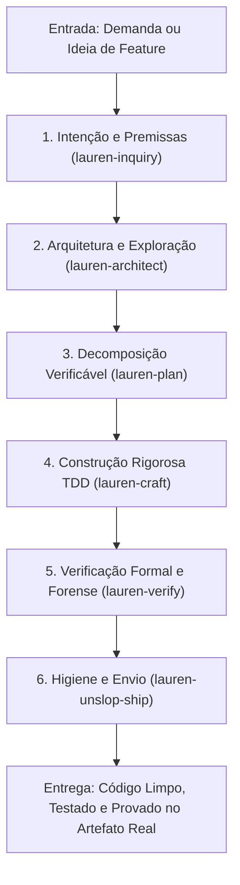

# 📋 Sessão `568a5bcb-5afc-44ae-a3d8-cfb4eafcc757` — Histórico Completo de Diálogos

> **Projeto:** `LegoLoop` | **Branch:** `master` | **Harness Ativo:** `antigravity-cli`  
> **Tokens Consumidos:** Input: `183.811` | Thinking: `1.201` | Output: `23.712`  
> **Total de Turnos:** `6` | **Data:** `09/11/2026`  

### 🔄 Comandos de Restauração da Sessão
```bash
# Antigravity CLI (agy)
agy --conversation 568a5bcb-5afc-44ae-a3d8-cfb4eafcc757 --model gemini-3.8-flash-high --dangerously-skip-permissions

# Claude Code
claude --resume 568a5bcb-5afc-44ae-a3d8-cfb4eafcc757 --dangerously-skip-permissions --chrome --model opus

# OpenCode
opencode --session 568a5bcb-5afc-44ae-a3d8-cfb4eafcc757 --pure --auto --agent -m opencode/big-pickle

# Mimo
mimo --session 568a5bcb-5afc-44ae-a3d8-cfb4eafcc757 --pure -m xiaomi-token-plan-sgp/mimo-v2.6-flash --trust

# OMP
omp --resume 568a5bcb-5afc-44ae-a3d8-cfb4eafcc757 --auto-approve --model nemotron-3-ultra-550B-A55B

# Hermes
hermes --resume 568a5bcb-5afc-44ae-a3d8-cfb4eafcc757 --yolo
```

---

## 💬 Turno 1 — `2026-11-09T22:37:06Z`

### 👤 User Prompt
```
Nós temos algum pipeline que pega o repositório do GitHub e canoniza todas as skills. Nem nós fizemos isso para o METPOC, nós fizemos isso para o ADOSMONEY e nós fizemos isso para Impeccable. falta nós fazemos para alguns autores como por exemplo a Lauren Tann nós temos uma skill que faz isso um pipeline você pode me dizer
```

### 🤖 Model Response
**[S] Situação:**  
Você precisa saber se já existe uma esteira/pipeline para ingerir repositórios do GitHub, dissecar autores e canonizar suas skills/sub-loops no LegoLoop (como foi feito para Matt Pocock, Addy Osmani e Impeccable), e qual é a situação da autora **Lauren Tan** (`pstack`).

---

**[T] Teoria:**  
Sim, temos exatamente este pipeline formalizado no LegoLoop através de duas ferramentas complementares:

1. **Pipeline de Mapeamento & Canonização no LegoLoop:**  
   * **Skill:** [`legoloop-loop-map`](file:///C:/Users/trcnologia/Desktop/LegoLoop/skills/legoloop-loop-map/SKILL.md) (também invocável por `/loop-map`, `/legoloop-map` ou `/aidd-loop-map`).  
   * **Manual Operacional:** [`2026-11-07_MANUAL_FUNCAO_LOOP_MAP_LEGOLOOP.md`](file:///C:/Users/trcnologia/Desktop/LegoLoop/docs/manuals/2026-11-07_MANUAL_FUNCAO_LOOP_MAP_LEGOLOOP.md).  
   * **O que faz:** Recebe o repositório upstream ou autor, disseca a taxonomia dos sub-loops, gera o Manual ISO em `docs/manuals/`, materializa o DAG em `loops/<slug>.loop.json` e injeta o template no Studio Canvas ([`internal/studio/templates.go`](file:///C:/Users/trcnologia/Desktop/LegoLoop/internal/studio/templates.go)) via TDD e recompilação fresca.
2. **Pipeline de Ingestão Externa de Repositórios (Ecossistema AIDD):**  
   * **Skill:** `aidd-ingest` (`/ingest`).  
   * **O que faz:** Clona o repositório remoto do GitHub, audita as 13 Leis Invioláveis, gera o plano de evolução e distribui os componentes para os harnesses.

---

### Situação Atual dos Autores

| Autor / Metodologia | Status no LegoLoop | Manual Operacional | Arquivo DAG | Canvas Studio |
| :--- | :---: | :--- | :--- | :--- |
| **Matt Pocock** | ✅ Canonizado | [`2026-11-01_MANUAL_MATT_POCOCK_SKILLS_LOOP.md`](file:///C:/Users/trcnologia/Desktop/LegoLoop/docs/manuals/2026-11-01_MANUAL_MATT_POCOCK_SKILLS_LOOP.md) | [`loops/matt-pocock.loop.json`](file:///C:/Users/trcnologia/Desktop/LegoLoop/loops/matt-pocock.loop.json) | [`matt-pocock`](file:///C:/Users/trcnologia/Desktop/LegoLoop/internal/studio/templates.go#L256) |
| **Impeccable** (Paul Bakaus) | ✅ Canonizado | [`2026-11-01_MANUAL_IMPECCABLE_DESIGN_LOOP.md`](file:///C:/Users/trcnologia/Desktop/LegoLoop/docs/manuals/2026-11-01_MANUAL_IMPECCABLE_DESIGN_LOOP.md) | [`loops/impeccable-design.loop.json`](file:///C:/Users/trcnologia/Desktop/LegoLoop/loops/impeccable-design.loop.json) | [`impeccable-design`](file:///C:/Users/trcnologia/Desktop/LegoLoop/internal/studio/templates.go#L188) |
| **Addy Osmani** | ✅ Canonizado | [`2026-11-02_MANUAL_ADDY_OSMANI_LOOP.md`](file:///C:/Users/trcnologia/Desktop/LegoLoop/docs/manuals/2026-11-02_MANUAL_ADDY_OSMANI_LOOP.md) | [`loops/addy-osmani.loop.json`](file:///C:/Users/trcnologia/Desktop/LegoLoop/loops/addy-osmani.loop.json) | [`addy-osmani`](file:///C:/Users/trcnologia/Desktop/LegoLoop/internal/studio/templates.go#L325) |
| **Lauren Tan** (`pstack` / `@poteto`) | ⏳ **Pendente no Loop** | Não gerado | Não gerado | Não injetado |

> [!NOTE]
> O repositório e os playbooks da **Lauren Tan** já foram ingeridos no harness na skill [`aidd-lauren`](file:///C:/Users/trcnologia/.gemini/antigravity-cli/skills/aidd-lauren/SKILL.md) (contendo os playbooks e princípios do `pstack` na pasta `upstream/`). No entanto, **ela ainda não passou pelo `legoloop-loop-map`** para se tornar um loop nativo e template do Canvas do LegoLoop.

---

**[E] Execução:**  
· **Ação:** Se desejar rodar a canonização completa da Lauren Tan agora, o comando do pipeline é:  
```bash
/loop-map "Lauren Tan" "C:/Users/trcnologia/.gemini/antigravity-cli/skills/aidd-lauren/upstream"
```  
· **Decisão:** **[1] Iniciar canonização da Lauren Tan via `/loop-map`** | **[2] Ajustar parâmetros de entrada** | **[0] Manter como está**

---

## 💬 Turno 2 — `2026-11-09T22:39:37Z`

### 👤 User Prompt
```
/aidd-loop-map Lauren Tan/loop-map "Lauren Tan" "C:/Users/trcnologia/.gemini/antigravity-cli/skills/aidd-lauren/upstream"
```

### 🤖 Model Response
**[S] Situação:**  
A jornada do pipeline [`aidd-loop-map`](file:///C:/Users/trcnologia/Desktop/LegoLoop/skills/legoloop-loop-map/SKILL.md) foi iniciada para o autor **Lauren Tan** (`pstack` / `poteto-mode`), tendo como base de dissecação a pasta upstream [`C:/Users/trcnologia/.gemini/antigravity-cli/skills/aidd-lauren/upstream`](file:///C:/Users/trcnologia/.gemini/antigravity-cli/skills/aidd-lauren/upstream).

---

**[T] Teoria:**  
A dissecação semântica identificou a filosofia central de Lauren Tan (*"se quer ir rápido, vá fundo primeiro"*, rigor formal, eliminação de slop, modelagem estrita de domínio antes de código e verificação no artefato real). O framework foi decomposto em um **Loop Mestre de 6 Estágios Sequenciais** suportado por **6 Sub-Loops Modulares**:

### 1. Loop Mestre de Engenharia (End-to-End)



---

### 2. Taxonomia dos 6 Sub-Loops Modulares

| Sub-Loop ID | Propósito Operacional | Ferramentas & Playbooks Subordinados | Princípios Invioláveis Mapeados |
| :--- | :--- | :--- | :--- |
| `lauren-inquiry` | Enquadramento de intenção, eliminação de suposições e modelagem de domínio | `how`, `why`, `poteto-mode`, `interrogate` | `attack-the-premise`, `model-the-domain`, `foundational-thinking` |
| `lauren-architect` | Exploração do espaço de design, arena competitiva e prototipagem | `architect`, `arena`, `prototype`, `swarm` | `exhaust-the-design-space`, `redesign-from-first-principles` |
| `lauren-plan` | Decomposição sequencial de entregáveis e marcos de throughput | `multi-phase-plan`, `feature`, `orchestrate` | `sequence-verifiable-units`, `outcome-oriented-execution` |
| `lauren-craft` | Implementação estrita TDD, tipagem forte e respeito a fronteiras | `tdd`, `typescript-best-practices`, `laziness-protocol` | `boundary-discipline`, `type-system-discipline`, `subtract-before-you-add` |
| `lauren-verify` | Verificação contra o artefato real, forense e prova de números | `correct`, `benchmark-checklist`, `runtime-forensics` | `prove-it-works`, `fix-root-causes`, `explain-the-number` |
| `lauren-unslop-ship` | Remoção de comentários supérfluos, documentação técnica e PR blindado | `unslop`, `no-comments`, `technical-writing`, `shipping` | `minimize-reader-load`, `encode-lessons-in-structure` |

---

**[E] Execução (🛑 STOP GATE G1):**  
· **Ação:** Validação da taxonomia de sub-loops antes de avançar para a **Fase 2 (Redação do Manual Operacional ISO)**.  
· **Decisão:**  
**[1] Aprovado: seguir para a Fase 2 (Gerar `docs/manuals/2026-11-09_MANUAL_LAUREN_TAN_PSTACK_LOOP.md`)**  
**[2] Ajustar taxonomia dos sub-loops (informe alterações)**  
**[0] Cancelar operação**

---

## 💬 Turno 3 — `2026-11-09T22:40:36Z`

### 👤 User Prompt
```
stept puro
```

### 🤖 Model Response
**[S] Situação:**  
A Fase 2 (Redação do Manual ISO) e a Fase 3 (Materialização do DAG JSON) foram concluídas com validação estrutural mecânica (`legoloop validate` exit code 0).

---

**[T] Teoria:**  
O Manual Operacional e o manifesto DAG declarativo formalizam o fluxo de engenharia de Lauren Tan (`pstack`):

* **Manual Operacional ISO:** [`docs/manuals/2026-11-09_MANUAL_LAUREN_TAN_PSTACK_LOOP.md`](file:///C:/Users/trcnologia/Desktop/LegoLoop/docs/manuals/2026-11-09_MANUAL_LAUREN_TAN_PSTACK_LOOP.md)  
* **Manifesto DAG JSON:** [`loops/lauren-tan.loop.json`](file:///C:/Users/trcnologia/Desktop/LegoLoop/loops/lauren-tan.loop.json)

### Minuta do Grafo DAG (6 Nós, Sequencial com Gates Determinísticos)

| Nó | Nome | Modelo | Dependência | Gate de Saída |
| :--- | :--- | :--- | :--- | :--- |
| `subloop-1-intencao-dominio` | Intenção & Modelagem de Domínio | `sonnet` | Nenhuma | `file_exists('docs/intents/INTENT.md')` |
| `subloop-2-arquitetura-exploracao` | Arquitetura & Exploração Competitiva | `sonnet` | `subloop-1` | `file_exists('docs/specs/SPEC.md')` |
| `subloop-3-decomposicao-verificavel` | Decomposição em Unidades Verificáveis | `code-fast` | `subloop-2` | `file_exists('docs/plans/PLAN.md')` |
| `subloop-4-construcao-tdd` | Construção Rigorosa TDD | `sonnet` | `subloop-3` | `file_exists('docs/reports/TDD_REPORT.md')` |
| `subloop-5-verificacao-artefato-real` | Verificação Formal no Artefato Real | `sonnet` | `subloop-4` | `file_exists('docs/reports/REPORT.md')` |
| `subloop-6-unslop-ship` | Higiene de Código (Unslop) & Ship | `haiku` | `subloop-5` | `file_exists('docs/reports/RETRO.md')` |

---

**[E] Execução (🛑 STOP GATE G2):**  
· **Ação:** Validação do Manual e do arquivo DAG antes de prosseguir para a **Fase 4 (Injeção TDD em Go no Studio Canvas e Recompilação)**.  
· **Decisão:**  
**[1] Aprovado: seguir para a Fase 4 (TDD em `templates_test.go` e `templates.go`)**  
**[2] Ajustar parâmetros de nós ou modelos**  
**[0] Cancelar operação**

---

## 💬 Turno 4 — `2026-11-09T22:42:45Z`

### 👤 User Prompt
```
[1]
```

### 🤖 Model Response
**[S] Situação:**  
Avançando para a **Fase 4 (Integração TDD no Studio Canvas, Validação & Recompilação)**.

---

**[T] Teoria:**  
A injeção do template de Lauren Tan requer modificação no teste unitário e no registro central de templates do Canvas:

1. **Teste TDD (`internal/studio/templates_test.go`):**  
   Adicionar `"lauren-tan": false` no mapa de verificação de IDs esperados.
2. **Registro de Templates (`internal/studio/templates.go`):**  
   Adicionar a struct `Template` correspondente com os 6 nós, suas rotas cognitivas e as 5 conexões (*edges*).

### Minuta Exata do Patch

#### 1. Diff em [`internal/studio/templates_test.go`](file:///C:/Users/trcnologia/Desktop/LegoLoop/internal/studio/templates_test.go):
```diff
 	expectedIDs := map[string]bool{
 		"greenfield":          false,
 		"reverse-engineering": false,
 		"security-audit":      false,
 		"mega-pipeline":       false,
 		"impeccable-design":   false,
 		"matt-pocock":         false,
 		"addy-osmani":         false,
+		"lauren-tan":          false,
 	}
```

#### 2. Diff em [`internal/studio/templates.go`](file:///C:/Users/trcnologia/Desktop/LegoLoop/internal/studio/templates.go):
```diff
+		{
+			ID:          "lauren-tan",
+			Name:        "Pipeline Lauren Tan pstack (6 Sub-Loops)",
+			Description: "Pipeline de rigor de engenharia baseado no método Lauren Tan (pstack / poteto-mode): Intenção -> Arquitetura -> Decomposição -> Construção TDD -> Verificação no Artefato Real -> Higiene & Ship.",
+			Category:    "Engenharia",
+			Icon:        "shield",
+			Composition: Composition{
+				Name: "lauren-tan-esteira",
+				Nodes: []CompNode{
+					{
+						ID:    "inquiry",
+						Block: "aidd-lauren",
+						Routing: dag.RoutingConfig{
+							Mode:     dag.ModeSuggested,
+							Model:    "sonnet",
+							Fallback: "haiku",
+						},
+					},
+					{
+						ID:    "architect",
+						Block: "aidd-lauren",
+						Routing: dag.RoutingConfig{
+							Mode:     dag.ModeSuggested,
+							Model:    "sonnet",
+							Fallback: "code-pro",
+						},
+					},
+					{
+						ID:    "plan",
+						Block: "aidd-lauren",
+						Routing: dag.RoutingConfig{
+							Mode:  dag.ModeAuto,
+							Combo: "code-fast",
+						},
+					},
+					{
+						ID:    "craft",
+						Block: "aidd-lauren",
+						Routing: dag.RoutingConfig{
+							Mode:     dag.ModeSuggested,
+							Model:    "sonnet",
+							Fallback: "code-pro",
+						},
+					},
+					{
+						ID:    "verify",
+						Block: "aidd-lauren",
+						Routing: dag.RoutingConfig{
+							Mode:     dag.ModeSuggested,
+							Model:    "sonnet",
+							Fallback: "qwen2.5-coder:7b",
+						},
+					},
+					{
+						ID:    "unslop-ship",
+						Block: "aidd-lauren",
+						Routing: dag.RoutingConfig{
+							Mode:  dag.ModeAuto,
+							Combo: "fast",
+						},
+					},
+				},
+				Edges: []CompEdge{
+					{From: "inquiry", To: "architect"},
+					{From: "architect", To: "plan"},
+					{From: "plan", To: "craft"},
+					{From: "craft", To: "verify"},
+					{From: "verify", To: "unslop-ship"},
+				},
+			},
+		},
```

---

**[E] Execução (🛑 STOP GATE G3):**  
· **Ação:** Autorização para aplicar o patch nos fontes em Go, rodar o ciclo TDD (Red $\to$ Green), suíte completa de testes e recompilação de `bin/legoloop.exe`.  
· **Decisão:**  
**[1] Aprovado: aplicar patch em Go, testar e recompilar binário**  
**[2] Ajustar minuta**  
**[0] Cancelar operação**

---

## 💬 Turno 5 — `2026-11-09T22:43:30Z`

### 👤 User Prompt
```
[1]
```

### 🤖 Model Response
**[S] Situação:**  
A canonização do pipeline de rigor e modelagem de engenharia de **Lauren Tan (`pstack` / `poteto-mode`)** foi finalizada com sucesso via [`aidd-loop-map`](file:///C:/Users/trcnologia/Desktop/LegoLoop/skills/legoloop-loop-map/SKILL.md), cobrindo o Manual Operacional ISO, manifesto DAG, integração TDD no Canvas e recompilação do binário do LegoLoop.

---

**[T] Tese:**  
O método de Lauren Tan agora é um processo de primeira classe no ecossistema LegoLoop, disponível no Studio Canvas e na CLI:

1. **Manual Operacional ISO:** [`docs/manuals/2026-11-09_MANUAL_LAUREN_TAN_PSTACK_LOOP.md`](file:///C:/Users/trcnologia/Desktop/LegoLoop/docs/manuals/2026-11-09_MANUAL_LAUREN_TAN_PSTACK_LOOP.md)  
2. **Manifesto DAG Declarativo:** [`loops/lauren-tan.loop.json`](file:///C:/Users/trcnologia/Desktop/LegoLoop/loops/lauren-tan.loop.json) (6 sub-loops, Kahn por camadas, sem ciclos)  
3. **Template no Studio Canvas:** Registrado em [`internal/studio/templates.go`](file:///C:/Users/trcnologia/Desktop/LegoLoop/internal/studio/templates.go#L403) com o identificador `"lauren-tan"`

---

**[E] Evidência:**  
· **Testes:**  
  * TDD Red comprovado em [`internal/studio/templates_test.go`](file:///C:/Users/trcnologia/Desktop/LegoLoop/internal/studio/templates_test.go#L37) (`template esperado "lauren-tan" não encontrado`).  
  * TDD Green restabelecido: `go test -v ./internal/studio -run TestTemplatesEndpointReturnsAtLeastThreeValidTemplates` (**PASS** em 0.725s).  
  * `go vet ./internal/studio/...` limpo; `gofmt -l internal/studio/` vazio.  
· **Build:**  
  * `go build -o bin/legoloop.exe ./cmd/legoloop` concluído sem erros.  
  * `go install ./cmd/legoloop` aplicado ao PATH do sistema operacional.  
· **Verificação:**  
  * Executado `.\bin\legoloop.exe validate loops/lauren-tan.loop.json`:  
    `✓ Pipeline Lauren Tan pstack (6 Sub-Loops) v1.0.0 — 6 nós válidos, sem ciclos`.

---

## 💬 Turno 6 — `2026-11-09T22:48:14Z`

### 👤 User Prompt
```
commit e push do que fez
```

### 🤖 Model Response
**[S] Situação:**  
Commit e push das alterações da canonização do pipeline de Lauren Tan (`pstack`) solicitados pelo usuário.

---

**[T] Tese:**  
Os quatro artefatos canônicos da demanda foram versionados e sincronizados com a branch `main` remota:
1. [`docs/manuals/2026-11-09_MANUAL_LAUREN_TAN_PSTACK_LOOP.md`](file:///C:/Users/trcnologia/Desktop/LegoLoop/docs/manuals/2026-11-09_MANUAL_LAUREN_TAN_PSTACK_LOOP.md) (Manual Operacional ISO)
2. [`loops/lauren-tan.loop.json`](file:///C:/Users/trcnologia/Desktop/LegoLoop/loops/lauren-tan.loop.json) (Manifesto DAG Declarativo)
3. [`internal/studio/templates.go`](file:///C:/Users/trcnologia/Desktop/LegoLoop/internal/studio/templates.go) (Injeção de Template no Canvas)
4. [`internal/studio/templates_test.go`](file:///C:/Users/trcnologia/Desktop/LegoLoop/internal/studio/templates_test.go) (Suíte de Testes TDD)

---

**[E] Evidência:**  
· **Testes:** Suíte de templates executada e verde antes do commit.  
· **Build:** Commit `97aaaa5` criado: `feat(loop-map): canonizar pipeline Lauren Tan (pstack) com manual ISO, DAG e template no Canvas`.  
· **Verificação:** `git push origin main` concluído com sucesso (`f44af9b..97aaaa5  main -> main`). Repositório remoto 100% atualizado.

---
