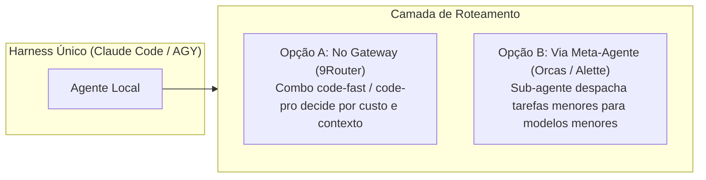

# 🧩 Espec Arquitetural: Looping Engineering & Lego Composition Engine

## 1. Princípio Fundamental: O que é uma Peça Lego?

Para evitar "salada de código", todo elemento do ecossistema segue um **Contrato de Três Portas**:

```
           ┌─────────────────────────────┐
Entrada ──>│  PEÇA LEGO (Skill / Tool)   │──> Saída (Artefato Estrito)
           │                             │
           │  • Entrada: Tipada / Schema │
           │  • Motor: Isolado (Zero side-effects no harness)
           │  • Saída: Markdown / JSON padronizado
           └──────────────┬──────────────┘
                          │ (Telemetria & Erro)
                          ▼
```

### Contrato Universal de Transição (Handoff Gate)
Uma peça Lego só passa o bastão para a próxima se cumprir a **Condição de Saída (Definition of Done)**:
* `interview` (Concepção) ➔ Produz `BRIEFING.md` aprovado pelo usuário.
* `spec` (Engenharia) ➔ Produz `SPEC.md` com critérios binários Pass/Fail.
* `tdd` (Construção) ➔ Produz código com suíte de testes passando (100% verde).

---

## 2. Nível de Personalização: Como o Usuário Monta o Loop?

A personalização é **100% livre**, dividida em dois formatos:

### A. Formato Declarativo (Arquivo `pipeline.yaml` no projeto)
O usuário escolhe exatamente quais peças quer usar em cada etapa:
```yaml
pipeline:
  name: "Greenfield Web Dinâmico"
  stages:
    - stage: "concepcao"
      skill: "interview"          # Usuário preferiu interview em vez de grill
      timeout: 30m
      gate: "file_exists('BRIEFING.md')"

    - stage: "especificacao"
      skill: "aidd-spec"
      input: "BRIEFING.md"
      gate: "has_acceptance_criteria('SPEC.md')"

    - stage: "engenharia_reversa" # Opcional: só aciona se tiver alvo
      engine: ["obscura", "rea", "playwright"]
      when: "context.has_target_url"
```

### B. Formato Visual (No Hub 3 do Symbiont)
* O Symbiont lista os blocos disponíveis no SO.
* O usuário seleciona o bloco de Concepção (`interview` vs `grill`), o bloco de UI (`impeccable` vs `stitch`), etc.
* O Symbiont compila a seleção em um arquivo `.aidd/pipeline.json` na raiz do projeto.

---

## 3. Matriz de Integração sem Conflito (As 3 Camadas Unificadas)

Para o ecossistema não virar uma bagunça, cada repositório tem uma **responsabilidade única**:

| Componente | Papel no Ecossistema | O que NÃO faz |
|---|---|---|
| **9Router** | **Gateway Cognitivo:** Normaliza schemas de tools (Gemini v1beta), gerencia combos de modelos e quotas, faz failover sem estourar contexto. | Não gerencia projetos nem roda comandos no disco. |
| **SYMBIONT** | **O Cérebro & Catálogo Local:** Mapeia 22k+ ativos do SO, oferece a UI/Lousa visual, arbitra repositórios e compila os loops. | Não substitui o harness de execução (Claude Code / AGY). |
| **Ecossistema AIDD** | **A Biblioteca de Blocos Lego:** O conjunto de skills canônicas, playbooks e regras de conduta (zero stubs, economia severa). | Não amarra o usuário a um fluxo único. |

---

## 4. Roteamento Inteligente de Modelos (Router Engineering)

Quando o usuário só tem um único harness (ex: só Claude Code ou só Antigravity), o roteamento de modelos **não depende de harness externo**; ele opera em duas opções:



1. **Roteamento por Payload (Via 9Router):** O 9Router analisa o tamanho do contexto e o tipo de chamada. Contextos grandes (>100k) vão para modelos 1M (Gemini); chamadas estruturadas vão para Sonnet.
2. **Roteamento por Especialidade (Via Subagentes):** Um harness monolítico usa sub-agentes internos (ex: `researcher` no Flash Lite, `architect` no Pro).
