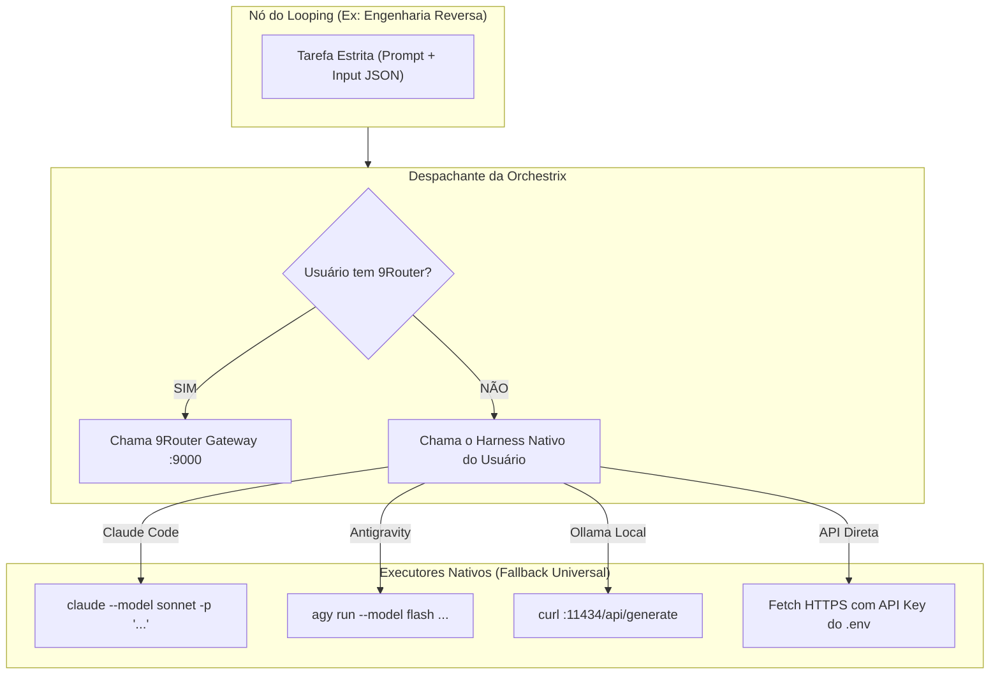

# 🎯 Espec Arquitetural: Orchestrix por Bloco & Provider-Awareness

## 1. O Problema Real
O sistema nunca pode sugerir ou tentar rodar um modelo que o usuário não possui (ex: sugerir Opus ou Gemini se o desenvolvedor só tem chave da OpenAI ou assinatura do Claude Code). Nem pode depender obrigatoriamente do 9Router.

---

## 2. A Solução: Descoberta de Provedores Locais (Provider-Awareness)

Antes de sugerir qualquer modelo, o motor (Symbiont / Runner) faz um **Inventário Passivo de Credenciais**:

```
[ Varredura Passiva de Conexões Locais ]
  ├── 1. Variáveis de Ambiente ($ANTHROPIC_API_KEY, $OPENAI_API_KEY, $GEMINI_API_KEY)
  ├── 2. CLI Logada (Claude Code `claude login`, Antigravity `agy auth`)
  ├── 3. LLMs Locais (Ollama rodando em :11434 com modelos instalados)
  └── 4. Gateways Opcionais (9Router local/remoto se configurado)
```

### Regra de Ouro:
> **O sistema só sugere modelos que existem na lista de "Disponíveis e Ativos" da máquina do usuário.**
> * Se o usuário só tem Claude Code oficial: todas as sugestões e rotas usam variantes do Claude (`haiku`, `sonnet`, `opus`).
> * Se o usuário só tem Ollama: o sistema só sugere modelos locais (`qwen2.5-coder`, `deepseek-r1`, `llama3`).

---

## 3. Como a Orchestrix por Bloco executa sem o 9Router?

Quando o usuário NÃO tem o 9Router, cada bloco do looping vira uma **Orchestrix Cirúrgica Standalone**:



### Vantagens do Modelo Orchestrix por Bloco:
1. **Isolamento de Processo:** Cada nó abre um subprocesso rápido, executa a tarefa com o modelo configurado, grava o artefato de saída no disco e fecha.
2. **Zero Contaminação de Contexto:** Não há histórico acumulado de 100k tokens arrastado de um bloco para o outro.
3. **Liberdade Absoluta de Provedor:** O Bloco 1 pode rodar em Ollama local (grátis), o Bloco 2 via Claude Code CLI (assinatura Pro), e o Bloco 3 via API do Gemini.
